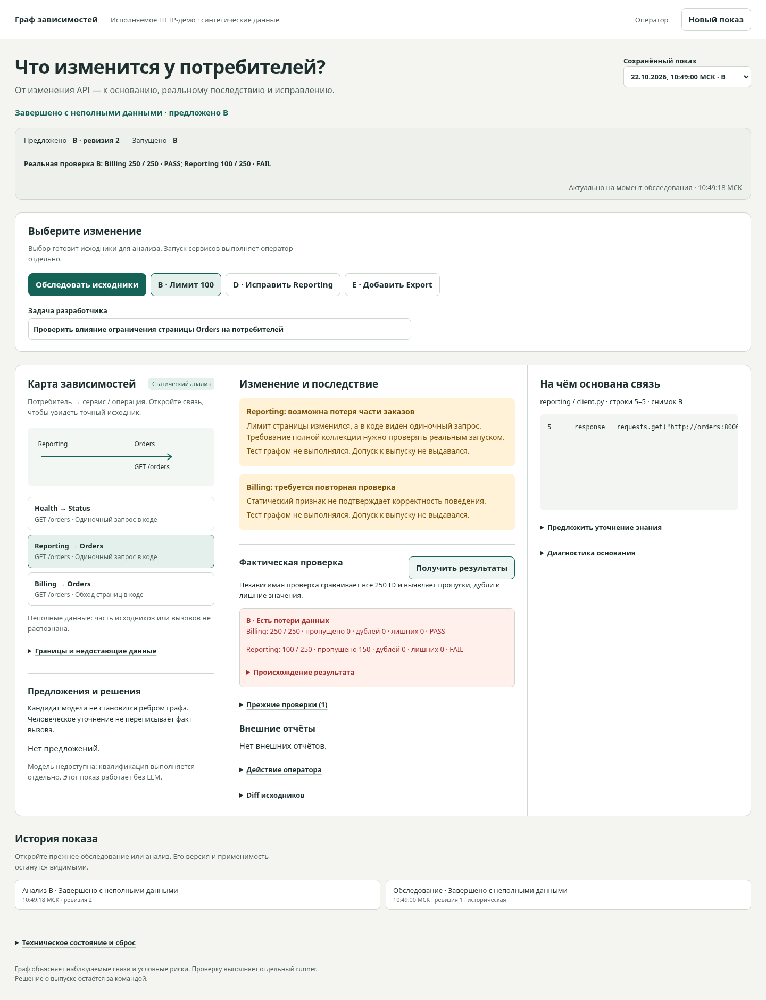

# Фактическая приёмка HTTP graph demo

Закрытая установка и отдельная приёмка **целевой ВМ dm-p1-ui** выполнены позднее
22 октября 2026 на `ca6b9cfff0e278fbf3503c308741e4ac96524645`:
[отчёт установки, пять показов, ресурсы, доступ и откат](deployments/2026-10-22/README.md).
Ниже сохранена историческая локальная приёмка приложения; её результаты не заменяют проверки ВМ.

Исполняемый код проверен на **1c3543eb8c0c2b8b7122b66efb68801d47f2a6a7**. Основание PR и read-only core pin: **a9385c565d5471698da62987b226dcff4cbdea86** (принятые PR28/32/33). Первоначальный main был 08a5270; перед интеграцией ветка перенесена на a9385c5. Ядро и модельные эксперименты в diff не меняются.

Полная локальная приёмка: **PASS**, 22 октября 2026, 10:48:55–10:51:09 МСК. [Машинный отчёт с manifests/dataset/image](acceptance/1c3543e.json). Это реальный Chromium + backend/CLI + Docker HTTP, не mocked E2E и не модельный цикл. Проверенный образ в среде приёмки: `sha256:2060f1447cfade10568989346b078330944031bb72623578e5e8d42181a6b9c2`. Бинарный образ не публиковался в GitHub artifacts; подготовлены исходники и off-VM сборка по RUNBOOK.

| Версия | Reporting | Billing | Export | Проверка |
|---|---:|---:|---:|---|
| A | 250 | 250 | ещё без вызова | PASS |
| B | 100 | 250 | ещё без вызова | Ожидаемый FAIL: пропуски101…250 |
| D | 250 | 250 | ещё без вызова | PASS после фиксированного исправления |
| E | 250 | 250 | 250 | PASS; новый callsite найден CLI |

PASS проверяет точное множество ID1…250, дубли и лишние значения. Health реально обращается к отдельному Status и не становится зависимостью Orders.

## Проверки

- 30 API/queue/snapshot/CLI tests: operator/viewer, Origin, чужая сессия/основание, строгий JSON, idempotency, revision CAS, конкурентный выбор версии, proposed/running, отмена после материализации, реальное убийство worker и восстановление, bounded queue, historical results, correction/supersedes/staleness, CLI overflow/invalid JSON/deadline/cancel.
- 116 регрессий принятого ядра. На проверенном коде прошли [Core research regression](https://github.com/rengalaxies/agent/actions/runs/39742971122), [P1 deployment regression](https://github.com/rengalaxies/agent/actions/runs/39742971185), [HTTP graph demo CI](https://github.com/rengalaxies/agent/actions/runs/39742971138).
- Настоящий браузер A→B→check→D→recheck→E: точное основание, исторический B после E, keyboard selection, desktop1440/mobile390 без горизонтального overflow. Для гонки внесена только клиентская задержка вокруг настоящих API-ответов; сценарные результаты не подменяются. Настоящий404 очищает старое основание и отключает correction. HTML в явно обозначенном тестовом fixture отображается текстом; это не исторический ответ модели.
- Root/app UID проверены в disposable-контейнере: фиксированный helper обращается к SQLite под10001, WAL остаётся владельца10001; root:10001 registry0640 читается приложением. Явные тестовые данные, без core/model вызовов.
- Два конкурентных activate с одной generation: один победитель, один conflict; <=1 sandbox. Инъекция исключения down даёт UNKNOWN и запрещает up до reconcile. Реальное убийство процесса после STARTING, до up, не возобновляет запуск автоматически. Контрольные контейнеры постоянного backend project и чужого project сохранены; настоящий native backend продолжает отвечать.
- Пять последовательных сессий/reset: история сохранена, после stop ноль sandbox; контейнеры не накапливаются. Рестарт Docker в этой локальной приёмке не выполнялся, поэтому отсутствие возрождения после него здесь не проверено.
- Ruff F401/F811/F841, `node --check`, независимый UI finish-review: PASS, блокирующих визуальных замечаний после исправлений нет.

## Реальные screenshots

Файлы получены Playwright от работающего приложения, без редактирования изображений. На mobile выбор связи переводит фокус и прокрутку к основанию; full-page screenshot показывает все последовательные панели.

[Desktop B](screenshots/desktop-B.png) · [390px B](screenshots/mobile-B.png) · [Desktop E](screenshots/desktop-E.png) · [390px E](screenshots/mobile-E.png).

## Границы и оставшаяся приёмка

Статическое покрытие **PARTIAL**: принятый core дополнительно считает FastAPI decorators `unknown_http_client`. Прогноз условный; cursor loop не доказывает полноту. PASS не является допуском к выпуску. Кандидат модели не становится ребром; human correction не переписывает факт или утверждённое требование. EXTERNAL_REPORTED остаётся внешним сообщением. После прерванного job файлы восстановлены, но immutable core head не перематывается: перед correction нужен explicit refresh.

Модель **UNAVAILABLE_NO_CALLS**. Исторические ответы не переписывались, закрытые серии не открывались; офлайн/UI-проверка не выдаётся за реальный модельный цикл. Модельная квалификация — отдельная пачка1.

Провайдеры после проверок занимали около31MiB и29MiB: steady samples, не peak и не доказательство fit целевой ВМ. Ubuntu24.04/2CPU/4GiB не обследовалась и не менялась.

Исполнителю развёртывания остаётся:

1. Собрать exact source off-VM по [RUNBOOK](RUNBOOK.md), выполнить accept для полученного immutable image и закрепить его digest перед передачей согласованным каналом. Установить отдельно core pin, права root:10001 и read-only mounts; проверить общий state/registry/workload lock на целевом host. Бинарная доставка этим PR не выполнена.
2. Повторить целевой цикл, сохранность SQLite/истории после OS/Docker/backend restart, reconciliation и сохранность настоящих соседних проектов.
3. Измерить peak RAM/CPU, cold/warm duration, OOM, disk/log growth; определить retention после экспорта истории. Настроенные memory caps не подменяют измерение.
4. Для внешнего просмотра предоставить hostname/DNS/TLS и HTTPS allowed_origins, выполнить внешние operator/viewer/session checks. Сейчас **NOT_CONFIGURED**, публичной работающей ссылки не заявляем.

ВМ, secrets/vars, DNS и Nginx не изменялись. Автоматического deployment/merge нет.
