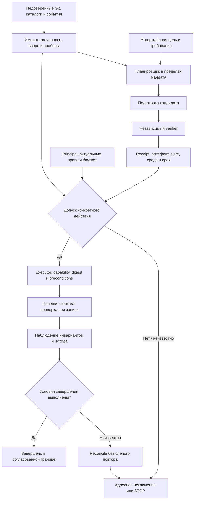
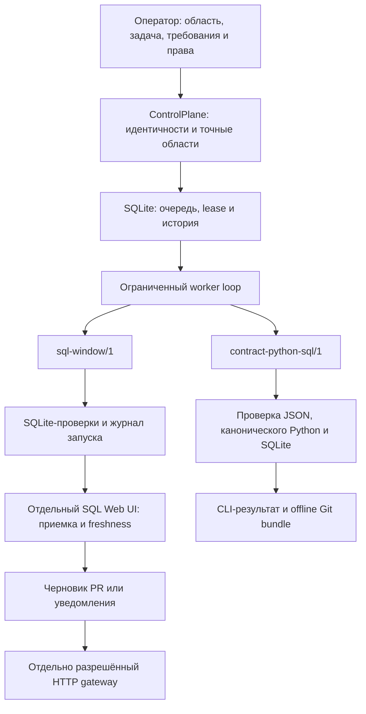
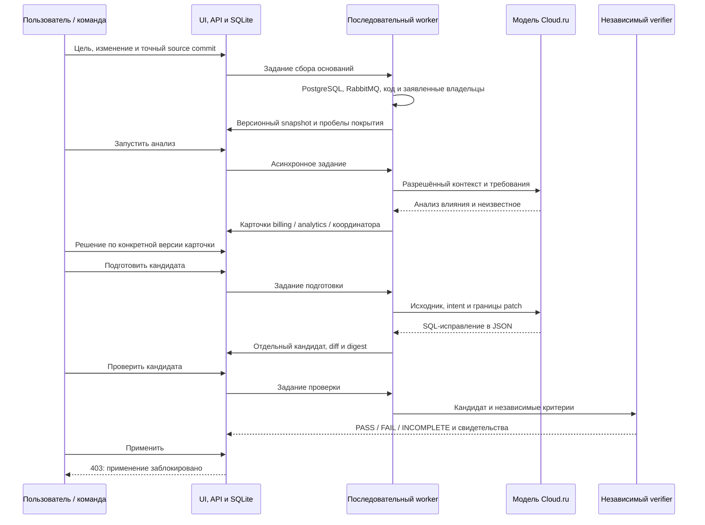
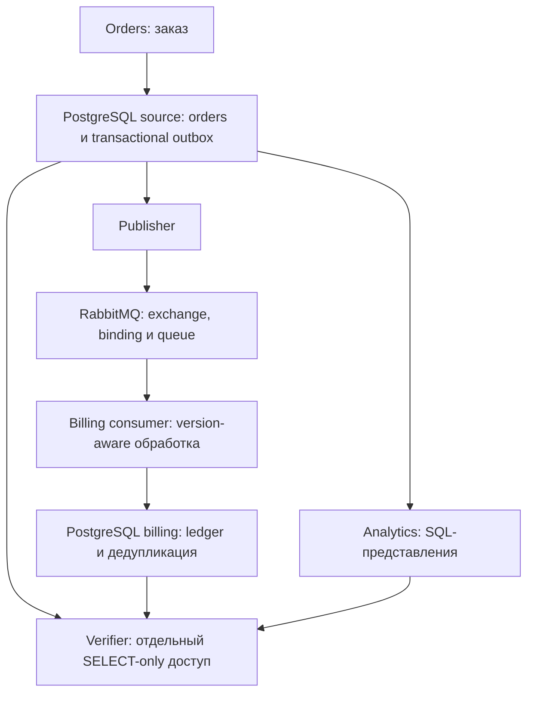
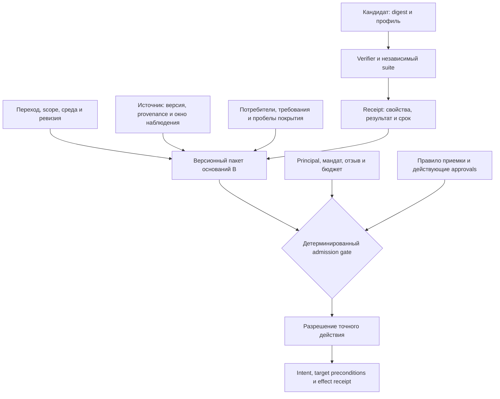
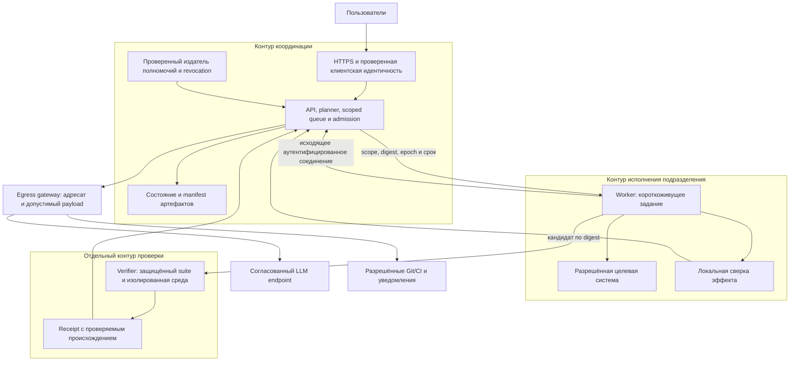
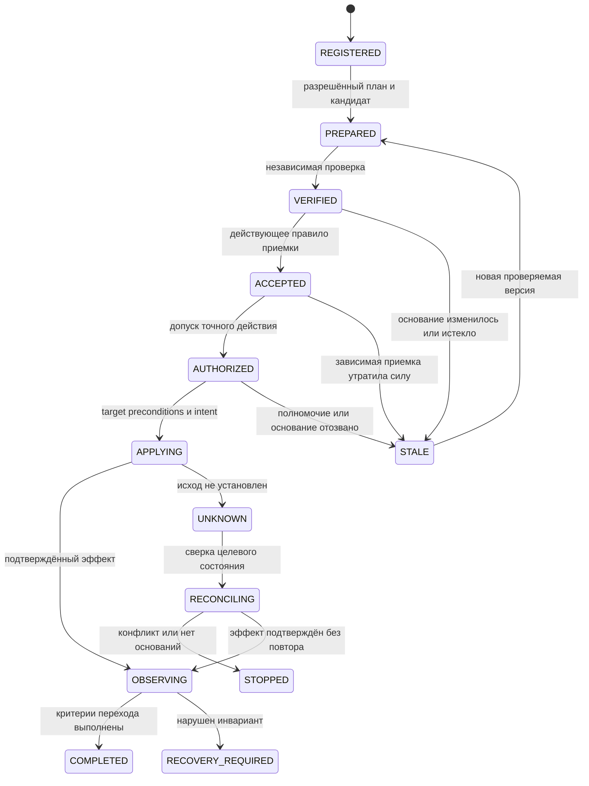

# Архитектура продукта: схемы взаимодействия, ограничения и предлагаемые усиления

Срез GitHub на 20.10.2026. Репозиторий: https://github.com/rengalaxies/agent
Редакция 2: разбор границ доверия, актуальности, полномочий и восстановления.

Назначение для следующего агента: карта текущих контуров и целевой архитектуры, реестр ограничений и предложения по усилению. Это не отчёт независимого аудита безопасности. Проектируемые защиты не следует считать реализованными; перед изменениями сверять код и актуальный HEAD.
Ветка: main. Проверенный commit: `81e9d755c320a30893308b7fb38d460b5900d46f`.

Документ составлен по актуальным исходникам, конфигурациям и сохранённым отчётам. Это архитектурная ревизия, без нового облачного развёртывания, платных вызовов модели или повторения всех экспериментов. Сохранённые результаты относятся к указанным в отчётах версиям, а не автоматически к каждому последующему commit. Открытых PR поиском GitHub на момент проверки не найдено.

## 1. Что представляет собой продукт

Целевой продукт - корпоративный исполнитель делегированных изменений данных и зависимых систем. Получает цель изменения, находит доступные зависимости, готовит связанные исправления, проверяет результат по требованиям каждого потребителя и координирует разрешённое завершение перехода.

Область поставки - компания, дивизион или департамент. Размещение - инфраструктура клиента, включая его частное облако. Изменение расчёта, контракта, источника и миграция платформы - разные поводы применить один механизм. Миграция не заменяет остальные сценарии и не сужает покупателя до интегратора.

| Покупатель / заказчик | За какую работу платит |
|---|---|
| Владелец данных / продукта данных | Довести изменение до корректного поведения потребителей |
| Руководитель платформы / интеграций | Сократить очередь связанных изменений и повторных обследований |
| Владелец бизнес-процесса / показателя | Обеспечить соответствие технического результата принятому бизнес-намерению |
| Руководитель миграции / интегратор | Завершить переход и закрыть остаточную работу |

Роли инициатора, бюджетодержателя, владельца смысла, технического владельца и приемщика могут принадлежать разным людям.

### Схема 1. Усиленная целевая модель с допуском конкретного действия

Схема показывает целевой цикл. Наличие узла не означает его полную реализацию сегодня.

Потребители не обязаны получать одинаковый результат. Например, analytics переходит с окна 30 на 90 дней, а audit сохраняет 30 дней; finance получает копейки, audit сохраняет рубли. Корректность определяется независимо утверждёнными требованиями и совместными инвариантами, а не одинаковым исправлением во всех системах.

## 2. Что фактически находится в репозитории

Сейчас это несколько самостоятельных исполняемых контуров. Они не образуют готовую единую корпоративную платформу.

| Контур | Код и точка входа | Что делает | Граница |
|---|---|---|---|
| Исследовательское ядро | `src/datamesh_release_protocol`, `services`, `ui`, `stand` | V0/V1-ind/V2, обязательства потребителей, knowledge-1, локальные вердикты, детерминированное решение | Исследовательский путь и синтетические сценарии |
| Продуктовый прототип | `src/change_completion`; `control_cli`, `run_cli`, `contract_cli`, `web_server` | Scoped queue, два профиля, SQL review UI, журнал, согласования, freshness, доставка через opt-in gateway | Один узел; UI и реестр очереди ещё не объединены |
| Интегрированный lab | `lab/product`, `lab/runtime`, `lab/app`, `lab/evaluator` | UI/API, сбор живых оснований, модельный анализ и SQL patch, карточки команд, независимая проверка PostgreSQL/RabbitMQ | Узкий лабораторный сценарий; применение из UI запрещено |
| Подготовка поставки | `infra/product`, `infra/cloudru/runtime`, workflows | Образы, Compose, доставка, защита доступа, восстановление и проверки | Наличие конфигурации не подтверждает успешную установку у клиента |

Публичный managed demo описан отдельно в `deploy/cloudru-managed/README.md`. Это исследовательское V2-демо, не публичная версия lab или корпоративного продукта. Его текущая доступность в этой ревизии не проверялась.

### Схема 2. Продуктовый прототип change_completion

**Связи на схеме:** UI читает результаты SQL-установки и имеет собственную конфигурацию идентичностей; схема не означает интеграцию UI с корпоративным реестром. Git bundle создаётся отдельной CLI-командой, а не автоматически при каждом задании очереди.

`sql-window/1` вычисляет ограниченный SQL patch, выполняет проверки и возвращает `READY_FOR_REVIEW`, `FAIL` или `STOP`. Исходный checkout не становится production-системой.

`contract-python-sql/1` проверяет JSON-контракт, интерпретирует ограниченный канонический Python mapping без исполнения произвольного Python и материализует результат в SQLite. Через очередь может создать кандидата по закреплённому операторскому intent. Независимый suite и его digest задаются вне кандидатского checkout.

Согласования SQL UI относятся к конкретному digest пакета. Изменение кода, ожиданий, fixtures, runtime или прав делает зависимые результаты устаревшими. Lease expiry либо потеря полномочий дают `UNKNOWN`, а не право автоматически повторить эффект.

## 3. Как взаимодействуют пользователь, модели и проверка

Наиболее связный пользовательский путь сейчас реализован в `lab/product`. Это отдельный интерфейс на FastAPI и HTML/JS; локальная точка входа - `127.0.0.1:8088`.

### Схема 3. Взаимодействие в интегрированном lab

Два модельных обращения - отдельные stateless роли аналитика и исполнителя. Сейчас модель не имеет shell, самостоятельного доступа к облачной инфраструктуре или права менять произвольные файлы. Поддержанный результат генерации - исправление `lab/sql/expand.sql`. Оркестратор проверяет форму ответа и допустимый путь, сохраняет отдельного кандидата и передаёт его доверенному evaluator.

В UI предусмотрены четыре раздела: изменения, детали изменения, командные карточки, patch и проверка. Решения команды не выдают execution grant. Выбор демонстрационной роли не является корпоративной аутентификацией. Для защищённого интервью предусмотрены отдельные серверная аутентификация и изолированные сессии.

Проверки в CI используют отдельные одноразовые PostgreSQL/RabbitMQ-проекты. Обычному публичному Web-процессу Docker authority не выдаётся; свежая облачная проверка требует отдельно квалифицированного исполнителя. Сохранённый PASS отображается как историческое свидетельство, а не новая проверка.

Режимы отображаются явно: `LIVE RUN` - новые обращения к живым источникам/модели; `REPLAY` - повторное использование сохранённых ответов; `FIXTURE / CONTROL` - детерминированный контроль. Достоверность нельзя выводить только из зелёного статуса job.

## 4. Где проходят данные в лабораторном сценарии

Сценарий проверяет переход от целых рублей к минимальным денежным единицам. Это предметный стенд для проверки механизма, а не окончательный технологический стек продукта.

### Схема 4. Прикладной поток данных

Источник и Billing размещаются в разных БД и используют разные роли. Постоянные volumes сохраняют данные PostgreSQL/RabbitMQ при рестарте компонентов. Publisher confirms не заменяют проверку бизнес-эффекта: проверяются отдельные заказы и итоговые суммы. Транспорт - at least once, бизнес-эффект дедуплицируется.

Поддержанный контроллером переход: S1 - расширение/backfill, S2 - version-aware Billing, S3 - Analytics v2, S4 - контролируемое переключение маршрута, S5 - сверка. Автоматический dispatcher требует более широких свежих оснований, чем текущий финансовый verifier выдаёт. Отдельные контролируемые проверки R6-R8 не превращаются автоматически в разрешение применения. S6, отключение legacy, не реализован.

## 5. Граф контекста и проверяемость решений

Граф нужен, чтобы отвечать: кто затронут, какое требование проверяется, каким действием это исправлять, кто вправе его выполнить и что перестаёт быть актуальным при следующем изменении. Отдельная графовая СУБД сейчас не является обязательной зависимостью.

### Схема 5. Пакет оснований и проверяемый допуск

Это логическая целевая модель: сегодня части связей представлены контрактами, snapshot, digest, SQLite-записями и сохранёнными артефактами в разных контурах. Единого корпоративного графового сервиса нет. Автоматический поиск всех потребителей и владельцев не реализован; статические ссылки и заявленные owners имеют явные пробелы и ограничения.

Изменение основания отзывает применимость зависимого результата, сохраняя историю. Новый сбор с тем же содержательным basis не обязан отзывать приемку только из-за нового timestamp. Пропущенные события, неизвестные владельцы и неохваченные потребители остаются неизвестным, а не превращаются в PASS.

## 6. Где и как будет работать поставка

### Схема 6. Целевое размещение и границы доверия

Схема целиком показывает целевые границы доверия. Общий admission service, распределённые capabilities, проверяемые receipts и интеграция с клиентским IAM ещё не реализованы как единая квалифицированная поставка. Соединения не означают прямой административный доступ: каждая операция отдельно авторизуется.

Центр координирует задания и метаданные свидетельств; workers работают рядом с доступными им системами. Видимость зависимостей также ограничивается правами. Иерархия подразделений не даёт автоматического наследования доступа. Физическая топология, выбор хранилища и высокая доступность требуют отдельной реализации; PostgreSQL как центральная БД продукта здесь не объявляется уже принятым и внедрённым решением.

LLM предлагается через утверждённый маршрут. On-premise размещение приложения само по себе не делает внешний inference локальным. Детерминированные профили работают без обязательного вызова LLM; модель готовит кандидата, а не устанавливает собственные критерии правильности.

### Текущее размещение и подготовленные варианты

| Место | Что там работает или подготовлено | Подтверждение и граница |
|---|---|---|
| Локальная Linux/Python 3.12 среда | change_completion CLI, SQL UI `127.0.0.1:8081`, SQLite | Реализованный односерверный профиль; Docker-поставка этого контура требует отдельной квалификации |
| GitHub Actions | Одноразовый lab PostgreSQL/RabbitMQ, браузерные сценарии, модельные прогоны, verifier | В отчётах есть реальные успешные CI-проходы; это не постоянно работающий сервис клиента |
| Cloud.ru Container Apps | Отдельное исследовательское managed V2-демо и аудит в object-storage volume | Описанный ранее deployment; не текущий продуктовый lab; доступность сейчас не перепроверялась |
| Существующая Cloud.ru UI VM | По отчётам квалифицирован доступ и доставлен исходник `107dfd1`; подготовлен защищённый runtime | Последний сохранённый cloud-отчёт: BLOCKED; успешный публичный HTTPS/UI запуск не подтверждён |
| Подготовленный Cloud.ru lab runtime | Web/worker, PostgreSQL, RabbitMQ, Caddy, постоянное состояние, без Docker socket | Конфигурация и CI image build есть; приёмка на VM не пройдена |
| Инфраструктура будущего клиента | Координационный сервис и исполнители по зонам доверия | Целевая поставка, не текущая промышленная возможность |

Последний cloud-отчёт фиксирует не только сетевые таймауты: один запуск достиг ОС, но native Docker build завершился ошибкой до старта контейнеров; последующие попытки не доходили до SSH. Поэтому причина не сводится доказанно к одному сетевому правилу. Нужны актуальная диагностика канала, доставка закреплённых CI-образов и полная приёмка приложения на целевой VM.

## 7. Что считать завершённым изменением

| Этап | Требуемое основание | Состояние реализации |
|---|---|---|
| Найдены зависимости | Источники связей, версии, границы обследования | Ограниченный локальный обход и живые lab collectors |
| Подготовлен кандидат | Разрешённые пути, intent и digest | Два change_completion-профиля и один узкий модельный lab patch |
| Проверен | Независимые ожидания, конкретный кандидат и среда проверки | Реализовано в ограниченных профилях; lab финансовая приемка R1-R5 |
| Принят | Решение по конкретной версии / утверждённое правило | SQL review UI и lab карточки; это разные механизмы |
| Доставлен | Отдельное право и receipt | Offline Git bundle; opt-in HTTP gateway; нет готового native Git transport |
| Слит / установлен | Свидетельство CI/CD и отдельные полномочия | Не следует автоматически из PASS, согласования или PR |
| Переключён и наблюдается | Текущее состояние потребителей, инварианты и план отката | Узкий лабораторный контроллер; промышленный цикл не квалифицирован |
| Старый путь выведен | Проверенные критерии retirement | Не реализовано как общий механизм; lab S6 отсутствует |

## 8. Расхождения документов и необходимые следующие шаги

1. В `examples/product/contract_change/README.md` сказано, что второй профиль не подключён к task queue. Это устарело: `control_plane.py` принимает `contract-python-sql/1`, а `work_once` вызывает `generate_candidate` и `check_profile`. Часть про отсутствие подключения к UI остаётся актуальной.
2. `docs/enterprise-product-design.md` описывает состояние раннего аудита: отсутствие реестра областей и немедленного отзыва относится к прежнему срезу. Сейчас есть односерверный scoped registry и отзыв на каждом обращении, но старый Web bearer mapping по-прежнему отдельный. Корпоративный SSO не реализован.
3. В `lab/status.md` и инфраструктурных инструкциях сохранены исторические блокеры, часть которых снята последующими отчётами. Последнее подтверждение различает квалифицированный ранее SSH, доставленные исходники и неработающий публичный runtime. Ни один из этих фактов не заменяет остальные.
4. README верхнего уровня подробно объясняет change_completion, но недостаточно заметно указывает на более новый интегрированный lab. Это создаёт риск снова спроектировать уже существующий UI или модельный путь.

Рекомендация для развития: переиспользовать lab UI и collectors, соединить их с ограничением прав и очередью change_completion через явные общие контракты, а независимую проверку оставить отдельной границей доверия. Это предлагаемая интеграция, а не уже выполненное объединение модулей. Затем пройти защищённую облачную приемку, закрыть recovery и подтвердить ценность на задачах клиента. Не запускать три расходящихся продуктовых интерфейса как три самостоятельные платформы.

Научный путь ВКР сохраняется отдельным: V0/V1-ind/V2, frozen-артефакты, независимый scoring и экспериментальные ограничения. Продуктовый lab не доказывает H1 ВКР и не заменяет основной E3. Пересмотр постановки ВКР этим документом не выполняется.

## 9. Разбор слабых мест и предлагаемые усиления архитектуры

Редакция 2 от 20.10.2026. Проверен тот же HEAD `81e9d755c320a30893308b7fb38d460b5900d46f`. Ниже различаются: воспроизведённое поведение кода, установленное чтением кода ограничение и проектируемая защита. Этот разбор не является независимым аудитом безопасности или пентестом работающей облачной установки. При подготовке архитектурной ревизии изменён только документ; исправления runtime и инфраструктуры не выполнялись. Публикация документа в GitHub является отдельным изменением документации.

### 9.1. Что было недостаточно точно в первой схеме

Первоначальный переход "независимая проверка -> приемка -> переключение" скрывал несколько разных решений. Технически успешный кандидат может быть проверен на другой среде, потерять актуальность после проверки, иметь недостаточную область покрытия либо вообще не иметь разрешения на применение. В усиленной схеме между проверкой и эффектом есть отдельный admission gate: детерминированная проверка допуска к одному конкретному действию. Существующий `evaluate_action` - основа части этих правил, а не уже готовый распределённый admission service.

Также нельзя считать два модельных обращения независимой приемкой: это два предложения, потенциально с одинаковыми ошибками. Независимость обеспечивается происхождением требований, защищённой версией verifier, отрицательными контролями и разделением полномочий, а не числом агентов.

### 9.2. Реестр рисков

P0 - закрыть до допуска эффектов или многопользовательской клиентской эксплуатации. P1 - закрыть до соответствующего пилотного режима. P2 - расширение устойчивости и производительности после подтверждения сценария. Это приоритет при развитии поставки; наличие P0 не означает обнаруженную возможность удалённого изменения production сегодня. Сейчас apply запрещён.

| Приоритет и риск | Что установлено | Усиление | Критерий приемки |
|---|---|---|---|
| P0. Подмена участника согласования | В lab `Store.decide` принимает `actor` из payload; Basic auth идентифицирует вход в стенд, но не владельца каждой команды. Локально произвольный actor записан. Решение не даёт execution grant | Получать principal только на сервере из проверенной идентичности; object-level права на каждую операцию; связать сессию с principal и scope. Web-роль не переносить в мандат | Изменение actor/team/session ID не позволяет читать или принимать чужой объект; подмена отклоняется до записи решения |
| P0. Устаревшее основание выглядит current | `Store.is_current` сравнивает ревизию и basis, но не проверяет максимальный возраст snapshot. Локально старый snapshot остался content-current. В другом SQL-контуре freshness реализована отдельно | Разделить совпадение версии и допустимость по времени; интервалы наблюдения, valid_until, качество канала, версии источников. Перед эффектом перечитать необходимые основания | Неизменный digest при истекшем сроке не даёт допуска; разрыв событий/недоступный источник дают UNKNOWN для зависящего действия |
| P0. Гонка между проверкой и эффектом | Dispatcher перечитывает authority и digests перед эффектом; это существующая защита. Но обнаружение локального изменения не является атомарной блокировкой внешней среды | Запечатанный артефакт; capability на точный digest и действие; preconditions и монотонный fencing token проверяются на стороне получателя при записи, где это поддержано | Изменение deployment revision или старый fencing token отклонены целевым адаптером до эффекта. Для неподдержанного адаптера явно ограничить режим и оставить риск открытым |
| P0. Проверяющий зависит от автора | Модель не получает evaluator-файлы; отдельный trusted evaluator есть. Но фактическая независимость всё равно зависит от прав ОС, поставки verifier и защиты suite | Отдельные writable области и credentials; suite/verifier из защищённого источника; receipt связывает candidate, suite, verifier и среду. Предложивший кандидат не может утвердить собственный suite | Candidate не меняет verifier, CI job, ожидания или ключ выдачи receipt. Поддельный/чужой receipt отвергается |
| P0. Неполное обследование и ошибочное бизнес-намерение | Статический обход и owners ограничены; неизвестные потребители отмечаются. Реестр знаний может быть ошибочным даже при корректном JSON | Утверждённое намерение и примеры отдельно от кандидатского кода; область покрытия и неизвестное в manifest. Материальные пробелы блокируют затронутый эффект, оставляя диагностику доступной | Скрытый или конфликтный потребитель не исчезает из отчёта; отсутствие owner не создаёт разрешение; одна ошибочная модель не переписывает требование |
| P0. Частичный межсистемный переход | Независимый PASS каждого потребителя не доказывает совместимость волн. Текущий lab не закрывает весь cutover/recovery | План волн, допустимые смешанные версии, общие инварианты, измеримые условия остановки; компенсация или утверждённое восстановление для каждой операции | Падение после каждого шага оставляет определённое наблюдаемое состояние; повтор эффекта исключён либо безопасно идемпотентен. При неизвестном результате - reconcile |
| P1. Prompt injection и утечка через inference | Модель получает недоверенные source/intent; system prompt предупреждает об этом. Узкий patch allowlist и отсутствие model shell уже снижают последствия. В lab разрешённые source contents передаются модели | Данные репозитория не становятся инструкциями или правами. Egress gateway минимизирует payload, проверяет класс данных/endpoint, удаляет запрещённые поля; model credentials отдельно от cloud/admin | Вредоносный README/комментарий/вывод модели не меняет права, endpoint, путь patch или suite. Тестовые секреты не попадают в запросы и логи |
| P1. Сессии обходят общий бюджет | Worker резервирует максимум два вызова на ревизию. Локальный mock показал: новая ревизия получает новую квоту. Общий денежный лимит в этом пути не задан | Устойчивый общий бюджет установки/организации и principal поверх лимита ревизии; резерв до вызова; лимиты verifier, очереди, storage и уведомлений; сверка UNKNOWN расходов | Создание новых change/revision/session не обходит общий лимит. Неизвестный платный исход сохраняет reservation. Валютный лимит заявляется только при проверенной модели тарификации |
| P1. Ложное чувство изоляции verifier | Subprocess/resource limits есть; это не квалификация произвольного клиентского кода. Lab verifier требует доверенного Docker host, Web Docker authority не выдаётся | Worker генерации и verifier имеют разные области доверия; одноразовая среда без production-секретов, default-deny сеть, лимиты CPU/RAM/диска/времени; cleanup как отслеживаемая задача | Candidate не читает секреты и чужие артефакты; resource exhaustion ограничен; после аварии среда обнаруживается и очищается. Arbitrary Python остаётся неподдержанным до отдельной квалификации |
| P1. Недостаточная защита внешней доставки | Есть exact endpoint allowlist, TLS, запрет redirect, timeout и UNKNOWN без повторов. Разрешение отправки не доказывает допустимость раскрытия всего payload | Проверять адресата и data class отдельно от права создать PR; сетевой egress allowlist, identity целевого сервиса; клиентские private endpoints разрешать явно. Receipt связан с payload и destination | Смена DNS/маршрута не открывает произвольный egress; запрещённый payload блокируется; gateway dedup и reconciliation проверяются независимо от клиентского outbox |
| P1. Восстановление возвращает старые полномочия или неполный контекст | change_completion restore отзывает identities и очищает grants; это сильная имеющаяся защита. Но registry, bound states, controls и секреты требуют согласованного восстановления. Полная замена установки администратором не исключена | Backup manifest всех состояний/артефактов, шифрование, schema/software version, authority epoch вне откатываемого backup в более строгой модели угроз; восстановление в карантин | Старый backup не активирует отозванный доступ; после restore approvals устаревшие; in-flight эффекты UNKNOWN; отдельный оператор проходит восстановление и сверку |
| P1/P2. Очередь и один узел ограничивают масштаб | Один worker; `Store.rows` загружает все записи выбранного вида. Single-process режим заявлен. Новый общий UI не наследует автоматически безопасность другого контура | До пилота: backpressure, pagination, deadlines, лимиты контекста, health/readiness отдельно от liveness. Сохранить один узел, пока хватает; распределение/HA только с migration и failover протоколом | Рост истории не даёт неограниченного ответа API; ограничение очереди наблюдаемо; потеря узла не вызывает автоматический повтор неизвестного внешнего эффекта |

### 9.3. Обязательный пакет оснований для действия

Admission gate должен получать не флаг `PASS`, а версионный пакет `B`:

`B = {installation_id, scope_id, environment_id, transition_id, transition_revision, source_versions, candidate_digest, requirement_versions, suite_digest, verifier_version, profile_version, observed_environment, coverage, shared_invariants, checked_at, valid_until, authority_epoch}`.

Конкретная целевая структура и кодирование пакета ещё проектируются. Идентификаторы installation/scope/environment предотвращают перенос положительного результата между одинаково названными объектами разных установок. `observed_environment` содержит проверенные версии/состояния, а не только строку "production". `coverage` фиксирует известных потребителей и незакрытые пробелы. Обновление входа создаёт новую версию пакета; прежняя остаётся в истории.

Разрешение действия:

`ALLOW(action, B) = authenticated_principal AND scope_match AND live_mandate AND qualified_profile AND integrity_valid AND freshness_valid AND required_coverage AND invariant_checks AND acceptance_policy AND budget_available AND target_preconditions`.

`UNKNOWN` любого обязательного предиката блокирует соответствующий эффект. Диагностика и подготовка могут продолжаться в ранее разрешённых пределах. Нельзя подставить недоступное значение как `true`, считать отсутствие ответа согласием или переносить допуск `PUBLISH_PR` на `MERGE`, `DEPLOY`, `CUTOVER`, `RETIRE`.

Правила приемки могут быть заранее утверждены: штатные C0/C1 выполняются в пределах действующего мандата без ручного согласования каждого шага. Для C2 нужны основания по затронутым владельцам и приемщику; для C3 - отдельный уполномоченный risk approver и дополнительные требования. Это согласуется с имеющейся action policy, но требует корректно аутентифицированных источников approvals. Система эскалирует исключения, а не создает бесконечную очередь обязательных кликов.

### 9.4. Жизненный цикл с отдельными свидетельствами

Это целевая модель, не перечень уже реализованных статусов API.

`COMPLETED` относится к явно согласованной границе задачи. Если заказано retirement, завершение требует отдельного подтверждения вывода старого пути. Если поставлен только PR, нельзя показать завершённую миграцию. Отправка PR и merge также требуют разных receipts. Старый путь не удаляется до выполнения его собственного плана вывода и окончания окна восстановления.

После `UNKNOWN` не выдаётся новое разрешение, маскирующее старый эффект новой ревизией: нужен журнал бизнес-операции и сверка исходного intent. Падение до, во время и после commit - разные окна отказа. Идемпотентный локальный enqueue не доказывает идемпотентность изменения у получателя.

Откат схемы не всегда восстанавливает бизнес-состояние: необратимые данные и уже отправленные сообщения требуют отдельной компенсации/восстановления. Для каждого профиля заранее задаётся, что обратимо, какие условия обязательны и какой незавершённый результат остаётся под ответственностью человека. Автоматически выдумывать rollback запрещено.

### 9.5. Точность графа и событий

- Каждая связь хранит `source`, `environment`, метод получения, версию/интервал наблюдения, подтверждение владельца и границы применимости. Статическая ссылка, настроенный binding и реально наблюдаемая доставка - разные виды свидетельств.
- Объединение snapshot PostgreSQL, RabbitMQ и Git не делает их атомарным снимком. Хранить время начала/окончания каждого сбора и версии источников; при эффекте повторно проверять критичные preconditions. Для недоступной общей транзакции явно задавать допустимое окно рассогласования.
- Корпоративные события должны иметь проверенного издателя, scope, event ID, source revision/sequence, schema version. Дедупликация, неверный порядок, пропуски и quarantine непонятных событий обрабатываются до изменения графа. Событие о проблеме запускает диагностику; полномочие на ремонт из события не извлекается.
- Удаление consumer из каталога не доказывает прекращение его работы. Требуется жизненный цикл регистрации/отзыва и подтверждение владельца. TTL связи не превращает неизвестного потребителя в отсутствующего.
- Перепроверять только зависимые свидетельства можно при достаточной точности индекса. При недоказанной независимости применять консервативную инвалидацию. Для C2/C3 учитывать общие инварианты и ограничения смешанных версий.
- При частичной видимости нельзя раскрывать чужие названия активов/владельцев. При этом admission должен получить безопасный признак неохваченного влияния от уполномоченного сервиса, иначе фильтрация по правам создаст ложную картину полного покрытия.

### 9.6. Практичная поставка без преждевременного усложнения

Для первого ограниченного пилота достаточно модульного координационного сервиса, имеющегося хранилища при его проверенной нагрузке, отдельного verifier и ограниченного executor там, где разрешены эффекты. SSO и secret manager подключаются клиентские. Не требуется заранее разрабатывать собственный IAM, event broker, графовую СУБД, Kubernetes и HA-кластер.

При этом разделение доверия должно быть реальным: разные учетные записи и writable области, Web без Docker socket и production/admin credentials, inference по разрешённому маршруту, авторизация проверяется в месте действия. Очередь и planner могут жить в одном процессе для пилота; verifier и effect executor имеют другие права. Это важнее числа сервисов на диаграмме.

Объединение lab и change_completion начинать с общих контрактов `Principal`, `Scope`, `GroundsManifest`, `VerificationReceipt`, `ActionAuthorization`, `EffectReceipt`; mapping старых идентичностей не расширяет права. Сначала read-only shadow mode и отрицательные проверки, затем отдельно разрешённая доставка PR. Производственные изменения подключаются только для квалифицированных профилей. Текущий apply403 сохраняется до отдельной реализации и приемки этих условий.

### 9.7. Проверки, зафиксированные при подготовке ревизии

Результаты этого подраздела перенесены из исходной архитектурной ревизии; при публикации повторно не запускались. Локальные контрольные пробы выполнены в одноразовом временном каталоге; сеть, облако и inference не использовались:

| Проба | Результат | Интерпретация |
|---|---|---|
| Произвольное имя actor в `Store.decide` | Записано; `grants_execution=false` | Подтверждена демонстрационная модель идентичностей; production authorization из этого решения не следует |
| Третий модельный вызов в одной ревизии через mock | Заблокирован | Существующий лимит работает |
| Первый модельный вызов новой ревизии через mock | Разрешён | Нужен отдельный устойчивый общий бюджет; платных вызовов не было |
| Snapshot с прежним timestamp и тем же basis | `is_current=true` | Проверка совпадения содержимого не заменяет проверку срока применимости |

Контрольные пробы не обходили apply403 и не демонстрируют production exploit. Auth API и публичная установка не испытывались в работающем окружении. Полный security review, supply-chain scan и тесты контейнерной изоляции не выполнены.

Повторно выполнены 74 существующих теста: 55 по action policy, control plane, delivery и state transfer; 19 по lab store и sessions. Все прошли. Это подтверждение проверенных текущих ограничений и гарантий, а не испытание спроектированных выше новых механизмов. API/браузерный набор не запускался: в локальной среде нет FastAPI/httpx; Docker, облако и платный inference не использовались.

### 9.8. Порядок реализации и блокирующие проверки

1. **До командного пилота:** серверный principal, scope-bound сессии, ограничения чтения/решений/egress, общий бюджет, TTL и качество каналов. Проверить подмену actor, чужой ID, остановившийся collector, новую ревизию и превышение лимита. Результат: прототип можно безопаснее показывать нескольким уполномоченным участникам в явно ограниченном режиме.
2. **До первого внешнего эффекта:** общий manifest/receipt, независимый verifier, immutable candidate по утверждённой модели доверия, action admission и целевые preconditions, отдельные delivery credentials. Проверить замену кандидата/требования/receipt, отзыв полномочий, чужую среду и потерю ответа. Результат: разрешён один квалифицированный тип действия с проверяемым исходом.
3. **До переключения систем:** mixed-version инварианты, план волн и восстановления, наблюдение, reconciliation каждого окна сбоя, authority quarantine при restore. Отдельный оператор проходит установку и restore. Результат: только испытанный профиль может завершать оговорённый переход; произвольные стеки не объявляются поддержанными.
4. **После этого:** сравнение с действующим процессом и сильным агентом при одинаковой независимой приемке. Считать setup, вопросы, review, остановки, устранение последствий и поддержку. Проверить, не превышает ли обслуживание графа и правил сэкономленный труд.

Усиление не меняет проблему, четыре группы покупателей и тему ВКР. Оно уточняет доказуемые условия автономного действия и границы исследовательских утверждений. Надёжность gate/receipt не доказывает новизну или экономию; для этого по-прежнему нужен отдельный эксперимент.

## 10. Первичные основания в GitHub

Все ссылки ниже закреплены на проверенном commit для воспроизводимости ревизии.

- [README и разделение контуров](https://github.com/rengalaxies/agent/blob/81e9d755c320a30893308b7fb38d460b5900d46f/README.md).
- [Текущая продуктовая постановка и история изменений](https://github.com/rengalaxies/agent/blob/81e9d755c320a30893308b7fb38d460b5900d46f/docs/product-rebuild-2026-10-16.md).
- [Покупатели, сценарии и модель поставки](https://github.com/rengalaxies/agent/blob/81e9d755c320a30893308b7fb38d460b5900d46f/docs/migration-completion-offer.md).
- [Целевая корпоративная архитектура](https://github.com/rengalaxies/agent/blob/81e9d755c320a30893308b7fb38d460b5900d46f/docs/enterprise-product-design.md).
- [Реализация очереди и обоих профилей](https://github.com/rengalaxies/agent/blob/81e9d755c320a30893308b7fb38d460b5900d46f/src/change_completion/control_plane.py).
- [SQL UI, роли, freshness и gateway](https://github.com/rengalaxies/agent/blob/81e9d755c320a30893308b7fb38d460b5900d46f/examples/product/execution/WEB.md).
- [Интегрированный lab UI и его границы](https://github.com/rengalaxies/agent/blob/81e9d755c320a30893308b7fb38d460b5900d46f/lab/product/README.md).
- [API, включая неизменный запрет apply](https://github.com/rengalaxies/agent/blob/81e9d755c320a30893308b7fb38d460b5900d46f/lab/product/api.py).
- [Модельный runtime и ограничения](https://github.com/rengalaxies/agent/blob/81e9d755c320a30893308b7fb38d460b5900d46f/lab/runtime/README.md).
- [Успешный реальный модельный CI-проход](https://github.com/rengalaxies/agent/blob/81e9d755c320a30893308b7fb38d460b5900d46f/lab/reports/agent-ci-summary.md).
- [Сквозной UI/API путь и браузерные проверки](https://github.com/rengalaxies/agent/blob/81e9d755c320a30893308b7fb38d460b5900d46f/lab/reports/product-path/REPORT.md).
- [Последний сохранённый cloud runtime отчёт](https://github.com/rengalaxies/agent/blob/81e9d755c320a30893308b7fb38d460b5900d46f/lab/reports/cloud-2026-10-18/REPORT.md).
- [Исследовательское managed demo](https://github.com/rengalaxies/agent/blob/81e9d755c320a30893308b7fb38d460b5900d46f/deploy/cloudru-managed/README.md).
- [Идентичности и маршруты lab API](https://github.com/rengalaxies/agent/blob/81e9d755c320a30893308b7fb38d460b5900d46f/lab/product/api.py).
- [Ревизии, current и запись team decision](https://github.com/rengalaxies/agent/blob/81e9d755c320a30893308b7fb38d460b5900d46f/lab/product/store.py).
- [Модельная квота, подготовка кандидата и verifier](https://github.com/rengalaxies/agent/blob/81e9d755c320a30893308b7fb38d460b5900d46f/lab/product/worker.py).
- [Детерминированная политика действий](https://github.com/rengalaxies/agent/blob/81e9d755c320a30893308b7fb38d460b5900d46f/src/change_completion/action_policy.py).
- [Повторная проверка непосредственно перед эффектом](https://github.com/rengalaxies/agent/blob/81e9d755c320a30893308b7fb38d460b5900d46f/lab/runtime/dispatch.py).
- [Независимый lab evaluator и его покрытие](https://github.com/rengalaxies/agent/blob/81e9d755c320a30893308b7fb38d460b5900d46f/lab/evaluator/verify.py).