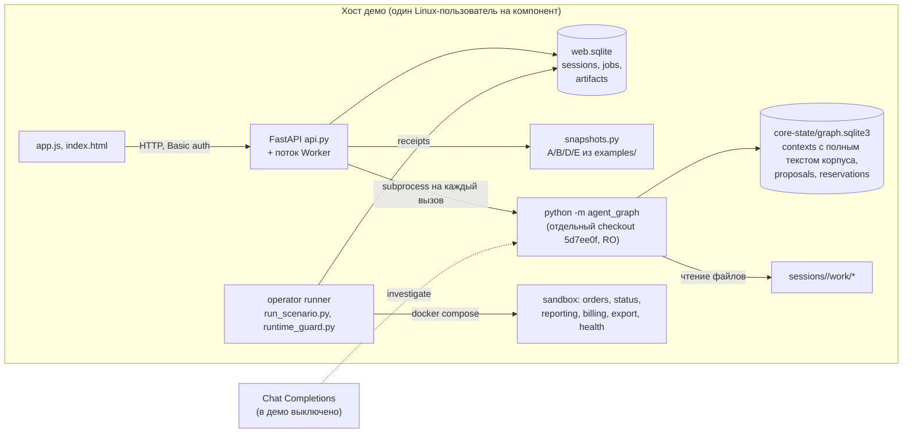

# Фактическая архитектура, восстановленная из кода

Срез: `main` = `c8cd01d` (после слияния #35, #39, #40, #41), профиль ядра
`http-requests-3`, демо закреплено на ядре `5d7ee0f`. Источник каждого
утверждения указан ссылкой на файл. Документы проекта здесь не используются,
их сравнение с кодом вынесено в [DOC-DRIFT.md](DOC-DRIFT.md).

## Компоненты и процессы

| Компонент | Код | Строк | Состояние |
|---|---|---|---|
| Ядро: сбор, извлечение, версии, анализ | `src/agent_graph/{sources,discovery,engine,store,contracts,__main__}.py` | 1204 | SQLite `graph.sqlite3` в каталоге 0700 |
| Ядро: модельный цикл | `src/agent_graph/{inference,evidence_refs}.py` | 578 | таблица `reservations` |
| Демо: API, очередь, worker, снимки | `src/agent_graph_demo/*.py` | 1437 | `web.sqlite`, каталоги сессий |
| Демо: UI | `src/agent_graph_demo/web/*` | 1479 | нет |
| Демо: оператор и приёмка | `tools/agent_graph_demo/*.py`, `infra/agent_graph_demo/*` | 1348 | receipts, runtime registry |
| Синтетический сценарий | `examples/agent_graph_demo/*` | 144 | нет |

Остальной репозиторий (ВКР `datamesh_release_protocol`, `change_completion`,
`lab`, `services`, `stand`, `infra/cloudru`) не импортируется путём графа.
Обратная связь есть одна: три скрипта эксперимента в `tools/*evidence_refs*`
импортируют ядро. Из 55 workflow графу принадлежат три
(`agent-graph-demo.yml`, `agent-graph-demo-delivery.yml`, `graph-evidence-refs.yml`).

## Жизненный цикл знания

### 1. Получение исходников

- В ядре получения нет. Оператор кладёт файлы на диск и перечисляет корни в
  policy (`contracts.py`, `Repository.root`). Git, fetch, ветки и diff не
  используются нигде в `src/agent_graph`.
- `Repository.revision` это строка из policy. Ядро её не проверяет и включает
  в `source_id` как метку (`sources.py`, `collect`). Версией по факту служит
  SHA-256 содержимого каждого файла.
- `collect` обходит корень, берёт `*.py`, `*.json`, `*.md`, пропускает скрытые
  и "чувствительные" имена, отказывается от файла с литералом вида
  `password = "..."` (пробел `sensitive_source`). Лимиты: до 10 000 файлов,
  256 КиБ на файл, 20 МБ на корпус, 120 с на обход (`Limits`).
- В демо исходники генерирует `examples/agent_graph_demo/scenarios.py`: четыре
  версии A/B/D/E собираются строковыми заменами из шести файлов и копируются в
  `sessions/<id>/work` (`snapshots.py`, `materialize`). Реального репозитория
  демо принять не может: адреса `http://orders:8000`, требование и состав
  репозиториев зашиты в `materialize`.

### 2. Обнаружение зависимости

- Поставщик: функция модуля с декоратором `@app.<method>("/literal")`, где
  `app = FastAPI()` в том же файле, либо операция в JSON-документе с ключом
  `openapi` (`discovery.py`, `providers`). Идентичность операции:
  installation, environment, service, method, path.
- Потребитель: вызов `requests.<method>` или `requests.request` с URL,
  который сводится к строке через однократно присвоенные константы модуля.
  URL сопоставляется с `policy.addresses` по схеме, хосту, порту и префиксу,
  затем с операцией по пути или шаблону (`match_url`).
- Классификация использования знает только пагинацию: `SINGLE_REQUEST_OBSERVED`,
  `CURSOR_LOOP_OBSERVED` (цикл и чтение `next_cursor`), `EXPLICIT_PAGE_SIZE`,
  `UNKNOWN_USAGE`. Других свойств вызова ядро не извлекает.
- Всё остальное становится пробелом. Любой вызов `x.get(...)`, `x.post(...)`
  на неизвестном объекте даёт `unknown_http_client`, включая `dict.get`,
  `os.environ.get` и сам декоратор `@app.get` (L1 прошлого аудита).

### 3. Основание

- Цитата: `source_id`, диапазон строк, точный текст (`discovery.py`, `evidence`).
  У зависимости две цитаты: строка вызова и вся объемлющая функция. У операции
  FastAPI цитата равна функции. У операции OpenAPI цитата равна **первой строке
  файла**, потому что `evidence(source)` без узла даёт строки 1..1.
- Требование приходит только из policy оператора и привязано к SHA-256 файла
  (`ApprovedRequirement`). При несовпадении хеша оно пропадает с пробелом
  `requirement_basis_stale`.
- `.md` становится `UNTRUSTED_NOTE`, `test_*.py` становится
  `TEST_SOURCE_OBSERVATION`. Это пометки целого файла, содержимое не разбирается.

### 4. Версия

- `prepare_context` дважды обходит корпус, один раз извлекает граф и сохраняет
  контекст как неизменяемый JSON (`engine.py`). В контекст входит **полный
  текст каждого файла** корпуса (`sources[...]["text"]`) и весь граф.
- `basis` = digest от inventory (путь и SHA-256 каждого файла), адресов,
  требований и `PROFILE`. Смена профиля делает все прежние контексты STALE.
- `heads(view)` хранит последний контекст и счётчик поколения; запись идёт
  через CAS по поколению (`store.py`, `save`). Старые контексты не удаляются.
- `view_id` = digest от установки, среды, списка репозиториев (без revision),
  адресов и требований (`contracts.py`, `Policy.view_id`). Это граница
  видимости: контексты и предложения другого view недоступны.

### 5. Анализ изменения

- `analyze_change(base)` не принимает diff. Он строит новый контекст по тому,
  что сейчас лежит на диске, и сравнивает операции base и head
  (`engine.py`). Распознаются три изменения: операция удалена, изменён
  известный default `page_size`, изменено объявление с неизвестным default.
- Находки строятся только для потребителей изменившейся операции. Новый
  потребитель и изменение потребителя изменением не считаются (L5).
- Если дельт нет, результат пишет `unknowns=["no_supported_behavior_delta..."]`.

### 6. Модельное предложение

- `investigate` ведёт до 12 шагов `read_source/propose/finish` через собственный
  HTTP-клиент Chat Completions (`inference.py`). Бюджет резервируется в SQLite
  до запроса и не возвращается.
- Протокол `quotes-v1` сохраняет гипотезу с точными цитатами как
  `UNAPPROVED_CANDIDATE`. Протокол `evidence-refs-v2` принимает типизированную
  связь, только если `dependency_sufficiency` находит **уже извлечённое
  статическое ребро** с теми же сервисами, методом и путём
  (`evidence_refs.py`). Кандидат ни в одном протоколе не попадает в
  `graph.dependencies`.
- В демо `investigate` запрещён (`graph_cli.py`, `store.enqueue`).

### 7. Человеческое решение

- Исправление человека это `Proposal(kind="human_correction")` с цитатами и
  `supersedes` (`engine.py`, `propose`). Оно хранится рядом с кандидатами
  модели, видно в выдаче, но не меняет рёбра, требования или находки.
- Утвердить требование можно только правкой policy оператора с новым SHA-256.
  Рабочего процесса утверждения в коде нет.
- Внешняя проверка (`report_check`) сохраняется как `EXTERNAL_REPORTED`.
  Receipts операторского runner живут в `web.sqlite` демо и сопоставляются с
  ревизией сессии (`runtime.py`, `applicable`).

### 8. Устаревание и обновление

- Свежесть проверяется при каждом чтении: `freshness` заново обходит и хеширует
  весь корпус и сравнивает basis (`engine.py`). Один изменённый байт в любом
  файле любого репозитория делает STALE весь контекст.
- Предложение и исправление человека STALE, если их basis не равен basis
  контекста. Привязка идёт к basis всего корпуса, а не к SHA-256 процитированных
  файлов.
- `propose`, `report_check` и каждый шаг `investigate` требуют, чтобы контекст
  был CURRENT и был head своего view (`_current`). Новый `prepare_context`
  любого участника делает чужой контекст `superseded_context`.
- Обновление только явное: новый `prepare_context`. Фоновых задач,
  инкрементального извлечения и сборки мусора нет.

## Что сохраняется и что вычисляется заново

| Данные | Где | Можно пересчитать из исходников? |
|---|---|---|
| Операции, зависимости, использование, пробелы | `contexts.graph` | Да, это детерминированная функция корпуса, policy и `PROFILE` |
| Полный текст корпуса | `contexts.sources` | Да, если исходники той же версии доступны |
| Исправления человека, кандидаты модели | `proposals` | Нет |
| Утверждённые требования | policy.json оператора | Нет, это вход |
| Бюджет модели | `reservations` | Нет |
| История job, receipts, evidence | `web.sqlite` демо | Receipts нет |

Граф не накапливает знание о зависимостях. Каждый запрос пересчитывает рёбра с
нуля, а хранилище держит копию результата и корпуса для воспроизведения.
Невосстановимое состояние сводится к исправлениям людей, отчётам проверок,
policy и бюджету.

## Скрытые контракты

1. **Формат выдачи ядра не описан.** `schemas/agent-graph-1.json` описывает
   только входы (policy, proposal, external_check, model_action). Worker
   находит цитаты по набору ключей `source_id/start_line/end_line/quote` в
   любом месте JSON (`worker.py`, `citations`), UI читает коды `usage` и
   `findings[].code` (`app.js`). Новый код находки в ядре UI покажет как
   "требуется повторная проверка", включая `OPERATION_REMOVED`.
2. **Ядро внутри репозитория одновременно закреплённая зависимость демо.**
   `tests/graph_demo/helpers.py` по умолчанию берёт ядро из корня репозитория,
   а `GraphCLI` сверяет его файлы с `core.lock.json`. Любая правка
   `src/agent_graph` без перезакрепления ломает `core-tests`. Перезакрепление
   затрагивает 8 файлов вне ядра и тестов и требует merge commit, потому что CI и delivery
   ссылаются на SHA ядра.
3. **Демо-приложение импортирует `examples/`** (`snapshots.py`, `runtime.py`).
4. **Задача в `analyze_change` теряется** (L3 прошлого аудита): worker не
   передаёт `task`, CLI берёт задачу базового контекста.
5. **Ограничение длины задачи в двух местах**: веб принимает 4000 символов,
   ядро 2000, `graph_cli.py` отклоняет разницу отдельным кодом.

## Обработка ошибок и наблюдаемость

- Ядро возвращает только стабильный код (`GraphError.code`) или
  `invalid_input_or_state`. Traceback не пишется никуда.
- `GraphCLI` отправляет stderr ядра в `DEVNULL`. Worker превращает любое
  неожиданное исключение в `worker_failed`. Поток worker при падении добавляет
  строку в список `failure` без traceback (`api.py`, `lifespan`). Модуля
  `logging` в пути графа нет, access log uvicorn выключен.
- Следствие: оператор видит `FAILED/worker_failed` или `cli_failed` и не может
  узнать причину без воспроизведения. Метрик длительности фаз, размера корпуса
  и числа вызовов CLI нет. `metrics.prepare_seconds` в контексте есть, но никуда
  не выводится.

## Состояние и миграции

- Схемы SQLite создаются `CREATE TABLE IF NOT EXISTS`. Версии схемы и миграций
  нет ни в ядре, ни в демо. Совместимость данных держится на `PROFILE`: смена
  профиля делает старые контексты STALE, `analyze_change` от них отказывает
  (`base_profile_mismatch`).
- Хранилище растёт без ограничения: каждый `prepare_context` и каждый
  `analyze_change` добавляют копию корпуса. Удаления и очистки нет.
- Демо при обновлении закреплённого ядра сохраняет сессии, но они становятся
  непригодными для анализа до нового обследования.

## Поставка

- Один `pyproject.toml` (`datamesh-release-protocol`) упаковывает четыре пакета:
  исследовательский протокол, `change_completion`, ядро графа и демо.
- Демо не ставится из `pyproject`. Образ собирается из отдельного
  `infra/agent_graph_demo/requirements.lock` (17 пакетов с хешами) офлайн,
  ядро монтируется отдельным checkout другого SHA того же репозитория.
- Сборка воспроизводима: базовый образ по digest, `--network=none`, проверка
  файлов образа по allowlist и хешам, передача архивом через SCP
  (`agent-graph-demo-delivery.yml`, отчёт #38). Это сильная сторона.
- Ядро и демо работают только на Linux (`fcntl`, `O_NOFOLLOW`, `dir_fd`).
