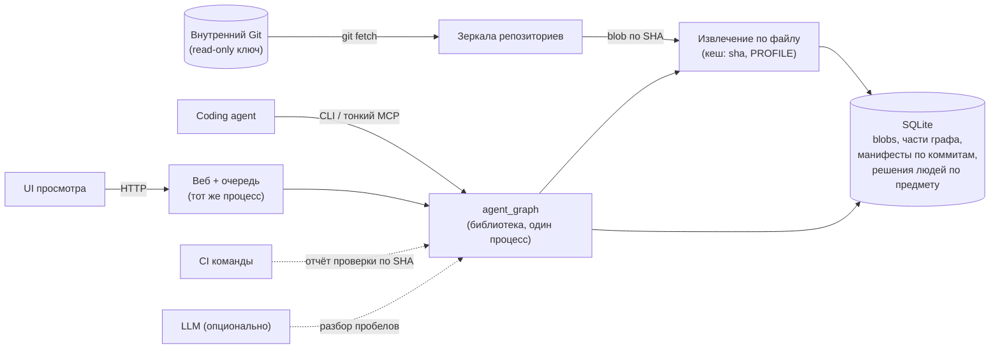

# Аудит архитектуры HTTP-графа, 22 октября 2026

Предмет: путь от демонстрационного стенда (`src/agent_graph`,
`src/agent_graph_demo`, PR #29, #36-#38) к внутреннему инструменту команды
разработки. Срез: `main` = `c8cd01d`. Предыдущий аудит интеграции PR
(`docs/audits/pr-integration/`, PR #43) принят как исходные данные; его
findings F1-F9 и ограничения L1-L8 здесь не повторяются.

Уточнение ревью от 24.10.2026: это исторический срез и набор предложенных
решений, а не утверждение всей последовательности работ. Принятие отчёта
не переводит восемь ADR из «предложено» в «принято». Исправления вынесены
в PR #45 и #46 и слиты 24.10.2026; дальнейшие задачи должны иметь отдельные
критерии приёмки. Сырые результаты и условия исходного замера сохранены.

- [Фактическая архитектура и жизненный цикл знания](AS-IS.md)
- [Расхождения документации и кода](DOC-DRIFT.md)
- [Измерения: корпус, оборудование, методика, результаты](MEASUREMENTS.md)
- [Решение по стеку](STACK.md)
- ADR: [001 Python](adr/ADR-001-keep-python.md) ·
  [002 ядро в процессе](adr/ADR-002-core-in-process.md) ·
  [003 контракт и пакет](adr/ADR-003-output-contract-and-package.md) ·
  [004 Git как источник](adr/ADR-004-git-as-source-of-truth.md) ·
  [005 инкрементальность](adr/ADR-005-content-addressed-incremental.md) ·
  [006 решения людей](adr/ADR-006-stable-human-knowledge.md) ·
  [007 роль LLM](adr/ADR-007-llm-role.md) ·
  [008 наблюдаемость](adr/ADR-008-observability.md)
- [Скрипты замеров и прототип](bench/)

## Вердикт

Ядро решает узкую задачу честно: закрытая AST-грамматика находит вызовы
`requests` к операциям FastAPI/OpenAPI, классифицирует пагинацию и говорит
"неизвестно" там, где не уверено. Это ценное свойство, и его стоит сохранить.

Архитектура вокруг ядра построена для показа одного синтетического сценария
из 7 файлов и для раздельной работы двух исполнителей. Для инструмента
команды она одновременно избыточна и недостаточна:

- **Избыточно:** процесс CLI на каждую цитату, отдельный закреплённый checkout
  ядра с хешами файлов, операторский runner с Docker sandbox, полный текст
  корпуса в каждом контексте, модельный цикл, который подтверждает уже
  найденные рёбра.
- **Недостаточно:** нет получения кода из Git и анализа PR по двум коммитам;
  стоимость каждого запроса пропорциональна всему корпусу; правка любого
  файла делает устаревшим всё; подключение репозитория скрывает накопленные
  решения людей; нет журнала и описанного формата выдачи.

Python не является узким местом. Рекомендуемый путь это вариант B из
[STACK.md](STACK.md): упростить границы и убрать измеренные узкие места на
том же стеке, без новой инфраструктуры.

## Ответы на принципиальные вопросы

**Что источник истины и почему ему можно доверять.** Байты файлов в каталогах,
которые перечислил оператор, плюс policy оператора (адреса сервисов,
утверждённые требования). Доверие держится на трёх механизмах: ядро не
исполняет и не импортирует анализируемый код; каждое утверждение привязано к
SHA-256 файла и точной цитате, которая повторно сверяется при чтении; policy
не принимается из анализируемых источников или ответа модели. Чего нет: связи
с коммитом. `revision` это непроверяемая строка, поэтому утверждение "так
устроен код в main" не установлено. ADR-004 делает источником коммит Git.

**Что граф сохраняет сверх разового поиска.** Меньше, чем подразумевает слово
"граф". Рёбра пересчитываются с нуля на каждый запрос и не накапливаются.
Сверх grep граф даёт: разрешение URL через константы модуля и адреса из policy
в конкретную операцию другого репозитория; классификацию использования,
относящуюся к изменению; явные пробелы; воспроизводимую историю с цитатами.
Невосстановимое состояние это только решения людей, отчёты проверок и бюджет
модели. Именно оно сейчас теряется при расширении policy (ADR-006). Сверх
статического анализатора общего назначения ядро даёт межрепозиторную связь
поставщик-потребитель; по глубине разбора кода оно уступает любому линтеру.

**Где LLM добавляет возможность.** В пробелах, которые грамматика честно
оставляет неизвестными (обёртки, динамические URL), в извлечении кандидатов
требований из текста и в объяснении находки потребителю. Там, где она
используется сейчас, она повторяет детерминированный код: `evidence-refs-v2`
принимает кандидата, только если AST уже нашёл то же ребро, за 26-37 с и
рубли на случай против миллисекунд (ADR-007).

**Наблюдение, предположение, требование, подтверждённый результат.**

| Категория | Что в коде | Кто создаёт |
|---|---|---|
| Наблюдение | `STATIC_RESOLVED`, коды `usage`, пробелы, `TEST_SOURCE_OBSERVATION`, receipt runner | Ядро, операторский runner |
| Предположение | Находка с `condition` (`POSSIBLE_TRUNCATION`), `UNAPPROVED_CANDIDATE`, `UNTRUSTED_NOTE` | Ядро, модель |
| Требование | `APPROVED_REQUIREMENT` из policy с SHA-256 файла; `requirement_candidate` модели не требование | Оператор |
| Подтверждённый результат | Отсутствует. `test_executed=false`, `compatibility_confirmed=false`; `EXTERNAL_REPORTED` и receipt это чужие наблюдения | Никто |

Разделение выдержано в коде и в UI после #40. Не хватает статуса
"подтверждено владельцем" для решения человека о совместимости; сейчас
исправление человека это заметка, а не подтверждение.

**Какие компоненты нужны продукту.**

| Нужно продукту | Только для показа, испытаний или обхода среды |
|---|---|
| Ядро: сбор, грамматика, версии, анализ, цитаты | Синтетический генератор A/B/D/E и импорт `examples/` в приложение |
| SQLite с CAS и неизменяемой историей | Отдельный checkout ядра, `core.lock.json`, `CORE_SHA` |
| Очередь с отменой и восстановлением (для асинхронного анализа PR) | Процесс CLI на каждую операцию и цитату |
| UI просмотра оснований | Операторский runner, Docker sandbox, runtime registry и receipts |
| CLI или API для coding agent | Basic auth с несолёным SHA-256, Nginx и systemd-обвязка ВМ |
| Офлайн-поставка с хешами | Модельный цикл подтверждения статических рёбер, бюджетный ledger на рубли |

**Второй репозиторий, второй пользователь, регулярные изменения.** Проверено
на ядре `main` (MEASUREMENTS.md, раздел "Жизненный цикл"):
добавление репозитория меняет `view_id`, и все прежние исправления людей
перестают выдаваться; после `prepare_context` другого участника запись на
прежний контекст отклоняется; правка несвязанного файла делает STALE все
исправления. Демо выполняет один job на всю установку, очередь на 4 места.

**Реальная стоимость поддержания графа.** Машинная: каждый запрос стоит
O(корпус), 1-3 полных обхода и полное извлечение. `analyze_change` занимает
3,2 с на 1000 файлах, 28 с на 9000, 17,6 с на django (2842 файла, 17 МБ);
django уже близок к жёсткому лимиту ядра в 20 МБ. Хранилище растёт на копию
корпуса и графа за каждый анализ без очистки: 5,5 МБ на 1000 файлах, 48 МБ на
9000. В демо поверх этого каждая цитата стоит процесс CLI: расчёт времени
job анализа на 20 файлах даёт около 231 с при лимите 180 с. Измерены 20
вызовов `evidence`, остальные оценены по их медиане; полный job и Linux
этим числом не измерены. Человеческая, которую код не
меряет: ручное ведение адресов в policy; пересчёт SHA-256 в policy после каждой
правки файла требования, иначе требование пропадает; перезакрепление демо из
8 файлов на каждую правку ядра; повторное обследование после каждой смены
профиля.

## Целевая архитектура

Один процесс Python, один SQLite, зеркала Git. Без брокера, графовой БД,
планировщика и отдельных сервисов, пока нет измеренной потребности.

## Последовательность перехода

Каждый шаг самостоятелен, выпускается отдельным PR и измеряется до и после.
Оценка трудоёмкости для одного разработчика, знакомого с кодом.

| Шаг | Проблема пользователя или эксплуатации | Изменение | Как узнаем, что стало лучше | Оценка |
|---|---|---|---|---|
| 0. Сделано в этом аудите | OpenAPI с `$ref` у `page_size` молча пропускал смену default и объявлял полное покрытие; UI называл удаление операции "повторной проверкой"; документы описывали другую систему | PR с исправлением ядра и перезакреплением, PR с подписью в UI, этот каталог и отметки в документах | Регрессия `test_r6_*` падает на `c8cd01d` и проходит на исправлении | сделано |
| 1. Журнал и ядро в процессе | Job анализа превышает 180 с уже на 20 файлах из-за процесса на цитату; оператор не видит причин сбоев | ADR-008, ADR-002: `logging` в JSON, worker вызывает ядро напрямую, проверка цитат пачкой | Процессов на job 0; job на синтетических 100 файлах укладывается в 10 с; в журнале есть длительности фаз и traceback сбоя | 1 неделя |
| 2. Контракт и пакет | Правка ядра требует второго коммита в 8 файлах и merge commit; UI молча неверно подписывает новые коды | ADR-003: JSON Schema выдачи, пакет `agent-graph` с версией, демо зависит от колеса | Правка семантики ядра меняет 1 файл вне ядра и тестов; тест подачи неизвестного кода в UI | 1 неделя |
| 3. Git как источник | Инструмент не может проанализировать настоящий PR: только файлы на диске и синтетический генератор | ADR-004: зеркала, `analyze_change(base, head)`, сценарий демо как тестовый репозиторий | Анализ реального PR внутреннего сервиса по двум SHA воспроизводится через неделю | 2 недели |
| 4. Инкрементальность и решения людей | Запрос стоит O(корпус); хранилище растёт на копию корпуса; решения людей устаревают от чужих правок и пропадают при подключении репозитория | ADR-005, ADR-006: части графа по файлу, свежесть по цитатам, решения по предмету, версия схемы SQLite | Обновление после правки одного файла до 2 с на корпусе команды; прирост хранилища до 1 МБ на анализ; три проверки `verify_claims.py` дают обратный результат | 2 недели |
| 5. Интерфейс для coding agent и проверка пользы | Основной пользователь по PRODUCT.md это агент, а у него только CLI с процессом на вызов | Команды `context` и `impact` поверх того же API, выдача по операции, по желанию тонкий MCP-адаптер | Диагностическая серия v4 §7 из 12 задач: агент с инструментом против агента с поиском; критерий продолжения из v4 (0 дополнительных серьёзных пропусков, -20% активного труда) | 2 недели + серия |
| 6. Условно: ширина грамматики и модель | Грамматика знает одну библиотеку, один фреймворк и одно свойство (`page_size`); на реальных репозиториях пробелы в основном шум | `httpx`/`Session`, коды ответов и поля по реальному случаю; сужение `unknown_http_client`; ADR-007 для пробелов | Доля шумовых пробелов на репозиториях команды; точность предложенных моделью рёбер на 30 размеченных пробелах | по результату шага 5 |

Шаг 6 начинается, только если шаг 5 показал пользу. Если агент с поиском
и собственными заметками даёт тот же результат за сопоставимый труд, v4 §7
уже предписывает не строить платформу; тогда полезные части ядра остаются
библиотекой для CI.

## Корпоративное размещение

- **Ограниченный интернет.** Текущая поставка подходит: колёса с хешами,
  образ с закреплённым digest, сборка без сети, перенос архивом. После ADR-003
  ядро ставится тем же путём. После ADR-004 нужен только доступ к внутреннему
  Git по SSH или HTTPS.
- **Внутренняя LLM** (vLLM на loopback или в сети): протокол и бюджет уже есть.
  Квалификации модели нет.
- **Внешняя или корпоративная LLM через шлюз**: клиент модели не поддерживает
  прокси и собственный CA-bundle, поэтому в сети с обязательным прокси не
  заработает. Нужна настройка в policy (ADR-007). Маршрут контекста к внешней
  модели остаётся решением политики заказчика.
- **Права.** Сейчас один доверенный OS-пользователь на установку. Для команды
  нужна проверка прав чтения на уровне репозитория при выдаче решений
  (ADR-006); SSO и мультиарендность не нужны для одной команды.

## Что сделано в рамках аудита

| Изменение | Ветка | Проверка |
|---|---|---|
| Ядро: `$ref` у `page_size` в OpenAPI даёт пробел и `PAGE_DEFAULT_UNRESOLVED`, профиль `http-requests-4`; перезакрепление демо | `fix/graph-openapi-page-size-ref` | `test_r6_*` падает на `c8cd01d` (оба подслучая) и проходит; остальной набор `tests/graph` без изменений; lock сверен с blob-ами Git; Linux CI не запускался |
| UI: отдельные подписи для `OPERATION_REMOVED` и неизвестных кодов | `fix/demo-removed-operation-label` | `node --check`; строки browser acceptance не меняются |
| Этот каталог и отметки в 6 документах | `docs/architecture-audit` | Ссылки проверены |

## Ограничения аудита

- Замеры сделаны на Windows через shim, который заменяет только чтение файла
  (`openat` + `O_NOFOLLOW`) и `flock`. Linux-цифры не сняты; запуск процесса и
  первое открытие файла на Linux дешевле. Скрипты в `bench/` воспроизводят
  серию на Linux без shim.
- ВМ демо не трогалась. Реальная модель не вызывалась; её задержки взяты из
  ledger серии #35.
- Тесты `tests/graph_demo` и браузерная приёмка требуют Linux и Docker и
  локально не запускались.
- Польза для команды не измерялась: это шаг 5.
