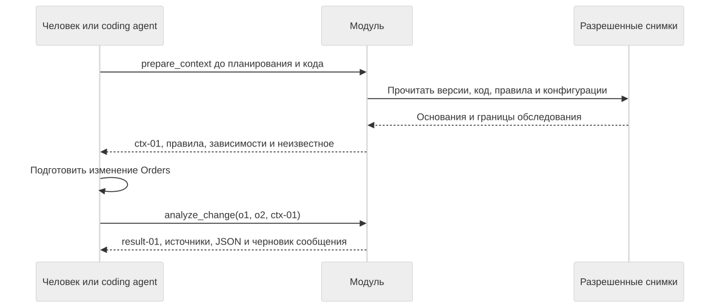

# Схемы архитектуры · редакция 4

20 октября 2026. Шесть схем текущего решения. Для встречи сначала откройте [основной документ](../../product-architecture-2026-10-20.md): он связывает постановку, пример, ограничения и способ проверки.

Это устройство проектируемого модуля, а не свидетельство реализации. Компоненты первой версии работают в одном локальном процессе. RabbitMQ показан как следующий профиль; отправка уведомлений и управление выпуском в MVP не входят.

| № | Схема | Назначение | Исходник | Изображение |
|---|---|---|---|---|
| 1 | Компоненты | Источники, контекст, анализ, пользователь и независимый выпуск | [Mermaid](01-system.mmd) | [SVG](01-system.svg) |
| 2 | Конституция кратко | Факты, применимые правила, кандидаты и конфликты до планирования | [Mermaid](02-constitution-summary.mmd) | [SVG](02-constitution-summary.svg) |
| 3 | Сбор конституции | Внешняя настройка, извлечение, применимость, полномочия и версия контекста | [Mermaid](03-constitution-details.mmd) | [SVG](03-constitution-details.svg) |
| 4 | RabbitMQ | Изменение маршрута, очереди, обработчики и неподдержанная область | [Mermaid](04-rabbitmq.mmd) | [SVG](04-rabbitmq.svg) |
| 5 | Пересчёт | Изменения источников, отрицательные выводы и новый результат | [Mermaid](05-context-invalidation.mmd) | [SVG](05-context-invalidation.svg) |
| 6 | Сквозной HTTP-кейс | Два обращения: до кода и после diff | [Mermaid](06-http-case.mmd) | [SVG](06-http-case.svg) |

## 1. Компоненты и процесс выпуска

## 2. Конституция до планирования

## 3. Детальный сбор конституции

## 4. RabbitMQ: следующий профиль

## 5. Актуализация контекста

## 6. HTTP: последовательность действий

## Источник и проверка

Исходные блоки находятся в [основной архитектуре](../../product-architecture-2026-10-20.md), [техническом приложении](../../product-architecture-details-2026-10-20.md) и [сквозном примере](../../product-architecture-case-2026-10-20.md). Файлы `.mmd` воспроизводят эти блоки; `.svg` получены `@mermaid-js/mermaid-cli@12.0.0`. Использованы Arial, нейтральная тема, classic look и `htmlLabels: false` на верхнем уровне [конфигурации](mermaid-config.json); HTML/foreignObject в изображениях отсутствуют. Проверены синтаксис, соответствие исходникам и читаемость шести изображений.

После установки указанной версии CLI изображение воспроизводится из папки галереи: `mmdc -i 01-system.mmd -o 01-system.svg -c mermaid-config.json -b white`. Для собственного Chromium/Edge отдельно задаётся локальная конфигурация Puppeteer через `-p`; абсолютные пути машины в репозитории не хранятся.

[Исторические схемы PR №26](../product-architecture-2026-10-20/README.md) сохранены отдельно и не описывают текущий MVP.
