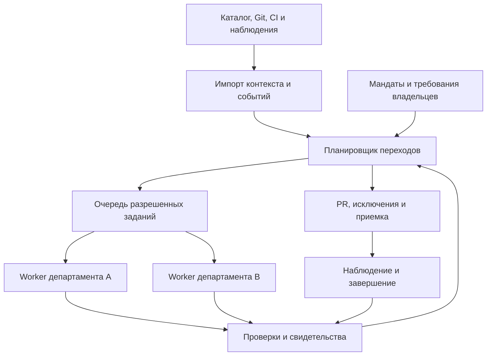

# Исполнение изменений в масштабе компании

> Историческая архитектура от 16 октября. Актуальные границы первой итерации заданы [решениями пачки 2 от 20 октября](product-focus-2026-10-20.md). Автономное исполнение и корпоративная поставка ниже сохранены как прежнее направление; они не являются обязательствами текущей проверки API/RabbitMQ и не подтверждают реализацию.

Дата: 2026-10-16. Статус: целевая архитектура и план эволюции после повторного аудита. Документ описывает проектные решения; наличие раздела не означает наличие реализации. Текущее состояние и коммерческая проверка - [основной документ](product-rebuild-2026-10-16.md).

## Продукт и граница ответственности

Продукт получает делегированную задачу изменения данных или связанной системы и доводит ее до проверяемого результата у затронутых потребителей. Охват - департамент, дивизион или компания с несколькими командами и контурами. On-premise означает размещение в инфраструктуре заказчика, а не ограничение одним компьютером, репозиторием или командой. Возможна установка в частном облаке заказчика. Между этими вариантами не должна меняться продуктовая модель.

Источником задач могут быть владелец данных, владелец бизнес-показателя, команда платформы, владелец приложения или руководитель программы миграции. Примеры: изменение расчета показателя; переход на другой источник; изменение контракта события; устранение несовместимости потребителей; завершение миграции. Общий механизм один, но каждый исполняемый технологический профиль должен быть квалифицирован отдельно. Поддержка всех этих сценариев сегодня не заявляется.

Ценность - выполнение повторяемой работы по обследованию, адаптации, независимой проверке и доставке изменений при ограниченном внимании людей. Каталог и общий агент остаются источниками контекста и инструментами. Собственная ответственность продукта - состояние обязательств перед потребителями, разрешенные действия, доказательства результата, отзыв устаревших подтверждений и завершение перехода.

Люди не должны заново писать карту компании и одобрять каждый штатный шаг. Они один раз задают область, права, правила приемки и независимые требования, затем отвечают на адресные исключения и критичные решения. Если поддержание этого состояния требует отдельной команды ручной разметки, гипотеза низкой трудоемкости не выполнена.

## Что есть в коде и чего пока нет

| Область | Реализация на момент аудита | Требуемое расширение |
|---|---|---|
| Область установки | `web_server.bind_service` связывает один checkout и один загрузчик `TransitionSpec` | Реестр областей и переходов; адресуемые источники и исполнители |
| Идентичность | Bearer identities загружаются при старте; `Principal` содержит список ID переходов | Корпоративная идентичность, группы, отзыв без перезапуска, область действия роли |
| Полномочия | Ограниченные действия, компонент, среда, срок; доверенный оператор задает grants | Проверяемый издатель, делегирование, запрет расширения прав, короткоживущие задания |
| Контекст | Обход SQL/JSON локального снимка; runtime-потребители неизвестны | Импорт каталога, Git/CI, схем и наблюдений; курсоры, сроки, конфликты и границы охвата |
| Исполнение | Реальный ограниченный SQLite-профиль; отдельный subprocess | Раздельные workers по зоне доверия и квалифицированному профилю |
| Актуальность | Синхронный повтор обхода и проверки при `view` и `tick` | Индекс зависимостей доказательств, очередь перепроверки, ограниченный fallback polling |
| Хранение | Два SQLite-файла одной установки; локальная дедупликация | Транзакционные задания/попытки/outbox, конкуренция, восстановление, миграции схем |
| Командная приемка | Владельцы всех объявленных потребителей и итоговый приемщик | Адресная приемка обязанностей; делегаты; заранее утвержденные правила |
| Завершение | READY_FOR_REVIEW, review, черновик/доставка через gateway | Раздельные состояния merged, staged, cutover, observed, retired с собственными свидетельствами |

SQLite и один сервер допустимы для квалификации ядра. Они не доказывают поддержку многокомандной эксплуатации, высокую доступность или безопасное разделение данных. Переписать все ядро перед проверкой спроса тоже не требуется.

## Целевая структура

Control plane хранит реестр задач, политик, метаданные доказательств, состояние попыток и журнал. Код, данные и секреты по возможности остаются в контуре worker. В центральный контур передаются только явно разрешенные метаданные и результаты. Даже имена таблиц и существование чужого компонента могут быть чувствительными: видимость зависимостей также проверяется по правам.

Worker инициирует исходящее защищенное соединение, получает подписанное или эквивалентно аутентифицированное короткоживущее задание и локально проверяет его область. Не требуется открывать центральному серверу прямой административный доступ ко всем БД. TLS сам по себе не заменяет проверку области, подписи задания, срока, версии политики и отзыва.

Workers разделяются по зоне доверия и типу исполнения, а не обязательно по каждой команде. Выполнение недоверенного Python требует иной изоляции, чем нынешний restricted SQL runner. Проверки с данными production требуют отдельно выданного доступа и правил минимизации; наличие read-only флага не решает риск утечки.

## Сущности и обязательные инварианты

| Сущность | Что хранит | Инвариант |
|---|---|---|
| Organization / Scope | Компания, дивизион, департамент, домен; связи подчинения | Подчинение не дает автоматически права записи или чтения чужого кода |
| Asset / Component | Система, репозиторий, API, событие, модель/таблица, владелец и источник сведений | Идентификатор стабилен; версия и источник не теряются при импорте |
| ConsumerObligation | Обязанность перед конкретным потребителем: смысл, формула, единица, интерфейс, SLO | Разные потребители могут иметь разные целевые состояния |
| Ownership / Delegation | Ответственный, делегаты, срок и область делегирования | Отсутствие ответа не превращается в согласие |
| ConnectorBinding | Endpoint, область, класс данных, ссылка на секрет, курсор и watermark | Коннектор не получает полномочия из найденного контента |
| Transition | Цель, исходное/целевое состояние, затронутые обязанности, C0-C3 | Список работ и история обновляются версионно |
| Mandate | Издатель, actor, ресурс/область, действие, среда, срок, бюджет и условия | Любое разрешение - пересечение мандата, профиля, политики и актуального контекста; объединение областей не расширяет права |
| ExecutionProfile | Поддерживаемые технологии, действия, ограничения, квалификация | Общий контракт не равен возможности исполнения любого языка |
| Task / Attempt / Lease | Идемпотентная задача, конкретная попытка, worker, срок владения | Истекшая lease не доказывает отсутствие внешнего эффекта |
| Evidence | Входы, независимое требование, результат, исполнитель, сроки и зависимости | Изменение основания отзывает применимость, а не удаляет историю |
| Approval / AcceptanceRule | Что именно принято, кем или по какой утвержденной политике | Принимается версия результата, а не название перехода |
| DeliveryIntent / Receipt | Назначение, ключ идемпотентности, payload digest, исход | UNKNOWN требует сверки, а не слепого повтора |
| RetirementPlan | Условия переключения, наблюдения, отката и отключения | PR и PASS не являются доказательством выключения старого пути |

Learning хранится отдельно: обнаруженная зависимость, принятый раньше шаблон или ответ человека могут предложить следующий план. Они не создают новое право, не утверждают бизнес-смысл и не делают профиль квалифицированным. Повторно использовать можно только утвержденное основание в действующей области и версии.

## Автономный цикл и внимание людей

1. Импортировать доступный контекст и события из разрешенных источников. Сначала использовать существующие идентификаторы, владельцев и lineage, затем дополнить наблюдаемыми связями.
2. Зарегистрировать цель или найти потенциально затронутые обязанности при событии изменения. Автоматическое обнаружение проблемы не равно разрешению начать исправление. Событие запускает диагностику, а не массовое изменение всех потребителей. Продвижение к исполнению требует отдельного действующего мандата в каждом затронутом домене.
3. Построить план, оценить C0-C3, неизвестное, доступные профили и бюджет. Если разрешен только анализ, ограничиться анализом.
4. Сгруппировать неизвестное по владельцам. Отправить один адресный запрос с найденными основаниями, предлагаемым ответом и последствиями. Не рассылать всем командам полный контекст.
5. Под действующим мандатом подготовить кандидатов и выполнить независимые проверки в workers. Общий агент может готовить код, но не назначает сам себе ожидаемый ответ.
6. Создать связанные PR, результаты CI и запросы только тем ролям, чьи обязательства затронуты и чьи права позволяют это видеть.
7. Применить правила приемки: штатный случай может приниматься автоматически по заранее утвержденной политике; исключение эскалируется человеку. Ни auto-merge, ни production deploy не следуют из права создать PR.
8. Наблюдать переключение и состояние потребителей. Выключать старый путь только при отдельных критериях и полномочиях; сохранять возможность отката в согласованном окне.
9. На изменение входов, срока, требования, policy, профиля или состава потребителей отзывать только зависящие свидетельства и приемки. Независимые результаты сохранять, если их область и основания не изменились.

При недоступности событий работает ограниченная периодическая сверка. Пропуск последовательности или отставание watermark переводят зависимые результаты в состояние неопределенной актуальности. Утверждение "событий не было, значит все актуально" запрещено.

## Совместная корректность нескольких потребителей

Независимый PASS каждого потребителя необходим, но недостаточен для пакетного изменения. План содержит также совместные инварианты: например, отчет и операционный сервис должны ссылаться на одну версию идентификатора, а суммарный лимит должен оставаться согласованным между системами. При этом значения метрик разных потребителей не обязаны совпадать: analytics может использовать 90 дней, audit - 30, если именно это независимо утверждено владельцами. Проверяется соответствие разным обязательствам и совместным инвариантам, а не всеобщая parity со старым результатом.

Для изменения в большой области нужен план волн: какие компоненты допускают смешанные версии, кто от кого зависит, какой порядок переключения разрешен и на каком наблюдении волна останавливается. Поддержка временной совместимости, максимальное окно двойной эксплуатации и порядок отката задаются явно. Эти действия не реализованы в нынешнем SQL-прототипе.

Каждое подтверждение связывается с конкретным набором оснований. Если меняется требование analytics, перепроверяются его результаты и совместные инварианты, которые от него зависят; приемку audit можно сохранить только при доказуемом отсутствии зависимости. При недостаточной точности индекса применяется консервативная инвалидация, а не предположение о независимости.

Широкий охват требует защиты от каскадов: лимит новых задач/PR/уведомлений и расходов на переход, дедупликация по версии источника, объединение повторных сигналов, rate limit по владельцу и аварийная остановка области. Отзыв мандата останавливает новые эффекты, но не отменяет автоматически уже совершенное действие. Его состояние выясняется по receipt и целевой системе.

## Полномочия и критичность

Автономность имеет две независимые оси: что продукт технически умеет и что ему разрешено делать здесь. Предлагаемые режимы: observe, prepare, propose, controlled execute. Переход режима - явное решение уполномоченного владельца; отсутствие пользователя не является таким решением.

| Уровень | Типичный риск | Целевой штатный режим | Причина остановки |
|---|---|---|---|
| C0 | Нет поведенческого влияния в подтвержденной области | Автоматические проверки и завершение по политике | Неподтвержденный охват, противоречие или потеря актуальности |
| C1 | Обратимое изменение компонента без внешнего контракта | Подготовка/PR; применение только при отдельном мандате и квалификации | Внешняя зависимость, выход за пределы профиля или бюджета |
| C2 | Внешний контракт или межкомандное влияние | Автоматическая подготовка; приемка затронутых обязанностей по делегированным правилам | Неурегулированное различие требований или недостающий приемщик |
| C3 | Критичная отчетность, финансы, регуляторный/необратимый эффект | Раздельная подготовка и независимая человеческая приемка; окно/откат | Нет подтвержденного восстановления, разделения обязанностей или явного разрешения |

Эта таблица - целевая политика, а не заявление о production-действиях нынешнего прототипа. Границы C0-C3 должны настраиваться под систему заказчика, однако понижение класса не должно обходить обязательные требования безопасности. Финансовая отчетность не становится C1 из-за малого diff.

Владелец данных отвечает за смысл и допустимые цели. Владелец потребителя - за свои обязательства. Владелец платформы - за доступ и эксплуатационные правила. Продукт отвечает за выполнение делегированного плана и доказательную трассу. Нельзя незаметно переложить поддержку платформы на владельца бизнес-показателя. Право data owner утвердить формулу не означает права выполнить deploy приложения; полномочие app owner выпустить код не означает права изменить утвержденную формулу.

## Развертывание и рост без обязательного Kubernetes

| Этап | Топология | Что проверяется до перехода дальше |
|---|---|---|
| Квалификация ядра | Один control plane и последовательный restricted worker; синтетические данные | Детерминированность, ограничения ресурсов, recovery, независимость ожиданий |
| Первый департамент | Один control plane; отдельный worker в зоне клиента; корпоративная идентичность или ограниченный pilot access | Отзыв доступа, секреты, очередь, восстановление, полный учет труда |
| Несколько департаментов | Общий реестр; workers по зонам доверия; общая транзакционная БД и раздельное хранилище артефактов | Межобластная изоляция, конкурирующие задачи, адресная инвалидация, эксплуатация без автора |
| Компания | Несколько экземпляров API/планировщика, HA хранилища и scheduler при измеренной необходимости | SLO, нагрузка, отказоустойчивость, стоимость и разделение полномочий |

Первую многокомандную версию можно развернуть на VM и контейнерах без отдельного брокера: транзакционная очередь с lease/outbox в PostgreSQL достаточно конкретна для начала. PostgreSQL здесь - проектное направление, пока не реализованная замена SQLite. Брокер или Kubernetes добавляются по требованиям надежности и замерам, а не ради слова "enterprise". Точный размер VM нельзя обосновать без числа активных переходов, payload, параллелизма, профиля проверок и целевого времени реакции.

Выбор SQLite для состояния control plane и выбор движка исполнения клиентского запроса - разные решения. Новый execution-профиль должен проходить проверки на настоящем целевом движке, включая типы, NULL, даты и округление. Обнаруженные зависимости имеют источник, версию и область покрытия; отсутствие наблюдения не доказывает отсутствие потребителя.

## Путь эволюции нынешнего кода

1. Сохранить verifier и технологически нейтральные контракты. Устранить непредсказуемое время сравнения и задать бюджеты до сетевого расширения.
2. Отделить чтение карточки от повторного дорогого исполнения проверки. На чтении проверять доступ и применимость сохраненной аттестации; ее содержимое перепроверять асинхронно при изменении оснований. Любой рискованный эффект проверяет актуальный мандат и версии повторно.
3. Ввести реестр установочных bindings и scoped repository APIs вместо единственного `spec_loader`. Сначала два изолированных перехода и два workers; не объявлять multi-tenant до adversarial тестов.
4. Разделить Transition, Task и Attempt. Добавить lease, heartbeat, отмену, reconciliation и новый attempt без переписывания прежнего результата. Контролировать budget на переход, а не только на процесс.
5. Вынести исполнитель в worker protocol с версией, идентичностью, job digest, expiry и отказом от неизвестных capabilities. Проверка права нужна и в control plane, и в worker.
6. Подключить один существующий каталог/реестр и Git/CI для реального сценария. Не строить полный собственный каталог; сохранять provenance и конфликты сведений.
7. Ввести индекс `evidence -> inputs/obligations/policy/profile` и адресную инвалидацию. Изменение UI-кода не должно отзывать все свидетельства исполнения: нынешний digest всех `.py` слишком груб для штатных обновлений.
8. Добавить SSO/группы, проверяемое делегирование и отзыв доступа без перезапуска. Проверить, что поиск, журнал, ошибки и счетчики не раскрывают чужие ресурсы.
9. Реализовать наблюдаемые завершения для конкретного профиля: PR merged, staging passed, cutover confirmed, observation window passed, retirement confirmed. Без фактического источника сигнала состояние остается неизвестным.

## Как проверить экономический эффект и минимум человеческого ресурса

Коммерческое уточнение 2026-10-17: основная метрика - Net_cash(T), фактические расходы сопоставимой альтернативы минус расходы с модулем за согласованный горизонт. Учитываются цена версии 100000-150000 руб. (гипотеза), отдельное внедрение, поддержка и ресурсы. Capacity_value по высвобожденным часам показывается отдельно; она не равна сокращению платежей и не суммируется с Net_cash без устранения двойного счета.

Не назначаем выдуманные часы внедрения или долю автономности. Собираем time log клиента и поставщика отдельно с первого подключения, включая скрытую помощь автора. Сравниваем три варианта: текущий процесс, сильный агент с сопоставимыми средствами, наш модуль.

| Показатель | Как считать | Зачем |
|---|---|---|
| Подключение области | Часы обеих сторон на доступ, источники, требования, безопасность, запуск | Не прятать ручной консалтинг во внедрении |
| Регулярная эксплуатация | Часы в неделю на connector drift, восстановление, policy, обновления | Проверить возможность эксплуатации клиентом |
| Внимание на принятый переход | Уточнения + review + STOP + повтор + cleanup, включая неуспешные попытки | Главная цена автономности для пользователя |
| Доля без вмешательства | Принятые результаты без внепланового действия человека / все подходящие задачи | Не выдавать автоматические черновики за законченные переходы |
| Доля с делегированной приемкой | Результаты по заранее утвержденным правилам / принятые результаты | Отличать политику от ручного клика |
| Задержка на исключениях | Время ожидания ответа и его причины | Не обвинять "процессы клиента" без анализа качества запросов |
| Повторное использование | Доля одобренных требований и connector mappings без повторной ручной разметки | Проверить, уменьшается ли стоимость второй установки |
| Стоимость результата | Фактические расходы клиента; мощность по часам отдельно; себестоимость поставщика отдельно | Не учитывать труд поставщика повторно внутри цены лицензии |

До пилота фиксируются денежный горизонт, граница завершения и критерии качества. Не менее 30% снижения полных часов клиента против сильного агента - вторичный предварительный управленческий ориентир при сопоставимом качестве; совокупные часы клиента и поставщика не хуже baseline; отсутствие принятого результата с пропущенной заранее определенной критичной ошибкой; чистая установка и восстановление другим инженером. Это проектные пороги проверки, не рыночные факты и не статистическое доказательство по одному примеру. Значения дополнительно ограничиваются фактическими критериями приемщика.

## Самокритика и условия пересмотра

- Центральный граф обязанностей легко превращается в еще один дорогой каталог. Если импорт и повторное использование не работают, сократить набор источников и сценариев, а не нанимать скрытую команду разметки.
- Всеобщая ручная приемка противоречит автономности. Она нужна только там, где не хватает действующего правила или риск требует отдельного решения. Вместе с тем искусственное удаление приемщика не устраняет ответственность за смысл.
- Продукт не может вывести нормативное бизнес-требование только из наблюдаемого кода. Если владелец не может его сформулировать, задача не становится автоматически проверяемой.
- Поддержка старой семантики у одного потребителя может потребовать двух версий данных и увеличить постоянную стоимость. План обязан показать цену и срок такого расхождения.
- Разделение workers добавляет сеть, deployment и поддержку адаптеров. Изоляция не бесплатна; она должна окупаться общим повторным использованием в области.
- Обычный агент с Git/CI и несколькими сохраненными инструкциями может повторить значительную часть подготовки. Преимущество придется доказывать на долговременном состоянии, разных обязанностях потребителей, инвалидации, recovery и снижении человеческих часов.
- Расширение покупателей не доказывает единый рынок. Владельцу данных нужен результат и приемка метрики; платформе - надежная эксплуатация; интегратору - сокращение себестоимости проекта. Отдельно проверяются бюджет, момент покупки и доступность данных.
- Ни эта архитектура, ни отсутствие явного описания у конкурента не доказывают рыночную уникальность. Сравнивать надо доступный покупателю полный сценарий и форму поставки.
