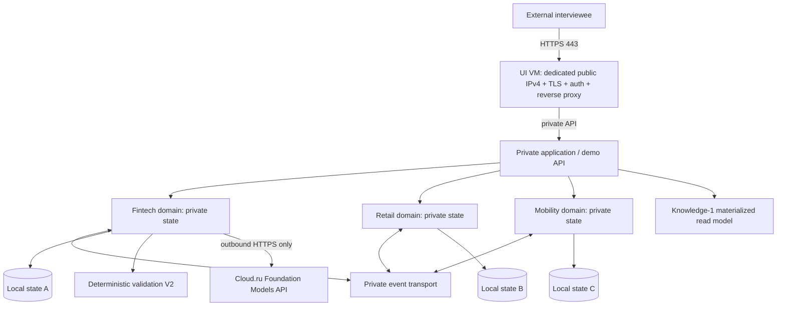

# Cloud.ru: пошаговое развёртывание с отдельным публичным UI
Статус: DESIGN / NOT DEPLOYED. Неподтверждённые опции помечены TO VERIFY.

## Архитектурные границы
- PUBLIC: UI/edge ВМ с **собственным арендованным публичным IPv4**, DNS A-запись и HTTPS. Снаружи открыты только TCP 443 (и 80 для выпуска/редиректа сертификата). 22 только через VPN/bastion/администраторский IP при необходимости.
- PRIVATE: одна вычислительная ВМ с тремя раздельными доменными процессами/контейнерами, независимыми состояниями, правами, конституциями и журналами; событийная шина; хранилища; Policy Engine; knowledge-1; агентный исполнитель; генератор синтетики.
- MODEL: исходящие HTTPS вызовы облачных Foundation Models через серверный адаптер. Ни API-ключи, ни прямой model endpoint не доступны из браузера.
- ADMIN: приватный доступ через VPN или кратковременный разрешённый IP. Никакого открытого Grafana, PostgreSQL, Kafka, Schema Registry или внутренних API.
- LAB: E3 и E1 не выполняются совместно с публичными демонстрациями, чтобы нагрузка UI не искажала метрики. Для финальных E1 нужна изолированная среда/окно.

## Минимальные ресурсы по стадиям (не прайс-квота)
P0: только предварительная демонстрация (макет + API на локальном стенде), без облака.
P1: UI 2 vCPU / 4 GiB RAM / 25-40 GB system disk; private 8 vCPU / 32 GiB RAM / 150-250 GB SSD. Если совместимость Kafka/KRaft, Registry и PostgreSQL вызовет память/OOM, поднять private до 12-16 vCPU / 48-64 GiB.
P2: подготовка E4: перенести каждый из трёх доменов на отдельные VM (ориентир 4 vCPU / 16 GiB каждая) и выделить broker/storage/control plane в отдельную VM. UI остаётся отдельным.
P3: отдельная нагрузочная VM 8 vCPU / 32 GiB на время E1 и изолированное окно тестирования. Для финальных выводов о распределённости P1 (одна private VM) недостаточна, он демонстрирует логическую изоляцию.

## Порядок действий
1. Получить доступ к Cloud.ru, определить регион/зону, квоты, лимит бюджета, программу гранта, тип аккаунта. Выбрать и зафиксировать Evolution Compute, правила начисления, текущие instance flavors и лимиты сервисов.
2. Создать проект/ресурсную группу; VPC, private subnet, security groups `sg-edge`, `sg-private`, `sg-admin`. Отдельные сервисные аккаунты и минимальные права; хранение секретов вне Git.
3. Создать private VM, отдельный SSD/data volume, шифрование при доступности, фиксированный образ ОС и патчи, SSH-ключ, автоматические security updates по контролируемому расписанию. Создать UI VM с минимальным системным диском.
4. **Арендовать и прикрепить отдельный публичный IPv4 к UI VM.** Зафиксировать allocation ID и назначение. Входящий трафик 443/80 только на UI; внутренние сервисы без inbound из интернета.
5. Проверить egress private VM к registries, пакетным зеркалам и model API (NAT/SNAT/другое поддерживаемое решение: TO VERIFY стоимость). Не открывать private VM наружу просто ради установки пакетов.
6. Добавить DNS-запись (сначала допустимо техническое имя), выпуск TLS-сертификата через ACME, редирект HTTP -> HTTPS, security headers, cookie flags, CORS только для нужного origin, ограничение размера тела и rate-limit.
7. Контейнерная поставка: digest-pinned версии; отдельные env/volumes/users для доменов; volume permissions; health-check; restart-policy; секреты через защищённые переменные/хранилище. Docker Compose допустим для P1; Kubernetes не требуется.
8. Взять существующий код из `rengalaxies/agent`, прогнать `make test` и тесты стенда по `stand/README.md`, затем `make seed` либо репозиторные эквиваленты после проверки реальных команд. Не предполагать, что интерфейс уже есть.
9. Backend routes: `GET /health`, `GET /demo/scenarios`, `POST /demo/run` с idempotency key, `GET /demo/runs/{id}`, `GET /knowledge/snapshot`, `GET /evidence/{id}` (без внешних чувствительных данных). Из браузера только demo-safe API.
10. Сделать 3 предзагруженных сценария: допустимое изменение, запрещённая смена смысла, неизвестный/недоступный потребитель -> NEEDS_REVIEW. Состояние изолировать на demo run или обеспечить reset.
11. Логирование с correlation_id/run_id, latency, error counters; health и smoke-test через публичный FQDN; не хранить сырой текст интервью в технических логах.
12. Backup: бэкап БД и конституций + проверка восстановления; контроль retention и ротации журналов; средства остановки/удаления VM; алерты по доступности, диску, бюджету и model spend.
13. Dry run с внешней сети, гостевой учетной записью и мобильным браузером; проверить запрет доступа к broker/DB, отсутствие секретов в JS bundle и сетевых ответах.
14. Для научного E4 повторить сценарии на отдельных VM, записать subnet, topology, limits, images, code SHA, config hashes, fault injection и run manifests; не выдавать P1 за доказательство физически распределённой отказоустойчивости.

## RTO/RPO и безопасность
До интервью установить проектные цели: восстановление демо за 60 минут, RPO до 24 часов для демонстрационных синтетических состояний (не обещать SLA); отдельный backup перед изменением. Критический commit RELEASE возможен только после проверки version/snapshot и всех обязательных позиций. Отказ, timeout и неизвестное обязательство не дают ACCEPT.
Публичный UI только для синтетических примеров. Для реальных контрактов потребуются соглашение, классификация информации, access controls, аудит, требования по персональным данным и передаче в сторонние LLM.

## Верифицированные документы Cloud.ru (дата проверки 2026-10-13)
- Public IP allocation: https://cloud.ru/docs/public-ip/ug/topics/guides__allocate-ip
- Public IP pricing: https://cloud.ru/docs/public-ip/ug/topics/pricing
- VM pricing rules: https://cloud.ru/docs/virtual-machines/ug/topics/pricing
- Security groups: https://cloud.ru/documents/contracts/terms-of-service/evolution/evolution-compute/description-evolution-compute
- DNS: https://cloud.ru/docs/tutorials-evolution/list/topics/dns__public-domain-vm
- Foundation Models billing: https://cloud.ru/docs/foundation-models/ug/topics/pricing

## Acceptance
Два hostname/сетевых контура логически и сетево разграничены; 1 выделенный публичный IPv4 **только у UI**; HTTPS, логин, 3 работающих демо-сценария, explainability, reset, backups, telemetry и confirmed billing. Доказательство E4 требует отдельного запуска P2, а не публичного UI.
