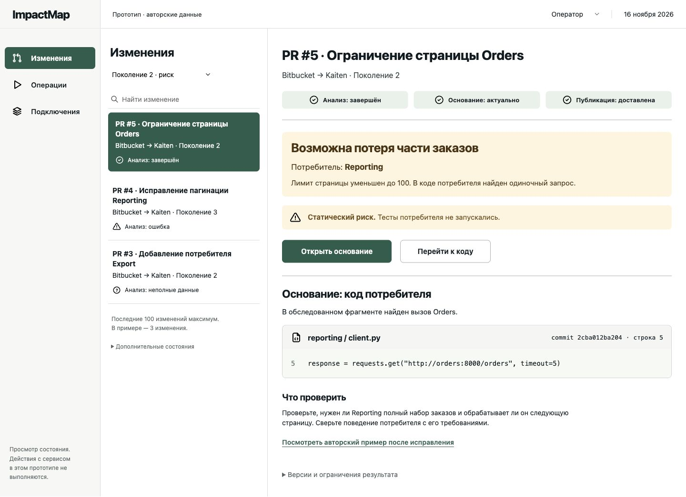

# A6.2 — доступ UI и компактная типографика, 16.11.2026

Implementation source: **f3c38e6**.

Реализованы opt-in серверные local accounts/sessions, роли reviewer/operator, login/logout CSRF, private auth SQLite, интерактивный CLI и read-only проекции по trusted request scope. Объём первой версии был утверждён ранее; новую визуальную развилку не вводили. По замечанию владельца уменьшены body до14px, desktop h1 с36 до28px, risk heading34→26px, sidebar/status/отступы; на390px h123px.

Это реализация A6.2 в исходниках с локальной проверкой. Рабочие result/operator screens на реальных service данных — A6.3/A6.4; HTTPS deployment, Linux artifact/recovery и LIVE UI acceptance — A6.5. Установленный worker на ВМ, реальные tracker accounts и ключи не менялись. [Операторская инструкция](../impactmap-ui-access.md).

## Проверки

- Исходный baseline diagnostics11 — PASS.
- Широкая серия service:456 тестов,4 skipped,551.937s, остальные PASS. Skips — Linux SIGKILL recovery path на Mac. Серия включает CoreAnalyzer/очередь/Jira/Kaiten и раннюю версию UI tests. После финальных локальных исправлений повторён профильный набор; **47/47 PASS** на финальных исходниках; raw [final-focused.log](final-focused.log). Не выдавать456 как полную проверку финального Linux-релиза.
- Новые тесты: auth, CLI, HTTP/CSRF/roles, cross-scope/legacy/STALE и mutation-free projection. RED→GREEN для отсутствовавших модулей, effective deadline, loopback peer/bind и снятия read_context. Реальный scrypt используется в тестах, без ослабления production cost.
- Box78:75 прошли,3 environmental errors. Один test bootstrap требует отсутствующий Python3.12; два guard tests на Mac не могут создать ticks, так как guard явно требует Linux (`guarded_recovery_requires_linux`). Эти файлы не изменены. Raw box.log сохранён, новая Linux приёмка NOT_RUN.
- Python wheel собран в отдельном build venv (setuptools80.9.0/wheel0.45.1); исходный venv не менялся. Финальный ZIP проверяется на все5 ui_web assets и4 UI modules. Это не Linux box release8153 и не новый установленный release pin.
- Один свежий security review:2 P2 по frontend expiry/logout. Оба исправлены, ниже реальные browser receipts. Других существенных серверных замечаний reviewer не сообщил; это не security certification.

## Реальный браузерный прогон на авторском стенде

Изолированный loopback18088 с настоящими AuthStore/ASGI/cookie/CSRF, временными случайными учётными записями и синтетической installation `author-fixture/qa`. Ни реальных code mirrors/трекеров, ни инъекции Authorization в browser stand. Воспроизведение использовало короткие test idle profiles10s и60s; production defaults20min/8h неизменны. Тестовые аккаунты/DB удалены при остановке stand, пароль в отчёт/Git не записывался.

1. Вход временного reviewer — сервер выдаёт настоящую cookie и me. [Экран сессии](session-reader.jpg).
2. Reviewer→operations — `operator_required`403. [Кадр](reviewer-operator-denied.jpg).
3. До исправления после10s страница всё ещё показывала пользователя, а `/me` уже давал401 — RED. [До исправления](expiry-before-fix.jpg).
4. После исправления тот же10s профиль автоматически возвращает на `/ui/login`, account отсутствует и qa-reader не виден — GREEN. [После исправления](expiry-after-fix.jpg).
5. Две вкладки: второй login вращает cookie, первая вкладка сохраняет старый CSRF. Фактическая последовательность `POST logout403 → GET me200 → POST logout200 → GET me401` подтверждена [журналом статусов](browser-rotation-statuses.json). Header/body/password/cookies в этот журнал не включены.
6. Обычный logout также проверен до401, console error/warn в финальном auth прогоне пусты. HTTPS/Secure-cookie flags отдельно проверены ASGI TestClient с HTTPS origin, настоящий TLS proxy NOT_RUN.

## Типографика по замечанию владельца

Проверены1440×1024 и390×844, devicePixelRatio1, без общего горизонтального overflow; размеры считаны из computed styles, источник не растягивался. Блокировка длинного source path и внутренний scroll кода сохранены. Скриншоты сохранены и открыты для проверки. Снимок при изменении viewport/фиксированном skip-link в scrolled full-page capture был отклонён и переснят в свежей вкладке с scrollY0.

[Компактный mobile](prototype-compact-mobile.jpg). Это авторский прототип, не новое подключение к рабочему service API. Старые A6.1 screenshots остаются историей прежней крупной типографики, не доказательством текущего CSS. QA supplement указан в prototype/design-qa.md.

## Сохранённые границы

UI отключён по умолчанию; реальных пользователей оператору нужно создать локально. Это один общий corpus scope, не multi-tenant/per-project isolation. Legacy/early-failed generations без trusted stamp могут не отображаться: нет автоматического доверительного backfill. Full service suite финального Linux artifact, distro installation/proxy/TLS/backup/restore новой auth DB и реальный Jira/Kaiten deep link не проверены в A6.2. Независимые исследования06/01/11 и Яндекс09 остаются открыты.

Следующая пачка A6.3 — подключить выбранный компактный result UI к новым сессиям/проекциям и обрабатывать401/403/STALE/PARTIAL без авторских fixtures в рабочем режиме.

## Source и воспроизведение

Runtime source commit `f3c38e6`; финальный focused run47/47, включая положительный authenticated result HTTP integration, без skips. Основной runtime не менялся после wheel-check. [Wheel receipt](wheel-check.json) фиксирует SHA и9 файлов, byte-identical текущим src; это source wheel, неLinux acceptance artifact. [Raw service](service.log), [raw focused](final-focused.log), [raw box](box.log), [raw wheel](wheel.log).

[Авторский browser stand](reproduce/auth_stand.py) запускается из корня checkout с PYTHONPATH=src:.:tests:tools и существующим API venv. Он создаёт случайные временные аккаунты, short idle60s, сохраняет credentials0600 только в ignored work/a6-2/private и удаляет их при Ctrl-C. Для expiry теста использовалось10s, для двух вкладок60s; production20min не меняется. Не использовать с реальными данными или публичным bind. Основной прототип по-прежнему на18087, auth stand после проверки остановлен.
