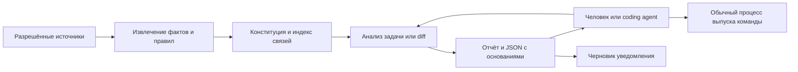
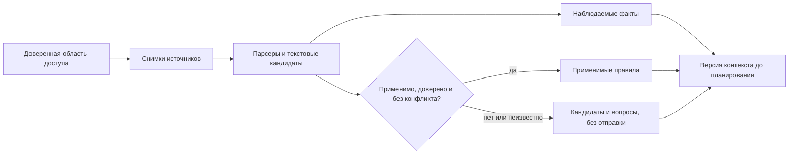

# Архитектура: проверяемый контекст межсервисных изменений

Редакция 4 · 20 октября 2026 · решение для разработки и обсуждения с преподавателем.
Основа — [продуктовый фокус](product-focus-2026-10-20.md), согласованный в PR №25. Эта редакция заменяет архитектуру PR №26, сохраняя HTTP/API, RabbitMQ, работу с людьми и агентами и отсутствие блокировки релиза.

**Решение:** разрабатываем небольшой консультативный модуль, который до планирования задачи собирает конституцию и зависимости из разрешённых источников, а после diff объясняет влияние на конкретных потребителей. Его ключевая ставка — повторное использование проверяемого контекста в серии изменений. Он не управляет выпуском и не становится новой системой корпоративных согласований.

Документ задаёт ожидаемое поведение v4. Обновление 21.10: в PR №28 реализован ограниченный HTTP-этап `agent_graph`, CLI и model controller; [фактический объем и проверки](agent-graph-implementation-2026-10-21.md). Полная архитектура, качество реальной модели, спрос и преимущество не установлены. Ниже сохраняется проектная модель v4, отдельно от этой ограниченной реализации.

## 1. Постановка и проверяемая гипотеза

**Проблема:** источники, потребители и ожидания разнесены между репозиториями. Разработчику или coding agent приходится собирать их заново, проверять актуальность и объяснять последствия другим командам.

**Артефакт:** модуль подготовки версионного контекста и анализа изменений межсервисных интерфейсов. Пользователь — человек или внешний coding agent; внутренний LLM необязателен. Покупатель — отдельная проверяемая гипотеза.

**Исследовательский вопрос:** сокращает ли повторное использование такого контекста полный труд анализа серии изменений без увеличения значимых пропусков относительно сильного агента с теми же исходниками, инструментами и правом сохранять собственные заметки?

Единица исследования — задача анализа одного изменения. Зависимость и правило — промежуточные объекты. Две независимые проверки: корректность извлечения/применения контекста и польза его использования. Эта постановка — предложение преподавателю, не автоматическая замена утверждённой H1/E3 или темы ВКР.

## 2. Один сквозной случай вместо набора обещаний

В разрешённом наборе четыре репозитория: Orders, Export, Reporting и Health. Система знает границы доступа и соответствия сервисов адресам, но **не получает готовую карту потребителей**. Она должна найти её по исходникам.

| Шаг | Что происходит | Результат модуля |
|---|---|---|
| До задачи | Из кода, документов, тестов, конфигураций и политик собраны исходные версии | Конституция: утверждённое требование Reporting получать все заказы за день; отдельное наблюдение, что его код делает один запрос |
| Намерение | В Orders планируют ограничить размер страницы GET /orders по умолчанию до 100, сохранив существующий cursor-протокол | До кода агент получает известных потребителей, основания и пробелы |
| После diff | У Export найден цикл по next_cursor, у Reporting — только первый запрос; Health обращается к другому сервису | Адресный риск для Reporting; найденный обход Export отмечен как свидетельство, не гарантия полной совместимости |
| Действие | Предложена проверка Reporting на наборе больше 100 заказов | Короткий отчёт, структурированный ответ и черновик сообщения; решение о выпуске остаётся у команды |
| Следующая версия | Reporting добавляет обход; в другой репозиторий добавлен новый вызов | Старые выводы перепроверяются и по изменённым основаниям, и по версии всего обследованного корпуса |

Требование — **полный набор заказов**, а не предписанный способ «обойти страницы». Пагинация — один из вариантов выполнения. Кейс синтетический: он объясняет механизм и не служит независимым доказательством эффективности.

[Полный разбор: исходные файлы → конституция → связи → diff → JSON-ответ → черновик → пересчёт](product-architecture-case-2026-10-20.md).

## 3. Устройство: два пользовательских действия, один результат

### Схема 1. Компоненты и независимый процесс выпуска

Компоненты — модули одного локального процесса, не отдельные микросервисы. Первая поставка читает снимки, хранит индекс и результаты локально и экспортирует Markdown/JSON. Нет фонового worker, обязательного сервера или собственного брокера.

| Операция | Вход | Выход |
|---|---|---|
| prepare_context | Задача/операция поставщика, разрешённый корпус, версии и доверенная конфигурация | Версия контекста: конституция, известные связи, охват, конфликты и неизвестное |
| analyze_change | Base/head поставщика, context_id и точные версии потребителей | Неизменяемый результат: затронутые места, механизм риска, доказательства, рекомендуемые проверки и черновики |

Операции — проектный интерфейс. Для человека и агента используется одна модель результата, а не разные несогласованные ответы. Ссылки на доказательства доступны отдельно; найденные команды из README не исполняются.

Внешний агент вызывает prepare_context **до предметного планирования**, затем analyze_change после diff. Это рекомендуемая последовательность использования, не технический запрет писать код без нашего сервиса. Недоступный модуль или исчерпанный срок дают ошибку/частичный ответ; стандартный процесс выпуска от него не зависит.

## 4. Конституция до работы: полезный контекст без бюрократии

Конституция — версия применимых правил и требований с источниками. Рядом с ней хранятся наблюдения, кандидаты и пробелы; они не маскируются под утверждённые нормы.

**До сбора** владелец задаёт доверенную конфигурацию: доступные источники/окружения, идентичность, маршрут LLM и лимиты. Агент не добывает себе полномочия из кода или документа. Затем он собирает контекст задачи и уточняет его по мере нахождения потребителей.

### Схема 2. Разделение извлечения и применения

| Откуда | Что получаем | Как используем |
|---|---|---|
| Утверждённые политики/контракты и внешняя конфигурация их доверия | Действующие нормы и область применения | Импортируем без ручного подтверждения каждого запуска |
| OpenAPI, код, тесты, конфигурации и топология | Объявленную структуру и наблюдаемое использование | Факты, отдельно от желаемого бизнес-результата |
| AGENTS.md, README, ADR, документация | Кандидаты проектных договорённостей и требований | Сохраняем источник; текст сам не повышает доверие и не даёт доступа |
| Каталог сервисов, CODEOWNERS, действующие решения | Кандидатов во владельцы и ранее подтверждённые требования | Не превращаем владение кодом в право согласовать чужую команду |

Правило применимо только при совпадении области/окружения/версии, действующем основании доверия и отсутствии неразрешённого конфликта с другой применимой нормой. Более новый файл, более узкий путь и уверенность LLM сами по себе ничего не отменяют. Разные требования разных потребителей не считаются конфликтом.

Изменение норм в предлагаемом PR отделено от исходного утверждённого набора. Автор изменения не может «подтвердить» свою правку норм через ответ модели. Спорный новый текст — кандидат и адресный вопрос. В MVP нет своего workflow утверждения норм: используем существующие основания, новые решения владелец вносит в доверенный источник.

**Полнота не является условием получения ответа:** неизвестные требования и владельцы возвращаются явно, а найденные технические связи всё равно могут быть полезны. Не требуется предварительно описать всю компанию.

## 5. Первая версия и следующий профиль

| Параметр | Зафиксированное решение |
|---|---|
| Начальный профиль | HTTP/API; Python, явно поддержанные calls requests и простые конфигурации base URL |
| Область проверки | Одна установка/среда, локальные версионные снимки разрешённого корпуса |
| Сопоставление | HTTP-метод, нормализованный путь, сервис и подтверждённое соответствие адреса окружению |
| Выход | Ссылка на вызов и изменение, механизм возможного последствия, конкретная проверка, пробелы и черновик |
| Поведение по времени | Запрос имеет deadline; кеш помечается версией/актуальностью; никаких бесконечных ожиданий |
| Не входит | SDK произвольного типа, динамические вызовы без адаптера, auto-merge/deploy, отправка сообщений, портал, governance-процесс |
| Следующий профиль | RabbitMQ: definitions + код, direct/topic, один vhost/exchange; route → очередь → обработчик |
| Условие расширения | Наблюдаемая польза первой серии либо внешний случай, который обосновывает явное изменение приоритета |

HTTP-профиль — закрытый список поддержанных конструкций, а не «агент поймёт любой код». Неоднозначный base URL или скрытый wrapper даёт неподтверждённую связь/unsupported. Неполный анализ не выдаёт итог «потребителей нет».

Для RabbitMQ различаем публикацию, ожидаемый маршрут, доставку в очередь и обработку. Наличие binding не доказывает бизнес-эффект. Alternate exchanges, policies, DLX, exchange-to-exchange и плагины вне первого профиля дают границу неизвестного, а не ложную уверенность. Отключённый consumer не исчезает из индекса.

[Точные контракты, правила конфликтов, алгоритмы HTTP/RabbitMQ, инвалидация и ограничения](product-architecture-details-2026-10-20.md).

## 6. Что обязательно должно выдерживать решение

1. **Новая зависимость.** Добавление репозитория или вызова в ранее нерелевантный файл меняет manifest/index version. Пересчитываются и отрицательные выводы, для которых раньше не было ребра зависимости.
2. **Изменившееся основание.** Правка вызова, контракта, применимого правила или доверия помечает зависимый результат устаревшим. Результат не переписывается задним числом — создаётся новая версия.
3. **Конфликт подтверждённых норм.** Система показывает оба основания и неопределённость применения, а не выбирает удобное правило.
4. **Подмена нормы.** Предлагаемый diff не становится собственным эталоном; текст репозитория не расширяет инструменты и доступ.
5. **Неподдержанная конструкция.** Сохраняются известные положительные связи и явно неизвестная область. Отсутствие находок не равно доказанному отсутствию потребителя.
6. **Частичный ответ.** Полнота, актуальность и состояние выполнения независимы: частичный результат тоже бывает свежим/устаревшим.
7. **Коммуникация.** Подготовить черновик, отправить, доставить, ознакомиться и подтвердить результат — разные действия. Отправка не входит в MVP.
8. **Стоимость подготовки.** Считаются импорт, ручные уточнения, исправление ошибочного извлечения, повторное индексирование и проверка результата — не только секунды ответа.

## 7. Как проверяем, что отдельный модуль нужен

Сильный агент может самостоятельно прочитать несколько репозиториев и найти проблему пагинации. Поэтому наличие красивого графа, MCP, LLM или правильного ответа на один пример не считается преимуществом.

**Предварительная серия — 12 задач анализа**, включая совместимые изменения, действительно затронутых потребителей, незатронутый репозиторий, неоднозначный вызов, пропуск источника и изменение состава корпуса. Часть задач — последовательные изменения одних интеграций: оценивается повторное использование контекста. Это диагностический объем для решения о продолжении, не достаточная статистическая выборка для универсального вывода. До первого прогона фиксируются 12 случаев и их порядок, серьёзность последствий, бюджеты, правила сохранения контекста и учёта затрат; варианты не получают ответы друг друга.

Эталон до прогона составляет другой инженер по исходникам и воспроизводимым проверкам; он не выводится из языка конституции нашего модуля. Пропущенный доступный потребитель — ошибка; недоступный источник — явно обозначенная граница. Независимый инженер проверяет также случай «ничего существенного не изменилось».

| Сравнение | Условия |
|---|---|
| Сильный агент без модуля | Те же исходники, поисковые средства, тесты, модель/лимиты; разрешены собственные заметки и повторное использование контекста |
| Тот же класс агента с модулем | Те же исходные возможности плюс подготовленный контекст; вся его подготовка и исправление включаются в затраты |
| Действующие проверки клиента | Сохраняются в обеих ветвях; не отключаем их ради демонстрации отличия |

Фиксируем пары «изменение — затронутый потребитель» и объяснение влияния; считаем пропуски, ложные находки, частичные ответы и отказы отдельно. На поддержанном случае отказ или отсутствие нужного вывода не считается успехом только потому, что выставлен UNKNOWN. Известная схема-несовместимость не выдаётся за найденное бизнес-последствие. Активные часы людей складываются по ролям; машинное время/токены и календарное ожидание показываются отдельно.

**Выбранный ориентир продолжения:** на диагностической серии не увеличиваются серьёзные пропуски относительно baseline, а суммарный активный труд, включая подключение и актуализацию, снижается хотя бы на 20%. Дополнительных серьёзных пропусков относительно baseline допускается ноль; показываются абсолютные FN и число релевантных случаев. Равенство двух неприемлемо плохих результатов не считается успехом; каждый серьёзный пропуск разбирается до расширения проверки. Это проектный ориентир, не измеренный эффект или обещание рынку. Показываем абсолютные числа и неопределённость; не скрываем неудачные попытки и не делаем вывод о статистической значимости.

Если агент с поиском и собственными заметками даёт тот же результат с сопоставимым полным трудом, отдельный продукт пока не обоснован: сохраняем полезные части как библиотеку/интеграцию и не строим платформу. Спрос проверяется отдельно: внешний владелец приносит следующий реальный случай и готов выделить ресурсы на повторную проверку.

## 8. Что уже есть и с чем идти к преподавателю

| Существующий задел | Решение |
|---|---|
| Исследовательское ядро и knowledge-1 | Источник идей и ограниченных механизмов; не доказательство нового эффекта |
| change_completion | Возможное переиспользование версий/истории; executor не переносим в первую версию |
| lab PostgreSQL/RabbitMQ | Возможный задел collectors и сценариев; не готовый discovery всех потребителей |

Новые контракты, парсеры и сбор конституции проектируются. Код, доступы, облако, CI и frozen-корпус этим документом не меняются. Выбор компонентов не требует предварительного объединения трёх контуров.

Для преподавателя уже предложены артефакт, единица исследования, конкретный первый стек, два действия пользователя и критерий продолжения. Обсуждаем три вопроса: соответствие утверждённой теме ВКР; независимый источник случаев/эталона и схема сравнения; достаточный эффект и объём подтверждающего исследования. Изменение H1 и основного эксперимента требует отдельного научного решения.

**Архитектурная ставка:** небольшой модуль версионного контекста, который приносит пользу до кода и после diff, заслуживает следующей проверки. Оснований строить универсального исполнителя или корпоративную платформу сейчас нет.

## Материалы

- [Сквозной кейс](product-architecture-case-2026-10-20.md) · [Техническое приложение](product-architecture-details-2026-10-20.md) · [Прожарка и принятые решения](product-architecture-roast-2026-10-20.md).
- [Проверенные изображения и Mermaid редакции 4](diagrams/product-architecture-v4/README.md).
- [Редакция 3 из PR №26](https://github.com/rengalaxies/agent/blob/9a942cac8cac4190845ec7cfb5c91ce45fe775b7/docs/product-architecture-2026-10-20.md) · [архив прежней модели исполнителя](archive/product-architecture-before-advisory-revision-2026-10-20.md).
- [Интервью](launch-2026-10/02-STAKEHOLDER-INTERVIEWS-RU-EN.md) · [предложение](migration-completion-offer.md). Первичные технические источники перечислены в приложении; они не подтверждают спрос.
