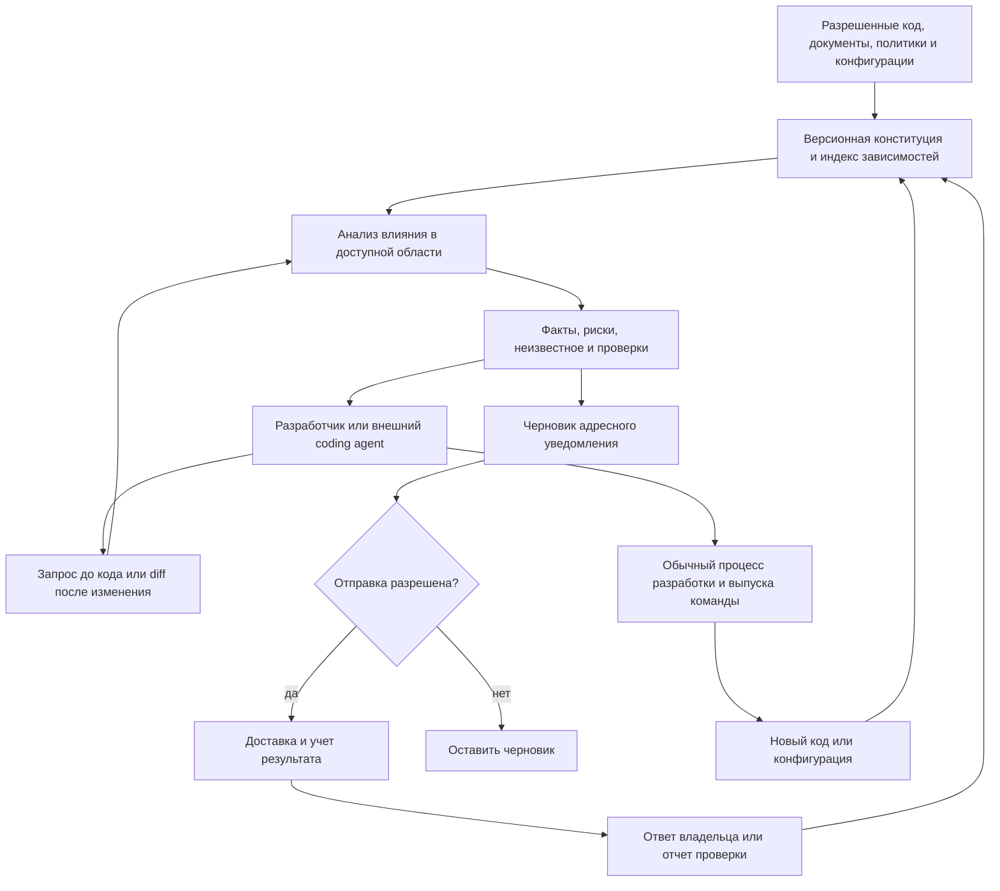
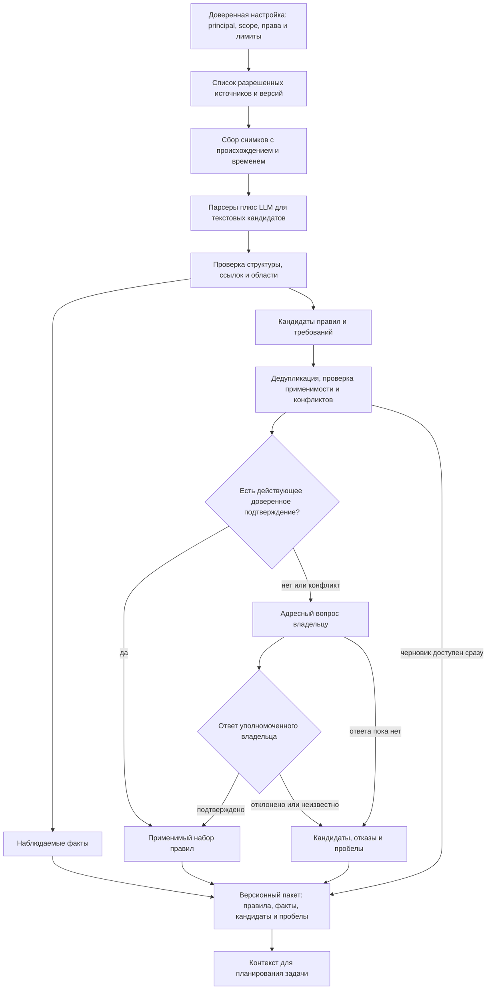
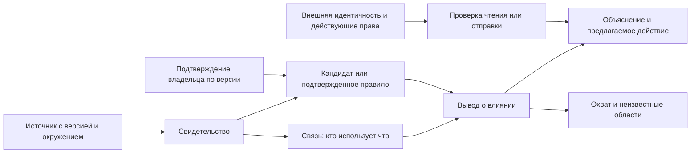
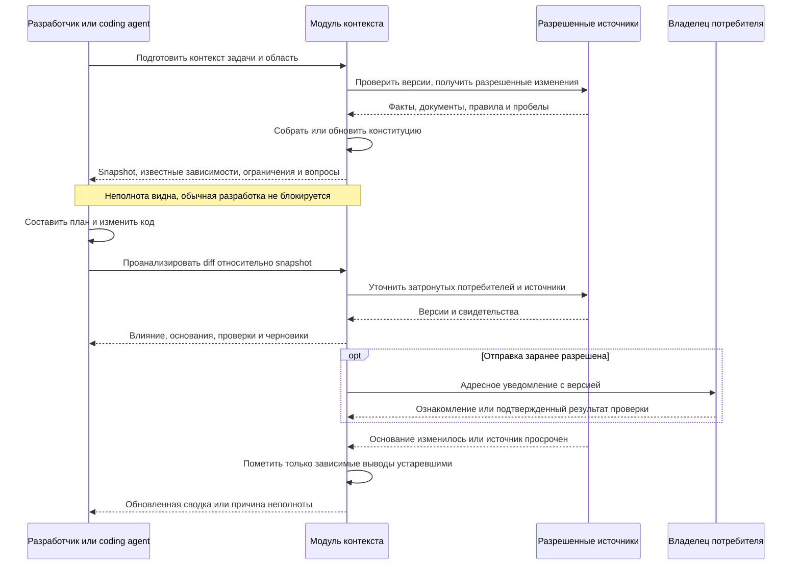
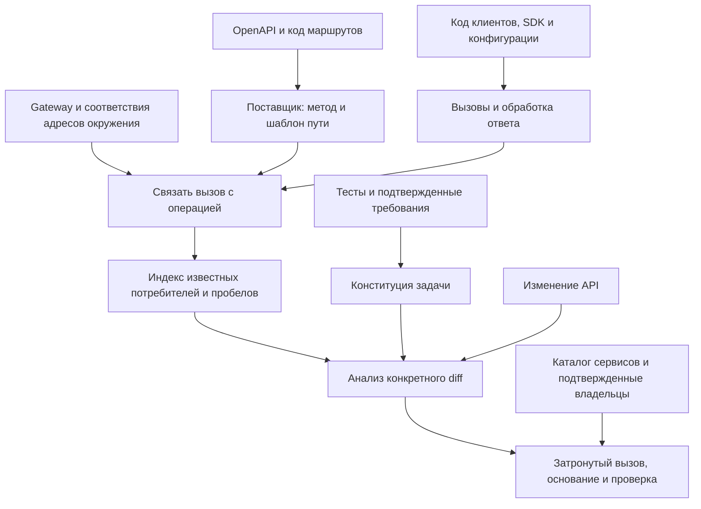
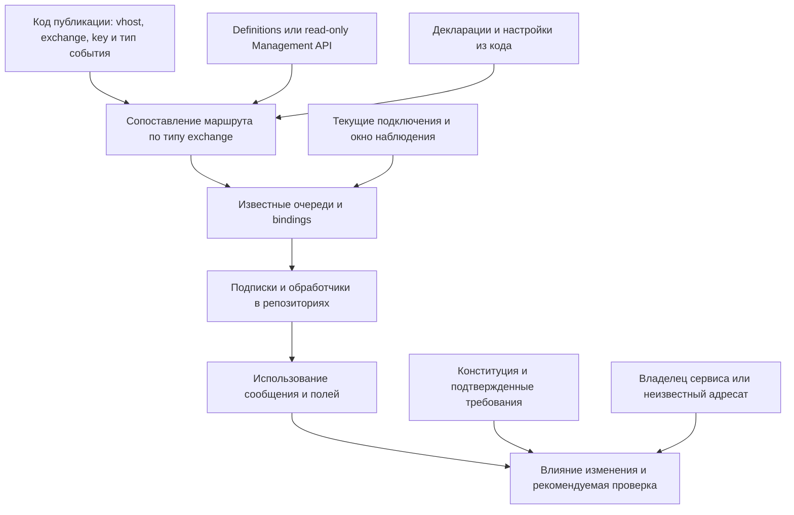
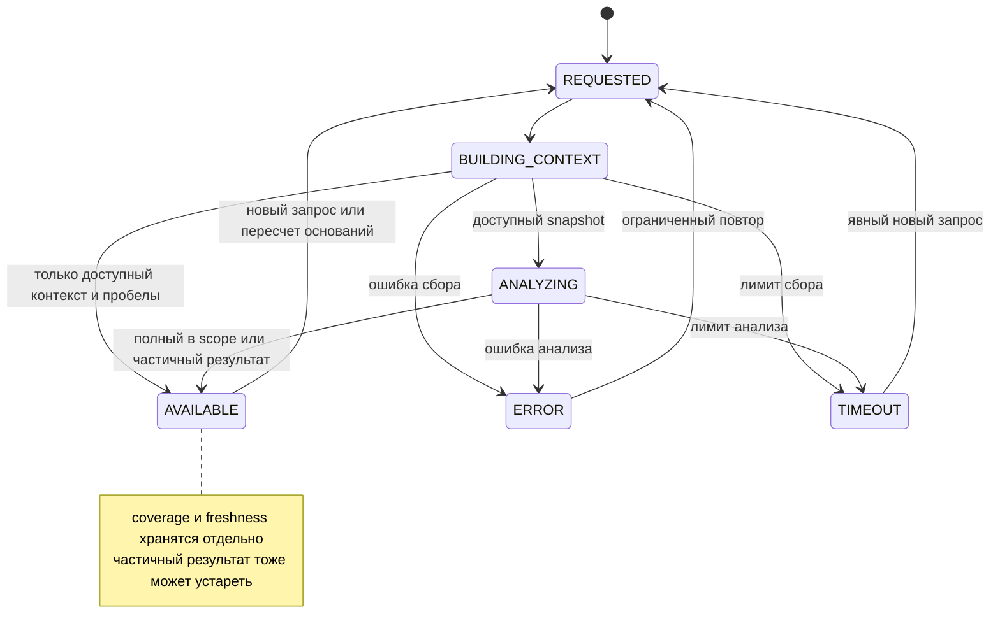
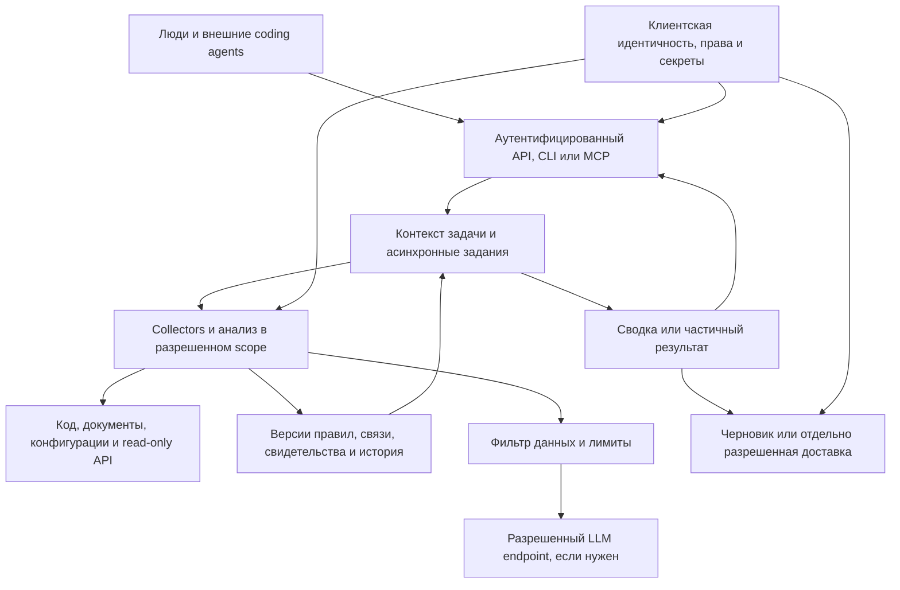
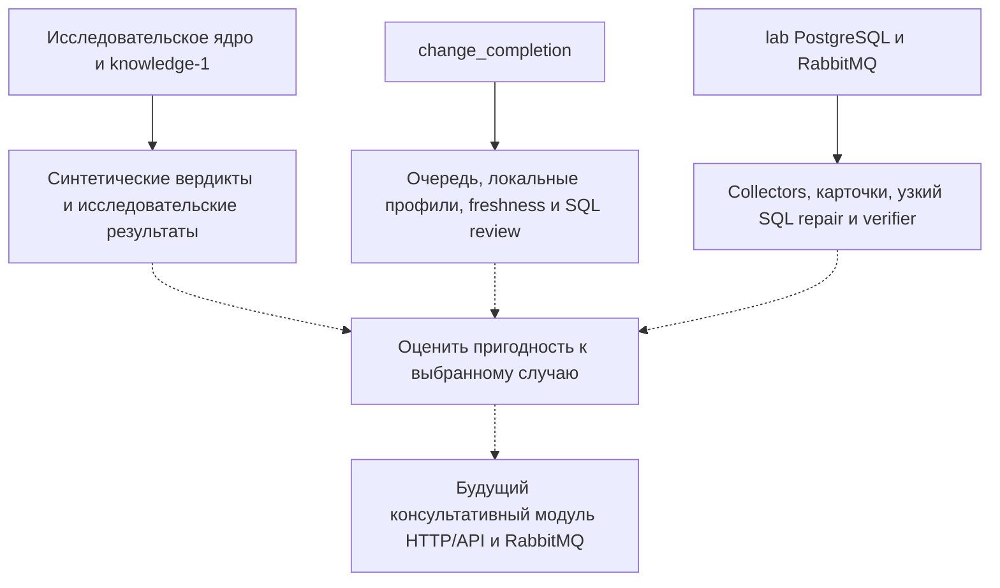

# Архитектура продукта: контекст изменений API и событий для людей и агентов

Редакция 3, 20 октября 2026. Проектируемая архитектура для обсуждения с преподавателем.
Продуктовая основа: [согласованные решения пачки 2](product-focus-2026-10-20.md), вошедшие в main через [PR №25](https://github.com/rengalaxies/agent/pull/25), плюс уточнение о предрабочем сборе конституции.

**Постановка:** модуль помогает разработчикам и ИИ-агентам до написания кода и после подготовки diff понимать межкомандные последствия изменений, находить известных потребителей, готовить уведомления и отслеживать актуальность подтверждений. Он не блокирует релиз. Первая проверка — HTTP(S)/API; RabbitMQ — следующий приоритет, который можно проверить первым при наличии реального случая.

Это проектирование, а не независимый аудит безопасности и не заявление о готовой реализации.
Кодовый задел описан по срезу `81e9d755c320a30893308b7fb38d460b5900d46f`; PR №25 меняет документы, не runtime. Новые collectors, конституция и единый интерфейс ниже — план. Исторические тесты, cloud-статусы и технические ограничения не объявляются заново проверенными.

[Прежняя редакция со всеми семью схемами](archive/product-architecture-before-advisory-revision-2026-10-20.md) сохранена без изменения содержания. [Результаты проверки всего документа и соответствие старых схем новым](product-architecture-review-2026-10-20.md). [Все девять схем отдельными SVG и Mermaid](diagrams/product-architecture-2026-10-20/README.md).

## 1. Проблема, роли и граница результата

Команда меняет интеграцию, но сведения о потребителях, ожиданиях и владельцах разнесены между репозиториями, конфигурациями, тестами, документацией и работающей средой. Агент, видящий только текущий репозиторий, может не получить этот контекст. Это гипотеза проблемы, частоту и стоимость которой проверяем на интервью.

| Роль | Что получает |
|---|---|
| Разработчик или coding agent поставщика | Контекст перед планированием и адресный анализ конкретного diff |
| Разработчик или агент потребителя | Объяснение влияния, источник и предлагаемую проверку |
| Уполномоченный владелец | Адресный вопрос о неоднозначном требовании или подтверждение по версии |
| Руководитель платформы/интеграций | Проверяемые сведения о полезности и полных затратах; бюджет и покупка пока гипотезы |

Результат первой итерации — сведения и следующее действие, а не готовый код в чужих репозиториях. Отправка сообщения требует отдельного разрешения; черновик можно готовить без отправки. Доставленное уведомление не означает, что потребитель проверен или проблема исправлена.

### Схема 1. Общий консультативный процесс



Стрелка к обычному процессу выпуска не проходит через наш анализ или разрешение на уведомление. Результаты INCOMPLETE, STALE, TIMEOUT, ERROR относятся к знанию модуля; они не становятся release gate.

## 2. Что означает «конституция»

**Конституция — компактный версионный набор применимых правил работы и требований с доказательствами происхождения.** Агент автоматически собирает ее до предметного планирования, затем уточняет при обнаружении зависимых потребителей. Это не автоматически истинный текст и не самостоятельно выданные полномочия.

Есть два уровня:
1. **Доверенная конфигурация подключения**, которую предоставляет владелец установки: идентичность, разрешенные источники/окружения, инструменты, маршруты inference, бюджет и правила отправки. Она нужна до любого обхода.
2. **Собираемый контекст задачи:** правила компании/проекта, требования интерфейсов и потребителей, наблюдаемые ограничения и явно неподтвержденные кандидаты. Он не может расширять первый уровень.

До первой задачи — начальная сборка; перед последующими — проверка версии и точечное обновление. Полный пересбор всех репозиториев перед каждым действием не требуется. Если часть правил неизвестна, возвращаем частичный контекст и вопросы; отсутствие ответа не останавливает обычную разработку.

### 2.1. Из чего собираем

| Источник | Что извлекаем | Статус и ограничение |
|---|---|---|
| Утвержденные политики компании и настройки проекта | Область доступа, разрешенный inference/egress, допустимые действия и порядок подтверждения | Нормативный источник только при установленном издателе, версии и применимости; реальные права проверяет система доступа |
| AGENTS.md, CONTRIBUTING, ADR, README, инженерные инструкции | Договоренности по работе, тестам, поддержке версий и уведомлениям | Проектные кандидаты; файл не становится системной инструкцией и не выдает доступ |
| OpenAPI, схемы событий, контракты | Объявленные параметры, форматы и обязательства | Утвержденный контракт и просто найденный файл различаются; соответствие работающей системе проверяется отдельно |
| Код поставщиков и потребителей | Фактические вызовы, обработчики, значения по умолчанию, использование полей и страниц | Наблюдение о реализации; код сам по себе не определяет желаемый бизнес-смысл |
| Тесты и CI-конфигурации | Проверяемые ожидания, существующие проверки, их область | Факт наличия теста не доказывает полноту и корректность требований |
| Конфигурации, gateway, IaC, RabbitMQ definitions | Адреса, маршруты, очереди, bindings и окружения | Заявленная топология; отдельно сверяем с живой |
| Каталог сервисов и CODEOWNERS | Идентичность компонентов и кандидатов во владельцы | Владение кодом не равно праву утверждать межкомандное требование |
| Разрешенные метаданные среды | Наблюдаемые маршруты/подключения и версии | Ограниченное окно наблюдения, не полный реестр потребителей; содержимое сообщений не требуется |
| Ранее подтвержденные записи и решения | Принятые требования, исключения, подтверждения по версии | Повторное использование только при сохранении области, оснований, срока и полномочий подтвердившего |

### 2.2. Как происходит сбор

### Схема 2. Сбор конституции до работы



**Алгоритм:**
1. Проверить субъект запроса и разрешенный scope. Не искать «всю компанию» с доступами collector, если вызывающий имеет более узкие права.
2. Построить manifest источников: repository/ref/commit/path либо endpoint/object/version, окружение, начало/конец сбора, результат доступа, метод и версия extractor. Зафиксировать пропуски и пагинацию коллекций.
3. Извлечь структурированные факты детерминированными парсерами. LLM использовать для текстовых кандидатов, сопоставлений и объяснения, не для выдачи прав или окончательного выбора нормы.
4. Нормализовать объект, действие, область, условие, содержание правила, источник и способ проверки. Сохранять цитируемый фрагмент или безопасный указатель, а не только пересказ модели.
5. Разделить наблюдение, объявленное требование и утвержденную норму. Найденный тест «ожидает список целиком» подтверждает ожидание теста, а не универсальную обязанность API.
6. Найти дубли, противоположные правила и различия окружений/версий. Не объединять одинаковые имена сервисов из разных установок.
7. Применять порядок приоритета только из заранее утвержденной политики владельца. Новизна файла или уверенность модели не разрешают конфликт. Разные требования двух потребителей могут быть одновременно действующими.
8. Существующие действующие подтверждения переиспользовать. Новые бизнес-требования, исключения и спорные кандидаты направлять владельцу соответствующей области. Сам автор извлечения не утверждает правило от имени чужой команды.
9. Выпустить snapshot даже при неполноте: применимые правила отдельно, кандидаты/конфликты/неизвестное отдельно. Не нужен ручной клик на каждое автоматически найденное техническое наблюдение.
10. Зафиксировать snapshot_id/digest, версии правил и источников, extractor/model revision при использовании, и ссылки на подтверждения. Пакет задачи получает этот идентификатор до предметной работы.
11. После discovery добавить только релевантные правила найденных потребителей в новую версию. Не утверждать автоматически изменение правил, подготовленное агентом ради удобного результата своей задачи.

Если организация еще не предоставила утвержденных правил, snapshot честно содержит черновик и наблюдения. Нельзя объявить автоматически собранную «конституцию» корпоративной политикой.

### 2.3. Запись правила и конфликт

Минимальная проектная запись:
```yaml
rule_id: api.orders.full-list
revision: 1
kind: consumer_requirement
scope:
  service: reporting
  environment: test
subject: GET /orders
statement: Потребитель должен обработать все страницы
status: CANDIDATE
sources:
  - repository: reporting
    commit: EXAMPLE_COMMIT
    path: tests/test_orders.py
    locator: test_import_reads_all_items
    evidence_kind: observed_test_expectation
extraction_method: parser_and_text_review
confirmation: null
supersedes: null
validity:
  basis_version: EXAMPLE_BASIS
  valid_until: null
unknowns:
  - Требование владельцем еще не подтверждено
```
Пример синтетический, не реальная запись. Для подтверждения добавляются проверенный principal, его область полномочий, время, основание и область действия решения. Отсутствующий valid_until не означает бессрочную свежесть: действует политика источника/обновления.

Конфликт «OpenAPI обещает полный список, код уже ограничивает 100 элементами» показывается двумя основаниями. Модуль рекомендует уточнить контракт и проверить потребителей; он не выбирает, что «правильнее», по одному типу файла. Чужое подтверждение или исключение нельзя перенести в другое окружение без основания.

## 3. Три слоя: использование, правила и полномочия

### Схема 3. Модель контекста и границы вывода



Граф зависимостей описывает использование; конституция — применимые правила и основания; авторизация — реально предоставленные права. Ни одно ребро графа или найденное имя владельца не создает полномочий. Графовая СУБД не обязательна: для пилота достаточно таблиц и индекса связей.

## 4. Работа человека и coding agent

Внешний coding agent — пользователь инструмента, а не обязательно внутренняя LLM модуля. Они могут использовать разные модели; модуль должен быть полезен и при обычной разработке человеком.

### Схема 4. До кода, после diff и после нового основания



Логические операции первой интеграции:
- prepare_context(task, scope): snapshot конституции, охват, известные зависимости и вопросы до планирования;
- analyze_change(base, head, context_id): анализ diff с сохранением связи с контекстом;
- get_evidence(result_id): разрешенные основания и причины статуса;
- draft_notification(result_id): черновик. Фактическая отправка — отдельная операция с отдельным правом.

Названия — проектные, не существующие endpoints. Доступ через API/CLI или MCP выбирается по среде клиента. Ответ содержит service/operation, environment, source versions, findings с типом доказательства, предполагаемым влиянием и проверкой, owner status, coverage, unknowns, conflicts, freshness и context_id. Один текст «все хорошо» недопустим.

Предлагаемые задачи и проверки — данные для планирования, не исполняемые команды из недоверенного README. Объем контекста ограничен; сначала краткая сводка, детали по запросу.

## 5. HTTP(S)/API: обнаружение и анализ

### Схема 5. От операции поставщика до использования потребителем



1. Идентичность операции: установка/окружение, сервис, HTTP-метод и нормализованный шаблон пути. Совпадение строк URL само по себе не доказывает зависимость.
2. Из OpenAPI и кода получаем кандидатов операций, параметров и схем. Из клиентского кода — HTTP-вызовы, SDK и преобразование ответа.
3. Связываем base URL, конфигурацию, gateway rewrites, версию SDK и операцию. Динамические адреса, reflection и закрытые библиотеки остаются неоднозначными до подтверждения.
4. Разделяем «потребитель вызывает endpoint» и «использует изменяемое поведение». Последнее требует конкретной обработки ответа, теста или утвержденного требования.
5. Сопоставляем base/head, версию контракта и клиентские ожидания. Объяснение содержит ссылки на оба конца связи и неопределенность.
6. По желанию клиента добавляем обезличенные метаданные трассировки: сервис, операция, окружение, период. Отсутствие наблюдения не исключает редкий вызов; тела запросов/ответов для первой проверки не нужны.

**Пример:** добавлена пагинация с default=100. В потребителе B найден один запрос и использование ответа как полного списка; в A найден обход страниц. Для B вывод — «возможна неполная загрузка, проверить на наборе больше 100», а не доказанный production-инцидент. Для A найден обход, но это не доказательство полной совместимости. Риск описан в [Google AIP-180](https://google.aip.dev/180).

Начальный объем: один поставщик, два потребителя, один выбранный по реальному случаю язык/HTTP-клиент. Универсальная поддержка фреймворков не обещается. HTTPS сохраняет TLS; чтение кода не требует перехвата зашифрованного трафика.

## 6. RabbitMQ: обнаружение и анализ

### Схема 6. От публикации к обработчику и команде



Идентичность включает broker/cluster, vhost, exchange, очередь и окружение. Ключ сообщения без типа exchange не определяет маршрут.

| Слой свидетельства | Что позволяет утверждать | Чего не доказывает |
|---|---|---|
| Код публикации и настройки | Заявленный exchange/key/headers и версия события | Фактическую публикацию в production |
| Снимок bindings | Ожидаемый маршрут при данном типе exchange и конфигурации | Попадание конкретного сообщения в очередь |
| Подписка в коде | Обработчик известной очереди | Что он сейчас подключен и работает |
| Текущее подключение | Наблюдаемый consumer в конкретный момент | Полный список редких/отключенных потребителей |
| Consumer ack или application test | Подтверждение соответствующего технического этапа | Сам по себе — корректность бизнес-результата |
| Подтвержденное требование владельца | Ожидаемый результат потребителя | Фактическое выполнение без проверки |

Direct сопоставляет binding key; topic учитывает шаблоны; fanout не использует routing key для отбора очередей. Headers, default exchange, exchange-to-exchange, DLX/retry, federation и нестандартные плагины требуют своих правил. **В первой квалификации выбираем direct или topic**; остальные конструкции явно помечаем неподдержанными, а не изображаем отсутствие зависимости. При будущем обходе exchange-to-exchange нужны защита от циклов и границы обхода. [Правила exchanges](https://www.rabbitmq.com/docs/exchanges).

Из конфигураций и кода ищем декларации, имена из переменных, подписки и поля, используемые обработчиком. Живую топологию получаем через разрешенное чтение API или экспорт; не потребляем сообщения, не публикуем пробы и не меняем bindings. Management-интерфейс способен и изменять систему, поэтому «доступ на чтение» проверяется реальными разрешениями и allowlist операций, не названием учетной записи. [Management API](https://www.rabbitmq.com/docs/management).

**Пример topic:** ключ order.created меняется на order.v2.created. Binding order.* больше не подходит, order.# подходит обоим. Это вывод о маршруте по снимку; бизнес-последствие требует связи с обработчиком. Publisher confirm не равен consumer ack, ни один не заменяет проверку бизнес-эффекта. [Confirms и acknowledgements](https://www.rabbitmq.com/docs/confirms).

Отключенный consumer не удаляется из индекса. Исчезновение auto-delete очереди или истечение наблюдения переводит связь в неизвестную/историческую, пока нет отдельного основания прекращения использования. Расхождения кода и живой топологии показываем с временем и средой. Начальный объем: один vhost, один exchange, несколько подключенных репозиториев.

## 7. Актуальность, подтверждения и уведомления

### Схема 7. Состояние результата анализа, а не релиза



AVAILABLE означает наличие ответа, в том числе частичного, а не безопасность релиза. Процесс обработки, охват и актуальность хранятся независимо:

| Измерение | Значения и смысл |
|---|---|
| Обработка | REQUESTED / BUILDING_CONTEXT / ANALYZING / AVAILABLE / ERROR / TIMEOUT |
| Охват | Обработана заявленная область / PARTIAL / UNKNOWN; полнота за ее пределами не заявляется |
| Актуальность | CURRENT / STALE / UNKNOWN относительно basis и политики источников |
| Достоверность отдельной записи | Наблюдение / кандидат / подтвержденное требование / конфликт |
| Коммуникация | Черновик / отправлено / доставлено / UNKNOWN; ознакомление и проверка отдельно |

Частичный результат может быть CURRENT, затем STALE. Изменение основания или срока сразу меняет freshness и применимость зависимых подтверждений, даже если пересчет еще не запрошен или не завершен. Сохраненные сведения доступны с этой пометкой; новый ответ не скрывает прошлые ошибки.

- Каждое основание хранит source revision/digest, окружение, время начала/конца наблюдения, valid_until или политику перепроверки. Глобальный атомарный snapshot Git/API/RabbitMQ не предполагается.
- Изменение кодового объекта, контракта, binding, требования, владельца/полномочий или истечение срока инвалидирует зависимые выводы. Новый timestamp при том же содержании не обязательно отзывает подтверждение; политика свежести проверяется отдельно.
- Пропущенные/неупорядоченные события и остановившийся collector ведут к пометке охвата/актуальности и ограниченной повторной сверке. TTL не превращает неизвестную связь в отсутствующую.
- Confirmations привязаны к объекту, result revision, constitution/basis version, области и проверенному principal. Если основание изменилось, старое подтверждение хранится как история.
- Доставлено, ознакомились, проверка выполнена, совместимость подтверждена — отдельные события. Внешний агент может предоставить test receipt, но не согласие команды вне своего мандата.
- Черновик уведомления содержит что изменилось, почему адресат затронут, ссылки на основания, что проверить, неизвестное и желаемую дату реакции, если она согласована.
- Отправка требует разрешенного канала/адресата/payload. Смена transport route не создает новый логический повод для дубликата. Неизвестный исход доставки требует сверки либо явного решения, а не слепого повтора.
- Переанализ не рассылает повторную тревогу без существенного изменения. Неизвестный владелец дает вопрос координатору; молчание не означает совместимость.

## 8. Размещение, доступ и устойчивость

### Схема 8. Минимальная поставка и границы доверия



Один модульный сервис, worker и существующее подходящее хранилище достаточны для пилота. Отдельные микросервисы, графовая СУБД, новый брокер, Kubernetes и HA не являются обязательной первой поставкой. Выбор между текущими контурами делается по пригодности к реальному случаю, не автоматически слиянием lab и change_completion.

Collectors могут иметь сервисный доступ шире вызывающего; retrieval, сбор контекста, использование LLM, кеш и ответ должны соблюдать права вызывающего. Cache keys включают scope/среду/доступ или результаты повторно фильтруются до выдачи. Чужие названия, владельцы и само существование скрытого актива не раскрываются без права; без безопасного признака покрытия модуль пишет «охват не установлен».

Контроль собственных чтений, бюджетов и отправки не является контролем релиза. Недостаток прав запрещает соответствующее действие модуля, а не работу внешней команды. Первая поставка не получает merge/deploy/admin-полномочий и не выполняет кандидатский код из репозитория при извлечении контекста.

Код/документы — недоверенные данные. Они не могут сменить endpoint, инструменты, права, нормативные правила или критерии проверки через prompt injection. В LLM отправляется только разрешенный минимальный контекст; on-premise приложения не означает локальный inference. Правила отправки и секреты хранятся вне автоматически генерируемой конституции.

Ограничения: размер/тип входов, глубина обхода, параллелизм, очередь, время, токены, общий бюджет установки/субъекта и storage. Новая revision/session не обходит общий лимит. Тайм-аут возвращает явный статус; существует быстрый доступ к помеченному кешу. Конкретные бюджеты выбираются до пилотного измерения; отсутствие блокировки не отменяет стоимости вызовов агента.

## 9. Существующий задел и честный статус

### Схема 9. Текущие контуры и возможное переиспользование



Пунктир — возможное переиспользование, не существующие импорты или готовая интеграция.

| Контур | Что уже описано в коде/отчетах | Что из этого не следует |
|---|---|---|
| src/datamesh_release_protocol, services, ui, stand | V0/V1-ind/V2, типизированные обязательства, knowledge-1, синтетический корпус | Проверка новой продуктовой пользы или готовый discovery интеграций |
| src/change_completion | Scoped queue, ограниченные SQL/contract-профили, review, freshness, gateway | Единая модель прав с lab или готовый HTTP-анализ |
| lab/product, lab/runtime, lab/app, lab/evaluator | UI/API, фиксированные collectors, SQL-кандидат и лабораторный verifier PostgreSQL/RabbitMQ | Автоматический поиск всех потребителей, независимость ролей по числу LLM-вызовов или бизнес-успех |
| infra/product, infra/cloudru | Подготовка образов, размещения и восстановления | Проверенная установка у клиента |
| deploy/cloudru-managed | Отдельное исследовательское managed demo | Публичная версия нового модуля |

Apply 403 в старом lab — техническое ограничение его исполнения, а не новое продуктовое обещание блокировать релиз. Его снятие не входит в эту архитектуру. LIVE/REPLAY/FIXTURE и сохраненные PASS различаются; свежий timestamp не превращает сохраненное свидетельство в новое испытание.

Предыдущая редакция сообщает о 74 тестах и локальных пробах. Здесь эти прогоны не повторялись и не используются как доказательство новых свойств. Инфраструктура клиента и коммерческая готовность не проверены. Научные H1/E3, frozen-корпус и рукопись не изменяются автоматически.

## 10. Риски и проверки по режимам

| Риск | Необходимая проверка | Когда |
|---|---|---|
| Правила извлечены из реализации и ошибочно объявлены нормой | Тест/код расходятся с утвержденным требованием; обе записи видны, норма не переписана | Уже в первом прототипе |
| Prompt injection в README или ответе модели | Текст не расширяет права, endpoint, список источников и статус подтверждения | При подключении извлечения |
| Чужой scope/окружение и утечка через кеш | Запрос/угадывание ID не возвращают чужое свидетельство или название | До многопользовательской проверки |
| Скрытый/отключенный потребитель | Пропуск источника и отсутствие подключения дают пробел, не «зависимостей нет» | В обоих discovery-сценариях |
| Неподдержанная маршрутизация RabbitMQ | Явный unsupported/unknown; не ложное отсутствие очередей | До утверждения поддержки профиля |
| Неактуальные требования и пропуски событий | Измененный basis/срок помечает зависимые выводы, релиз не блокируется | В ограниченном пилоте |
| Подмена автора подтверждения | Server-side principal и scope, агент не подписывает чужую команду | До совместной работы команд |
| Ложные уведомления и повтор неизвестной доставки | Измерение шума; дедупликация, явный UNKNOWN и сверка | До автоматической отправки |
| Стоимость подготовки выше пользы | Замер полного труда, в том числе чужим инженером | До расширения разработки |
| Очередь/LLM задерживают работу | Явный timeout, ограниченный бюджет, асинхронный результат | В каждой серии измерений |

Контроль произвольного выполнения кода, атомарный cutover, rollback бизнес-данных и распределенные capabilities старого executor сохранены в архиве. Они нужны только при отдельном решении перейти к соответствующим эффектам; не являются входным билетом в проблемное интервью или read-only проверку.

## 11. Порядок проверки и минимальная версия

1. Выбрать реальный случай и один стек HTTP-клиентов; если есть сильный RabbitMQ-кейс, явно поменять порядок. Определить вопрос пользы и внешнего владельца случая.
2. По локальным/обезличенным снимкам подготовить ограниченную конституцию и индекс: один поставщик, два потребителя. Отметить ручные подтверждения и время подготовки. Контекст готовится до решения задачи.
3. Дать человеку/агенту два обращения: подготовить контекст и проанализировать diff. Выдать основания и черновик уведомления; без отправки и production-эффектов.
4. Сравнить с обычным поиском/тестами и сильным агентом с теми же доступами и информационными возможностями. Учитывать все попытки, ошибки и расходы настройки; не ослаблять альтернативу искусственно.
5. При полезном результате добавить чтение живых источников, актуальность, идентичность участников и отдельно разрешенную доставку. Проверить границы совместной работы до такого пилота.
6. Затем расширять поддержанные типы API/RabbitMQ, сохраняя измерение цены контекста и шума. Отдельный executor, merge/deploy и platform HA не входят в первую версию.

Критерии: полезные находки до выпуска, пропущенные и ложные выводы, время подготовки/реакции/устранения, действия получателей, ручные уточнения, активный труд клиента и поставщика, время/токены агента. Совпадение выводов с существующими тестами может быть приемлемым только при иной измеренной пользе; само по себе не доказывает преимущество.

## 12. Разговор с преподавателем: постановка и вопросы

**Предмет разработки:** консультативный модуль версионного контекста межсервисных изменений для людей и coding agents. Конституция связывает применимые правила с источниками, а индекс — поставщиков и потребителей. Конкретное изменение порождает объяснимый анализ и адресное действие; релиз остается у команды.

**Кандидат исследовательского вопроса:** уменьшает ли автоматически собранный и проверяемый межсервисный контекст пропуски зависимостей и полный труд при анализе изменений относительно сильного агента с сопоставимыми средствами? Это новая гипотеза для обсуждения, не утвержденная замена H1.

Обсудить:
- Как согласовать эту продуктовую постановку с утвержденной темой и требованиями ВКР?
- Что выбрать основной единицей исследования: изменение, зависимость, требование или задача агента?
- Откуда независимо получить реальные/реалистичные случаи и эталон зависимостей/последствий?
- Как отделить корректность извлечения конституции от полезности ее применения? Что считать ошибочной нормой?
- Как сравнить агента с модулем и без, учитывая одинаковые доступы, перенос опыта и все затраты подготовки?
- Какой минимальный эффект практично значим и какая выборка позволяет его оценить?

До эксперимента фиксируются метрики, критерии, происхождение случаев, разметка и ограничения. Генерировать сценарии, oracle и правила проверки из одного языка конституции и на этом основании заявлять внешнее преимущество нельзя.

## 13. Основания и история

- [Продуктовый фокус](product-focus-2026-10-20.md), [офер](migration-completion-offer.md), [интервью RU/EN](launch-2026-10/02-STAKEHOLDER-INTERVIEWS-RU-EN.md): согласованная текущая постановка.
- [Архитектура редакции 2](archive/product-architecture-before-advisory-revision-2026-10-20.md): прежние семь схем, полные риски executor, исторические результаты и ссылки на исходный code commit.
- [Отчет о проверке документа](product-architecture-review-2026-10-20.md): замечания, решения, границы проверки и соответствие схем.
- [Исходный кодовый срез](https://github.com/rengalaxies/agent/tree/81e9d755c320a30893308b7fb38d460b5900d46f): ограниченный инженерный задел.
- Внешние технические основания: [API compatibility](https://google.aip.dev/180), [RabbitMQ exchanges](https://www.rabbitmq.com/docs/exchanges), [Management API](https://www.rabbitmq.com/docs/management), [confirms/acknowledgements](https://www.rabbitmq.com/docs/confirms). Они объясняют механизмы, не подтверждают спрос или преимущество продукта.
