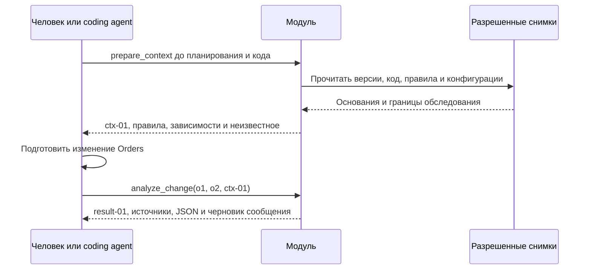

# Учебный кейс: изменение пагинации Orders

20 октября 2026. Синтетический пример для обсуждения с преподавателем.
[Основная архитектура](product-architecture-2026-10-20.md) · [Подробные контракты](product-architecture-details-2026-10-20.md).

Все репозитории, версии, лица, подтверждения и результаты ниже вымышлены. Сниппеты объясняют механизм; runtime и benchmark не создаются. Кейс не доказывает эффективность, спрос или отсутствие других потребителей.

## 1. Входные материалы и права

Первый MVP читает локальные снимки четырех репозиториев Python. Список репозиториев задан, **карта потребителей не задана**. Доступны конфигурации соответствия base URL сервисам. Сеть, реальная отправка сообщений и запуск кода репозиториев не используются.

| Репозиторий и версия | Материал и точный locator | Содержание |
|---|---|---|
| `orders@o1` | `app/api.py::list_orders` | FastAPI, `GET /orders` |
| `orders@o1/o2` | `docs/storage.md#read-orders` | Смысл параметра page_size helper, не меняется в o2 |
| `reporting@b1` | `app/import_orders.py::load_day` | Один запрос через requests |
| `reporting@b1` | `docs/business.md#daily-report` | Полный набор заказов за день |
| `reporting@b1` | `tests/test_import.py::test_all_items` | Наблюдаемое ожидание полноты |
| `reporting@b1` | `docs/sampling.md#daily-report` | Неподтвержденное предложение ограничиться 100 |
| `export@a1` | `app/export_orders.py::load_day` | requests, цикл по cursor |
| `health@h1` | `app/check.py::check_inventory` | Тот же GET /orders, но другого сервиса |
| Каждый снимок | `config/services.yaml::services` | Имена, base URL и `environment: test` |

В разрешенной конфигурации `orders` соответствует `https://orders.test`, `inventory` — `https://inventory.test`. Модульные константы BASE_URL в Reporting и Export совпадают с адресом orders, а в Health — inventory. Имена сервисов не выводятся из одного похожего URL: учитываются конфигурация, метод, маршрут и окружение.

Внешняя доверенная настройка `case-authority.yaml` предоставлена владельцем учебной установки, не извлечена из README. Она разрешает субъекту `reviewer` чтение четырех снимков, подготовку анализа и черновиков; отправка, изменение файлов и release-действия не разрешены. Одинаковые ограничения действуют для человека и coding agent.

Сопровождающий `case-approvals.json` связывает требование `reporting.daily-completeness` с digest фрагмента `reporting@b1:docs/business.md#daily-report`, областью `reporting/test`, principal `reporting-owner` и его подтвержденными полномочиями. Это вымышленное внешнее подтверждение, а не подпись модели. Доверенная настройка и manifest доступны до первого обхода.

## 2. Исходный код: формат ответа остается одинаковым

`orders@o1:app/api.py::list_orders`:

```python
@app.get("/orders")
def list_orders(day: str, cursor: str | None = None,
                page_size: int | None = None):
    items, next_cursor = store.read_orders(day, cursor, page_size)
    return {"items": items, "next_cursor": next_cursor}
```

Отдельное основание `docs/storage.md#read-orders` в manifest: контракт существующего helper: `page_size=None` возвращает все оставшиеся заказы выбранного дня; положительное значение ограничивает страницу. `next_cursor` указывает продолжение либо равен `null`. Порядок и смысл элементов не меняются. Helper здесь не реализуется.

`reporting@b1:app/import_orders.py::load_day`:

```python
BASE_URL = "https://orders.test"

def load_day(day):
    response = requests.get(BASE_URL + "/orders",
                            params={"day": day}, timeout=10)
    response.raise_for_status()
    return response.json()["items"]
```

`export@a1:app/export_orders.py::load_day`:

```python
BASE_URL = "https://orders.test"

def load_day(day):
    items, cursor = [], None
    while True:
        response = requests.get(BASE_URL + "/orders",
            params={"day": day, "cursor": cursor}, timeout=10)
        response.raise_for_status()
        page = response.json()
        items.extend(page["items"])
        cursor = page["next_cursor"]
        if cursor is None:
            return items
```

Export уже умеет продолжать обход, хотя при старом default обычно получает одну страницу.

`health@h1:app/check.py::check_inventory`:

```python
BASE_URL = "https://inventory.test"

def check_inventory():
    return requests.get(BASE_URL + "/orders", timeout=10)
```

Health — отрицательный пример для сопоставления: даже одинаковые requests.get и путь /orders не делают его потребителем Orders. Вывод ограничен обследованными файлами `h1` и выбранным способом извлечения.

## 3. Конституция собирается до планирования

Первый запрос человека или агента: `prepare_context("ограничить размер страницы Orders", scope="test")`. Из разрешенных источников автоматически собираются правила, наблюдения и индекс. Контекст `ctx-01` фиксирует версии `o1/b1/a1/h1`, внешние authority/approvals, manifest файлов `corpus-00` и версию extractor.

| Категория | Запись в контексте | Основание |
|---|---|---|
| Факт | Reporting делает один вызов `GET /orders` и берет `items` | `b1:app/import_orders.py::load_day` |
| Факт | Тест ожидает все элементы подготовленного набора | `b1:tests/test_import.py::test_all_items` |
| Кандидат | Неподтвержденная заметка предлагает «для отчета достаточно первых 100» | `b1:docs/sampling.md#daily-report` |
| Применимое правило | Reporting должен загрузить полный набор заказов за выбранный день | `business.md#daily-report` + внешнее подтверждение |

Норма требует полноты, **не предписывает пагинацию**. Тест — свидетельство ожидания реализации; сам по себе он не утверждает бизнес-требование. Кандидат из `sampling.md` не подменяет подтвержденную норму. Права на чтение/отправку остаются во внешней настройке, не в автоматически извлеченном тексте.

Если внешний manifest подтверждает также противоположное требование «использовать только первые 100» из `sampling.md` для того же отчета, дня и окружения, получается `CONFLICT`. Сохраняются обе версии и их подтверждения; ни новизна файла, ни уверенность LLM не выбирают норму. До разрешения конфликта вывод о соблюдении требования остается неопределенным; частичный контекст доступен, разработка команды продолжается.

В основном прохождении внешне подтверждено только требование полноты. AGENTS.md и README могут дать кандидатов инженерных правил; они не добавляют новые системные полномочия и не разрешают отправку сообщения.



## 4. Diff и найденное влияние

После получения контекста разработчик готовит `orders@o2`; изменение в `app/api.py::list_orders`:

```diff
-                page_size: int | None = None):
+                page_size: int | None = 100):
```

Response остается `{items, next_cursor}`; меняется количество элементов по умолчанию, не смысл поля. Вызов `analyze_change(base=o1, head=o2, context_id=ctx-01)` создает результат с отдельной версией. Для анализа нового provider head модуль выпускает ctx-02 и manifest `corpus-01`, сохраняя исходные утвержденные требования отдельно от предлагаемого изменения: context_requested_id=ctx-01, context_used_id=ctx-02. Если discovery расширит релевантные сведения, они также войдут в реально использованную версию.

В этом примере `corpus-XX` — версия полного manifest файлов и их digest, а не постоянное имя списка репозиториев. Поэтому любое изменение исходников дает новую версию, даже если состав четырех репозиториев прежний:

| Контекст | Manifest | Снимки в рабочем корпусе | Результат |
|---|---|---|---|
| ctx-01 | corpus-00 | o1 / b1 / a1 / h1 | Подготовка до планирования |
| ctx-02 | corpus-01 | o2 / b1 / a1 / h1 | result-01, сравнение o1→o2 |
| ctx-03 | corpus-02 | o2 / b2 / a1 / h1 | result-02, пересмотр после исправления Reporting |
| ctx-04 | corpus-03 | o2 / b2 / a1 / h2 | result-03, пересмотр после нового вызова Health |

Исходный `o1` остается отдельным закрепленным основанием diff, а утвержденная норма — отдельным baseline. Версия индекса также учитывает профиль извлечения; изменение профиля не маскируется неизменностью исходников.

Сопоставление: `test / orders / GET /orders` → `reporting@b1:app/import_orders.py::load_day`; константа BASE_URL сопоставляется с orders/test через явно заданную конфигурацию; Python-конфигурация не исполняется. Та же операция связана с циклом Export. Health вызывает `inventory / GET /orders` и не образует это ребро.

```json
{
  "result_id": "result-01", "context_requested_id": "ctx-01",
  "context_used_id": "ctx-02",
  "change": {"provider": "orders", "base": "o1", "head": "o2"},
  "schema_version": "0.1-draft", "environment": "test",
  "run": {"run_id": "run-02", "status": "COMPLETED"},
  "coverage": {"status": "COMPLETE_WITHIN_PROFILE",
    "corpus": "corpus-01", "repositories": 4,
    "boundary": "offline snapshots; one Python/requests profile",
    "missing_sources": [], "unresolved_calls": [],
    "limitations": ["dynamic calls unsupported", "outside corpus not enumerated"]},
  "freshness": {"status": "CURRENT", "basis": "basis-01",
    "comparison_basis": "PINNED_CORPUS", "assessed_at": "2026-10-20T12:00:00Z",
    "meaning": "current for pinned snapshots, not live production"},
  "source_refs": {
    "P": "orders@o1..o2:app/api.py::list_orders",
    "H": "orders@o1/o2:docs/storage.md#read-orders",
    "B": "reporting@b1:app/import_orders.py::load_day",
    "C": "reporting@b1:config/services.yaml::services.orders",
    "R": "reporting@b1:docs/business.md#daily-report",
    "T": "case-approvals.json::reporting.daily-completeness"
  },
  "finding": {"consumer": "reporting", "status": "POTENTIAL_IMPACT",
    "reason": "One request may return only 100 orders",
    "requirement": "Complete daily order set", "refs": ["P", "H", "B", "C", "R", "T"]},
  "action": {"kind": "RECOMMENDED_CHECK",
    "description": "Check a day with more than 100 orders; inspect cursor handling"}
}
```

Export имеет свидетельство обхода страниц; полной совместимости это не доказывает. Для Reporting найден риск неполноты, а не доказанный production-инцидент. Итог не содержит `RELEASE PASS`: команда самостоятельно решает, когда и как выпускать изменение.

## 5. Полный черновик уведомления

> **Черновик — не отправлено. Адресат: уполномоченный владелец Reporting.**
>
> В Orders предлагается default page_size=100 вместо неограниченной страницы (`o1→o2`, `app/api.py::list_orders`). Формат items/next_cursor сохраняется. В Reporting `b1`, `app/import_orders.py::load_day`, найден один запрос без обхода продолжения; при более чем 100 заказах за день отчет может получить неполный набор.
>
> Требование полноты: `docs/business.md#daily-report`, подтверждение `case-approvals.json::reporting.daily-completeness`. Анализ `result-01`, запрошенный контекст `ctx-01`, использованный `ctx-02`, окружение test; обследованы четыре локальных снимка. Динамические конструкции вне профиля и репозитории вне корпуса не покрыты; фактическая потеря данных не проверялась.
>
> Предлагаем проверить загрузку дня с более чем 100 заказами и обработку next_cursor. Сообщите результат проверки и версии кода, если это входит в вашу область. Срок реакции не согласован. Решение о выпуске остается у команд.

Черновик — часть экспорта analyze_change, не третья операция. Модуль сохраняет его вместе с результатом. Человек выбирает дальнейшее действие; в кейсе сообщение не отправляется. Даже разрешенная в другом режиме доставка не означает ознакомление, выполненную проверку или подтвержденную совместимость.

## 6. Два изменения оснований

**Исправление Reporting.** Команда создает `reporting@b2`, добавив в `load_day` цикл по next_cursor, как у Export. При следующем prepare_context/analyze_change модуль сверяет manifest (`corpus-01→corpus-02`) и помечает зависимый `result-01` устаревшим относительно обновленного рабочего корпуса и сохраняет его содержимое. Новый `ctx-03` и новый неизменяемый `result-02` ссылаются на `o2/b2/a1/h1`: прежнее основание «один запрос» устранено, рекомендуемая проверка полноты остается. Прохождение теста не выдумывается.

**Новая зависимость без прежнего ребра.** В `health@h2:app/tasks.py::daily_probe`, ранее обследованном файле без обращений к Orders, появляется новый вызов `GET /orders`; конфигурация `services.orders` также добавлена. Это потенциальный новый потребитель внутри известных четырех репозиториев, а не заранее заданной consumer-map.

При следующем обращении изменение corpus/index coverage (`corpus-02→corpus-03`) инвалидирует отрицательный вывод «в h1 поддержанным extractor вызов Orders не найден» и сводку состава известных потребителей, хотя старого ребра Health→Orders не было. Модуль пересматривает измененные файлы и связанное сопоставление конфигурации, выпускает новый ctx-04, новую версию индекса и result-03. Нового ребра до пересмотра не было. Опора только на прежние положительные ребра пропустила бы добавление. Новый недоступный репозиторий вне corpus по-прежнему остается неизвестным.

## 7. Следующий сценарий: RabbitMQ

Для topic exchange в одном vhost ключ `order.created` меняется на `order.v2.created`: binding `order.*` больше не подходит, `order.#` подходит обоим. Основания — версия публикации, снимок bindings, окружение и связь очереди с обработчиком; маршрут не доказывает доставку или бизнес-результат.

Если у exchange указан alternate exchange, а его топология недоступна или не поддержана профилем, итоговый маршрут имеет статус `UNKNOWN`. Нельзя утверждать, что сообщение потеряется или других потребителей нет. Подробный движок RabbitMQ не входит в HTTP-MVP; этот фрагмент показывает перенос принципа ограниченного, объяснимого анализа.
