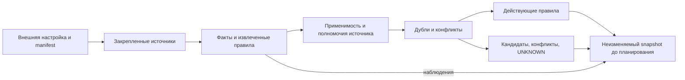
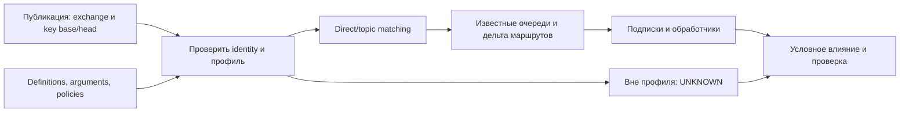
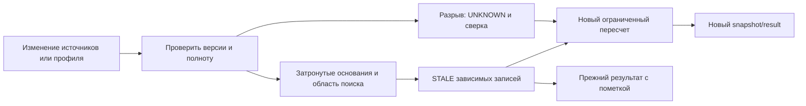

# Технические контракты и ограничения проектируемого модуля

20 октября 2026. Приложение к [основной архитектуре](product-architecture-2026-10-20.md).
Все интерфейсы, записи и алгоритмы ниже проектные; их наличие в документе не означает реализацию.
[Сквозной пример](product-architecture-case-2026-10-20.md) показывает применение этих решений.

## 1. Зафиксированный объем

Первая проверка — HTTP: Python `requests`, один поставщик, два потребителя и отвлекающий репозиторий в разрешенном корпусе одной установки.
Подключается корпус исходников, а не готовая карта потребителей; связи предстоит извлечь и проверить.
Входы — локальные закрепленные снимки кода, контрактов, конфигураций и существующих утвержденных правил.
Выход — CLI с двумя логическими операциями `prepare_context` и `analyze_change`, JSON и читаемый Markdown.
Модуль не исполняет анализируемый код, не изменяет чужие репозитории и не выполняет предложенные проверки.
Сервис, worker, MCP, живые connectors, runtime traces и отправка уведомлений не входят в MVP.
RabbitMQ — следующий независимый профиль: экспорт definitions и исходники, именованные direct/topic exchanges.
Ограничение действий самого модуля не является запретом планирования, merge или выпуска внешней команды.

## 2. Доверенная настройка и сбор конституции

До обхода оператор предоставляет конфигурацию вне анализируемого diff: `installation_id`, идентичность запуска, разрешенные локальные корни и окружения, лимиты и допустимый inference.
`corpus_manifest` перечисляет все разрешенные файлы repository/path/revision/digest, service identity и окружение; он не объявляет зависимости.
С ним закреплены inventory/index version, отображение типов файлов на extractor/profile version и trust manifest version; новый файл также меняет manifest.
`trust_manifest` отдельно закрепляет издателей нормативных источников, утвержденные версии/digests, области их полномочий и разрешенные исключения.
Доступ к файлу, авторство коммита и CODEOWNERS сами по себе не являются правом утверждать межкомандное требование.
Установка не получает новых прав из README, найденного имени владельца, модели или текста самой конституции.
Для локального MVP действует один явно настроенный субъект; это не доказательство готовой многопользовательской авторизации.

1. Проверить конфигурацию, область и доступность закрепленных источников; не расширять корпус по ссылке из найденного документа.
2. Записать manifest чтения: источник, revision/digest, locator, окружение, extractor/profile version, время и результат чтения.
3. Структурированные данные извлечь парсерами. Текстовое извлечение сохраняет фрагмент источника и способ получения; LLM дает кандидатов и объяснения.
4. Разделить нормативные правила, объявленные контракты, наблюдения кода/тестов и предполагаемые требования. Существующая утвержденная норма не требует нового ручного клика при каждом запуске.
5. Проверить срок действия, актуальное основание доверия, применимость и конфликты. Непонятная интерпретация даже утвержденного текста остается кандидатом интерпретации; одобрение источника не делает пересказ модели безошибочным.
6. Найти зависимости в разрешенном корпусе и добавить релевантные требования найденных потребителей. Повторить только в установленной глубине и бюджете.
7. Выпустить snapshot до предметного планирования, включая пробелы. Незамкнутый обход дает PARTIAL с причиной; ответ владельца не является условием выдачи.

Собственного workflow утверждения норм в MVP нет. Спорный кандидат становится вопросом в отчете.
Если организация позднее утвердила правило своим процессом, оператор подключает новую утвержденную версию; следующий snapshot фиксирует это основание.
Завершенное discovery или анализ diff может расширить релевантный контекст новой версией; ранее выданный snapshot не переписывается.

### 2.1. Применимость, наследование и конфликт

`applicable(rule, task, asset, role, action, environment, interface_revision)` возвращает YES, NO или UNKNOWN с причиной.
Профиль поддерживает точные идентификаторы установки/сервиса/операции, явные списки окружений/версий, роль и действие, префикс пути внутри закрепленного repository.
Условия объединяются AND; списки внутри одного поля — OR. Неуказанный селектор наследуется из зарегистрированной области источника; всеобщность требует явного `*`.
Произвольное условие на естественном языке, неизвестная версия или отсутствующий необходимый атрибут дают UNKNOWN, а не универсальную применимость.
Правило родительской области действует в дочерней при совпадении селекторов; более узкое или новое правило автоматически не отменяет его.
Переопределение допустимо только по разрешенной в trust manifest связи полномочий, с явной ссылкой на заменяемую норму и область исключения.

Для MVP детерминированно выявляются дубли по нормализованному ключу и несовместимые значения одного структурированного ограничения в пересекающейся области.
Предполагаемое смысловое противоречие свободных текстов помечается отдельно: полнота автоматического поиска конфликтов не обещается.
Неразрешенный конфликт сохраняет обе записи и вопрос; модель не выбирает победителя по уверенности, имени файла или timestamp.
Разные требования двух потребителей могут действовать одновременно. Их совместная реализуемость — вопрос изменения интерфейса, а не повод удалить требование одной команды.
Инструкции по редактированию файлов потребителя не становятся автоматически инструкциями агенту, который редактирует поставщика.

Утвержденный baseline закреплен независимо от `base/head` анализируемого изменения.
Если diff меняет файл политики или утвержденный контракт, новая формулировка рассматривается как предлагаемое изменение; она не подменяет основание своей собственной проверки.
Контекст задачи содержит правила как данные и не повышает их до системных инструкций инструмента.

## 3. Минимальные записи и две операции

| Запись | Необходимый контракт |
|---|---|
| `SourceSnapshot` | installation/environment, source/object ID, immutable revision/digest, locator, время чтения, access/result, extractor version |
| `Rule` | rule/revision ID, kind, issuer/authority reference, selector, statement или predicate, evidence IDs, approval, validity, explicit overrides |
| `Evidence` | source snapshot, фрагмент/locator, extraction method, claim kind, stage: declared/static/observed/test receipt |
| `Dependency` | provider operation, consumer и callsite, environment, mapping evidence, match status, usage evidence, unresolved reasons |
| `ContextSnapshot` | immutable ID/digest, baseline/trust/corpus/index/profile versions, источники, применимые правила, связи, coverage и gaps |
| `AnalysisResult` | immutable ID, change ID/base/head, context_requested_id/context_used_id, findings, basis/dependency IDs, coverage, supersedes |
| `Run` и оценка свежести | run ID/status/error, result ID при наличии; отдельно freshness по basis и области, assessed_at, причины |
| `NotificationDraft` | finding/change/consumer identity, существенная revision, адресат-кандидат, основания, проверка, неизвестное; отправки нет |

`kind`, подтвержденность, конфликт и свежесть независимы: утвержденное требование может конфликтовать с другим и иметь устаревшее основание.
Для неподтвержденного бизнес-смысла допустим CANDIDATE; факт наличия теста остается наблюдением даже при уверенном извлечении.
ID операции включает установку, окружение, service identity, HTTP-метод и path template. Переименование пути не должно бесследно переписать старую операцию.

### 3.1. prepare_context

Проектный вход: `task`, разрешенный scope, ссылки на `corpus_manifest`, `trust_manifest` и extraction profile.
Идентичность запуска поступает из внешней настройки, а не произвольного поля с именем чужого пользователя.
Выход: `context_id`, применимые правила, известные зависимости, coverage, freshness с моментом оценки, candidates/conflicts/unknowns и вопросы.
Контекст включает найденные зависимости до планирования; отсутствие карты потребителей не мешает начать поиск по всему разрешенному корпусу.
Закончить с частичным контекстом допустимо. Неполученный ответ владельца или неподдержанный вызов не превращаются в запрет разработки.

### 3.2. analyze_change

Проектный вход: разрешенные `base`, `head` и `context_id`; MVP анализирует изменение одного поставщика относительно закрепленных снимков остальных репозиториев.
Проверить основания контекста, извлечь изменение интерфейса/поведения, сопоставить затронутые операции с индексом, получить релевантные правила и основания обоих концов.
Если discovery уточнил контекст, выпустить новую версию и вернуть `context_requested_id`, `context_used_id` и краткую дельту.
Выход: findings с условием риска, типом свидетельства, проверкой, версией/окружением, предполагаемым адресатом, coverage/freshness и черновиками.
Черновики входят в экспорт результата `analyze_change`; отдельной пользовательской операции подготовки/отправки в MVP нет.
Вывод не является выполненной проверкой; найденный цикл пагинации не дает общего заключения «потребитель совместим».

Обе операции ограничены временем, объемом файлов, глубиной, токенами и общим бюджетом запуска/установки.
Некорректный вход дает структурированную ошибку; тайм-аут может сохранить пригодный частичный результат с явной причиной.
Повторный запуск не изменяет прежний `AnalysisResult`: создает новый run/result и при необходимости связь `supersedes`.
Формат содержит версии схемы, profile и правил; проектные названия не объявляются существующими CLI-командами.

## 4. HTTP: замкнутая грамматика discovery

| Участок | Поддерживается первым профилем | Вне профиля |
|---|---|---|
| Поставщик | Закрепленный OpenAPI: method/path/schema; явные простые declarations маршрутов выбранного случая | Произвольные фреймворки и восстановление маршрутов исполнением приложения |
| Вызов | `requests.get(...)`, `requests.request(...)` с известным литеральным методом; явно разобранный import alias | Session/wrappers, reflection, monkey patching, generated SDK и неизвестный dispatch |
| Адрес | Literal URL либо `BASE_URL + "/orders"`, где module constant `BASE_URL` — строковый литерал; простые локальные constants | Значение из произвольного вычисления, secret store или динамического выбора tenant/host |
| Конфигурация | Явное alias → service/environment и известный rewrite в trusted manifest; ссылки на файл-основание | Совпадение hostname, имени переменной или строки `/orders` без identity mapping |
| Использование | Ограниченный локальный разбор обращения к полям/результату, известный цикл и связанные тесты | Доказательство отсутствия скрытого вызова/ветки, полного бизнес-смысла или runtime-выполнения |

1. Из контракта и поддержанных declarations собрать операции; расхождение описания и кода сохранить двумя основаниями.
2. Во всех разрешенных репозиториях найти callsites; разрешить поддержанные aliases/constants без import/exec анализируемого кода.
3. Сопоставить адрес через явную конфигурацию с установкой, средой и поставщиком; затем method/path с операцией.
4. Конкретный путь сопоставлять раньше шаблонного. Неоднозначность сохранять; нормализация не должна стирать значимые различия пути.
5. Записать `STATIC_RESOLVED`, `AMBIGUOUS` или `UNRESOLVED` и основания. STATIC_RESOLVED означает соответствие исходников и конфигурации, не наблюдаемый production-вызов.
6. Отдельно извлечь свидетельства использования изменяемого поведения. Связь с endpoint сама по себе не доказывает ущерб.
7. Сравнить base/head, контракт и известные ожидания; вывести условный риск и предлагаемую проверку.

Отвлекающий репозиторий может вызывать тот же `/orders` у другого сервиса/в другой среде: это не потребитель выбранной операции.
`/orders/export` нельзя автоматически приписать `/orders/{id}`; неизвестный rewrite не выбирается догадкой модели.
Случай «обрабатывает полный список» не равен норме «обязан использовать именно пагинацию»: способ исправления остается предметом разработки.
Отсутствие найденного вызова означает только отсутствие совпадения в поддержанной части исследованного корпуса.
Даже полностью обработанный корпус не доказывает отсутствие неподключенных, внешних или редких потребителей.

## 5. RabbitMQ: следующий профиль

Вход — закрепленные definitions и код публикации/подписки. Identity включает installation, environment, cluster, vhost, exchange и очередь.
Тип exchange, arguments, применимые policies, source revision и полнота экспорта обязательны для квалификации маршрута.
Первый профиль поддерживает именованный direct/topic exchange и прямые bindings к обычным очередям; отдельно разрешает статические значения key/queue из кода.

Direct требует точного равенства binding key. Topic сопоставляет сегменты, разделенные точкой: `*` — один сегмент, `#` — ноль или больше.
Для `order.created → order.v2.created` binding `order.*` теряет совпадение, `order.#` сохраняет; `order.#` также подходит к `order`.
Вычисляются `routes(base_key, topology)` и `routes(head_key, topology)`, затем потерянные/добавленные/сохранившиеся очереди.
Это прогноз маршрута по заданному снимку, а не доказательство публикации, доставки, обработки или бизнес-эффекта.

Default/headers/fanout, exchange-to-exchange, alternate exchanges, DLX/retry, federation, stream и plugins вне этого профиля.
Неизвестная/неподдержанная policy или неполный экспорт добавляет unresolved frontier; именованный direct/topic не означает автоматически поддержанную топологию.
Положительные известные маршруты сохраняются вместе с UNKNOWN; неполнота не стирает их и не превращается в «очередей нет».
Если primary bindings не совпали, alternate exchange может принять маршрут: без проверки этой границы нельзя утверждать отсутствие получателей.
Только полный квалифицированный снимок допускает `NO_MATCH_IN_SNAPSHOT`, который не означает production-потерю сообщения.
Очередь связывается с callsite подписки и обработчиком; несколько competing consumers одной очереди не получают каждый по копии каждого сообщения.
Отключенный consumer не исключается из индекса. Исчезнувшая auto-delete очередь сохраняется исторически с неизвестной текущей применимостью.
Publisher confirm, consumer ack, test receipt и подтверждение бизнес-результата описывают разные этапы.
Чтение definitions не потребляет сообщения, не публикует пробы и не меняет topology; live Management API в MVP отсутствует.

## 6. Свежесть, пересчет и отрицательные выводы

В локальном MVP изменение обнаруживается при явной перепроверке снимков/manifest в одном из двух обращений; фонового наблюдения нет.
У результата фиксируется `comparison_basis`: PINNED_CORPUS (закрепленный исторический корпус) либо CURRENT_CORPUS (разрешенный рабочий корпус на момент запроса).
Неизменность старого pinned corpus доказывает воспроизводимость относительно его версий; она не делает вывод CURRENT относительно более нового рабочего корпуса.
Если рабочий corpus не перепроверен, свежесть относительно него UNKNOWN; если выявлен новый digest/manifest — STALE с перечнем измененных оснований.
Будущий адаптер событий передает source/object ID, event ID, source cursor/epoch, revision/digest и время получения.
События дедуплицируются; устаревшее событие не откатывает watermark. Git SHA является identity, а не упорядоченным счетчиком времени.
Разрыв событий/неудачная сверка дает UNKNOWN для затронутой области; известное изменение дает STALE.
Неизменный digest при новом времени чтения сам по себе не отменяет содержательные выводы; политика свежести оценивается отдельно.

Положительные выводы зависят от конкретных источников и правил; отрицательные — также от состава корпуса, покрытия поиска и версии индекса/extractor.
Контрпример: результат не нашел других потребителей в A/B, затем появился C или новый callsite в ранее нерелевантном файле.
Ребра к еще не найденному C нет; поэтому изменение corpus/index/search scope инвалидирует соответствующее заявление об отсутствии совпадений.
Новый контекст или профиль не переносит подтверждение автоматически; старое основание и результат остаются в истории.
Изменение отмечается после получения достоверного события/сверки либо наступления срока, а не мгновенно в неизвестной модулю среде.
Запоздавший пересчет не заменяет более новую текущую версию: публикация latest требует совпадения ожидаемой generation источников.

| Измерение | Значение |
|---|---|
| Run | BUILDING_CONTEXT / ANALYZING / COMPLETED / FAILED / TIMED_OUT; новый запуск имеет новый ID |
| Coverage | COMPLETE_WITHIN_PROFILE / PARTIAL / UNKNOWN; обязательны исследованная область, пропуски и неподдержанные конструкции |
| Freshness | CURRENT / STALE / UNKNOWN, assessed_at и причины по context/basis и заявленному coverage |
| Finding | Утверждение, условие риска, evidence stage, применимые правила, неизвестное и следующая проверка |

PARTIAL может быть CURRENT относительно проверенных оснований, затем стать STALE; UNKNOWN не означает ни совместимость, ни отсутствие зависимости.
CURRENT означает отсутствие выявленного изменения в проверенных версиях на момент оценки, а не атомарный снимок всей компании.
Freshness — отдельная версионная оценка неизменяемого результата; провал нового run не уничтожает ранее полученные сведения.

## 7. Данные, черновики и границы эффекта

Каждый источник/свидетельство и производный вывод наследуют ограничения раскрытия. Фильтровать только ссылки после генерации недостаточно: сама сводка может пересказать скрытый код.
При расширении до совместной работы проверка прав обязательна до retrieval/inference и каждой выдачи; cache учитывает актуальные права или пересобирает разрешенный view.
Недоступное имя, существование актива или число скрытых потребителей не раскрываются через coverage; допустимо «охват не установлен».
Данные репозитория не меняют инструменты, egress, лимиты и критерии доверия. Анализ не исполняет предложенные README команды.

Черновик содержит изменение, почему известный адресат затронут, разрешенные основания, условие риска, неизвестное и предлагаемую проверку.
Адресат из CODEOWNERS — кандидат; собственный реестр мандатов и коммуникационный workflow в MVP не строятся.
Если позже появится доставка, отдельное разрешение охватывает канал, адресата и hash payload, включая вопросы владельцам/координаторам.
Логический ключ уведомления определяется change/consumer/finding и существенной revision; новая transport route или run ID не создают новый повод.
Исход отправки UNKNOWN требует сверки либо поддержанной транспортом идемпотентности; слепой повтор недопустим.
Доставлено, прочитано, тест выполнен и совместимость подтверждена не подменяют друг друга. Молчание не является подтверждением.
Модуль не возвращает обязательного разрешения выпуска, не получает merge/deploy прав и не превращает свой PARTIAL/STALE/ERROR в release gate.

## 8. Риски и проверка границ

| Риск/контрпример | Ожидаемое поведение и способ проверки |
|---|---|
| Diff переписывает норму ради прохождения анализа | Baseline остается закреплен; предлагаемая норма отделена; проверить изменение policy в том же diff |
| Тест полного импорта объявлен универсальной бизнес-нормой | Наблюдение и кандидат различаются; применимость/утвержденность не выводятся из наличия теста |
| Указание из consumer/AGENTS применяется к редактированию provider | Проверить role/action/path selector; чужая инструкция не расширяет область |
| Decoy вызывает тот же path у другого service/environment | Ребро не создается без identity mapping; неоднозначный mapping дает UNKNOWN |
| Wrapper или динамический URL скрывает HTTP-вызов | Unsupported reason виден; отсутствие совпадения не превращается в отсутствие потребителя |
| Topic matcher ошибается на `#`, alternate exchange скрывает очередь | Проверить ноль/один/несколько сегментов; сохранить unsupported frontier и известные положительные связи |
| Новый consumer отсутствует в старом reverse index | Изменение corpus/search/index версии инвалидирует отрицательное заявление по области |
| Старое событие/пересчет возвращает устаревший результат как latest | Cursor не откатывается; generation проверяется; старый результат доступен только со своей оценкой |
| Скрытые сведения утекли через summary/cache или черновик | Проверять происхождение производных данных и доступный view; до совместного пилота — отдельная проверка границ |
| Тайм-аут, молчание владельца или неизвестная доставка выглядят успехом | Явные причины PARTIAL/UNKNOWN; результат проверки и коммуникация различаются; выпуск остается у команды |

Эти проверки нужны для заявленных границ профиля; они не заменяют независимую разметку зависимостей и измерение пользы на реальном случае.
Технические основания: [OpenAPI: сопоставление путей](https://spec.openapis.org/oas/v3.1.1.html#paths-object), [RabbitMQ: типы и маршрутизация exchanges](https://www.rabbitmq.com/docs/exchanges).
