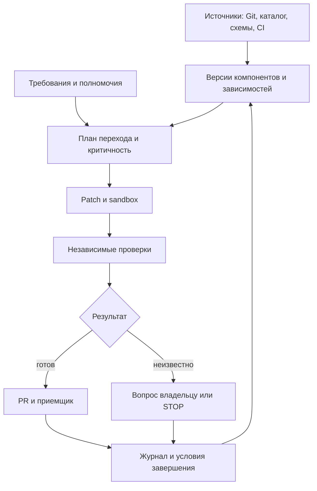

# Продукт: завершение межсистемных изменений

Дата решения: 2026-10-16. Статус: коммерческая гипотеза, платный спрос и преимущество не установлены.

Этот документ - текущая внутренняя версия. Для покупателя: [краткий оффер](migration-completion-offer.md). Предыдущие 1012 строк с 36 рисками, 54 предельными случаями и историей обсуждений сохранены в [архиве](archive/product-rebuild-before-commercial-entry-2026-10-16.md). Архив не является действующим обещанием клиенту. Исследовательские baseline, frozen-корпус и результаты ВКР не меняем.

## 1. Решение после независимого разбора

Продолжаем разработку и проверку спроса. Первый коммерческий вход - подготовка зависимых систем к завершению миграции. Покупатель: владелец миграции либо интегратор, которому принадлежит экономия часов при сохранении выручки. Целевая поставка после уточнения автора - on-premise модуль с разовым внедрением и правом использования версии; сопровождение отдельно. Ограниченный пилот проверяет результат до такой поставки. Подробности в разделе 25.

Три независимых разбора охватили экономику, рынок/оффер и пилот/безопасность. Их согласие не является доказательством рынка. Итог ниже принят по аргументам, а не голосованием.

| Замечание Claude | Решение и уточнение |
|---|---|
| Числа экономики - допущения | Принять. Ни часы, ни p, ни N, ни стоимость принятой задачи не измерены у клиентов |
| Нужны минимум 8 переходов в месяц | Только для конкретного набора параметров и p=60%. Это не общий порог жизнеспособности и не аргумент против проектного продукта |
| Семантические переходы редки | Не установлено. Частоту измеряем за 12 месяцев; формулировка ниши сама по себе частоту не доказывает |
| Источники подтверждают миграции, а не узкую семантическую нишу | В основном принять. HeadHunter/Hoff подтверждают работу с метаданными, не прямой спрос на миграцию. Источник Сбера - материал инженеров заказчика, не только вендорский кейс |
| Входить через завершение миграции | Принять как более проверяемую коммерческую гипотезу, а не найденную свободную нишу |
| Конкуренты не закрывают приемку | Отклонить: Datafold прямо заявляет PR, data diff, UAT и полный migration delivery. Уникальность этой формулировки отсутствует |
| Интегратор покупает быстрее | Не установлено. При time-and-materials экономия часов может уменьшать выручку; доступы зависят также от конечного заказчика |
| Главный конкурент - сильный агент | Принять; сравнивать также с действующим специализированным решением, если оно уже есть |
| Считать только часы клиента | Клиентские часы - главный показатель, но часы поставщика и совокупный ресурс обязательны, иначе автоматизацию подменит ручной сервис |
| Один пропуск ошибки убьет доверие | Риск серьезный, но это не измеренная закономерность. Любой известный опасный ACCEPT блокирует соответствующий класс пилота |
| CAST(integer AS REAL) всегда ошибка | Нет. Ошибка определяется контрактом типа/точности; числовое равенство 1 и 1.0 недостаточно при строгом контракте |

## 3. Пользовательская ценность и первая область

После переноса основной платформы остаются зависимые приложения, обработчики, задания и отчеты. Они продолжают использовать старый источник, расходятся по результату или блокируют отключение старого пути. Работа заканчивается, когда определены доступные потребители и пробелы обследования, подготовлены связанные изменения, выполнены согласованные проверки и явно перечислены условия переключения и вывода прежнего пути.

Первый оффер: один согласованный контур миграции, поддержанные технологии, назначенный приемщик. Результат PR-only пилота: связанные PR, воспроизводимые проверки, обнаруженные расхождения и блокеры, план переключения/отката и условия вывода старого пути. Фактическое переключение production и отключение не входят в такой пилот.

Гипотеза преимущества: меньше человеческих часов на завершение перехода через неоднородные границы приложения, события и данных; независимые ожидания, обнаружение устаревших оснований и продолжение до проверенного результата. Это проверяемая ставка. Каталог, граф, агентность, генерация SQL, PR и diff по отдельности преимуществом не считаем.

Цепочка JSON-событие -> Python -> PostgreSQL -> SQL-витрина и пример 30d/90d остаются техническим демонстратором изменения смысла при прежней схеме. Это не граница целевого продукта и не свидетельство платного спроса. Новые адаптеры добавляем при повторяемом клиентском запросе и наличии проверяемого критерия результата.

## 19. Аудит репозитория и выполненная консолидация

В main реализован исследовательский детерминированный контур и knowledge-1. Полный автономный цикл внедрения, ремонта, приемки и cleanup не реализован. Исследовательский PR/SQL/dbt-задел находится в ветке research/pr-change-assistant, срез b54e342fad3b428dcc3d5b50ec372355fb2960e5, а не автоматически в main.

Предыдущая проверка ядра: 119 тестов прошли; CI core/verify/configuration успешен на d42ec7c. Последующие изменения документации не являются новой проверкой runtime. Frozen-корпус, исторические результаты и исследовательские гипотезы сохранены. Новую продуктовую проверку вести отдельно.

## 20. Описание продукта и модульная архитектура

Целевой продукт - автономный исполнитель делегированных межсистемных изменений. Он сам восстанавливает доступный контекст, готовит связанные исправления, проверяет результат и маршрутизирует нерешенные вопросы владельцам. Первая продаваемая область - завершение миграции. Универсальная платформа для всех систем сейчас не строится.

| Модуль | Работа | Проверяемый результат |
|---|---|---|
| Подключение и обследование | Читает разрешенные репозитории, схемы, CI, каталоги и журналы | Версионный инвентарь и явно неизвестные области |
| Контекст исполнения | Связывает потребителей, требования, источники и срок действия | Для каждого решения известны основание, версия и границы достоверности |
| Политика действий | Проверяет полномочия, критичность, бюджеты и разрешенные эффекты | Отдельное разрешение на чтение, PR, уведомление и изменение среды |
| Планирование и ремонт | Строит план, получает технические факты, готовит patch | Связанные изменения с общим идентификатором перехода |
| Независимая проверка | Исполняет sandbox/replay и заранее заданные ожидания | Принятие, отказ либо STOP с причиной |
| Координация | Назначает владельцев, создает разрешенные PR/notifications | Доставка, подтверждение, срок реакции, эскалация |
| История и инвалидация | Хранит действия, основания и смену версий | Воспроизводимая история и пересчет затронутых решений |
| Завершение | Сверяет критерии переключения, отката и retirement | Выполненные критерии или конкретные незакрытые условия |

### Ответственность и реакция

У каждого перехода есть заказчик изменения, владельцы затронутых компонентов, приемщик и владелец полномочий. Агент исполняет делегированный мандат; договорная и бизнес-ответственность остается у уполномоченных лиц. CODEOWNERS и каталог помогают найти кандидата, но не дают права действовать.

При новом событии агент определяет затронутые компоненты, пересчитывает актуальность свидетельств и критичность, готовит согласованный набор PR. В разрешенном канале направляет владельцу карточку: что меняется, почему он затронут, срок, ссылка на PR/replay, требуемое решение. Дедупликация по переходу и версии; повторные уведомления только по изменению статуса или SLA. Без заранее разрешенной отправки готовит черновик. Не найден владелец - эскалация координатору, без самоназначенного разрешения.

Пример: источник изменил окно 30d на 90d при прежнем JSON. Агент находит обработчик и витрину, проверяет утвержденное требование окна для каждого потребителя, готовит PR и replay отдельно по их ожиданиям. Сохранение 30d может быть правильным для одного потребителя. При отсутствии источника бизнес-смысла - адресный вопрос и STOP соответствующего действия.

### Четыре уровня критичности

| Уровень | Критерий | Действия по умолчанию |
|---|---|---|
| C0 - без влияния на поведение | Документация или подтвержденное отсутствие изменения внешнего поведения | Автоматические проверки; PR, если заранее разрешен |
| C1 - локальный | Обратимое изменение в одном компоненте без внешнего контракта | PR владельцу и тесты; auto-merge только по отдельной политике |
| C2 - межсистемный | Несколько команд, совместимость, backfill или переключение | Связанные PR, подтверждение приемщика и план отката; без самостоятельного production эффекта |
| C3 - критичный | Деньги, доступ, персональные данные, необратимая операция, большой простой | Остановка эффекта до явного разрешения уполномоченного лица и усиленной проверки |

Неизвестный масштаб не понижает критичность. Конкретные пороги, SLA и перечень критичных активов задает клиент; агент может повысить уровень и объяснить причину.

### Автономное развертывание

Образ/Helm-пакет может после выдачи доступа сам обследовать поддержанные источники, импортировать правила, запустить диагностику и предложить первый план. Базовая политика запрещает production эффекты, утечки и превышение бюджета. Из текста репозитория нельзя автоматически получить полномочия или неизвестный бизнес-смысл.

Человек необходим для сервисной учетной записи, allowlist, маршрута LLM, владельца/приемщика и разрешенных эффектов. После этого агент должен самостоятельно обновлять доступный контекст. Оценка 16 ч discovery и 50 ч поставщика на пилот ниже - план бюджета, не измеренная трудоемкость bootstrap. Считать setup, вопросы, поддержку и повторное подключение отдельно. Требование нулевого человеческого труда сейчас не подтверждено.

## 21. Граф исполнения и связи сущностей

Это конкретная модель контекста: узлы компонента, версии контракта, требования, владельца, полномочия, изменения и свидетельства; ребра потребляет, реализует, требует, разрешает, проверяет. Импорт каталога не заменяет эту модель, но избавляет от повторного построения известных связей.



Свидетельство содержит digest входа, версию требования, источник, проверку, время и условие устаревания. Изменились схема, код, полномочие, требование либо наступил срок - зависимое решение пересчитывается. Истечение срока проверяется таймером, даже без нового события. Неизвестные связи не изображаем полным покрытием экосистемы.

Журнал append-only: transition_id, event_id, actor, компонент/версия, before/after digest, основание, C0-C3, полномочие, действие, затраты, outcome, время, ссылка на PR/replay, подтверждение приемщика. Исправления - новые записи с supersedes. Хеш-цепочка без внешнего якоря и резервных копий не доказывает защиту от администратора. Храним данные по согласованной политике сроков и доступа.

## 22. Рынок РФ/СНГ: проверка спроса и публичных аналогов

### Реестр доказательств

Источники описывают исторические кейсы либо предложения поставщиков. Ни один не подтверждает наш заказ, цену или преимущество. Публичная страница продукта не доказывает его качество или отсутствие незаявленных возможностей.

| Утверждение и источник | Что подтверждает | Чего не подтверждает | Область |
|---|---|---|---|
| [Росбанк / Arenadata](https://arenadata.tech/projects/rosbank/) | Реальные сложности зависимостей при миграции и работу с новым стеком | Текущую незакрытую потребность и готовность купить наш продукт | Миграция |
| [Сбер: опыт миграции](https://habr.com/ru/companies/sberbank/articles/869294/) | Необходимость сравнения результатов, соответствия ключей и S2T | Спрос на наш узкий демонстратор и текущий бюджет | Миграция |
| [HeadHunter / ADC](https://arenadc.io/articles/tpost/kkx1bosch1-headhunter-sdelal-katalog-dannih-arenada) | Выбор внешнего каталога и ценность метаданных | Покупку завершения миграции либо семантических изменений | Метаданные |
| [Hoff / Arenadata](https://arenadata.tech/projects/arenadata-catalog-v-hoff-fundament-dlya-prozrachnoj-i-tochnoj-analitiki/) | Работу с владельцами и качеством данных | Новизну нашей маршрутизации и спрос на автономное исправление | Метаданные |
| [Postgres Pro: кейсы](https://postgrespro.ru/cases) | Наличие реальных проектов перехода | Число открытых проектов и цену нашей последней стадии | Миграция |
| [Datafold Migration](https://www.datafold.com/data-migration/) | Заявленные PR, diff, UAT, fixed-price delivery, работу с интеграторами | Доступность в РФ/СНГ и сравнительное качество нашего решения | Прямое пересечение |
| [Arenadata: замещение](https://arenadata.tech/solutions/zameshchenie-inostrannyh-sistem/) | Конкурентное предложение миграционных работ | Отсутствие у поставщика адаптации потребителей | Миграция |
| Изменение окна 30d/90d при прежней схеме | Наш проверяемый технический сценарий | Частоту в компаниях и готовность платить | Семантический переход |

Финсервис из прежнего обзора не используем как отдельное доказательство, пока не привязан первичный источник к конкретному утверждению. Пустая клетка в конкурентной матрице означает "не установлено", а не "функции нет".

### Где искать преимущество

Кандидат: доведение неоднородного перехода от источника через приложения/события до результата у потребителей, с независимыми требованиями, учетом неизвестного и устаревания проверки. Проверить против Datafold, локального миграционного решения и сильного универсального агента. Если преимущество только в контексте или verifier, продавать этот модуль/skill/MCP/OEM; самостоятельная платформа не обязательна.

### Размер доступной области

[Postgres Professional сообщил о 3000+ организациях-заказчиках](https://postgrespro.ru/blog/news/5971746) 27 марта 2025; [Arenadata сообщает о 200+ клиентах](https://arenadata.tech/ru/investors). Это не количество наших покупателей. Базы пересекаются, группы компаний и малые установки требуют очистки. Их нельзя суммировать.

Сценарий только внутри наблюдаемого пула 3000: 5-15% подходят по неоднородности = 150-450; у 20-40% есть финансируемый проект в год = 30-180; доступны по закупке/доступам 20-50% = 6-90 возможностей в год. Все три коэффициента - допущения, не исследование TAM/SAM. Это не оценка всего рынка РФ/СНГ; добавка СНГ не установлена. Следующий шаг - список именованных групп, дедупликация, конкретный проект и бюджет. 12-21 постоянных клиента из старой модели нельзя сравнивать с годовым числом разовых проектов.

## 23. Экономическая проверка и коммерческая модель

### Формулы вместо обещанного ROI

Единица N - независимый переход с общей целью и критериями завершения; несколько PR одного перехода не увеличивают N. b - часы текущей лучшей альтернативы; a - часы клиента при принятом результате; s - все часы клиента при STOP/провале с последующим завершением; p - доля принятых результатов без дополнительного ремонта. Это экономический исход, не показатель безопасности.

M - постоянные часы сопровождения в месяц; O - разовые часы подключения; T - месяцы распределения O; w - полная стоимость часа; P - цена в месяц; I - дополнительные расходы клиента в месяц, не включенные в P. Нельзя дважды учитывать inference. Освобожденные часы не обязательно уменьшают денежные расходы компании.

```
d = b - s + p*(s-a)
Net = w*(N*d - M - O/T) - P - I
p_min = (s-b + (M+O/T+(P+I)/w)/N)/(s-a)
```

Последняя формула применима при N>0,w>0,T>0,s>a. При s=a эффект не зависит от p; при s<a обычного минимального порога нет, требуется разбор определения исходов. p_min>1 - безубыточность недостижима; p_min<=0 - выполняется и при p=0. При N=0 нет порога p, остаются постоянные затраты.

Старый пример (все допущения): b=24,a=6,s=28,p=60%,M=8,O=32,T=6,w=3000,P=150000,I=20000. Тогда d=22p-4=9.2 ч, фиксированная нагрузка эквивалентна 70 ч, Net при N=20 = 342000 руб./мес. При b=16 получаем -138000. Это не фактическая экономия.

| N/мес | Точное p_min | Минимум целых процентов для Net>=0 |
|---|---|---|
| 5 | 81.8182% | 82% |
| 8 | 57.9545% | 58% |
| 10 | 50.0000% | 50% |
| 20 | 34.0909% | 35% |
| 40 | 26.1364% | 27% |

У Claude последние две округленные границы 34%/26% дают небольшой убыток. При N=10,p=50% - ровно ноль. N=40 при прежней цене - только чувствительность; пакет на 20 задач не покрывает 40 автоматически. При p=60% N_min=7.6087, целое 8. Частоту этой величины у клиентов еще не знаем.

### Продажа первого проекта

Разведка: предварительный бюджет 80000 руб., до 16 ч поставщика и 10000 руб. вычислений. Пилот: ориентир 240000 руб., до 50 ч поставщика и 30000 руб. вычислений, только после определения объема. Оба числа - гипотезы цены и себестоимости, не рыночный тариф. Каждая стадия оплачивается до начала; после разведки возможен отказ от пилота с выдачей ее результата. Срок пилота 4-6 недель после доступов. Налоги, расходы и права закрепляются в конкретном предложении.

Пример при ставке поставщика 3000 руб./ч: общая выручка 320000, прямые затраты 238000, вклад 82000 (25.6%) до продаж, R&D и накладных расходов. Это не чистая прибыль. При дополнительных затратах клиента 20000 и его ставке 3000 нужно высвободить более 113.3 ч, чтобы покрыть весь бюджет. Нельзя обещать окупаемость пилота из трех обычных задач по 24 ч. Для малого объема это оплачиваемая техническая проверка, а не экономически окупаемый проект; решение должно быть явным. Повторяемая экономика проверяется отдельно от исследовательского бюджета.

Пилотный объем - один контур, до 2-4 заранее описанных переходов, согласованные репозитории, адаптеры, объем replay и критерии. Число переходов не гарантирует подходящий объем: после разведки согласовать цену по сложности либо отказаться. Новые адаптеры, production effects и расширение scope - отдельное предложение. Для интегратора - ограниченный субподряд/white-label с согласиями конечного заказчика, границей ответственности и правами на результаты. При T&M сначала проверить, кому достается экономия.

### LLM-маршруты и расчет цены

| Маршрут | Что оплачивается | Что требуется проверить |
|---|---|---|
| LLM клиента | Токены/квота клиента и наша эксплуатация | Модель, endpoint, доступность, журналирование, качество |
| Полностью локальная | GPU, резерв мощности, администрирование, электричество | Нет неразрешенных исходящих вызовов; качество на том же наборе |
| Облако РФ | Вход/выход, cache, retries, хранение и sandbox | Реальный маршрут/субподрядчики, допустимость данных и актуальное предложение |

Сопоставимая цена маршрутов не установлена: неизвестны модель, контекст, число попыток и требуемое качество. Формула на переход: input_tokens/1e6*rate_in + output_tokens/1e6*rate_out + cache + retries + sandbox + доля инфраструктуры. Для локальной модели использовать затраты выделенной мощности и загрузку, а не нулевую цену токена. Старые 1000 руб./задачу - сценарный placeholder, не котировка. Измерять стоимость принятого результата, включая STOP и человеческую проверку. Перед КП запросить тариф/квоту и прогнать одинаковый набор; дешевый токен не доказывает дешевый результат.

## 24. Следующий связный этап и критерии продолжения

### Интервью: сценарий и запись

Вступление: "Разбираем, что мешает завершать межсистемные переходы. Можно пройти последний конкретный случай? Сейчас не просим оценить наш продукт". Запросить разрешение на запись и использование обезличенных фактов.

1. Последний переход: когда, зачем, какие производители и потребители, что считается завершением? Сколько сопоставимых переходов за 12 месяцев, отдельно по месяцам/проектам? Уточнить единицу и исключить счет PR вместо переходов.
2. Кто и сколько работал: обследование, реализация, вопросы, review, replay, STOP, cleanup? Часы по ролям, календарная длительность отдельно. Есть ли tickets/таймшиты/проектный отчет; кто оплачивал труд? Если часов нет, записать "не установлено", не домножать недели на полный штат.
3. Чем делали: скрипты, каталог, миграционный продукт, сильный агент, интегратор? Что осталось нерешенным? Попросить артефакт или пример; не предлагать заранее желаемую проблему.
4. Остался ли старый путь, почему, кто разрешает отключить, что мешает, каков документируемый расход на него? Не переводить стоимость инфраструктуры в обещанную экономию без возможности ее убрать.
5. Кто принимает и платит, есть ли финансируемый проект и срок закупки? Какие артефакты/read-only доступны, какая LLM разрешена, кто согласует? Следующий шаг с конкретной датой: обезличенный кейс, технический доступ или платная разведка.

Уточнения: факты последнего случая отдельно от оценок; источник и уверенность ответа; фиксированная цена/T&M/внутренний штат; ограничения контакта на раскрытие. Не называть собеседнику порог 8, желаемые 30% и предполагаемую цену до сбора исходных данных. Не продавать автономность, не обещать отсутствие ошибок, не считать "интересно" спросом.

Запись: ID, компания/группа, сегмент и роль; дата/ID кейса, определение перехода, N12м и источник; часы по стадиям/ролям и достоверность; лучшая альтернатива; старый путь/расход/источник; бюджетодержатель/бюджет/срок; доступы/LLM; неизвестное; следующий шаг/ответственный/дата. Факты, слова респондента и наши выводы - отдельно. Таблица для заполнения включена в калькулятор.

### Зафиксированные критерии новой кампании

Дата фиксации: 2026-10-16, до новых интервью этой кампании. Это датированная запись в git, не нотариальное заверение. Не распространяется задним числом на предыдущие разговоры. Пересмотр через 30 календарных дней после первого нового квалифицированного интервью; изменения критериев - отдельная запись с причиной.

| Проверка | Продолжать | Пересмотр |
|---|---|---|
| 10 целевых разговоров | >=4 компании/интегратора с конкретной очередью и финансируемым проектом | Меньше 4: менять сегмент/проблему, не строить платформу |
| Доступ и обязательство | >=2 готовы дать разрешенные артефакты; >=1 оплатила разведку | Формальное обсуждение бюджета не считать оплатой. Нет оплаты к контрольной дате - пересмотр цены/оффера/канала |
| Повторяемость | Для подписки отдельно измерить N и положительный Net на числах клиента | Низкая частота: проектный продукт, пакет для интегратора или OEM |
| Контрольная инженерная серия | 6-10 заранее выбранных сопоставимых задач; >=30% снижения совокупных часов клиента против сильного агента | Не выполнено: проверить модуль/skill/MCP/OEM; нет оснований для отдельной платформы |
| Совокупный ресурс | Часы клиента + поставщика не выше baseline с той же границей учета | Экономия клиента обеспечена скрытым сервисом: считать сервисную модель отдельно |
| Надежность | Все известные опасные mutants отклонены/STOP, валидные примеры приняты; ни одного известного опасного ACCEPT на holdout | Немедленная пауза затронутого класса, разбор причины и повторная проверка |
| Маржа | Положительный вклад проекта на фактических прямых затратах | Отрицательный вклад без отдельно одобренного R&D-бюджета: менять цену/scope/процесс |

Один пилот не доказывает размер рынка или надежность в генеральной совокупности. Разделять решение "можно продолжить проверку" и "доказан самостоятельный продукт".

### Протокол сравнения с сильным агентом

1. До старта зафиксировать независимый переход, snapshot, ожидаемый результат, область доступов и запрещенные эффекты. Не выбирать удобные задачи после запуска. До 10 архивных задач - только калибровка; следующая серия 6-10 задач - оценка. Коммерческий пилот на 2-4 переходах не заменяет эту серию.
2. Baseline получает того же класса модель, версии, инструменты, документы, права, лимиты и лучшие доступные skills/MCP. Если агент использует каталог/граф, не запрещать. Учитывать настройку обеих сторон. Ожидания и скрытые случаи формирует независимый приемщик до просмотра кандидатов.
3. Для одной задачи использовать независимых операторов и изолированные копии, не переносить найденные исправления. На серии чередовать операторов/порядок по заранее записанному плану. Если один инженер решает дважды, раскрыть перенос опыта; такой кейс не считать чистым сравнением.
4. Учитывать все назначенные задачи: STOP, timeout, неудачные попытки, ручной ремонт и финальную приемку. Клиентские часы по стадиям: подключение, уточнения, реализация, review, проверка, исправления, cleanup. Поставщик отдельно: setup, скрытые ручные действия, поддержка. Также токены, compute, календарное время. Параллельные человеко-часы складывать, не заменять временем ожидания.
5. Главный показатель: 1 - SUM(client_hours_system)/SUM(client_hours_baseline) на одинаковом объеме. Показать сырые пары, медиану/диапазон и суммарные часы. Setup показать целиком и отдельно распределить только по наблюдаемому объему. Показать первый и последующие переходы. Если baseline=0, относительный показатель не определен.
6. По возможности приемщик не знает ветку происхождения. Он проверяет одинаковые критерии и фиксирует дефекты. PR-only завершение означает принятую готовность и план, а не отключенную систему. Реальное отключение требует отдельного мандата и наблюдения. Отклонения от протокола датировать; исключения не менять задним числом.

### Verifier: блокеры до клиентского пилота

Состояние: список ниже - план, не отчет об исправлениях. Начать с отдельной продуктовой ветки; frozen-корпус не менять.

| Порядок | Контрпример/работа | Ожидаемое поведение |
|---|---|---|
| 1 | Контракт точности/типа: CAST integer->REAL, значения >2^53, деньги, NaN/Infinity, границы округления | При строгом контракте потеря/тип отклоняется. При разрешенной числовой эквивалентности 1 и 1.0 не обязаны различаться |
| 2 | Дубликат/лишняя/пропавшая строка, NULL vs zero/empty, порядок, ошибка исполнения | Проверка multiset и контракта; исключение исполнения не превращается в ACCEPT |
| 3 | CASE на неохваченном значении, пустой набор, агрегат совпал при неверных строках | Скрытые различающие fixtures, проверка по ключам/инвариантам |
| 4 | Общая ошибка candidate/oracle, копирование той же реализации | Независимые ручные примеры или другая реализация и скрытые mutants; совпадение двух ошибочных вычислений не доказывает правильность |
| 5 | Истечение 30d/90d без событий, timezone, late/duplicate events, restart | Таймер инвалидации, детерминированный replay, проверка состояния |
| 6 | Нет кандидата, неподдержанный адаптер, устаревшее основание, отозванное разрешение | STOP/отказ и отсутствие эффекта; права повторно проверены непосредственно перед действием |

До допуска: чистый воспроизводимый прогон, все известные опасные mutants rejected/STOP, положительные примеры проходят, независимые ожидания не извлекаются из кандидата. Остаточные ограничения перечислены приемщику. Версия тестов, replay и результат закреплены коммитом. Не заявлять, что уже закрыт пакет A.

### Ответ для службы безопасности

Пилот читает только согласованные репозитории/схемы/CI и обезличенные fixtures. Значения production-данных требуют отдельного разрешения. Код, схемы, имена таблиц, логи и зависимости также могут быть чувствительными. До подключения согласовать перечень данных, получателей, retention и удаление.

Поток: клиентский connector -> worker и состояние -> явно согласованный LLM endpoint -> sandbox -> PR в разрешенный репозиторий. Для каждого участка зафиксировать, что передается и где хранится. Секреты в secret manager, не в prompt/replay. Логи очищать от значений и credentials; сроки хранения/доступ задает клиент. Sandbox без ambient credentials, host mounts и неразрешенной сети; текст репозитория не является источником полномочий.

Раздельные scopes: read, patch, publish PR, notify, production effect, delete. По умолчанию только read/sandbox; PR и уведомления отдельно включаются. Перед эффектом повторная проверка текущих прав, бюджета и версии; доступны revoke/stop. Журнал, резервные копии и экспорт результатов принадлежат согласованному контуру. Локальный маршрут не объявлять "без исходящего трафика", пока это не проверено. Сертификация и соответствие требованиям конкретного клиента не установлены. Конкретные модель, endpoint, payload, retention и числовая стоимость фиксируются до договора.

### Чистота внешних формулировок

Внешний оффер: "подготовленные и проверенные изменения, блокеры, условия завершения". Не используем голосование как доказательство, "аналогов нет", гарантированный ROI, "конституция", "сеть агентов", "найдем всех потребителей", "сам развернется без участия" или "выключим старый путь" для PR-only. Внутренние архитектурные термины и исторические материалы сохранены с явной маркировкой. Этот аудит касается действующего оффера и навигации, не переписывания git-истории или научных результатов.

## 25. ЦА, JTBD и поставка on-premise

Уточнение 2026-10-16: предпочтение автора - разовая поставка модуля с внедрением и правом дальнейшего использования. Поддержка и обновления отдельно, обязательной подписки нет. Предыдущий проектный пилот остается способом проверки, но не единственной моделью продажи. Месячная модель раздела 23 - чувствительность альтернативного тарифа; порог N>=8 не является условием покупки разовой лицензии.

### Кому предлагаем

Первый профиль - команда платформы данных/интеграций компании с конкретной миграцией, несколькими зависимыми системами, доступным тестовым контуром и собственными эксплуатационными компетенциями. Не всякая компания с PostgreSQL подходит. Квалифицирующий признак - дорогой незавершенный переход, который можно воспроизвести и принять.

| Роль | Кто именно | Участие |
|---|---|---|
| Пользователь | Data/platform engineer, разработчик интеграций, QA | Запускает переход, разбирает PR, проверки и блокеры |
| Внутренний инициатор | Руководитель команды платформы/интеграций, архитектор миграции | Дает кейс и собирает участников |
| Технический приемщик | Владелец целевой системы и затронутые команды | Подтверждают требования и результат в своей области |
| Экономический покупатель | Руководитель миграционной программы/ИТ-директор/владелец бюджета | Покупает поставку, утверждает бюджет и границы |
| Бизнес-заказчик | Владелец отчета, процесса, продукта данных | Подтверждает допустимый смысл и последствия изменения |
| Эксплуатация и допуск | DevOps/SRE, ИБ, администратор среды | Размещение, сервисные доступы, backup, разрешенный LLM-маршрут |
| Второй канал | Интегратор с проектами фиксированной цены | Использует модуль в проектах при согласованной экономике и правах конечного клиента |

Бизнес-подразделение обычно не ежедневный пользователь и не первый адресат технической демонстрации. Выходим к руководителю платформы/интеграций и руководителю миграции, затем подключаем владельца бизнес-результата. Для поставки без постоянной поддержки приоритет - конечный заказчик с эксплуатационной командой. OEM/white-label интегратору требует отдельной модели прав и не входит автоматически в лицензию одного заказчика.

### JTBD по сторонам

| Чья работа | Когда | Что нужно сделать | Как понять, что стало лучше |
|---|---|---|---|
| Инженер интеграций | Источник перенесен/изменен, потребителей несколько | Найти доступные зависимости и подготовить согласованные исправления | Меньше часов обследования и ремонта, меньше ручных повторных проверок |
| Технический приемщик/QA | PR готов, одной проверки схемы недостаточно | Проверить результат по независимым ожиданиям и получить воспроизводимое основание | Обнаружены различающие ошибки; понятны границы принятия и причины STOP |
| Руководитель платформы | Переход застрял между командами | Видеть оставшуюся работу, владельцев и условия завершения | Меньше незакрытых блокеров и повторного сбора контекста |
| Руководитель миграции | Срок проекта близок, старый путь продолжает жить | Получить подтвержденную готовность к переключению | Выполнены критерии, известны исключения, назначен ответственный за фактическое отключение |
| Владелец бизнес-процесса/отчета | Технология меняется, смысл результата должен сохраниться либо измениться намеренно | Сохранить согласованные суммы, правила и метрики | Выполнены бизнес-примеры и допуски; технологический diff не подменяет проверку смысла |
| Бюджетодержатель | Оплачивается двойная эксплуатация и работа проекта | Уменьшить устранимые затраты и неопределенность завершения | Измерен высвобожденный труд; фактическое снижение счета только после подтвержденного отключения |
| DevOps/SRE и ИБ | В контур вводится новый инструмент | Развернуть и эксплуатировать его без постоянного доступа поставщика | Повторяемая установка, понятный трафик, резервное копирование, восстановление и отзыв прав |

Последние два результата требуют отдельно проверять причинность: наш PR сам по себе не отключает сервер и не уменьшает бюджет.

### За что разовая оплата

Поставка = право использования конкретной версии в согласованном контуре + внедрение поддержанных адаптеров + приемка + передача эксплуатации. В счете это может быть одна сумма; внутри считаем отдельно лицензионную часть L и внедрение D. Право на использование не должно прекращаться только из-за отказа от отдельного сопровождения - предлагаемая коммерческая конструкция для согласования, не готовое юридическое условие.

В состав передачи входят образы с зафиксированными версиями и digest, конфигурация, поддержанная матрица стека, миграции состояния, инструкция установки/backup/restore/удаления, список зависимостей и их лицензий, пример сценария, протокол приемки и известные ограничения. До договора проверить происхождение кода и права на результаты ВКР; коммерческие права на наш код не заменяют лицензии сторонних компонентов и модели.

Отдельно оплачиваются новые версии, новые адаптеры, изменение scope и SLA/поддержка по желанию. Клиент оплачивает свою инфраструктуру и LLM либо использует имеющуюся квоту. Без обязательной подписки поставка не должна требовать нашего облака, онлайн-проверки лицензии или постоянного участия разработчика. Эксплуатационные обновления среды и модели могут потребовать повторной квалификации совместимости. Приемочное исправление дефектов и последующее сопровождение разграничить в конкретном предложении; "без поддержки" не означает отсутствие критериев качества поставки.

Экономика проекта: Net = w*(H_лучшая_альтернатива - H_с_модулем) - L - D - дополнительные расходы. H_с_модулем включает труд клиента на установку, review, STOP, повторные запуски и эксплуатацию. По нескольким переходам брать фактический горизонт, остаток ценности версии и новые расходы, а не искусственно считать N в месяц. Цены 80/240 тыс. из раздела 23 остаются бюджетным примером прежнего пилота; цена лицензии не установлена.

### Предложение команде и внедрение

Внешняя формулировка: "Готовим локальный модуль для подготовки и проверки изменений в зависимых системах при миграции. Он должен выдавать связанные исправления, воспроизводимые проверки и список того, что мешает завершить переход. Предлагаем разобрать ваш последний случай, затем проверить модуль в тестовом контуре. Целевая поставка - разовое внедрение и право использования версии, без обязательной подписки". Прототип не представлять готовым коммерческим ПО.

| Шаг | Наша работа | Клиент | Результат |
|---|---|---|---|
| Квалификация | Разбор последнего кейса и альтернативы | Владелец задачи, часы/артефакты | Решение, есть ли подходящая работа |
| Технический разбор | Матрица технологий, границы, потоки данных | Архитектор, ИБ, SRE, приемщик | Паспорт контура и разрешенные эффекты |
| Согласование поставки | Версия, L+D, объем, ограничения и приемка | Покупатель и ответственные | Конкретное предложение; без выдуманной цены |
| Установка в test/staging | Образы, конфигурация, диагностика | VM/runtime, учетные записи, LLM endpoint | Пройденный smoke без production записи |
| Проверка на переходе | Обследование, patch, replay, блокеры | Независимые ожидания и review | Принимаемый набор артефактов |
| Передача | Runbook, обучение, backup/restore и повторная установка | Эксплуатация выполняет шаги без нас | Подписанный протокол готовности версии |

Паспорт до установки: заказчик/приемщик/владельцы, границы источников и потребителей, точные версии стека, LLM endpoint и запрет исходящего трафика, типы данных и retention, service accounts/scopes, ожидаемое поведение, допустимые эффекты, SLA реакции, способ остановки, ресурсы и владелец эксплуатации. Пока такого паспорта на реальную компанию нет.

## 26. Прототип: куда ставим, как работает и что отсутствует

### Фактическое состояние после проверки кода

Проверены pyproject.toml, UI/API, knowledge API, аудит PostgreSQL, Dockerfiles и пример Compose. В docs находится 40 Markdown-файлов и 2 JSON-инвентаря на момент аудита. Это инвентаризация и проверка критического пути, не полный аудит всех файлов и всех угроз.

| Сейчас | Реальное назначение | Для нового модуля |
|---|---|---|
| src/datamesh_release_protocol, V2 | Проверяет явно записанные требования | Переиспользовать как ограниченный механизм проверки, не как весь продукт |
| knowledge-1 и API | Версии связей/оснований, полномочия и журнал | Переиспользовать с отдельными адаптерами и моделью перехода |
| services/demo_api.py и ui/index.html | Development-сценарии, E4 и синтетическая карта | Исследовательский демонстратор; нет реального ремонта миграции |
| services/audit_pg.py | Запись синтетических V2 решений | Не готовое хранилище жизненного цикла нового продукта |
| deploy/p1 и Dockerfiles | Development-размещение | Не квалифицированная offline on-premise поставка |
| research/pr-change-assistant | Отдельный задел PR/SQL/dbt | Выборочно переносить после исправления verifier, не вливать как готовый продукт |

Исправлены противоречивые статусы UI/README. Добавлен локальный запуск исследовательского UI с API: `PYTHONPATH=src python -m services.local_demo`, после установки api/distributed/test-api extras, адрес http://127.0.0.1:8080. Это способ увидеть имеющееся, а не новый продукт. Внешняя публикация и подключение клиента не выполнялись. Повторная проверка в отдельной среде с API-зависимостями: 35 тестов knowledge, knowledge API и demo API прошли; smoke локального launcher проверил UI, health, запуск реального development V2 и knowledge-1. Первоначальный запуск без FastAPI завершился ошибкой зависимости; после установки extras в изолированную среду проверка успешна. Docker в среде аудита недоступен; сборку контейнеров этим запуском не подтверждаем.

### Проектное решение для первой работающей версии

Размещаем модуль в выделенном тестовом сегменте клиента рядом с Git/CI и тестовой БД. Он не встраивается в production путь события и не становится обязательной точкой отказа приложений. Запуск по запросу либо webhook разрешенного изменения; остановка модуля оставляет обычный процесс работы команд доступным.

Предлагаемый стек: существующие Python 3.12, Pydantic, FastAPI; Git для snapshots/patches; PostgreSQL для нового состояния переходов и журнала; отдельный worker и изолированный sandbox для проверок; простой UI. OCI-образы и Compose для первого согласованного одиночного узла. Kubernetes/Helm только если этого требует среда заказчика; Kafka и отдельная графовая СУБД не являются начальными зависимостями. Это решение для реализации, не описание уже собранной поставки. [Docker: single-server deployment](https://docs.docker.com/compose/how-tos/production/), [FastAPI: containers](https://fastapi.tiangolo.com/deployment/docker/).

LLM подключается через явно заданный клиентский endpoint; сама по себе on-premise установка API не означает локальность inference. Для полностью изолированного контура модель, зависимости, UI assets и образы также должны быть доступны внутри. Версии моделей и адаптеров фиксируются; сервисные секреты не попадают в sandbox. Для небольшого стенда без собственной LLM можно начать планирование с 2 vCPU/4 GiB и 20 GiB состояния, но это непроверенное ресурсное предположение, не паспорт производительности; GPU модели рассчитывается отдельно. Квоты Cloud.ru и нагрузочный тест не заменены этим предположением.

Первый клиентский переход выбираем по реальной задаче и доступным критериям приемки, без обязательного JSON/Python/SQL. Общее описание: версионированный источник/компонент -> зависимые компоненты -> наблюдаемый результат. Цепочка JSON/Python/SQL остается одним внутренним лабораторным примером. Поддержка конкретного стека определяется операциями адаптеров и проверками, а не валидностью описания. Неподдержанное действие дает blocker/STOP.

Рабочий путь: разрешенный snapshot -> обнаруженные зависимости/пробелы -> план и C0-C3 -> patch в изолированной копии -> независимые проверки -> PR-ready пакет/блокеры -> подтверждение приемщика -> условия завершения. До выдачи отдельного Git-разрешения сохраняется локальный patch; публикация PR не подразумевается автоматически. Исправление одной цели не должно молча менять требования остальных потребителей.

На экране нужны четыре объекта: карточка перехода (цель/границы/владелец/критичность), найденные компоненты и неизвестное, изменения и проверки, история/блокеры/условия завершения. Это спецификация нового прототипа. Текущий исследовательский экран этих объектов полностью не реализует.

Готовность первого продуктового прототипа: воспроизводимо установить на чистой среде; подключить fixture-репозиторий; выполнить один корректный переход с фактическим diff и проверками; отклонить неверное изменение/STOP при неизвестном; сохранить и восстановить историю после restart; повторный запуск не создает повторных эффектов; без LLM/доступа нет фиктивного успеха; пакет принимает другой инженер по инструкции. Демонстрационная метка не заменяет эти проверки.

### Приведение репозитория в порядок

Сохраняем один текущий внутренний документ и один оффер. Научные версии, frozen-корпус, результаты и публикации не удаляем: это воспроизводимость ВКР, не мусор. launch-2026-10 и прежняя пересборка - явно исторические планы. Старые документы не должны быть маршрутами внедрения нового продукта.

Следующая кодовая организация: отдельный пакет `src/change_completion` и отдельные продуктовые тесты/fixtures; исследовательское ядро остается в `src/datamesh_release_protocol`. В пачке 1 созданы отдельные контракты и декларативная оценка покрытия в этом пакете; executor, verifier и хранилище еще не реализованы. Не переименовывать старый движок в новый продукт. Новая модель перехода, adapters, worker, verifier, журнал и UI создаются по связанному пути выше; PR-задел переносится выборочно. Физическое перемещение исторических файлов возможно только с правкой ссылок; сейчас удаление не требуется и не выполнено.

Ближайший порядок: закрыть verifier и независимые ожидания -> собрать один сквозной переход -> показать инженеру установку и результат -> замерить труд -> принять решение о поставляемой версии. Интервью идут параллельно и уточняют поддержанный стек. Дальнейшее расширение описания не считается прогрессом реализации.

## 27. Пачка 1: общая модель перехода и границы реализации

Решение автора: не закреплять JSON/Python/SQL ни как стек продукта, ни как обязательный клиентский MVP. Сужаем объем работы, но не выбираем стек за клиента. Общая единица: одно делегированное изменение с целью, областью, версиями компонентов, требованиями каждого потребителя и критериями завершения. Формат JSON для описания перехода не означает JSON в прикладном потоке.

### Кодовый каркас

Создан отдельный `src/change_completion`: модели `TransitionSpec`, `Component`, `Requirement`, `Dependency`, `CapabilityNeed`, `AdapterDeclaration`, `AuthorityGrant`, `EvidenceBinding`, `JournalEvent`; порты обследования, подготовки patch и проверки; чистый `assess_declarations`. Старое исследовательское ядро и его corpus не переписаны.

У компонента есть профиль технологии и ссылки на версионные артефакты. У каждого потребителя свои утвержденные ожидания; 90d для одного не отменяет 30d другого. Зависимость содержит observed/inferred/unknown и основание. Неизвестное не считается отсутствием влияния.

Адаптер объявляет action + artifact_kind + точный profile, версию, ограничения и planned/experimental/qualified. Умение discover не дает patch/verify; другой диалект не считается совпадением. Профиль должен определять версии и поддержанные конструкции. Декларация qualified требует ссылки на квалификацию, но подлинность ссылки и наличие реального исполнителя пока не проверяются. Совместимость профилей по semver не реализована: совпадает только точный идентификатор.

Разрешение содержит actor, issuer, компоненты, actions, environment и интервал времени. Это формат декларации, не доверенная платформа авторизации: входной документ не может сам выдать рабочие полномочия. Перед фактическим эффектом будущий runtime обязан загрузить актуальные права из доверенного источника и повторно проверить их.

C0 запрещен при неизвестном влиянии/неподтвержденных связях. Межкомандные связи, заявленное изменение контракта или межсистемный эффект требуют минимум C2; заявленные критичные риски - C3. Это минимальные ограничения декларации, не автоматическое распознавание всех рисков из кода.

`assess_declarations` оценивает только перечисленные needs. Нет квалифицированной capability, текущего grant, действие вне мандата или есть неизвестное - blocker. Даже полное покрытие деклараций имеет статус `NOT_EXECUTED`, `effects_authorized=False`; оно не равно проверенному patch, приемке, переключению или удалению старой системы. Полноту списка needs будущий planner/приемщик проверяет отдельно.

Evidence привязано к transition_id, fingerprint контекста, проверке и сроку действия. Изменение fingerprint или проверки и истечение срока не позволяют повторно использовать binding. Автоматический расчет полного fingerprint кода/контрактов/требований/политики, проверка содержимого и независимость oracle еще не реализованы. `JournalEvent` - только формат записи: append-only persistence, дедупликация и восстановление остаются работой следующих пачек.

### Что проверяет сценарий первого MVP

Клиентский сценарий выбираем по реальному переходу: доступные артефакты, измеримая дорогая работа, независимые ожидания и приемщик. Первый runnable профиль должен провести весь путь обследование -> фактический patch -> независимая проверка -> пакет приемки, хотя бы с несколькими различающимися обязанностями потребителей. Нельзя выбирать пример только потому, что он легко демонстрируется. Конкретный клиентский кейс и поддержанные адаптеры пока не выбраны.

Для проверки нейтральности схемы добавлены два описания: service/event с Java-потребителем и batch/report с двумя потребителями. Это контрастные синтетические manifests, не реализация или поддержка этих технологий. Реальные коннекторы отсутствуют, поэтому примеры должны получать blockers. Ссылки и digests в примерах иллюстративны; они не являются свидетельствами реальных систем. Инструкция: [examples/product](../examples/product/README.md).

### Матрица требований и приемки

| ID | Требование | Реализация/проверка пачки 1 | Статус и остаток |
|---|---|---|---|
| P01 | Стек не зашит в ядро | Профили в моделях; два контрастных manifest | Контракты готовы; адаптеры отсутствуют |
| P02 | Есть цель, scope, владельцы, приемщик и завершение | TransitionSpec; проверки ссылочной целостности | Готово для декларации; discovery в пачке 3 |
| P03 | Отдельные требования всех потребителей | Requirement; тест двух разных ожиданий и пропущенного потребителя | Контракт готов; бизнес-истинность не устанавливается схемой |
| P04 | Нет выдуманной поддержки | Capability/action/artifact/profile; tests planned/read/wrong-profile | Оценка перечисленных деклараций готова; runtime registry в пачке 3 |
| P05 | Полномочия отделены от намерения | Actor/environment/actions/time interval; tests expiry/future/wrong actor | Декларативная проверка; доверенный issuer/revocation/effect gate в пачках 3-4 |
| P06 | Неизвестность не дает C0/готовность | Unknown/inferred blockers, C0-C3 constraints | Минимальные инварианты готовы; классификация реального воздействия позже |
| P07 | Результат не переиспользуется при другой версии | EvidenceBinding context/check/expiry tests | Binding готов; fingerprint builder и verifier в пачках 2-3 |
| P08 | Историчность и restart | Формат JournalEvent | Хранилище/append-only/recovery в пачках 3-5 |
| P09 | Есть автономный реальный ремонт | Порты discovery/patch/verify | Не реализовано; пачка 3 после verifier |
| P10 | Есть разовая on-premise поставка | Границы поставки в разделах 25-26 | Установка/backup/offline/передача в пачке 5 |
| P11 | Регрессия ВКР не подменена продуктом | Отдельные tests/product и examples/product, общий discover | Проверяется тестовым прогоном, без нового confirmatory E3 |
| P12 | Документация не ведет в разные продукты | Исправлены README/infrastructure/freeze banner и ссылки | Научные/исторические материалы сохранены; точных дублей не найдено |

### Порядок следующих пачек

2 - verifier и независимые ожидания; 3 - исполняемый переход и состояние; 4 - рабочий процесс команд/PR/уведомления; 5 - автономная эксплуатация поставленной версии; 6 - сравнение, клиентская приемка и экономика. Поддержка произвольного стека, готовая автономность и полная миграция результатами пачки 1 не объявляются.

Пачку 1 выполняли координатор и два вспомогательных агента: аудит репозитория и независимый review. Проверяющий выявил возможность C0 при inferred-связи без unknowns; ограничение исправлено и закреплено тестом. Второй многопотребительский manifest добавлен, чтобы проверять разные требования, а не только смену имени технологии. Приемка основана на проверках и явных остатках, не на голосовании.

Проверка завершения пачки 1: 131 тест общего discover прошел, включая 12 новых продуктовых проверок. Независимый агент повторно запустил продуктовые тесты и не нашел блокеров публикации. Локальные Markdown-ссылки проверены на существование файлов; `git diff --check` успешен. Проверки не являются экспериментом E3, проверкой runtime-адаптеров или доказательством качества автономной миграции.
