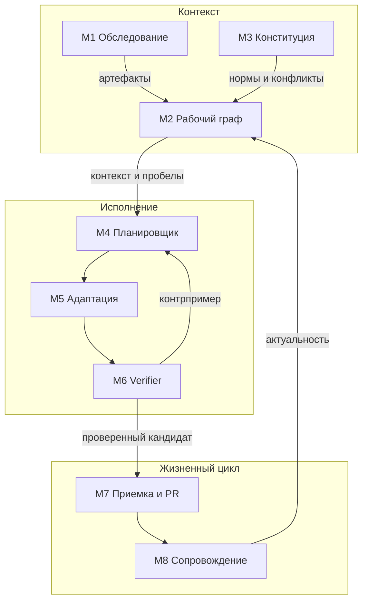
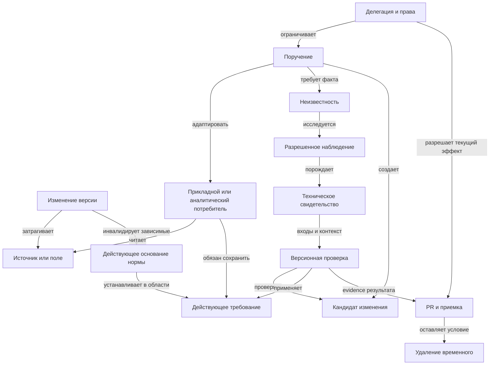
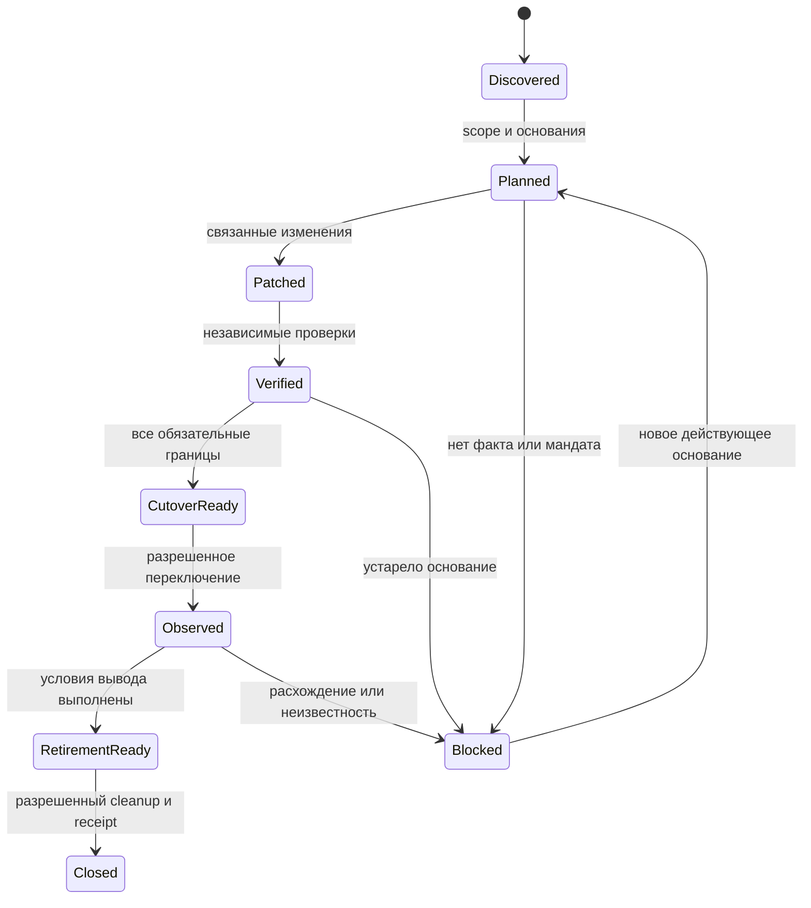

# Пересборка продукта: автономные агенты, рабочий граф и исполняемая конституция

Дата: 2026-10-16, Europe/Moscow. Статус: рабочая продуктовая ставка и план проверки.
Репозиторий: rengalaxies/agent. Этот документ - точка входа для продолжения работы с ИИ.
Документ фиксирует итог обсуждений 15-16 октября, а не новую реализованную версию продукта. Повторный разбор по запросу автора уточнил нишу: завершение семантических переходов через цепочку API/события/обработчик/витрина. Это рекомендуемая продуктовая ставка, не изменение ВКР и не доказанное преимущество.

Навигация после аудита 16 октября: [фактический код и консолидация](#19-аудит-репозитория-и-выполненная-консолидация), [описание продукта и модули](#20-описание-продукта-и-модульная-архитектура), [граф](#21-граф-исполнения-и-связи-сущностей), [рынок](#22-рынок-рфснг-проверка-спроса-и-публичных-аналогов), [экономика](#23-экономическая-проверка-и-коммерческая-модель), [следующий этап](#24-следующий-связный-этап-и-критерии-продолжения).

## 1. Главное решение и моя ответственность

Развиваем агентную систему, которая самостоятельно обследует разрешенную среду, собирает и поддерживает граф зависимостей и действующих правил, добывает недостающие технические свидетельства и завершает делегированную задачу с проверяемым результатом.

Автономность распространяется на внедрение и сопровождение самой системы: клиент не должен сначала вручную заполнить граф, описать все правила и выделить сотрудника для обслуживания статусов.

Моя ставка как ИИ-соавтора: преимущество искать в снижении полного человеческого труда на последовательности изменений, включая самостоятельное восстановление контекста, приемку и удаление временных решений. Граф и автономность - архитектурное ядро. SQL-переход потребителя - первый технический задел, а не предел продукта. Рекомендуемая область преимущества - один завершенный межсистемный переход с разными обязательствами потребителей, управлением необходимыми фактами и выводом прежнего пути; конкретизация в разделах 20-24.

Принимаю ответственность за связность предложения, проверяемость утверждений, фиксацию ошибок и пересмотр ставки по результатам. Не обещаю коммерческий успех и не подменяю измерения уверенностью. Не могу взять на себя договорную ответственность компании или решения ее уполномоченных лиц.

### Что автор явно выбрал

- Идти в автономность агентов и сеть взаимодействующих агентов.
- Автоматически находить источники и строить/обновлять граф.
- Автоматически собирать конституцию из существующих оснований.
- Минимизировать полный ресурс внедрения и поддержки у клиента.
- Рассматривать продукт как стартап; не ограничивать продуктовое решение прежней исследовательской конструкцией.
- Сохранить V2, карту, evidence и другие полезные активы, оценив их реальные ограничения.
- Двигаться через проверяемую работу, не выдумывая спрос, уникальность или надежность.

Последнее обсуждение расширило видение после голосования восьми агентов. Автоматическое обследование и сбор конституции как отдельный новый полный контур ими не голосовались и экспериментально не подтверждены. Их нельзя ретроспективно объявлять одобренными восьмью экспертами.

## 2. Эволюция ставок

| Этап | Ставка | Что сохранили | Что изменилось |
|---|---|---|---|
| Исходный V2 | Проверять явно записанные требования при изменении контракта | Детерминированные проверки и объяснимые исходы | Не считать декларации автоматически истинной семантикой |
| Граф и PR-review | Найти потребителей и показать влияние | Импорт связей, provenance, конкретный контекст | Один finding оставляет человеку основную работу |
| Воспроизведение расхождения | Восстановить входы, показать дефект, оставить тест | Replay, различающие примеры, воспроизводимость | Incident-to-test и diff уже имеют аналоги |
| Адаптация потребителя | Подготовить проверенный patch | Одна принимающая команда, ограниченный радиус внедрения | Не выдавать копирование старого SQL за синтез ремонта |
| Автономное завершение | Агент сам получает факты и заканчивает поручение | Бюджет, права, независимые ожидания, STOP | Генерации и числа агентов недостаточно |
| Сопровождение переходов | Дешевле второй и третий переход, включая cleanup | Актуальные основания, точная инвалидация | Reuse evidence тоже имеет прямые аналоги |
| Текущее видение | Автономное обследование + живой граф + сбор конституции + исполнение | Весь предшествующий полезный механизм | Проверять и стоимость внедрения, а не начинать опыт после ручной подготовки |

Это последовательное уточнение одной задачи: снять работу по надежному завершению изменений. Не следует одновременно строить каталог, отдельную платформу агентов, BI-продукт и универсальный governance.

## 3. Пользовательская ценность и первая область

Большое обещание-кандидат: "Система сама разбирается в разрешенном участке вашей среды, поддерживает необходимый контекст и выполняет порученные изменения с меньшим участием команды".

Первый технический задел проверяет адаптацию SQL-потребителя. Продуктовая единица шире: изменение смысла или интерфейса источника должно пройти через согласованную цепочку сервисов, событий, обработчиков и аналитических потребителей. Система обследует зависимости, различает сохраняемые и разрешенные новые свойства, готовит изменения и собирает приемку по каждой обязательной границе. Усиленный стенд должен включать неоднородную цепочку, а не только несколько SQL-запросов. Это расширение плана, не статус имеющейся реализации.

Первый пользователь: инженер принимающей команды. Покупатель-кандидат: руководитель интеграций/data engineering/платформенной команды с существующей очередью изменений. Возможный канал: интегратор с фиксированным бюджетом или ответственностью за срок, встроенный CLI/MCP/OEM. Это гипотезы, партнер и покупатель пока не установлены.

Начать можно с одной команды; не требуется право блокировать релизы всей организации. Если нет независимого бизнес-ожидания, сначала можно проверить явно делегированное сохранение наблюдаемого поведения, честно указав, что бизнес-правильность старого поведения не установлена.

## 4. Улучшенный граф: рабочая модель исполнения

Граф нужен для выбора следующего действия: что затронуто, что известно, какого факта не хватает, где его получить, какой результат еще актуален и что разрешено выполнить.

Это логическая модель, не требование заранее внедрить отдельную графовую СУБД. Текущие таблицы/документы и индексы могут быть достаточны. Выбор хранения определяется нагрузкой и операционными свойствами.

| Слой | Узлы | Основные связи |
|---|---|---|
| Техническая среда | Источник, поле, запрос, модель, job, отчет, API, версия | reads, derives, calls, produces, consumes |
| Нормативный контекст | Правило, обязательство, разрешенная дельта, запрет, область | requires, preserves, permits_change, conflicts |
| Основания | Документ, тест, наблюдение, fixture, runtime, решение | supports, contradicts, derived_from |
| Исполнение | Задача, неизвестность, гипотеза, эксперимент, кандидат, результат | needs_fact, can_observe, discriminates, verifies |
| Полномочия | Actor, команда, роль, делегация, ресурс, срок | may_read, may_execute, may_patch, may_publish |
| Жизненный цикл | Временный адаптер, срок хранения, условие удаления | supersedes, invalidates, expires, removes |

### Обязательные свойства утверждения

Идентификатор; тип; источник и его точное положение; версия/commit; время наблюдения и применимости; область; доступ; способ извлечения; статус; основания; противоречия; зависимости актуальности.
Численная уверенность LLM не является разрешением на действие. Оценка уверенности допустима для приоритизации, но требует калибровки и не заменяет статус основания.

Статусы: наблюдалось; извлечено как кандидат; подтверждено авторитетным источником в области; опровергнуто; устарело; конфликтует; неизвестно.
Согласие нескольких агентов не переводит кандидат в нормативное правило.

Нужно различать event time, observation time и время действия правила. Позднее поступивший документ не обязательно новее действующего контракта.

### Как граф появляется и поддерживается

1. Найти разрешенные источники через явные коннекторы и конфигурацию клиента.
2. Детерминированно импортировать доступные manifest/schema/tests/CI/IAM-артефакты.
3. Агентами извлечь кандидатов из SQL, документации и доступного исполнения.
4. Сопоставить сущности по устойчивым идентификаторам и версии; неоднозначные rename не склеивать молча.
5. Подтвердить технические связи доступными независимыми наблюдениями.
6. Хранить пробелы покрытия: неизвестный потребитель не становится отсутствующим.
7. Инкрементально обновлять граф по событиям и периодической сверке.
8. Собирать только подграф, необходимый текущему классу задач; расширять при полезном запросе.

Неизвестная область и неподдержанный SQL не должны автоматически загрязнять все локальные выводы. При этом доказанно посторонний объект нужно отличать от потенциально скрытой зависимости. Точная инвалидация требует обоснования, а не оптимистического игнорирования.

## 5. Автоматический сбор конституции

Конституция - версионированный набор целей, обязательств, ограничений, полномочий и правил эскалации в объявленной области. Это целевой механизм; автоматический сбор в полном виде не реализован.

Источники: действующие политики доступа, CI, контракты, тесты, правила владения, документация и ранее принятые решения. Код дает наблюдаемое поведение. Сам по себе код не устанавливает обязательную бизнес-норму.

### Контур сборки

- Импортировать действующие машиночитаемые правила без нового ручного ввода.
- Извлечь кандидатов с точными ссылками на основания.
- Проверить противоречия, сроки, владельцев и применимость.
- Применять только заранее заданный порядок авторитетности источников. При его отсутствии не придумывать приоритет.
- Для некритичного технического факта использовать разрешенное наблюдение или эксперимент.
- Для нового намерения предъявить минимальный конкретный выбор действующему уполномоченному лицу.
- Сохранить решение и его область, чтобы не задавать тот же вопрос без новых обстоятельств.
- Отделить предложение изменения правила от его принятия. Агент не расширяет свои права и не ослабляет критерий ради успешного patch.

Целевое управление федеративное: доменные правила должны оставаться у соответствующих команд; общие ограничения наследуются в делегированной области. Междоменный конфликт не разрешается голосованием агентов. Распределение хранения и вычислений еще предстоит реализовать; текущий single-writer журнал нельзя называть децентрализованным исполнением.

### Пример

В SQL окно 90 дней, в действующем контракте 30. Система показывает противоречие, затронутый результат и источник каждой версии. Если контракт установлен как действующий и задача требует его сохранения, проверяется 30 дней. Если источники равноправны и намерение не установлено, нужен адресный выбор. Автоматическое извлечение не должно закреплять старую ошибку как закон.

## 6. Сеть агентов и детерминированный контур

Роли - логические функции; число процессов и моделей выбирается по измерениям.

| Роль | Работа | Ограничение |
|---|---|---|
| Обследование | Найти источники и собрать технические наблюдения | Не запрашивать лишние права и не исполнять инструкции из документов |
| Конституция | Извлечь правила, происхождение и конфликты | Не принимать собственные кандидаты как нормативные |
| Планирование | Разложить задачу, выбрать недостающий факт/эксперимент | Соблюдать бюджет и исходную цель |
| Адаптация | Подготовить изменение и временный путь | Не менять независимые ожидания |
| Проверка | Запустить средства проверки, искать контрпримеры | Другой агент сам по себе не независимый oracle |
| Сопровождение | Обновить основания, удалить временное | Не удалять действующие зависимости |
| Координатор | Состояние задачи, дедупликация, версии, восстановление | Не подменять свежие права историческим receipt |

Детерминированные средства должны проверять поддержанные форматы, подписи, полномочия, версии, бюджеты, ожидаемые результаты и актуальность.
Независимость проверки означает отдельное нормативное основание и контролируемый evaluator, а не только другую ветку одной LLM.
Межагентные сообщения и граф получают provenance; общий источник ошибки не становится несколькими свидетельствами.

Многопоточность требует идемпотентных задач, leases, порядка событий, ограничения fan-out, общей квоты и разрешения конфликтов версий. Текущий локальный ledger не решает это для распределенной сети.

## 7. Полный автономный цикл

Разрешенная область -> обследование -> граф -> проект/импорт действующих правил -> конкретная задача -> план -> получение фактов -> кандидаты -> проверка кандидата и пригодности проверки -> разрешенный эффект -> приемка/наблюдение -> cleanup -> актуализация графа.

Перед потенциальной потерей данных: сохранить разрешенный путь к необходимому признаку, если есть доступ к границе изменения. Сначала код/ссылки, затем долговечная версия данных, затем разрешенный fixture. Не обещать универсальную минимальность и не копировать весь production автоматически.

Пример active_30d -> active_90d: одного boolean недостаточно восстановить прежнее значение. Нужен доступный различающий факт, например дата покупки. Если она исчезнет, capture нужно делать до удаления. Если нет доступа, права хранения или подходящего источника, корректен STOP.

Правильного кандидата может не быть. Единственный survivor после конечных проб не означает правильность на всех входах.

### Состояния результата

Отдельно хранить: исполнение; предметный результат; покрытие; актуальность; права; следующее действие.
Терминальные исходы: выполнено в области; найдено нарушение; недостаточно свидетельств; требуется новое намерение; нет прав; исчерпан бюджет; технический сбой.
STOP не считать успешно завершенной адаптацией. Автономность не повышать сокращением знаменателя.
Первый эффект - PR/изолированное изменение; production publisher с актуальными правами и восстановлением пока не реализован.

## 8. Что уже есть, а что только проектируем

Первоначальное основание таблицы: локальные материалы и предыдущие аудиты. Аудит 16 октября уточнил: SQL/dbt import, PR-помощник и evidence-модули находятся в исследовательских ветках, а не в main; см. раздел 19. Наличие файла в исследовательской ветке не равно релизу. Полный тестовый набор main проверен отдельно в ходе консолидации.

| Актив | Фактический задел | Незакрытая часть |
|---|---|---|
| V2 | Явные typed требования и детерминированные решения | Истинность/полнота требований, смысл произвольного кода |
| Импорт SQL/dbt | Ограниченные наблюдаемые зависимости, gaps | Произвольный PostgreSQL, UDF, dynamic SQL, полное покрытие |
| Граф | Read-only проекция снимка, типизированные связи/provenance | Самостоятельное обследование, рабочий планировщик по графу, точная инвалидация |
| PR-помощник | Подготовка compatibility-кандидата и fixture | В текущем примере копирует старый SQL, не универсально синтезирует ремонт |
| Evidence/snapshots | Версии, hashes, подтверждения/отзывы | Достаточность входов и долговечный replay реальной среды |
| Журнал/допуск | Локальная устойчивость, подписи, CAS, fail-closed | Cloud recovery, multi-writer, реальный IAM/publisher |
| Демонстратор автономности | Конечные авторские пробы без LLM | Production-agent loop, реальные вводные, независимый эффект |
| Сбор конституции | Концепция и явные входные правила | Автоизвлечение, конфликты, authority resolver, измерение нагрузки |
| Сеть агентов | Исследовательские ветки анализа | Долговременная исполняющая сеть и сравнение single/multi |
| Клиентская ценность | Рыночные косвенные свидетельства класса задачи | Наш покупатель, оплачиваемый пилот, полная экономика |

Сохранить frozen исследовательские baselines. Доработки формулы, scope или интерпретатора версионировать отдельно, не переписывать прежние результаты.

## 9. Валидация по экспертной обратной связи

Здесь "экспертная ОС" означает обобщения из сохраненных отчетов о встрече 15 октября. Исходная приватная транскрибация в этом раунде не перечитывалась. Ниже не дословные цитаты и не утверждение, что все участники согласовали новую архитектуру. Приватные материалы, личности и детали организации не публикуются.

| Обобщение экспертной ОС | Что изменили в замысле | Митигируем сейчас? | Остаток / проверка |
|---|---|---|---|
| Готовой карты и правил может не быть | Автономное обследование и сбор конституции | Пока преимущественно план; есть ограниченный импорт | Измерить качество и весь труд построения с нуля |
| Нельзя добавлять глобальное согласование | Начало с одной принимающей команды | Частично: advisory flow, нет обязательного глобального gate | Число новых ожиданий/согласований измерить у клиента |
| Нужен конкретный покупатель | Очередь переходов, именованный приемщик | Гипотеза сегмента | Нет внешнего обязательства внедрить/платить |
| Бизнес-логика не выводится из структуры | Развести наблюдение, кандидат и норму | Частично: явные требования/provenance | Автосбор норм не реализован и может ошибаться |
| Существующие тесты могут быть достаточны | Сильный baseline, допускаем проигрыш | Да в ограниченных диагностиках; реальный agent baseline не выполнен | Сравнить равные tools, данные и бюджет |
| После предупреждения нужна работа | Законченный переход и cleanup | Пока частичный помощник | Полное автономное завершение не реализовано |
| Производитель не обязан обслуживать все неоговоренные ожидания | Consumer-side делегация и versioned scope | Проектное решение | Проверить реальный переход без изменения чужого процесса |
| Нужны конкретные реальные ошибки | Реальный корпус и скрытые проверки | Авторские примеры есть | Внешний корпус и приемка отсутствуют |
| Агентность сама по себе не ценность | Полный человеческий труд как критерий | Зафиксирован протокол | Нет клиентского замера |

## 10. Реестр рисков и состояние мер

Шкала статуса: "частично" = ограниченная защитная мера реализована, но риск не закрыт; одна диагностика без исправления означает выявленный открытый риск; "план" = требование есть, исполнения нет; "открыт" = нет подтвержденной достаточной меры.
Приоритеты P0/P1 - порядок проверки, не оценка вероятности.

| ID | Риск и источник | Уже имеющаяся мера / статус | Что остается и как проверяем |
|---|---|---|---|
| R01 P0 | Нет покупателя нашего продукта; рынок | Гипотеза конкретной очереди; открыт | Внешний спонсор, артефакты, приемщик, коммерческий сигнал |
| R02 P0 | Agent+skill+tools делает то же; рынок | Сильные baselines включены в план | Равный сравнительный опыт на последовательности |
| R03 P0 | Ручной граф съедает пользу; экспертная ОС | Ограниченный импорт; частично | Считать все исправления извлечения и onboarding |
| R04 P0 | Извлеченное поведение стало ложной нормой; наша критика | Явные требования/provenance; частично | Статусы кандидатов, authority rules, запрет auto-promotion |
| R05 P0 | Старый код и тест одинаково ошибочны | Требуем независимое основание; план | Граф происхождения oracle и скрытый общий дефект |
| R06 P0 | Verifier пропускает существенную ошибку | Слепые зоны воспроизведены, исправление не заявлено | Полный multiset, типы, numeric, mutation challenge |
| R07 P0 | Верного кандидата нет среди предложенных | STOP предусмотрен концептуально | Скрытый случай absent correct candidate, без forced winner |
| R08 P0 | Источник удалился до сбора свидетельств | Proactive capture; план | Равные hooks baseline, durable dataset и цена retention |
| R09 P0 | Полномочия расширены агентом / prompt injection | Разделение норм и кандидатов; план для сети | Внешний capability enforcement, злонамеренные артефакты |
| R10 P0 | Локальный SQL replay имеет side effects | Ограниченный runner; частично | Процессная изоляция, запрет опасных UDF, resource limits |
| R11 P0 | Потеря отзыва/решения на целевом storage | Локальные journal/CAS/fsync; частично | Cloud crash/restore, backup, одна запись/транзакционная БД |
| R12 P0 | Историческое разрешение приняли за текущее | Различие описано, локальные проверки | Fresh authorization перед реальным эффектом, publisher |
| R13 P0 | Утечка данных/метаданных через граф, capture, журнал или notification | Доступы как требование; полноценная мера не подтверждена | ACL на производных, tenant isolation, retention/deletion |
| R14 P1 | Dynamic SQL/UDF/BI/редкий consumer не виден | Явные gaps ограниченного импорта | Реальные логи/корпус, окно наблюдений, не обещать полноту |
| R15 P1 | Посторонняя модель инвалидирует все | Два контрпримера найдены; не исправлено этим документом | Per-claim dependencies и тест locality при неизвестных связях |
| R16 P1 | Скрытая зависимость делает reuse опасным | Provenance/versions; частично | Консервативная инвалидация при неизвестности, непрямые изменения |
| R17 P1 | Ошибка идентификации/rename объединяет сущности | Идентификаторы/версии в модели; план | Коллизии имен, перенос команды, конфликт mapping |
| R18 P1 | Конституции доменов конфликтуют | Версионность/эскалация; частично в явных правилах | Authority resolver, неполный порядок, конкретный вопрос |
| R19 P1 | Агенты согласованно ошибаются | Голос не oracle; исследовательский принцип | Общий источник ошибки, единый бюджет, независимые проверки |
| R20 P1 | Распределенные гонки/дубли/out-of-order, повторные PR/notifications | Локальная сериализация, run IDs; целевой notifier dedupe еще план | Leases, idempotency внешних эффектов, partitions/retries |
| R21 P1 | Подпись настоящая, владелец не уполномочен | Ed25519/trust config; частично | Реальный IAM, ротация, отзыв, соответствие роли |
| R22 P1 | Откат всей корректной истории незаметен | Hash chain не закрывает полный rollback | Внешний checkpoint/anchor, защищенный backup |
| R23 P1 | Теряется семантика роли/timezone/state | Контекст как требование; частично | RLS, cutoff, incremental state, late events, engine config |
| R24 P1 | Snapshot ID ошибочно считается долговечным | Ограничение PostgreSQL выявлено | Durable version/fixture; тест восстановления после закрытия tx |
| R25 P1 | Пустые/слабые примеры дают green | Некоторые пустые fixtures отвергаются; частично | Отрицательные контроли и скрытые различающие входы |
| R26 P1 | Клиент повторяет весь review | Компактная исполняемая приемка; план | Независимый приемщик, reviewer-time, rerun в чистой среде |
| R27 P1 | Временные shims становятся вечным legacy | Cleanup включен в цель; план | Условие удаления, owner, проверка зависимостей/стоимости |
| R28 P1 | Экономия на коде исчезла в доступах/compute | Полная стоимость в протоколе | Учет времени обеих сторон, procurement/setup/retention |
| R29 P1 | Финитные примеры выдают за общую надежность | Явные ограничения отчетов | Фиксировать область, независимый корпус, неопределенность |
| R30 P1 | Новизна/уникальность заявлена по композиции | Конкуренты найдены; риск остается | Сравнительное преимущество, не отсутствие лозунга |
| R31 P1 | Люди обслуживают каждый STOP | STOP не успех, затраты включены | Измерять handoff/recovery и долю нового намерения |
| R32 P1 | Бюджет агента исчерпан после частичного эффекта | Локальный budget demo; частично | Чекпойнты, компенсация, safe cancellation, stranded resources |
| R33 P1 | Нефункциональный ущерб при верном output | Обязательства расширены в плане | Latency, стоимость, доступы и downstream в приемке |
| R34 P1 | Сам граф/конституция создают lock-in | Переносимые артефакты; план | Экспорт, восстановление без продукта, цена выхода |
| R35 P1 | Начальный stack разрастается на все сферы | SQL-first задел сохранен; план расширен до одной неоднородной цепочки | Каждый адаптер и verifier принимаются отдельно; исследовательский API/event стенд не расширяет production-права |
| R36 P1 | Технический риск объявлен договорно снятым | Разделяем историю и операционные роли | Условия поставки отдельно; документ не юридическое заключение |

Ни один риск не помечен полностью закрытым для production. Обнаружение ошибки не является ее mitigation. Написанное требование не является реализованным контролем.

## 11. Проверенные контрпримеры, которые нельзя потерять

- Добавление несвязанной модели меняло provenance hash прежнего ребра.
- Неподдержанный SQL постороннего отчета переводил итог в NEEDS_REVIEW при неизменном проверяемом пути.
- CASE для amount=42 возвращает 777, но проходит все шесть исходных входов демонстратора.
- UNION ALL с лишней строкой проходит проверку fetchone.
- Floating division на 9007199254740993 копейках теряет копейку.
- Identity получает ACCEPT на семантически неверном fixture 100 -> 100; независимое 100 -> 1 меняет решение.
- query_only не является изоляцией процесса при доступной side-effecting UDF.
- Сохраненная общая сумма не гарантирует правильное распределение по клиентам.
- active_90d не позволяет восстановить active_30d без дополнительного признака.
- Старое разрешение не дает права нового действия после отзыва.
- "Минимум 30 дней" не выражает "ровно 30 дней".
- Literal equality формул может отвергать эквивалентное форматирование.

Это конкретные ограниченные диагностики, не частоты ошибок в компаниях. Действующий демонстратор нельзя использовать как готовый финансовый runtime.

## 12. План пересборки и критерии приемки

### Пакет A. Исправить основание доверия
Версионировать verifier; сравнивать весь результат; определить числовую семантику, NULL/multiplicity; внешние expectations; mutation cases; конкретные зависимости результата.
Приемка: известные контрпримеры обнаруживаются, старые результаты не переписываются, границы явно видны.

### Пакет B. Автономное обследование и граф
Один repo и один поддержанный SQL/dbt stack. Самостоятельно получить артефакты, построить подграф, указать неизвестное и обновить при изменении.
Приемка: независимая разметка связей, цена исправления человеком, повторяемый обход; постороннее изменение не вызывает необоснованный полный review.

### Пакет C. Сбор конституции
Импорт существующих машиночитаемых правил и извлечение кандидатов с provenance. Конфликты не скрываются; агент не подтверждает свои расширения прав.
Приемка: заранее заданные авторитетные/устаревшие/противоречивые источники и вредоносные инструкции; корректные применимые правила без ручного заполнения всей среды.

### Пакет D. Законченное поручение
Найти gap, выбрать наблюдение, подготовить и проверить изменение, создать обычный PR/изолированный результат, затем cleanup.
Приемка: внешне понятный результат, воспроизводимость, текущие права, работа без новых вопросов на задачах с достаточным исходным мандатом. STOP отдельно.

### Пакет E. Сравнительный внешний пилот
Начинать поиск партнера параллельно A-C, не ждать универсальной платформы. Нужна реальная очередь и приемщик.
Если материалы не получены, автономно готовить технический корпус, но не объявлять его клиентской валидацией.

## 13. Эксперимент для графа, автономности и экономики

Общий baseline: одна модель, хорошие skills, лучшие доступные SQL/evidence инструменты, те же доступы/hooks/retention и бюджет.
Варианты:
- B: baseline без нашего движка.
- G: B + наш граф/версионный контекст.
- A: G + самостоятельное планирование получения свидетельств и выполнения.
- При достаточном корпусе: A без сохраненной истории; single vs multi при равном суммарном бюджете.

Не запрещать baseline самостоятельно строить граф или использовать свои аналоги. Добавление нашего графа не должно давать скрыто дополнительную информацию; если он ее сам добывает, учитывать работу получения во всех сравнениях.
Проверять фактически измеренный вклад функций, не пытаться одновременно доказать все на нескольких примерах.

Последовательность: onboarding -> первый переход -> следующий релевантный -> постороннее изменение -> новое намерение -> удаление признака -> изменение verifier -> отзыв права -> cleanup/выход.

Критерии фиксировать до анализа с конкретным клиентом. Измерять:
- полный труд клиента и поставщика до принятого результата;
- setup, вопросы, review, разбор STOP, поддержка, cleanup;
- ошибочные принятия и ложные тревоги;
- compute, latency, storage/retention;
- качество графа, неизвестные связи, исправления извлеченных правил;
- стоимость первого отдельно от второго/третьего перехода;
- принятие результата и коммерческий сигнал.

Реальные закрытые решения скрыты от всех в режиме адаптации. Синтетика, архив и следующие реальные изменения учитываются отдельно. Связанные случаи не считать независимыми наблюдениями. Ноль ошибок на малом наборе не устанавливает нулевой риск.

## 14. Голосование и статус подтверждений

Ранние раунды: 3/3 за ограниченный эксперимент. Последний: восемь новых веток, 8 ЗА, 0 нейтральных, 0 против. Требуемая буквальная комбинация 7+1 нейтральный не получена; голоса не менялись. Общее условие минимум семь за и никто против выполнено.
Голосовали за ограниченную проверку сопровождения переходов с сильным baseline. Не голосовали за доказанный спрос, уникальность, production-надежность или весь новый модуль автоматического сбора конституции.
Общая модельная среда ограничивает независимость голосования.

| Тезис | Статус |
|---|---|
| Есть дорогая задача адаптации и проверки изменений | Есть внешние vendor-published customer cases |
| Покупатель хочет наш отдельный продукт | Не подтверждено |
| Граф + diff + AI уникальны | Не подтверждено, есть прямые аналоги |
| Reuse evidence уникален | Не подтверждено, найден Click |
| Counterexample repair уникален | Не подтверждено, найден Skolem и другие |
| Наш полный цикл дешевле agent+skill | Не измерено |
| Автосбор графа/конституции снижает поддержку | Центральная новая гипотеза |
| V2 автоматически понимает бизнес | Неверно для текущей реализации |
| Production автономность готова | Нет |

## 15. Рынок и источники, сохраненные из раундов

Это реестр ранее проверенных источников, не новый полный обзор рынка. Документированные функции и маркетинговые заявления не равно сравнительная надежность.
- [Datafold AI review](https://docs.datafold.com/deployment-testing/ai-code-reviews)
- [Datafold DMA](https://docs.datafold.com/data-migration-automation/datafold-migration-agent)
- [CHG case](https://www.datafold.com/case-study/chg-healthcare-mysql-to-snowflake-migration/)
- [Nutrafol case](https://www.datafold.com/case-study/nutrafol/)
- [Rocketlane/Storable](https://www.rocketlane.com/customers/how-storable-cut-data-migration-time-by-75-with-rocketlanes-migration-agent)
- [Recce MCP](https://docs.reccehq.com/setup-guides/mcp-server/)
- [Monte Carlo toolkit](https://docs.getmontecarlo.com/docs/agent-toolkit)
- [dbt versions](https://docs.getdbt.com/docs/mesh/govern/model-versions)
- [sqleq](https://github.com/datadog-labs/sqleq)
- [SqlProof](https://sqlproof.com/)
- [Skolem](https://github.com/NguyenTienDat377/Skolem)
- [Click](https://github.com/grapefruit0205/click)
- [Data Workers](https://dataworkers.io/resources/schema-agent-breaking-change-review/)
- [EvalQA](https://eval.qa/business.php)
- [PostgreSQL statistics](https://www.postgresql.org/docs/17/pgstatstatements.html)
- [PostgreSQL snapshot synchronization](https://www.postgresql.org/docs/17/functions-admin.html)
- [OpenTelemetry sensitive data](https://opentelemetry.io/docs/security/handling-sensitive-data/)

Нормализованные query statistics не гарантируют значения параметров. Snapshot ID PostgreSQL не долговечен после закрытия экспортирующей транзакции. Автоматическое определение чувствительности и безопасная анонимизация не гарантированы.

## 16. Откуда продолжать следующему ИИ

Сначала прочитать разделы 1, 4-10, 12-14. Проверить фактический main и локальные непубликованные изменения перед реализацией.
Не предлагать отказаться от графа и автономности без нового основания: это выбранное направление. При этом роль конкретного механизма можно опровергнуть сравнением.
Не обещать универсальный бизнес-oracle, самоназначение полномочий, полную карту организации и отсутствие людей во всех задачах.
Не возвращаться к ручному заполнению всего графа как обязательному первому этапу.
Не считать доказанным то, что записано в этом документе как план.
Не менять ВКР и frozen эксперимент автоматически: это отдельный продуктовый контекст. Актуальный Google Doc в этом раунде не перечитывался, его согласованность с новой ставкой не утверждается.
После аудита репозитория следующая рекомендуемая техническая работа - пакеты раздела 12: основание доверия, ограниченное обследование/граф и сбор конституции. Обозначения пакетов не следует путать с вариантами сравнительного эксперимента раздела 13. Следующая продуктовая работа - внешний владелец очереди и один принимаемый результат. Дальнейшее направление обсуждаем с автором по результатам.

## Приложение. Сохраненный реестр 54 предельных случаев

Реестр ниже перенесен из первого отчета пересборки. Это проектные требования, а не свидетельство того, что меры реализованы или случаи успешно пройдены. Текущий статус основных групп указан в разделе 10.

| № | Случай | Поведение продукта и остаточный риск |
|---|---|---|
| 1 | Нет владельца метрики | Указать пробел; не выбирать норму автоматически |
| 2 | Владелец в отпуске | Использовать существующее делегирование; не создавать новый процесс |
| 3 | Два владельца противоречат | Сохранить версии ожиданий; решение остается у действующего управленческого процесса |
| 4 | CODEOWNER не знает бизнес-смысл | Разделять технического адресата и источник ожидания |
| 5 | Различие намеренное | Версионировать ожидание вместе с изменением; старый waiver не бессрочный |
| 6 | Старое поведение ошибочно | Не использовать parity как oracle без оговорки |
| 7 | Тест сгенерирован из нового кода | Пометить characterization; независимая правильность не доказана |
| 8 | Правило устарело | Изменение ожидания должно иметь источник и review |
| 9 | Разные snapshot | Не приписывать различие коду; сначала восстановить сопоставимость |
| 10 | Поздние события | Фиксировать cutoff и модель полноты; проверять границы |
| 11 | Incremental state/backfill | Сохранять состояние и последовательность; чистая таблица недостаточна |
| 12 | Недетерминированный порядок | Сравнивать с нужной семантикой порядка, а не случайным расположением |
| 13 | now/random/volatile UDF | Зафиксировать зависимости или признать replay ограниченным |
| 14 | Timezone/DST/конец периода | Явные настройки и специальные пограничные примеры |
| 15 | Decimal/float/округление | Предметные допуски; не общий epsilon для денег |
| 16 | NULL/collation/encoding | Явные правила сравнения и версия движка |
| 17 | Дубли и many-to-many JOIN | Сохранять кратности; уникальный key не предполагать |
| 18 | Уменьшение fixture убрало причину | После каждого шага перепроверять исходное свойство |
| 19 | Параметры в логах потеряны | Не подставлять угаданные значения как наблюдавшиеся |
| 20 | Dynamic SQL/UDF скрывает чтения | Дополнительный источник либо явный coverage gap |
| 21 | BI вычисляет после SQL | Сравнивать соответствующий слой; не обещать KPI по одному SQL |
| 22 | Кэш или Excel за пределами доступа | Указать непроверенного потребителя |
| 23 | Сезонный запрос не встречался | Ограничить вывод окном наблюдения |
| 24 | Удаленные или переименованные объекты | Сопоставление версий с подтверждаемым mapping, не по одному имени |
| 25 | RLS/tenant/session role | Сохранять контекст; тест одной роли не распространяется на остальные |
| 26 | Внешний API изменился | Контролируемая запись/заглушка либо невоспроизводимость |
| 27 | Ошибка конкурентности/retry | Нужен сценарий событий, не только CSV |
| 28 | Side effects запроса | Изоляция и запрет опасных операций; не production replay |
| 29 | Запрос слишком дорог | Бюджет времени/ресурсов, отмена и частичный результат |
| 30 | Сэмпл пропустил редкий дефект | Описать стратегию выбора и неизвестность, не "безопасно" |
| 31 | Пустой результат в обеих версиях | Проверять, что тест вообще упражняет нужное поведение |
| 32 | Ошибка окружения выглядит как red | Классифицировать execution_error отдельно от нарушения свойства |
| 33 | Green на любой версии | Проверить red на дефекте и отрицательные контрольные примеры |
| 34 | Тест заточен под строку фикса | Проверять бизнес-свойство и независимые изменения |
| 35 | Новый commit после анализа | Инвалидировать старый вывод по отпечатку |
| 36 | События webhook пришли не по порядку | Идемпотентность и проверка актуальной версии |
| 37 | Прямой push обошел MR | Не обещать enforcement за пределами реально настроенного CI |
| 38 | Runner недоступен | Отдельный технический статус и заранее выбранный fallback |
| 39 | Сотни похожих findings | Группировать по причине и подавлять дубли |
| 40 | Нужен факт от человека | Один конкретный вопрос, а не заполнение всего графа |
| 41 | SQL содержит персональные данные | Ограничение доступа, локальная обработка, контроль сохранения |
| 42 | Малый fixture раскрывает личность | Малый объем не равен обезличиванию; отдельная проверка |
| 43 | Prompt injection в описании/логах | Артефакты считаются данными; отдельные разрешения на инструменты |
| 44 | Отозван токен или изменились ACL | Инвалидировать доступ, не отдавать старый кэш другому пользователю |
| 45 | Смешение tenants в кэше | Изоляция пространств и тесты доступа |
| 46 | Удаление данных/retention | Удаление производных входов и воспроизводимых пакетов по политике |
| 47 | Утечка схемы через граф | Наследовать ограничения источников и в отчетах |
| 48 | Много ложных тревог | Считать потерянное время и отключать бесполезные проверки |
| 49 | Каждому случаю нужно новое обследование | Учитывать как услуги; не выдавать за масштабируемую автоматизацию |
| 50 | Инциденты редки | Проектная экономика или другой job, не искусственная подписка |
| 51 | Интегратор уже делает дешевле | Проверка заменителя; возможен канал, но не предполагать партнерство |
| 52 | Клиент не принимает тесты | Нет доказанной долговременной ценности |
| 53 | Агент общего назначения равен нам | Отдельный механизм не подтвержден |
| 54 | Хорошая демка только на синтетике | Не переносить результат на спрос и production надежность |

## 17. Повторная валидация документа

Проверка 2026-10-16: сверены выбранное направление, границы голосования, статусы реализации, реестр рисков и последовательность работ. Это редакционно-методологическая проверка сохраненных материалов, не новый аудит всего кода, не повтор внешних интервью и не новый рыночный поиск.

Исправлены две неоднозначности: федеративное управление обозначено как целевое, а обозначения пакетов работ отделены от вариантов эксперимента. Диагностика ошибки отдельно от ее исправления. Сохранены 36 рисков и 54 предельных случая.

Вывод: документ пригоден как рабочая точка пересборки. Утверждать, что продукт целиком валидирован и все риски сняты, нельзя. Главные открытые вопросы: качество автоматического сбора графа/конституции, пригодность verifier, полный труд внедрения, преимущество над сильными агентами и внешняя приемка.

Исторически первая попытка публикации была отклонена автоматической проверкой без явного подтверждения публичного размещения. После прямого поручения автора опубликовать документ он размещен в main: наличие подтверждено чтением GitHub 16 октября, исходный commit аудита `430e90ba531ddd90ef53efe07e0443370eac052b`. Прежняя запись о невыполненной публикации устарела. Текущая консолидация выполняется по прямому поручению автора продолжить работу в этом публичном проекте; приватные интервью и данные организаций в нее не включаются.

## 18. Первоначальное поручение: три агента и консолидация GitHub

Историческое поручение начала этой итерации, уже выполнено: автор поручил запустить ровно трех субагентов помимо ведущего агента. Это не инструкция повторять три запуска в каждом следующем чате. Цель - привести репозиторий и рабочий процесс в соответствие с этим видением, сократить дублирование и устаревшие инструкции, сохранив значимые доказательства и воспроизводимость. Не создавать новый набор стратегических отчетов по каждому агенту.

### Распределение работы

1. Агент кода и исполнения: проверить фактические main, ветки и PR, код, зависимости, CI, тесты и локальные непубликованные изменения. Сопоставить их с разделами 8, 10 и 12. Найти неиспользуемые/дублирующие компоненты, расхождения контрактов и кода, дорогие или избыточные проверки. Не удалять активный путь по одному поиску имени.
2. Агент документации и навигации: инвентаризировать документы, README, runbooks и инструкции; определить актуальные источники истины, устаревшие конкурирующие формулировки и дубликаты. Подготовить точные действия: оставить, объединить, заменить ссылкой, архивировать или удалить. Проверить входящие ссылки и команды из документации.
3. Агент архитектуры и рисков: независимо сверить предложения первых двух с выбранной автономностью, графом, сбором конституции и реестром рисков. Проверить, не удаляют ли необходимые основания, контрольные случаи и сильные baselines. Выделить минимальный связный следующий этап реализации и его приемку.

### Работа ведущего агента

- Передать всем один и тот же документ, фактическую ревизию репозитория и общие ограничения. Зафиксировать исходный commit и состояние worktree.
- Сначала дать агентам read-only аудит. Их результаты - сообщения/временные рабочие заметки, затем один общий план изменений. Не разрешать параллельную правку одних файлов.
- Свести карту "нынешний путь -> действие -> целевой путь -> причина -> проверка" в тело PR или одну временную рабочую запись. Не плодить три постоянных отчета аудита.
- Прогрессировать автономно в обратимой части: консолидировать дубли, чинить ссылки, выравнивать статусы и навигацию, убирать явно воспроизводимый мусор в отдельной ветке. Сначала проверить применимые инструкции и доступы.
- Значимые исследовательские результаты, frozen-корпус, baselines, fixtures, контрпримеры и первичные основания сохранять. Устаревшее описание снабдить статусом/ссылкой или архивировать, если история нужна. История Git не заменяет доступные входы воспроизводимого эксперимента.
- Не выполнять git reset --hard, git clean, переписывание истории, массовое удаление веток/релизов и уничтожение чужих незакоммиченных изменений. Потенциально ценное без понятной замены не считать мусором.
- Реальную инфраструктуру, секреты, доступы, frozen эксперимент и ВКР не менять как побочный эффект уборки. Не переносить внутреннюю стратегию в публичный репозиторий в обход обозначенного блока публикации.
- Показать один связный diff/PR с конкретными изменениями. Запустить уместные проверки ссылок, команд и затронутого кода. Удаление документа проверять также на потерю уникального содержания и воспроизводимости.

### Целевая организация документов

Предпочтение - существующие файлы и один понятный вход. README дает краткую навигацию; этот документ хранит текущую продуктовую ставку; технические спецификации описывают реализованное; экспериментальные результаты сохраняют версии и происхождение. Фактические имена и размещение выбрать после аудита, не создавать заранее новую иерархию из десятков файлов.

Новую постоянную документацию добавлять только для отдельной функции, которую нельзя ясно разместить в существующем источнике истины. При новой итерации обновлять текущий документ и Git-историю вместо создания очередного почти одинакового датированного отчета. Для исторических результатов сохранять версии там, где они нужны для научной честности и воспроизводимости.

### Критерии завершения

- Из README понятно, что читать и запускать сейчас.
- У текущих продукта, архитектуры и запуска нет нескольких противоречащих источников истины.
- Убраны или помечены проверенные дубли и устаревшие указания; нет целевого сокращения числа файлов ради самого числа.
- Сохранены уникальные результаты, контрольные случаи и рабочие инструкции; исправлены ссылки после перемещений.
- Фактически реализованное отделено от плана; новая архитектура не объявлена готовой из-за уборки документов.
- Есть один следующий связный этап реализации, привязанный к рискам и приемке, и один общий итог аудита.

Первоначально это было поручение следующему чату. 16 октября запущены ровно три субагента; результаты сведены ведущим в одну правку. Итог, проверка рынка, описание продукта и следующий этап приведены в разделах 19-24. Полная реализация пакетов A-E и внешний пилот этим не заявляются.

## 19. Аудит репозитория и выполненная консолидация

### Вывод по четырем запросам автора

| Вопрос | Что установлено 16 октября | Чего пока нет |
|---|---|---|
| Техническая возможность | Ограниченный цикл для одного SQL/dbt stack реализуем из известных компонентов; наш исследовательский код подтверждает отдельные звенья | Работающего полного автономного цикла и production-надежности |
| Экономика и бизнес | Возможна положительная экономика на повторяющейся очереди при ограниченном onboarding и review; рассчитаны условия | Замеров полного труда у клиента, установленной цены и готовности платить |
| Спрос РФ/СНГ | Публичные внедрения подтверждают существование задач; публичные аналоги и заменители существуют | Спроса именно на наше решение и доказанного превосходства над заменителями |
| Получившийся продукт | Сформулированы результат для клиента, модули, граф, границы и приемка | Это целевая спецификация, а не объявление готового релиза |

Решение: продолжить ограниченную инженерную проверку и поиск оплачиваемого пилота. Не переходить к универсальной платформе и коммерческим гарантиям до измерений. Нельзя обещать заранее требуемое подтверждение спроса или отсутствия конкурентов.

### Основание аудита

Исходный main: `430e90ba531ddd90ef53efe07e0443370eac052b`; свежий checkout был чистым. В этом checkout нет прежних локальных неопубликованных материалов автора: аудит не устанавливает их наличие или отсутствие на другом компьютере. AGENTS.md в репозитории не обнаружен. Запущены ровно три субагента: код/исполнение; документация/экономика; независимая архитектура/рынок. Первые два предложения дополнительно проверены третьим; правки файлов выполнял только ведущий.

Фактическое разделение активов:

| Место | Проверенный статус | Действие |
|---|---|---|
| main | V0/V1-ind/V2, knowledge-1, журнал, локальный E4, demo API/UI | Сохранить; не объявлять автономным продуктом |
| `research/pr-change-assistant` / `b54e342fad3b428dcc3d5b50ec372355fb2960e5` | Уникальные SQL/dbt import, change assistant, evidence-модули; 16 профильных тестов проходят | Сохранить ветку; переносить выборочно после исправления verifier |
| Другие research-ветки | Версии отдельных экспериментальных механизмов, а не доказанные дубли | Не удалять автоматически |
| Старые `results/pilot-results.json` | Включают исторический V1-oracle; актуальная модель его не загружает | Не переписывать; актуальный тест строит development-результат во временном каталоге |

В research PR runner лишняя строка `UNION ALL` уже отвергается; слепую зону старого `fetchone` нельзя приписывать этой версии. Но `CAST(integer AS REAL)` принимается против integer-ожидания из-за равенства Python `1 == 1.0`. Это воспроизведено на указанном commit; строгая типовая совместимость не подтверждена. Старые контрпримеры раздела 11 сохраняются с привязкой к своей версии.

В первом аудите после установки заявленных test extras и исправления тестового входа выполнено `python -m unittest discover -s tests -v`: **119 тестов, OK, без пропусков**. Это development/regression, не основной E3. Тест бизнеса теперь строит raw/scoring только по development-каталогу во временном каталоге. Исторические результаты, evaluation-oracle и исследовательский интерпретатор не менялись.

В CI добавлен полный core unittest job при изменениях ядра и его входов. Облачные workflows не запускались. У bootstrap workflow уже есть `set -e`: окончание `exit 0` само по себе не доказывает подавления ошибки, первоначальное подозрение снято.

### Одна карта изменений вместо трех отчетов

| Нынешний путь | Действие / целевой путь | Причина | Проверка |
|---|---|---|---|
| README | Добавить текущую навигацию в том же файле | Разделить реализованное исследование и продуктовую цель | Все относительные ссылки существуют |
| Этот документ, разделы 8/17/18 | Уточнить ветки, публикацию и выполнение поручения; расширить этот же источник | Устранить устаревший статус; не плодить отчеты | Сверка с исходным SHA и GitHub |
| `adapters/README.md` | Исправить на фактические YAML/JSON E4 adapters | Не называть ODCS/AsyncAPI реализованными | Чтение `stand/adapters.py` |
| `agents/README.md` | Отделить ограничение исследования от целевых ролей | Не потерять выбранную автономность | Сверка с разделами 6/20 |
| `docs/architecture.md`, `business-process-to-be.md`, `stakeholders-and-value.md`, `business-problem.md` | Уточнить исследовательскую область и ссылку на текущий продукт | Не оставлять несколько конкурирующих roadmap | Сохранение содержимого и проверка ссылок |
| `docs/launch-2026-10/00,04,05,06,07` | Исторический статус и ссылка на текущую ставку | Старый план не должен конкурировать с новым | Ссылки и сохранение уникального содержания |
| `infra/cloudru/deploy/README.md` | Исправить отсутствие bootstrap на наличие шаблонов | Шаблоны есть, runtime в этом аудите не проверен | Чтение существующих cloud-init |
| `tests/test_business_case.py` | Генерировать текущий development fixture временно | Не читать старый режим актуальной enum и не менять историю | Полный unittest |
| `.github/workflows/core-tests.yml` | Добавить отдельный core job | Прежние API/deployment jobs не покрывают весь core | YAML и локальный эквивалент job |

Повторный разбор по запросу автора выполнен двумя дополнительными агентами: конкурентная ниша и клиентские задачи. Переработаны существующие разделы 3/20-24, уточнен R35, добавлены метки исследовательской области и исправлен пример с истечением окна без события. Это документационная итерация: новый runtime и новые тестовые результаты не заявляются.

Удалений документов и веток нет: полезный материал преимущественно уникален или нужен для воспроизводимости. Консолидация достигнута статусами и навигацией, а не сокращением числа файлов ради числа. Изменения подготовлены в отдельной ветке и одном PR; слияние отдельно от подготовки. Реальная инфраструктура, доступы и ВКР не изменены.

## 20. Описание продукта и модульная архитектура

### Верхний уровень и выбранная ниша-кандидат

**Автономное сопровождение межсистемных изменений: от изменения источника до принятого перехода потребителей и вывода старого пути.** Целевой пользователь - инженер интеграций, backend/data engineer или руководитель перехода. Продукт не ограничен SQL/dbt и не обещает произвольное преобразование всей ИТ-среды.

Рекомендуемая первая ниша: семантические изменения в действующей интеграционной цепочке, где одновременно существуют API/события, обработчик со своим состоянием и аналитический либо прикладной потребитель. Например, производитель меняет значение признака активности; CRM должна принять новое окно, а риск-отчет сохранить прежнее. Схема сообщения остается прежней. Нужно провести разные разрешенные изменения, получить приемку и перестать обслуживать временный старый путь.

Покупатель-кандидат: владелец уже финансируемой миграции/замены источника, руководитель интеграций либо интегратор с фиксированной ценой проекта. Платформенная команда может купить повторное обслуживание очереди таких изменений. Продажа начинается с конкретного незавершенного перехода, а не с просьбы построить Data Mesh или новую платформу агентов.

| Ниша-кандидат | Работа, за которую потенциально платят | Почему приоритет / главный риск |
|---|---|---|
| 1. Завершение межсистемного семантического перехода | Согласовать разные требования потребителей, исправить цепочку и довести до приемки | Рекомендуемый вход: объединяет имеющиеся активы; конкурирует с агентом и набором контрактных/миграционных tools |
| 2. Подготовка к потере необходимой информации | До удаления поля/детализации найти, кому она нужна, сохранить разрешенный источник и проверить восстановимость | Сильный механизм усиления №1, но редкая задача и высокие storage/ACL риски; не отдельная широкая платформа |
| 3. Завершение затянувшейся временной совместимости | Убрать старый topic/API/view/adapter после подтвержденного перехода | Понятный результат, но неизвестные/редкие потребители ограничивают автономное удаление |

Это гипотеза недостаточно закрытого стыка решений. Найденные источники не устанавливают отсутствие полного аналога. Граф, независимые проверки, cutover и cleanup по отдельности уже известны; конкурентное преимущество должно состоять в лучшем результате полного поручения.

### Формулировка преимущества и его проверка

Обещание-кандидат: "Проведем изменение смысла данных через зависимые сервисы и потребителей: сами восстановим контекст, подготовим и проверим адаптации, покажем, что еще мешает переключению, и завершим временную совместимость в пределах мандата".

| Предполагаемый механизм преимущества | Конкретное поведение | Как опровергаем |
|---|---|---|
| Один план перехода через разные интерфейсы | Одна change-задача связывает API/event/код/состояние/витрину; отдельные PR связаны общими условиями приемки | Сильный агент с теми же tools получает тот же результат с не большим полным трудом |
| Отдельные ожидания каждого потребителя | Новое поведение CRM и сохраняемое поведение risk проверяются раздельно; общий green схемы не завершает задачу | Система принимает неправильное окно одного потребителя или сама ослабляет expectation |
| Планирование по достаточности фактов | До удаления `last_purchase_at` проверяет, нужен ли он для old 30d, и получает разрешенный источник | Обнаруживает потерю слишком поздно либо копирует лишние данные без необходимости/права |
| Управление промежуточным состоянием и окончанием | Учитывает действующие версии, replay/checkpoints, временные адаптеры и конкретные условия вывода | PR закрыт, но потребитель не переключен, state неверен или временный путь остался без причины |
| Автоматическое получение контекста и повторное использование | Не требует заранее ручной полной карты; повторный релевантный переход использует только актуальные основания | Ручное исправление графа и обслуживание STOP съедают выигрыш |

Ни один пункт пока не является подтвержденным нашим свойством. Особенно важно сравнивать не с голым LLM, а с agent + DataHub/каталог + Pact/Schema Registry + replay/diff и доступными migration tools. Совместимость с этими решениями полезнее конкуренции количеством коннекторов.

### Сквозной пример вместо общего обещания

`CustomerStatusChanged.active`: было "покупка за 30 дней", станет "покупка за 90 дней". У CRM согласовано новое правило 90 дней; у риск-отчета действует требование 30 дней. Тип остается boolean. Это синтетический проектный пример, не история клиента. Действующее требование должно также задавать `as_of`, timezone, включительность границы, допустимые покупки, полноту истории и политику опозданий/исправлений. В стенде можно явно зафиксировать UTC и точную длительность окна; это не автоматическое правило для клиента.

1. Импортировать доступные контракт, код producer, usage, consumers, CI и действующие нормы; конфликт в документах сохранить, не скрыть.
2. Зафиксировать, что из `active_90d` нельзя восстановить `active_30d`. Найти разрешенный `last_purchase_at`, его полноту/семантику и срок доступности; если его уже нет и альтернатив нет, выполнить STOP по соответствующему обязательству.
3. Подготовить переход CRM к 90d и отдельную адаптацию обработчика risk к 30d. При необходимости предложить версионное сосуществование, но не ослаблять правило risk.
4. Проверить границы времени и timezone, late/duplicate events, повтор после checkpoint, состояние обработчика и результат витрины. Обязателен случай истечения 30 дней без нового события: нужен разрешенный таймер пересчета либо вычисление активности на момент запроса. Один event-triggered handler может оставлять устаревший boolean. Контрактный тест, управление временем и replay решают разные части задачи.
5. Создать связанные PR с точными версиями и условиями следующего шага. Отдельно предъявить готовность к переключению; наличие PR не означает, что оно выполнено.
6. После разрешенного переключения и независимого наблюдения установить, какие версии еще используют старый путь. Предложить cleanup только при выполнении условий в объявленной области. Короткое окно отсутствия чтений не доказывает отсутствие редкого потребителя.

На первом инженерном этапе продукт выдает PR, replay-пакет и блокеры переключения. Реальный deploy/cutover/delete не заявляется реализованным: для него нужны принятый state machine, внешние capabilities, устойчивые receipts и rollback. Если полномочия ограничены PR, отчет показывает ровно этот достигнутый этап.

### Расширение за SQL/dbt без универсального обещания

| Уровень | Поддерживаемая область / новый объем | Граница |
|---|---|---|
| Имеющийся задел | V2/knowledge/E4 в main; ограниченный SQL/dbt import и PR-helper в research | Не переименовывать в готовый кросс-платформенный продукт |
| Следующий неоднородный стенд | OpenAPI/JSON Schema как входные контракты; JSON event -> Python handler -> PostgreSQL state -> SQL view | Одна реализация handler, один формат события, одна СУБД; независимые проверки каждого слоя; API contract import не равен API runtime repair |
| Следующий пилот | Одна реальная цепочка и явно перечисленные runtime/IAM/CI/broker adapters | Реальный broker/HTTP добавляются с отдельной приемкой; нет автоматического обобщения на Avro/Java/все BI |
| Расширение продукта | Новые языки, движки, API/events, consumer adapters | После измеренной потребности и доказанного результата на предыдущей области |

Выбранная связка - референсный стенд для проверки причинно связанного результата, не условие установки продукта у клиента. Продукт описывает роли producer/transport/transform/state/consumer; конкретные JSON/Python/PostgreSQL/SQL заменяются поддержанными адаптерами. При нужном scope возможны API -> backend -> state либо event -> Java handler -> другое хранилище; обещание поддержки появляется после реализации и приемки соответствующих адаптеров.

Усиление - неоднородность одного законченного сценария. Оно проверяет переносимость ядра за пределы SQL, сохраняя контролируемую площадь реализации. Разные интерфейсы требуют разных verifier; один табличный diff не проверит состояние, порядок событий и предметное намерение.

### Принцип ответственности и реакция на изменение

Это проектируемая операционная модель. Координатор отвечает за ведение поручения и завершение разрешенной технической работы; человеческие полномочия на смысл и выпуск остаются у действующих владельцев. Логическая роль агента не требует отдельной модели/процесса для каждой команды.

| Участник | За что отвечает | Что система делает вместо ручной рутины |
|---|---|---|
| Владелец перехода, назначенный клиентом | Scope, цель, бюджет, разрешенная дельта и условия завершения общего поручения | Координатор ведет общий статус, собирает receipts, показывает конкретные блокеры |
| Команда-производитель | Собственный интерфейс/контракт и исходящее изменение | Агент импортирует change diff, основания и версии; готовит producer-side patch при мандате |
| Затронутая команда-потребитель | Действующие требования к своему результату и приемка своей части | Агент находит использование, готовит consumer-side PR и независимые проверки |
| Существующий release owner/on-call | Разрешение фактического эффекта, исключения и реагирование на инцидент | Агент подает readiness/incident evidence в уже настроенный процесс |
| Поставщик продукта | Качество поставки, поддержанные адаптеры, эксплуатация своего компонента в договорном scope | Автоматизация установки/обновлений/диагностики; не обещание ответственности за весь бизнес клиента |

CODEOWNERS определяет технического адресата кода, но не автоматически владельца бизнес-нормы. Приоритет маршрутизации задан клиентом: действующий service/ownership registry и делегации -> доступные технические владельцы -> назначенный sponsor для неоднозначности. Если нет адресата, агент создает ownership gap и обращается к уже назначенному sponsor; не назначает случайного человека ответственным.

Порядок реакции:

1. Webhook repo/CI/registry, изменение схемы, разрешенная runtime-телеметрия либо периодическая сверка создают один change_id. События дедуплицируются; порядок поступления не принимается за порядок версий.
2. Система фиксирует базовые версии и diff, определяет затронутый подграф, обязательства и полноту покрытия. Критичность считается для каждой обязательной границы и общего перехода.
3. Для каждой затронутой команды формируется адресный пакет: что изменилось, какая ее зависимость обнаружена, что сохраняется/меняется, критичность, основания, что агент уже проверил и какое решение необходимо.
4. При существующем мандате агент сам получает технические факты, готовит branch/PR в разрешенном repo и запускает sandbox/CI. Один change_id связывает producer PR и consumer PR; это не атомарная межрепозиторная транзакция.
5. Агент может сам публиковать PR и notifications **через заранее настроенный notifier**: разрешенный канал/адресат, отдельный scope токена, dedupe key и разрешенный состав сообщения. Рассылка, review request и создание PR являются внешними действиями, а не чтением: права на них проверяются отдельно. Эта спецификация не отправляет реальных уведомлений.
6. Пакет для команды содержит PR либо конкретный blocker. Некритичные сообщения агрегируются, повторы обновляют существующий объект; не создается новая задача на каждое наблюдение.
7. Приемка связывается с точными версиями требований/кода/данных и полномочием принимающей стороны. Если все ожидания уже установлены, дополнительный бизнес-вопрос не нужен; если требуется новое намерение, предъявляется один конкретный выбор.
8. Нет ответа - отдельный waiting/blocked status и эскалация по установленному таймеру. Молчание не означает согласия. Условия блокировки релиза действуют только в реально подключенном gate и делегированной области.
9. После разрешенного эффекта система наблюдает результат, проверяет условия вывода старого пути и завершает cleanup либо сохраняет точную причину незавершенности.

Один логический агент может вести PR и notifications нескольким командам. В защищенном многодоменном контуре предпочтительны локальные workers с полномочиями своей команды и координатор, обменивающийся ограниченными receipts. Центральному агенту не требуются постоянные write-права ко всем repo. Рабочая сеть и общий coordinator получают отдельную приемку устойчивости; текущий main этого еще не реализует.

### Четыре уровня критичности изменения

Критичность отделена от уверенности/полноты. UNKNOWN не пятый уровень и не низкий риск. Уровень описывает потенциальное последствие; наличие проверок определяет, достаточно ли оснований для действия.

| Уровень | Смысл и пример | Реакция агента | Человеческое участие |
|---|---|---|---|
| C0. Не влияющее в проверенной области | Форматирование/комментарий, не меняющий исполняемое поведение, норму, доступ или обязательство | Запись в журнал, локальная сверка; по умолчанию без отдельного notification | Не требуется новое решение при выполненной политике; вывод ограничен проверенным scope |
| C1. Низкое | Обратимое локальное изменение без нарушения установленных обязательств; например добавление реально неиспользуемого optional-поля | Самостоятельные проверки и PR; digest/адресное уведомление по настройке | Обычный review; auto-merge возможен только по заранее принятой узкой политике и gate, не является возможностью первого релиза |
| C2. Существенное | Меняется расчет/ключ/окно или нужна адаптация нескольких известных потребителей | Связанные PR, отдельные expectations, временный путь и план возврата; адресный пакет каждому владельцу | Приемка затронутых обязательных границ и предусмотренное разрешение переключения |
| C3. Критичное | Возможны существенный денежный ущерб, потеря невосстановимых фактов, нарушение доступа либо критичного бизнес-процесса | Срочная маршрутизация в действующий on-call/release процесс, сохранение разрешенных фактов, изолированный draft patch; никаких самовольных необратимых эффектов | Явное решение назначенного уполномоченного; dual approval, если этого требует политика клиента |

Основания классификации: измененный смысл/тип/область/права, критичность ресурса и процесса, радиус воздействия, восстановимость и действующие требования. Числовые пороги ущерба/критичных ресурсов задает клиент; один универсальный порог в рублях не навязывается. LLM предлагает классификацию с evidence; заданные обязательные risk floors применяются вне LLM. Общая критичность не ниже максимума обязательных частей; сочетание частей может повысить ее. Предполагаемый низкий score LLM не дает права снизить уровень.

Неизвестное влияние на обычный ресурс дает как минимум предварительный C2 и запрет автоматически считать изменение безопасным; на критичном ресурсе - C3 до разрешения неизвестности. Это консервативная стартовая политика, которую утверждает клиент. Дополнительные факты могут обосновать переклассификацию; переход C3/C2 ниже обязательного policy floor требует действующего уполномоченного решения и записи в журнале. Права на merge/deploy/delete не выводятся из C0/C1.

Для каждого уровня отдельно задаются routing/escalation timers. Предлагаемый первоначальный режим: C0 журнал/digest, C1 рабочая очередь, C2 ответственный владелец перехода, C3 существующий срочный канал. SLA и круглосуточное дежурство продукта не объявляются автоматически. В первом релизе все production эффекты остаются у существующего процесса клиента, независимо от критичности.

### Автономное развертывание и базовая конституция

Целевая поставка: версионированный OCI-образ и installer/Compose либо Helm-пакет по среде клиента, с pinned dependencies, healthcheck, persistent state, миграциями служебной БД, резервным копированием и rollback обновления. Это план поставки, не утверждение, что образ полного продукта уже собран. Kubernetes не обязательное условие.

Базовая конституция состоит из трех слоев:

1. Обязательные ограничения поставки: scope, budget, запрет расширения собственных прав, изоляция выполнения, read-only bootstrap, кандидаты отдельно от норм, журнал, безопасная остановка и разрешенные внешние endpoints.
2. Пакет клиента: allowlisted repos/системы, service identity и секреты через vault, действующие authority/risk policies, routing, владельцы, допустимые operations, approved LLM route и retention. Он использует существующий IAM и реестры; агент не выдает себе права.
3. Извлеченный локальный контекст: наблюдения и кандидаты с provenance, сроками и конфликтами. Они не меняют автоматически первые два слоя.

Человек один раз запускает installer или разрешает bootstrap job, предоставляет service account и область обследования, назначает sponsor и подключает исходные authoritative sources. После этого агент сам проверяет доступность коннекторов, импортирует артефакты, строит нужный подграф, выделяет неизвестное, проверяет конфликты и начинает разрешенную работу. Не требует предварительно ручной полной карты или новой конституции для каждого объекта.

Под "начинает копать" понимается обход разрешенных коннекторов с квотами, а не сканирование всей сети, поиск чужих credentials или самораспространение. Секреты не входят в образ. Read access не дает права исполнять произвольный SQL/UDF: наблюдения и replay также ограничены отдельными capabilities. Увеличение числа workers или подключение новой системы допускаются только в уже выданном deployment/resource scope. Обновление базового образа не выполняется самим агентом вне политики клиента.

Оценка человеческого труда для **поддержанного одного контура**, не измерения:

| Этап | Клиент | Поставщик | Что включено / ограничение |
|---|---:|---:|---|
| Первый запуск в готовой среде | 16-40 ч | 24-60 ч | Доступы, scope/routing, подключение, разбор неоднозначных норм, приемка первых результатов; исполнение installer само занимает существенно меньше |
| Раннее сопровождение | 4-12 ч/месяц | 8-16 ч/месяц | Актуальность доступов/оснований, обновления, connector failures и support; review/STOP задач считаются дополнительно в a/s |
| Зрелая повторная установка | 8-16 ч | 8-24 ч | Целевой результат повторяемой поставки, не текущая возможность |
| Зрелое сопровождение | 4-8 ч/месяц | 3-6 ч/месяц | Цель стандартизации, которую нужно измерить |
| Новый закрытый контур/неподдержанные интеграции | 60-160+ ч | По обследованному scope | Отдельный проект; согласования могут занимать недели календарно и не исчезают из-за готового образа |

Расчет раздела 23 использует клиентские O=32 ч, M=8 ч/месяц и supplier onboarding=40 ч/support=12 ч/месяц как одну точку внутри диапазонов. Гипотеза снижения труда проверяется с нулевого подключения; бесплатно подготовленный идеальный граф из учета не исключается. При ухудшении качества автосбора время исправлений добавляется в M/O/a/s, а не скрывается за "автономностью".

### Журнал изменений и историчность

Журнал - обязательный компонент продукта, а не источник самостоятельной новизны. Его логическая модель append-only; исправление создает supersedes/revocation event, не переписывает прежний вердикт. Фактические гарантии хранения/восстановления отдельно проверяются на целевом storage.

Записываются: обнаружение изменения; до/после версии; исходное событие; scope и coverage; классификация C0-C3 и ее пересмотр; извлеченные нормы/конфликты; действия агента и бюджет; разрешения/отзывы; созданные и обновленные PR/notifications и delivery receipts; проверки с verifier/input/expectation hashes; решения людей; переходы состояния; внешние effects и подтверждения; тайм-ауты/STOP/errors; rollback/компенсации; cleanup и закрытие.

Минимальные поля события: event_id, change_id, parent/causation_id, idempotency_key, tenant/domain, actor/service identity, observed_at/event_time/effective_interval, resource и версии, criticality, operation/status, authority/policy version, evidence refs/hashes, outcome, cost и связь с предыдущим событием. Для воспроизведения хранится модель/toolchain version и существенные конфигурации; точное воспроизведение текста внешней LLM не гарантируется.

Журнал позволяет спросить: "какое правило действовало тогда", "кто разрешил эффект", "почему изменился уровень", "что именно было принято", "какие старые версии остались". Историческое разрешение не становится текущим; перед эффектом права перечитываются. Replay журнала по умолчанию read-only и не отправляет повторно PR/уведомления/деплой.

Raw данные/секреты не дублируются в журнал автоматически: evidence хранится отдельно с ACL и retention, в журнале - разрешенные ссылки/хеши и статусы. Удаление чувствительного payload по принятой политике не подменяется обещанием вечного хранения. Приложение не имеет update/delete прав к audit events; external checkpoints/backup и проверка восстановления защищают от отдельных отказов. Hash chain сама по себе не выявляет удаление/откат всей истории; это ограничение сохраняется до внешнего anchor/защищенного хранения.

### Модули и контракты

Все строки ниже описывают цель. Частичный задел указан отдельно в разделах 8/19.

| Модуль | Вход | Выход и состояние | Полномочия, ошибка и приемка |
|---|---|---|---|
| M1. Подключения и обследование | Разрешенные repo/dbt, OpenAPI/JSON Schema, runtime/config, tests/CI, каталог, документация | Версионные артефакты, обнаруженные сущности, coverage gaps | Read-only по allowlist; неподдержанный источник фиксируется как gap; измерять полноту на независимой разметке и труд исправления |
| M2. Рабочий граф | Артефакты M1, события версий, результаты задач | Типизированные утверждения и локальные подграфы с provenance/freshness | Сохраняет ACL исходников на производных; неизвестное не равно отсутствию; чужое изменение не инвалидирует доказанно независимый путь |
| M3. Сбор конституции | Действующие контракты, CI/IAM, принятые решения, документация | Импортированные нормы; кандидаты; конфликты; область и срок действия | Authority order задан извне; LLM-кандидат не повышается до нормы автоматически; конфликт требует установленного процесса |
| M4. Координатор и планировщик | Change-задача, граф, обязательства границ, C0-C3, бюджет и capabilities | План перехода, задачи, leases, чекпойнты, блокеры cutover/retirement, причины STOP | Не расширяет мандат; общий лимит на сеть; повтор не должен создавать второй внешний эффект |
| M5. Адаптация | Проверенный контекст, разрешенная дельта, независимые expectations | Связанные patches поддержанных SQL/handler/config, преобразования, временные адаптеры | Может писать в выделенную ветку/песочницу; не правит ожидания ради прохождения; допускает отсутствие верного кандидата |
| M6. Verifier и sandbox | Кандидат, входы, baseline, отдельное основание приемки | Версионный результат, контрпример, coverage и execution_error | SQL: multiset/типы/NULL/decimal; handler: replay/state/dedupe/time; отдельные expectations; изоляция; green только в объявленной области |
| M7. Приемка и публикация | Проверка M6, актуальный scope/commit, C0-C3, свежие права и routing | Связанные PR/MR и адресные notifications, проверочный пакет; delivery/acceptance receipts | Отзыв права или новый commit блокируют устаревший эффект; Git merge не подменяет предметную приемку |
| M8. Сопровождение и выход | Принятый результат, события источников, срок/условие удаления | Инвалидация, повторная проверка, cleanup PR, экспорт артефактов | Удаление временного - проверяемое изменение; нельзя удалить действующего потребителя; rollback и exit costs учитываются |

Сквозные службы: идентичность и capability enforcement вне LLM; append-only change journal, классификация C0-C3, dedupe notifier и метрики; хранилище разрешенных evidence; модельный шлюз с бюджетом; tenant/ACL isolation; экспорт. Это не восемь отдельных микросервисов и не обязательные восемь LLM-процессов. Первый релиз может быть одним Python worker с транзакционной БД, очередью задач и отдельными sandbox workers. PostgreSQL для утверждений/состояния и файловое/object storage для разрешенных fixtures достаточны как стартовое проектное решение; отдельная graph DB и Kubernetes не обязательны.

Каталог - один из источников технических связей и идентификаторов. Из него берем проверенные ссылки; при его отсутствии собираем подграф по разрешенным repo, контрактам и наблюдениям. Собственная единица состояния - переход конкретного изменения: какие обязательства сохранены, какие факты еще доступны, какие версии реально перешли и что мешает убрать старый путь. Точная модель и запросы приведены в разделе 21. Продукт не требует предварительного внедрения каталога.

### Почему технически возможно, но пока не подтверждено целиком

Детерминированный интерпретатор, версионный журнал и локальный протокол уже исполняются. Исследовательская ветка демонстрирует импорт ограниченного SQL/dbt и PR-кандидат. На рынке документированы отдельные и составные механизмы translation/diff/graph/MCP (источники в разделе 22). Поэтому технического запрета на ограниченную композицию не обнаружено.

Остаются инженерно-исследовательские вопросы: извлечение норм без ложного закрепления старой ошибки; независимость verifier; неполные зависимости; сохранение различающего факта до удаления; ресурсные лимиты; права на последний момент; полезность долгосрочного контекста. Универсальное восстановление потерянной информации невозможно: если два разных старых состояния дают одинаковый доступный новый вход, агент не может выбрать верное без дополнительного свидетельства.

Локальные часы координатора, один storage или наличие трех агентов не доказывают федеративное управление. Целевые домены владеют своими нормами и полномочиями; центральная read-model не получает права менять их. Реализация распределенных storage/решений и проверка отказов остаются отдельной работой.

## 21. Граф исполнения и связи сущностей

### Состав продукта

Службы прав, бюджета, журнала и изоляции применяются ко всем модулям. Диаграмма показывает проектируемые отношения, а не уже работающие сервисы.

### Предметный граф

Техническое наблюдение подтверждает факт или поведение, но не устанавливает обязательное бизнес-намерение. Источник нормы и источник наблюдения хранятся раздельно. Не каждая связь равна доказанному факту. У каждого ребра - источник, версия, время действия, scope, ACL, status и зависимости актуальности. Доступная документация может порождать только кандидат. Право на создание PR отдельно от полномочия менять норму и от разрешения production deploy.

### Что именно хранит наш граф

Каталог обычно дает связи объектов. Рабочий граф связывает **два состояния одной интеграционной цепочки и план перехода между ними**. Он не подменяет каталог и не копирует его полностью.

| Сущность в примере C17 | Конкретная запись | Для какого решения нужна |
|---|---|---|
| Граница и версия | producer@commit, event@schema_id, risk-handler@commit, view@hash, deployed version@time | Какой именно путь проверен и не устарел ли он |
| Норма потребителя | CRM требует 90d; risk требует 30d; источник/authority/scope каждой нормы | Разрешено ли изменение для каждого потребителя |
| Наблюдаемая связь | risk-handler читает topic.v1; подтверждение runtime ограничено окном наблюдений | Кого включить в переход и где неизвестное покрытие |
| Необходимый факт | `last_purchase_at`, as_of/clock policy, полнота/late corrections, источник, право, срок доступности, permitted retention | Можно ли получить прежний результат после изменения |
| Переход | C17, исходные/целевые версии, разрешенная дельта, набор обязательных границ | Что означает завершение всей change-задачи |
| Действие | Получить разрешенный fixture; patch handler; replay; PR; наблюдение | Какое следующее действие разрешено и устраняет какой блокер |
| Свидетельство приемки | verifier version + input hash + expected rule + result + coverage | Достаточен ли результат для конкретной границы |
| Промежуточное состояние | Shadow handler, checkpoint/offset context, временный adapter | Что еще удерживает старый путь и как продолжить после сбоя |
| Условие удаления | Принятые target versions, scope coverage, observation policy, rollback/retention constraints | Готов ли cleanup и что еще мешает |
| Право | Кто может читать/patch/execute/publish/delete; ресурс/срок/отзыв | Разрешен ли текущий эффект, а не когда-то выданный план |

Claim хранит свои зависимости: код handler, schema entry, relevant requirement, parser/verifier version, входы и контекст. Изменение соседнего независимого отчета не должно инвалидировать все. Изменение `last_purchase_at`, нормы 30d или verifier должно инвалидировать зависящее свидетельство. Если независимость неизвестна, reuse не объявляется безопасным.

### Запросы, из которых получаются действия

| Запрос к графу | Пример ответа | Следующее действие |
|---|---|---|
| Кто еще не готов к C17? | CRM проверена; risk имеет старый результат 30d без доступного факта | Найти разрешенный источник даты или адресно эскалировать невосстановимость |
| Почему нельзя принимать patch? | Тест сгенерирован из того же нового handler, независимого ожидания нет | Импортировать действующее требование/fixture; не голосовать агентами |
| Можно ли переключить risk? | Replay прошел, но checkpoint/duplicate-event сценарий не проверен | Выполнить конкретную недостающую пробу |
| Что мешает убрать v1? | Consumer K наблюдался на старой версии; сезонное покрытие неизвестно | Проверить deployment/потребителя; выполнить установленную политику наблюдения; cleanup пока заблокирован |
| Что делать после отзыва права? | Patch сохраняется; право на publish отозвано | Отменить внешнее действие, сохранить чекпойнт, сообщить конкретный блокер |

Система не спрашивает человека о каждом техническом пробеле, если у нее уже есть право и подходящий инструмент получить факт. Человек нужен для нового намерения, конфликтующих полномочий или недоступного источника, а не для ручного заполнения всей карты.

### Состояние перехода, а не один общий green

Это проектный state machine, не реализация. BLOCKED хранит последний безопасный этап и выполненные эффекты; возврат к планированию не откатывает мир автоматически. Для каждого потенциального эффекта нужны idempotency key, current authorization, ожидаемая версия и предусмотренная компенсация. Много PR не дает атомарной транзакции через системы. Необратимую потерю исходного факта rollback-обещанием не исправить.

Для PR-only делегации доступна приемка этапа Patched/Verified и пакет готовности, но не Closed всего production-перехода. В метриках полного завершения такая задача не становится успешной только из-за зеленого CI.

## 22. Рынок РФ/СНГ: проверка спроса и публичных аналогов

### Метод и ограничения

Поиск и чтение первичных публичных страниц выполнены 16 октября 2026. Проверены официальные продукты, документация, публичные репозитории и вендорские/интеграторские кейсы; внутренние закрытые разработки не включались в сравнительную карту. "Публичное решение" включает коммерческий продукт, а "открытый код" указан отдельно. Обзор целевой, не исчерпывающая перепись всех поставщиков. Существование продукта не устанавливает доступность его продажи конкретному покупателю, цену или независимую надежность.

РФ проверена глубже; СНГ представлено конкретными материалами Казахстана и Узбекистана. Переносить вывод на все страны СНГ и считать общий TAM по этим материалам нельзя. Большинство источников - заинтересованные публикации поставщиков. Они подтверждают задокументированную функциональность/кейс, а не независимую сравнительную эффективность.

### Сравнительная карта

| Публичное решение | Проверенное пересечение | Ограничение вывода и источник |
|---|---|---|
| Arenadata AI Ready / Umformer / Data Steward, РФ | SQL migration assistant; дополнение каталога и lineage; инфраструктура управляемых агентов | Близкий конкурент сразу по нескольким модулям; нет основания утверждать совпадение всего cleanup/consumer-flow. [S1], [S2] |
| Yandex Data Catalog + AI Studio MCP, РФ | Получение metadata и lineage таблиц/колонок в контекст агента | Это уже доступный контекстный слой; autonomous repair этой страницей не установлен. [S3] |
| MWS Data Scout, РФ | Семантические описания и кандидаты классификаций/связей | Уменьшает новизну автообогащения; принятие бизнес-норм не доказано. [S4] |
| MWS DataRentgen, открытый код | Runtime lineage, включая dbt, OpenLineage, column lineage | README прямо исключает задачи каталога и static lineage; нельзя приписывать полный продукт. [S5] |
| Neoflex, публичная услуга РФ | Сборка DataHub/OpenMetadata, Scout/Rentgen, GE/Soda/dbt | Конкурирует за бюджет готовым внедрением; потенциальный канал только при выгодной экономике партнера. [S6] |
| Postgres Pro ora2pgpro, РФ | Обследование Oracle, извлечение структуры/данных, SQL export, преобразование PL/SQL | Сильный заменитель преобразования; не равен независимой приемке семантического consumer transition. [S7] |
| RBC Group / Talend Data Catalog, Казахстан | Публичное предложение каталога, сбора metadata, lineage/impact и поддержки | Подтверждает локальное предложение; число продаж и наш спрос не установлены. [S8] |
| Datafold DMA + Data Knowledge Graph, глобальный | LLM translation, feedback по data diff, граф и результат миграции | Прямой составной аналог. Коммерческая доступность в РФ не установлена; нельзя объявлять его отсутствующим конкурентом. [S9], [S10] |
| OpenMetadata, открытый код | Context/knowledge graph, каталог, AI/agent-интеграции | Заменитель значительной части контекста, сильная база для build-vs-buy. [S11] |
| SQLMesh, открытый код | Планы изменений, изолированные environments, impact/tests/audits | Практический baseline управления изменениями без нашей сети агентов. [S12] |
| DataHub Cloud Custom Agents | Scoped graph, задачи, MCP plugins, HITL и trace tools; Public Beta | Общее сочетание graph + agents + maintenance уже публично предложено; не приписывать Cloud-функции OSS. [S17] |
| PactFlow skill / pact-maintainer | Граф consumer-provider, can-i-deploy diagnosis/fix, обновление pacts, cleanup неактивных объектов | Прямой workflow-аналог для API/messages; его полное качество нами не измерено. [S18] |
| Confluent Data Contracts | Правила качества и upgrade/downgrade transformations; документированные ограничения отдельных runtimes | Semantic migration и version coexistence сами по себе не уникальны. [S19] |
| Temporal Worker Versioning | Версии workflow и наблюдение draining для вывода старых workers | Stateful execution/retirement внутри runtime уже решается; можно интегрировать, не объявлять своим изобретением. [S20] |
| Moderne | Массовые code migrations и отслеживание версий across repositories | Просто расшириться с SQL на несколько repo/языков недостаточно. [S23] |
| Unleash | Жизненный цикл flags и признаки устаревания для cleanup | Контроль временного пути сам по себе не новый класс задачи. [S24] |
| EventCatalog | Consumer field usage, архитектурный каталог и MCP | Использование полей зависит от деклараций; runtime-полнота не установлена. v5 source-available BSL, не OSI open source; roadmap не равно готовым функциям. [S25] |

Ни одна пустая клетка сравнительной карты не доказывает отсутствия функции у конкурента. Здесь указано только то, что установлено прочитанными страницами. Нужны демонстрации и task-level comparison прежде, чем заявлять исключительное отличие.

**Вывод об аналогах:** тезис "аналогов нет" для широкой идеи опровергается публичными предложениями. Для узкого полного цикла "consumer adaptation + independent acceptance + repeated transitions + cleanup" идентичность всего набора функций по этому обзору не установлена. Это открытый сравнительный вопрос, а не доказанная свободная ниша.

### Свидетельства задачи и границы спроса

| Свидетельство | Что поддерживает | Чего не подтверждает |
|---|---|---|
| Росбанк, официальный исторический кейс: 18 локальных хранилищ, около 100 источников, неучтенные пользователи при миграции [S13] | Поиск зависимостей и миграция создают реальную работу | Росбанк как текущего лида или заказ на наш продукт |
| HeadHunter выбрал внешний ADC вместо дальнейшего развития собственного каталога; активное внедрение около 3 месяцев [S14] | Организации покупают внешний metadata-продукт; внедрение само имеет цену | Нашу цену, автономность и готовность купить нашу надстройку |
| Postgres Pro публикует реальные миграции, включая DWH Финсервиса с BI.Qube [S15] | За проекты миграции платят, имеются текущие заменители и каналы | Размер нашего доступного сегмента и долю в бюджете |
| GlowByte публикует завершенный DWH-проект Узбекинвеста [S16] | В СНГ существует работа интеграторов с данными | Спрос на наш класс агента, подписку или конкретный пилот |
| RBC Group публично предлагает Talend Data Catalog в Казахстане [S8] | Доступное локальное предложение и конкуренцию | Объем спроса или продажи нашего решения |

Бизнес-развитие не равно кабинетному подтверждению. В этом раунде подготовлены сегменты, оффер и критерии; исходящих обращений, новых интервью, LOI или оплат не было. Называть это подтвержденными продажами нельзя.

### Более глубокий разбор задач внедрений

| Кейс и тип источника | Конкретная выполненная работа / уже решено | Добавка нашего продукта, которую нужно проверить |
|---|---|---|
| Росбанк [S13], вендорский исторический кейс | Во время параллельной разработки обнаруживались неучтенные потребители, росло число команд; миграция завершена | Автообследование -> очередь потребителей -> связанные задачи перехода -> блокеры отключения; сократить внеплановую ручную координацию |
| Сбер [S22], первичный инженерный текст заказчика 2024 года | Регулярная сверка перед переключением; различавшиеся межплатформенные ключи, соответствия, S2T-метаданные и историчность; проект завершен | Импортировать существующие соответствия и проверять их применимость; связать обнаруженное расхождение с разрешенным исправлением и приемкой, а не только показать diff |
| HeadHunter [S14], вендорский кейс | Внешний каталог, metadata разных систем и процессы работы с контекстом уже внедрены | Использовать существующий контекст для завершения конкретного change, измерить уменьшение труда; MCP/поиск сами по себе не наше отличие |
| Hoff [S21], вендорский кейс | Каталог связал DWH/ERP/BI, маршрутизация поддержки по владельцам автоматизирована | При известных адресатах и нормах самостоятельно довести patch до приемки; новое намерение оставить уполномоченному лицу |

Это не доказательство незакрытой текущей боли перечисленных компаний и не список лидов. Истории успешного решения показывают состав и стоимость работы; актуальная незакрытая задача устанавливается у нового партнера на его очереди. Внутренний механизм Сбера используется только как свидетельство клиентской работы, не включается в карту публичных конкурентов.

### Коммерческий вход после уточнения ниши

Предлагаемый первый заказ: **"Завершить переход выбранной группы потребителей на новый источник/смысл данных: устранить расхождения, предъявить готовность к переключению и убрать временный путь при выполнении условий"**. В первом PR-only пилоте явно продается соответствующий инженерный этап, без обещания автономного production-вывода.

Предпочтителен уже финансируемый проект: миграция, замена API/поставщика, новая версия события либо затянувшееся сосуществование. Покупатель - руководитель интеграций/перехода или интегратор с фиксированным бюджетом. Надстройка над имеющимися каталогом/контрактными tools уменьшает повторное внедрение; сама по себе совместимость преимущества не доказывает.

| Сигнал квалификации | Что просить как подтверждение | Отрицательный сигнал |
|---|---|---|
| Переход реально не завершен | Действующий change ticket и список известных блокеров, обезличенные артефакты | Только интерес к AI без задачи |
| Есть экономическая цена ожидания | Труд разбора/координации; оплачиваемый параллельный режим; владелец бюджета | Старый путь почти бесплатен, сроки не важны |
| Нужны разные части цепочки | Несовпадающие нормы/форматы/состояния и действующие tools | Один простой SQL diff полностью решает задачу |
| Возможна приемка | Действующий уполномоченный приемщик и независимые критерии | Критерий "агент должен сам понять, как правильно" |
| Можно работать без нового governance-проекта | Разрешенный scope и существующие authority/access артефакты | До опыта нужно вручную описать всю организацию |

Каналы-кандидаты: экосистемы Postgres Pro/Arenadata/MWS, интеграторы Neoflex/GlowByte и региональные партнеры, RBC Group в Казахстане. Это также конкуренты; партнерств и готовности покупать не установлено.

Пилот 4-6 недель: один ограниченный интеграционный контур, существующие нормы, измерение труда от подключения до приемки/cleanup. Предлагаемые BD-пороги остаются 10-12 разговоров, 3 технических разбора, 2 согласованных scope, 1 платный пилот; это управленческие ориентиры, не доказанный PMF. Исходящих обращений в текущем раунде не было.

### Реестр прочитанных первичных источников

Все ссылки проверены в рамках этого раунда; проценты экономии поставщиков не используются как наши измерения.

- S1. [Arenadata AI Ready Edition](https://arenadata.tech/products/data-platforma-ai-ready-edition/) - официальный продукт.
- S2. [Arenadata: замещение иностранных систем](https://arenadata.tech/solutions/zameshchenie-inostrannyh-sistem/) - официальный migration offer с Umformer.
- S3. [Yandex Cloud: интеграция AI Studio и Data Catalog](https://yandex.cloud/ru/docs/tutorials/ml-ai/data-catalog-integration) - техническая документация.
- S4. [MWS Data Scout](https://mws.ru/data/data-scout/) - официальный продукт.
- S5. [DataRentgen](https://github.com/MTSWebServices/data-rentgen) - публичный репозиторий, Apache-2.0; API в активном развитии.
- S6. [Neoflex Data Governance](https://neoflex.ru/services/data-governance) - публичная интеграторская услуга.
- S7. [ora2pgpro, глава 1](https://postgrespro.ru/docs/ora2pgpro/23/ch01) - техническая документация.
- S8. [RBC Group Казахстан: Talend Data Catalog](https://www.rbcgrp.com/kazakhstan/talend-data-catalog/) - локальное публичное предложение.
- S9. [Datafold Migration Agent](https://docs.datafold.com/data-migration-automation/datafold-migration-agent) - документация.
- S10. [Datafold](https://www.datafold.com/) - официальное описание graph/agents/diff; маркетинговые гарантии не проверены нами.
- S11. [OpenMetadata](https://open-metadata.org/) - официальное описание открытой платформы.
- S12. [SQLMesh overview](https://sqlmesh.readthedocs.io/en/stable/concepts/overview/) - документация открытого продукта.
- S13. [Arenadata: кейс Росбанка](https://arenadata.tech/projects/rosbank/) - вендорский исторический кейс.
- S14. [Arenadata Catalog: кейс HeadHunter](https://arenadc.io/articles/tpost/kkx1bosch1-headhunter-sdelal-katalog-dannih-arenada) - вендорский кейс внешней покупки, не описание внутренних закрытых продуктов.
- S15. [Postgres Pro: кейсы](https://postgrespro.ru/cases) - вендорские внедрения.
- S16. [GlowByte: Узбекинвест](https://glowbyteconsulting.com/uzbekinvest_v_partnerstve_s_glowbyte) - интеграторский кейс.
- S17. [DataHub Custom Agents](https://docs.datahub.com/docs/features/feature-guides/agents) - официальная документация Cloud add-on, Public Beta.
- S18. [PactFlow AI Assistant Skill](https://docs.pact.io/ai_tools/pactflow-skill) - официальная документация skill/агентов; OSS и Cloud возможности различаются.
- S19. [Confluent Data Contracts](https://docs.confluent.io/platform/current/schema-registry/fundamentals/data-contracts.html) - официальная документация с ограничениями runtimes.
- S20. [Temporal Worker Versioning](https://docs.temporal.io/production-deployment/worker-deployments/worker-versioning) - документация управления версиями и draining.
- S21. [Arenadata: Hoff](https://arenadata.tech/projects/arenadata-catalog-v-hoff-fundament-dlya-prozrachnoj-i-tochnoj-analitiki/) - вендорский кейс, включая уже автоматизированную маршрутизацию поддержки.
- S22. [Команда Сбера: проверка качества при миграции Teradata/Greenplum](https://habr.com/ru/companies/sberbank/articles/869294/) - первичный инженерный текст, 24.12.2024; только свидетельство клиентской работы.
- S23. [Moderne: отслеживание миграций](https://docs.moderne.io/user-documentation/moderne-platform/how-to-guides/track-migrations/) - документация multi-repo migration tracking.
- S24. [Unleash: technical debt](https://docs.getunleash.io/concepts/technical-debt) - документация жизненного цикла feature flags.
- S25. [EventCatalog v5](https://www.eventcatalog.dev/blog/eventcatalog-v5) и [Consumer field usage](https://www.eventcatalog.dev/docs/development/guides/resources/schemas/explore-schemas/consumer-field-usage) - официальное описание и документация; возможности roadmap отличать от реализованных.
- S26. [Хабр Карьера: зарплаты IT I полугодия 2026](https://habr.com/ru/specials/1060148/) - первичное исследование самоотчетов; общий рынок, не наша специальная выборка.
- S27. [Aston Data Engineer](https://getmatch.ru/vacancies/32105-data-engineer) - опубликованная архивная вакансия с gross вилкой; точечный ориентир, не медиана.
- S28. [Cloud.ru: каталог Foundation Models](https://cloud.ru/products/evolution-ai-factory/catalog-foundation-models) и [правила тарификации](https://cloud.ru/docs/foundation-models/ug/topics/pricing) - официальные опубликованные ориентиры inference; не стоимость эксплуатации целого продукта.

## 23. Экономическая проверка и коммерческая модель

### Измеримая единица ценности

Целевая единица - принятый переход одного объявленного интеграционного контура с перечисленными обязательными границами; SQL-потребитель может быть его частным случаем. Несколько локальных green нельзя суммировать как несколько завершенных сквозных переходов. Учитываются неудачные попытки, сопровождение и завершение временных решений. Для портфеля показатель считается по всем подходящим поручениям, а не только удачным PR. Экономия рабочего времени сама по себе не равна сокращению денежных расходов: она может высвобождать capacity при неизменном payroll. Конверсию в деньги отдельно подтверждает покупатель.

Обозначения для месяца:

- N - число подходящих задач; b - труд клиента на задачу без продукта.
- p - доля автономно принятых результатов среди всех подходящих задач; STOP остается в знаменателе.
- a - труд клиента на успешную приемку; s - весь клиентский труд STOP/неудачи, включая повторную работу.
- M - поддержание контекста в часах/месяц; O - onboarding клиента; T - срок амортизации в месяцах.
- w - полная стоимость часа клиента; P - цена продукта; I - дополнительные клиентские compute/storage/security расходы.

`Hsaved = N * (b - p*a - (1-p)*s) - M - O/T`

`ClientNet = Hsaved*w - P - I`

Отдельно: стоимость поставщика `COGS = N*c + support_hours*vendor_rate + vendor_onboarding/T + hosting + third_party + retention`; валовая маржа `(P-COGS)/P`. CAC, R&D, общие расходы, налоги и возвраты выводятся отдельно; валовая маржа не прибыль компании. Частично выполненные эффекты и cleanup входят в c/support, а не исчезают при STOP.

### Рыночные ориентиры и расчет для текущей ниши

Запрос автора - оценить экономическую ценность по рынку и инженерному суждению, без ожидания пилота. Поэтому ниже **предварительная инвестиционная оценка**, где опубликованные цены/зарплаты отделены от наших допущений. Старый подробный расчет SQL-задач с ценой 450 тыс. ₽ заменен этой моделью; он сохранен в Git-истории, не является текущим тарифом.

Проверенные внешние ориентиры на 16 октября:

- S26: исследование Хабр Карьеры за I полугодие 2026, 45 226 зарплат, указывает общую медиану IT 191 тыс. ₽. Это контекст рынка, не средняя стоимость наших инженеров.
- S27: опубликованная архивная вакансия Aston Data Engineer указывает 270-324 тыс. ₽/месяц до налогов. Одна вакансия не репрезентативная медиана; для модели берем округленные 300 тыс. ₽ gross как реалистичный ориентир квалифицированного инженера.
- S28: Cloud.ru публикует Qwen3-Coder-Next 122 ₽/1 млн входных и 244 ₽/1 млн выходных токенов; Sonnet 4.6 - 589,26/2946,30 ₽ соответственно. Это цены страницы каталога, не наш биллинг, коммерческая оферта или гарантия эффективности модели. Точный тариф/налоговый режим/доступность выбранной модели проверяются перед оплатой.

Расчет цены часа: `300000 * 1.5 / 150 = 3000 ₽`. Коэффициент 1,5 на совокупные расходы работодателя и 150 продуктивных часов - наши оценочные параметры, не утверждение о налоговой ставке или норме времени. Разумный диапазон чувствительности 2500-4000 ₽/ч; при другой стране СНГ/составе команды подставляются местные значения. Не смешиваем gross вилку вакансии с общерыночными окладами и не считаем фонд оплаты автоматически сокращаемыми деньгами.

### Экономика клиента

Оцениваем **переход ограниченного контура средней сложности**, суммарные часы нескольких ролей, а не переписывание одного SELECT и не миграцию всей компании.

Допущения:

- До продукта b=24 человеко-часа на переход: обследование 5, уточнение требований/координация 4, изменение 7, проверки/приемка 5, cleanup 3. Это инженерная оценка распределения, не статистика рынка.
- На автономно принятом переходе клиент тратит a=6 ч на обязательные уточнения, review и приемку.
- На STOP/неудаче s=28 ч, включая потерянное время и ручное завершение; неудачи не исчезают из знаменателя.
- Поддержание контекста M=8 ч/месяц; клиентский onboarding O=32 ч, горизонт T=6 месяцев.
- Плановая цена P=150 тыс. ₽/месяц за ограниченный пакет **до 20 уникальных change-задач** с оговоренными complexity/token/support caps. Это предложенная проверочная цена, не найденная рыночная цена аналога. STOP/неудачная change-задача остается в N; внутренние пробы/retries входят в ее суммарный бюджет, а дедуплицированный webhook не создает новую оплачиваемую задачу. Новый scope фиксируется отдельно.
- Дополнительные клиентские расходы на разрешенные source queries, тестовую БД/реплику и storage I=20 тыс. ₽/месяц. Эти статьи отделены от supplier inference/временных verification workers; один и тот же ресурс не считается в обеих сторонах. Модель использует одну сторону оплаты LLM: inference включен в supplier COGS, поэтому в I второй раз не добавляется. Если клиент оплачивает LLM сам, пересчитываются P и COGS.

| Сценарий | N переходов/месяц | p автономно принято | Высвобождено клиентских часов после M и O/T | Валовая ресурсная ценность | Эффект после цены и I |
|---|---:|---:|---:|---:|---:|
| Редкая очередь / слабый результат | 5 | 40% | 10,7 | 32 тыс. ₽ | -138 тыс. ₽ |
| Основной расчет | 20 | 60% | 170,7 | 512 тыс. ₽ | +342 тыс. ₽ |
| Большая очередь, арифметическая чувствительность | 40 | 75% | 486,7 | 1460 тыс. ₽ | +1290 тыс. ₽ до увеличения тарифа |

Последняя строка не является предложением 40 задач по цене пакета 20. При дополнительной цене/infra X итог уменьшается на X; поставщик обязан ограничивать или тарифицировать повышенное потребление. Можно использовать ее только для чувствительности эффекта и определения цены большего scope.

Основной расчет: без продукта 480 ч/месяц и 1,44 млн ₽ ресурсной стоимости. При продукте после расходов на review/STOP/upkeep/onboarding остается 309,3 клиентских часа. Высвобожденные 170,7 ч имеют оценочную ценность 512 тыс. ₽; после 150+20 тыс. ₽ остается 342 тыс. ₽, расчетный ROI дополнительных расходов `(512-170)/170 ≈ 201%` на шестимесячной амортизированной базе. Это стоимость capacity, а не обещание увольнений или денежного снижения payroll.

За первые шесть месяцев при неизменных параметрах net=2,052 млн ₽. В первый месяц с полным O=32 ч, без амортизации, net=262 тыс. ₽. За 12 месяцев с одним O=32 ч и без повторной амортизации во втором полугодии оценка net=4,2 млн ₽; повторный onboarding/расширение scope увеличит затраты.

При p=60% экономия до постоянных затрат равна 9,2 ч/переход; расчетная безубыточность начинается с 8 переходов/месяц: `((150000+20000)/3000 + 8 + 32/6)/9.2 ≈ 7.61`. При w=2500-4000 ₽ основной net составляет примерно 257-513 тыс. ₽/месяц.

**Сильная проверка альтернативы:** если хороший coding-agent с существующими tools уже снижает b с 24 до 16 ч, а наши a/s/p не улучшаются, экономия составляет всего 10,7 ч и net=-138 тыс. ₽. Поэтому положительная экономика относительно ручной работы не устанавливает преимущество относительно лучшей доступной альтернативы. Нужны больший p, меньший review/STOP или выигрыш по завершению/cleanup, чтобы надстройка оправдала цену.

### Экономика поставщика

Для оценки inference предполагаем суммарно на все роли и повторы одного перехода 2 млн входных и 0,2 млн выходных токенов. По S28 это около 293 ₽ на Qwen3-Coder-Next либо 1768 ₽ на Sonnet 4.6. Это счетчик суммарной нагрузки, не один контекст модели и не доказательство качества более дешевой модели. Reasoning/retries/additional scans могут увеличить расход.

Для основного расчета закладываем **1000 ₽/change-задачу, включая ее внутренние пробы** на выбранную маршрутизацию LLM + sandbox/replay, со строгим cap. Это допущение бюджета, не универсальная себестоимость. Если все change-задачи используют дорогую модель, cap и тариф должны быть пересчитаны. Исходные scans/onboarding и connector support учитываются также в прямом труде/hosting; дополнительный платный scan добавляется в COGS.

| Прямая статья в расчете 20 уникальных change-задач | Ранняя поставка | Зрелая стандартная поставка, цель |
|---|---:|---:|
| Inference + sandbox | 20 тыс. ₽ | 20 тыс. ₽ |
| Supplier support по 3000 ₽/ч | 12 ч = 36 тыс. ₽ | 4 ч = 12 тыс. ₽ |
| Supplier onboarding на 6 месяцев | 40 ч = 20 тыс. ₽/месяц | 8 ч = 4 тыс. ₽/месяц |
| Изолированный control/state hosting | 10 тыс. ₽ | 10 тыс. ₽ |
| Итого COGS | 86 тыс. ₽ | 46 тыс. ₽ |
| Валовой вклад при P=150 тыс. ₽ | 64 тыс. ₽ | 104 тыс. ₽ |
| Валовая маржа | 42,7% | 69,3% |

В ранней поставке первый месяц с полным supplier onboarding=120 тыс. ₽ дает COGS=186 тыс. ₽ и валовой убыток 36 тыс. ₽ до продаж/R&D. Нужны предоплата/установочный платеж, оборотные средства либо более стандартизованное внедрение. Подписка с месячным расторжением без компенсации тяжелого внедрения особенно рискованна. Поставка пилота по фиксированному scope может быть разумнее подписки.

Если условный CAC=180 тыс. ₽ амортизировать на 12 месяцев, contribution после CAC=49/89 тыс. ₽ на клиента в месяц. При условных фиксированных продуктовых расходах 1 млн ₽/месяц **сверх уже включенного delivery/support труда** нужно около 21 раннего либо 12 зрелых клиентов для покрытия этой суммы. Это расчет размера необходимой клиентской базы, не доказательство наличия стольких покупателей; налоги, churn, кассовый разрыв, rebates и прочие расходы отдельно.

Следовательно, на раннем этапе это экономика продукта с заметной услугой внедрения. Целевая продуктовая масштабируемость зависит прежде всего от стандартизации адаптеров и снижения supplier hours. Большое количество агентов без общего бюджета ухудшает этот расчет.

### Дополнительная ценность и границы вывода

Ускоренное отключение старой системы может дать отдельную денежную выгоду только по реальным счетам и срокам, за вычетом rollback/retention/cleanup. Эта выгода здесь принята нулевой. Избежанные инциденты, денежные ошибки, штрафы и простой также не монетизированы: надежных частот и ущерба для нашего продукта нет. Не складывать одни и те же часы и инфраструктуру дважды.

Вывод по оценке: ресурсная ценность правдоподобна у команды с повторяющимися достаточно сложными переходами; при редкой очереди и уже эффективном generic-agent baseline покупка может быть невыгодной. Числа достаточны для выбора проверочного scope и ценового разговора, но не заменяют замер полного труда и коммерческий сигнал.

## 24. Следующий связный этап и критерии продолжения

Первый аудит/консолидация и описание выполнены; затем по запросу автора проведен разбор еще с двумя агентами. Следующая документационная итерация уточнила ответственность, PR/notifications, C0-C3, журнал, deployment и рыночную оценку экономики в этих же разделах, без нового набора стратегических документов. Пакеты A-E раздела 12 не объявляются завершенными. Последовательность следующей реализации сохраняет выбранную автономность и не требует вручную подготовленной полной карты.

| Шаг | Конкретный объем | Проверка и связанные риски |
|---|---|---|
| 0. Управляемый bootstrap | Образ/installer, service identity, allowlist, базовая и клиентская конституции, persistent state и read-only self-test | Права не расширяются, секретов нет в образе, повторный запуск не дублирует ресурсы, время клиента/поставщика измеряется с подключения |
| A. Verifier vNext | Отдельно версионировать проверку research-кандидатов; полный multiset, типы/NULL/точные деньги, execution_error; запрет менять expectations | Контрпримеры раздела 11 с указанием версий; integer/real; дубли; суммы по клиентам; общий дефект oracle; R04-R07/R10/R23/R25 |
| B. Самостоятельный bootstrap | Сохранить проверку SQL/dbt import; добавить OpenAPI/JSON Schema input и наблюдения Python-handler одной цепочки; per-claim dependencies | Независимая карта межслойных связей, неизвестное покрытие, стоимость исправлений; локальность инвалидации; R03/R14-R17 |
| C. Импорт конституции | Импорт существующих машиночитаемых правил и extraction кандидатов с source pointers; внешний authority order | Конфликт, устаревший источник, вредоносный текст, недостающий мандат; ни одного auto-promotion в норму; R04/R09/R18/R21 |
| D. Неоднородный переход | JSON event -> Python handler -> PostgreSQL state -> SQL view; связанные PR, replay, независимые expectations, readiness/retirement blockers | Разные нормы 30d/90d, expiry без нового события, late/duplicate events, restart/checkpoint, потеря факта, отзыв прав; PR-only отдельно от полного разрешенного cutover/cleanup; R07-R08/R12/R20/R23/R26-R27/R32 |
| E. Внешний пилот параллельно A-C | Одна принимающая команда, существующая очередь, независимый приемщик, заранее фиксированные критерии | Полный труд обеих сторон, доступы, отрицательные результаты, коммерческий шаг; R01-R02/R28-R31/R34-R36 |

Первый сквозной контрольный сценарий - раздел 20 (30d/90d), с заранее размеченными отказами: нет нужной даты; один неизвестный потребитель; старое состояние handler; двойной учет события; истечение 30d без события; expectation изменен вместе с кодом; старый путь нельзя удалить. Контракт адаптера предусматривает `discover`, `describe_versions`, `prepare_patch`, `verify`, `observe`, `prepare_retirement`; отсутствие поддержанной операции возвращает явный unsupported, а не выполняет догадку. Общий coordinator не становится универсальным verifier. В этот этап включаются C0-C3 с запретом снижения через LLM, append-only journal с replay и notifier dry-run: разные права read/patch/notify/publish/delete, дедупликация и отсутствие ответа без автоматического согласия. Нагрузки развертывания/поддержки измеряются с первого подключения.

Плановый технический корпус: 10 исторических переходов для настройки и отдельные следующие реальные задачи для внешней проверки; ориентир 10 следующих задач обсуждается с партнером. Это объем пилота, не статистическое обоснование надежности. Исторические fixes скрыты от всех участников сравнения; синтетические, исторические и перспективные результаты отчетливо разделены.

Предлагаемые до измерений gates: снижение совокупных часов клиента и поставщика минимум на 30% относительно сильного agent+skills+tools на сопоставимом полном контуре; отсутствие известных опасных принятий в заранее определенном поддержанном holdout; приемщик подтверждает пригодность результата; повторный переход дешевле сопоставимого первого; коммерческий шаг и возможный ценовой коридор. 30% - управленческий порог, который фиксируется с пилотным scope, а не научно установленная константа. Ноль ошибок на малой выборке не означает production-надежность. Регрессии, ошибки и STOP не исключаются из расчета. Дополнительно считать время ручных передач между компонентами/командами, ложные readiness/retirement решения, оставшиеся временные пути, потерянные/повторно учтенные предметные события. Задача успешна по полному scope только при приемке всех обязательных границ; этапы Patched/Verified показываются отдельно.

Сравнения B/G/A из раздела 13 остаются равноправными по доступам, моделям и суммарному бюджету. Baseline разрешено строить свой граф и использовать лучшие публичные инструменты. Вклад графа, автономного получения фактов и нескольких агентов разделяется; число агентов не является целевой метрикой.

Если полный труд не сокращается, сначала выясняем, съедают ли эффект setup, неверные извлечения, review или ненужные сетевые роли. Если сильный агент с tools равен нам, отдельная надстройка не доказана: возможны skill/MCP/OEM-поставка вместо самостоятельной платформы. Если нет повторяющейся очереди и оплаты, технический результат остается инженерным/исследовательским. Это условия пересмотра формы поставки, а не автоматический отказ от выбранных графа и автономности.

ВКР прочитана как отдельный научный контур; ее цель и H1 не переписаны продуктовым видением. Расширение продуктового графа и автономности не устанавливает научную новизну. Для научного заявления нужен отдельный актуальный обзор литературы и согласованная постановка эксперимента.

### Итоговая продуктовая оценка после уточнения операционной модели

Решение: **есть основания продолжать продуктовую разработку и коммерческую проверку**. Правдоподобная покупаемая работа - завершение уже нужного межсистемного изменения с меньшим полным трудом и без бесконечной временной совместимости. Предварительная экономика положительна в определенном сегменте очередей и отрицательна при редких/простых задачах или достаточно сильном более дешевом baseline.

Ответ на вопрос "чего полноценно не заявлено на РУ-СНГ рынке": на прочитанных публичных страницах рассмотренных российских/региональных предложений не установлен готовый единый цикл, объединяющий автоматический bootstrap без ручной полной карты, разные business expectations потребителей, исполняемый переход через прикладное состояние, адресные PR/приемку и обоснованный retirement старого пути. Это ограниченный вывод обзора публичных заявлений. Он не утверждает, что такой функции нет в демонстрациях, коммерческих проектах или у нерассмотренных поставщиков.

У Arenadata публично заявлены агентная инфраструктура, on-prem/IAM/audit, каталогизация и Umformer; у MWS и региональных каталогов - значительная часть контекста/lineage/описаний; у глобальных PactFlow/DataHub/Datafold - сильные части исполняющего контура. Четыре уровня критичности, PR, образ и журнал по отдельности не являются уникальным преимуществом. Внутренние закрытые инструменты не используются как публичные аналоги. Новый обзор не устанавливает мировую научную новизну.

Наше преимущество-кандидат - продуктовая сборка с проверяемым итогом, переносимыми adapters и низким полным трудом от подключения до закрытия перехода. Технический замысел и ориентировочная экономика достаточны для проверки; готовность платить, качество полного runtime, реальная стоимость onboarding и превосходство над сильным agent+tools остаются открытыми. Не объявляем продукт доказанно коммерчески жизнеспособным, пока этих подтверждений нет.
