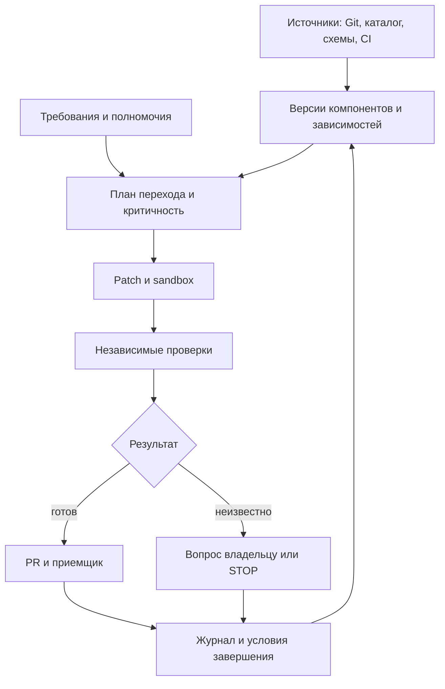

# Продукт: завершение межсистемных изменений

Дата продуктового решения: 2026-10-16; коммерческая редакция: 2026-10-17. Статус: коммерческая гипотеза; текущая реализация - раздел 33 (scoped queue, два ограниченных профиля и установка-кандидат). Цена версии и метрики - раздел 23. Платный спрос и преимущество не установлены.

Этот документ - текущая внутренняя версия. Для покупателя: [краткий оффер](migration-completion-offer.md). Предыдущие 1012 строк с 36 рисками, 54 предельными случаями и историей обсуждений сохранены в [архиве](archive/product-rebuild-before-commercial-entry-2026-10-16.md). Архив не является действующим обещанием клиенту. Исследовательские baseline, frozen-корпус и результаты ВКР не меняем.

## 1. Решение после независимого разбора

Продолжаем разработку корпоративного исполнителя изменений данных и зависимых систем. Целевой охват - компания, дивизион или департамент; размещение в инфраструктуре клиента не ограничивает охват одной машиной или репозиторием. Основные инициаторы - владельцы данных и продуктов данных, руководители платформ/интеграций, владельцы бизнес-процессов; экономическим покупателем становится роль с бюджетом и измеримыми затратами изменения. Миграция остается одним из проверяемых входов, а не границей продукта.

Целевой результат - автономное выполнение поддержанных изменений по делегированным полномочиям с обращением к человеку по исключениям. Целевая поставка - право использования определенной версии и внедрение; сопровождение отдельно. Компания-wide полномочия автоматически не выдаются: охват складывается из явно подключенных областей и мандатов. Текущий код пока одноустановочный ограниченный прототип; целевая архитектура описана в [корпоративном дизайне](enterprise-product-design.md).
Три независимых разбора охватили экономику, рынок/оффер и пилот/безопасность. Их согласие не является доказательством рынка. Итог ниже принят по аргументам, а не голосованием.

Эта таблица сохраняет решения первого коммерческого разбора. Расширение покупателей и области применения в текущем раунде зафиксировано выше и в разделе32; миграции больше не считаются единственным входом.

| Замечание Claude | Решение и уточнение |
|---|---|
| Числа экономики - допущения | Принять. Ни часы, ни p, ни N, ни стоимость принятой задачи не измерены у клиентов |
| Нужны минимум 8 переходов в месяц | Только для конкретного набора параметров и p=60%. Это не общий порог жизнеспособности и не аргумент против проектного продукта |
| Семантические переходы редки | Не установлено. Частоту измеряем за 12 месяцев; формулировка ниши сама по себе частоту не доказывает |
| Источники подтверждают миграции, а не узкую семантическую нишу | В основном принять. HeadHunter/Hoff подтверждают работу с метаданными, не прямой спрос на миграцию. Источник Сбера - материал инженеров заказчика, не только вендорский кейс |
| Входить через завершение миграции | Принять как более проверяемую коммерческую гипотезу, а не найденную свободную нишу |
| Конкуренты не закрывают приемку | Отклонить: Datafold прямо заявляет PR, data diff, UAT и полный migration delivery. Уникальность этой формулировки отсутствует |
| Интегратор покупает быстрее | Не установлено. При time-and-materials экономия часов может уменьшать выручку; доступы зависят также от конечного заказчика |
| Главный конкурент - сильный агент | Принять; сравнивать также с действующим специализированным решением, если оно уже есть |
| Считать только часы клиента | Клиентские часы - главный показатель, но часы поставщика и совокупный ресурс обязательны, иначе автоматизацию подменит ручной сервис |
| Один пропуск ошибки убьет доверие | Риск серьезный, но это не измеренная закономерность. Любой известный опасный ACCEPT блокирует соответствующий класс пилота |
| CAST(integer AS REAL) всегда ошибка | Нет. Ошибка определяется контрактом типа/точности; числовое равенство 1 и 1.0 недостаточно при строгом контракте |

## 3. Пользовательская ценность и первая область

Когда меняются смысл показателя, формула, контракт, источник, доступ, pipeline или платформа, зависимые приложения и отчеты должны сохранить прежнее обязательство либо намеренно перейти к новому. Владелец данных задает намерение; владельцы потребителей определяют свои обязательства и делегируют допустимые действия. Продукт должен самостоятельно выполнить доступную работу, подготовить связанные исправления и проверить каждое обязательство. Неизвестное не превращается в норму или разрешение.

Три входа: регулярные изменения продукта данных; межкомандное изменение контракта/бизнес-логики; миграция или вывод источника. Для первого внешнего кейса выбираем один повторяемый класс, фактический стек и независимого приемщика. Это ограничение квалификации версии, не ограничение рыночного видения. Пример30/90 остается диагностикой разных целевых требований, не выбранной навсегда нишей.

Первый пилот продается как подготовка и проверка согласованного пакета перехода с передачей ответственным; production переключение и вывод старого пути не обещаем до реализации соответствующего профиля. Цель дальнейших версий - очередь таких изменений в масштабе подразделения/компании и минимальная ручная координация. Система не должна добавлять новый глобальный gate каждой команде.

Гипотеза преимущества: выполнение намеренно разных требований потребителей, повторное использование актуальных проверенных оснований и адресная обработка исключений при меньшем полном труде. Каталог, граф, агентность, enterprise охват, генерация SQL и наличие PR сами по себе преимуществом не считаем. [Конкурентный реестр](competitive-evidence-2026-10-16.md) отделяет подтвержденные функции от неизвестных.


## 19. Аудит репозитория и выполненная консолидация

В main реализован исследовательский детерминированный контур и knowledge-1. Полный автономный цикл внедрения, ремонта, приемки и cleanup не реализован. Исследовательский PR/SQL/dbt-задел находится в ветке research/pr-change-assistant, срез b54e342fad3b428dcc3d5b50ec372355fb2960e5, а не автоматически в main.

Предыдущая проверка ядра: 119 тестов прошли; CI core/verify/configuration успешен на d42ec7c. Последующие изменения документации не являются новой проверкой runtime. Frozen-корпус, исторические результаты и исследовательские гипотезы сохранены. Новую продуктовую проверку вести отдельно.

## 20. Описание продукта и модульная архитектура

Целевой продукт - корпоративный автономный исполнитель делегированных изменений данных и зависимых систем. Он восстанавливает доступный контекст, готовит связанные исправления, проверяет требования потребителей и маршрутизирует исключения владельцам. Развертывание может охватывать компанию, дивизион или департамент через исполнителей в разрешенных средах. Поддержка конкретных технологий квалифицируется отдельно; корпоративный охват и исполнение произвольного кода пока не реализованы. Миграции - один из сценариев наряду с регулярными изменениями данных.

| Модуль | Работа | Проверяемый результат |
|---|---|---|
| Подключение и обследование | Читает разрешенные репозитории, схемы, CI, каталоги и журналы | Версионный инвентарь и явно неизвестные области |
| Контекст исполнения | Связывает потребителей, требования, источники и срок действия | Для каждого решения известны основание, версия и границы достоверности |
| Политика действий | Проверяет полномочия, критичность, бюджеты и разрешенные эффекты | Отдельное разрешение на чтение, PR, уведомление и изменение среды |
| Планирование и ремонт | Строит план, получает технические факты, готовит patch | Связанные изменения с общим идентификатором перехода |
| Независимая проверка | Исполняет sandbox/replay и заранее заданные ожидания | Принятие, отказ либо STOP с причиной |
| Координация | Назначает владельцев, создает разрешенные PR/notifications | Доставка, подтверждение, срок реакции, эскалация |
| История и инвалидация | Хранит действия, основания и смену версий | Воспроизводимая история и пересчет затронутых решений |
| Завершение | Сверяет критерии переключения, отката и retirement | Выполненные критерии или конкретные незакрытые условия |

### Ответственность и реакция

У каждого перехода есть заказчик изменения, владельцы затронутых компонентов, приемщик и владелец полномочий. Агент исполняет делегированный мандат; договорная и бизнес-ответственность остается у уполномоченных лиц. CODEOWNERS и каталог помогают найти кандидата, но не дают права действовать.

При новом событии агент определяет затронутые компоненты, пересчитывает актуальность свидетельств и критичность, готовит согласованный набор PR. В разрешенном канале направляет владельцу карточку: что меняется, почему он затронут, срок, ссылка на PR/replay, требуемое решение. Дедупликация по переходу и версии; повторные уведомления только по изменению статуса или SLA. Без заранее разрешенной отправки готовит черновик. Не найден владелец - эскалация координатору, без самоназначенного разрешения.

Пример: источник изменил окно 30d на 90d при прежнем JSON. Агент находит обработчик и витрину, проверяет утвержденное требование окна для каждого потребителя, готовит PR и replay отдельно по их ожиданиям. Сохранение 30d может быть правильным для одного потребителя. При отсутствии источника бизнес-смысла - адресный вопрос и STOP соответствующего действия.

### Четыре уровня критичности

| Уровень | Критерий | Действия по умолчанию |
|---|---|---|
| C0 - без влияния на поведение | Документация или подтвержденное отсутствие изменения внешнего поведения | Автоматические проверки; PR, если заранее разрешен |
| C1 - локальный | Обратимое изменение в одном компоненте без внешнего контракта | PR владельцу и тесты; auto-merge только по отдельной политике |
| C2 - межсистемный | Несколько команд, совместимость, backfill или переключение | Связанные PR, подтверждение приемщика и план отката; без самостоятельного production эффекта |
| C3 - критичный | Деньги, доступ, персональные данные, необратимая операция, большой простой | Остановка эффекта до явного разрешения уполномоченного лица и усиленной проверки |

Неизвестный масштаб не понижает критичность. Конкретные пороги, SLA и перечень критичных активов задает клиент; агент может повысить уровень и объяснить причину.

### Автономное развертывание

Образ/Helm-пакет может после выдачи доступа сам обследовать поддержанные источники, импортировать правила, запустить диагностику и предложить первый план. Базовая политика запрещает production эффекты, утечки и превышение бюджета. Из текста репозитория нельзя автоматически получить полномочия или неизвестный бизнес-смысл.

Человек необходим для сервисной учетной записи, allowlist, маршрута LLM, владельца/приемщика и разрешенных эффектов. После этого агент должен самостоятельно обновлять доступный контекст. Оценка 16 ч discovery и 50 ч поставщика на пилот ниже - план бюджета, не измеренная трудоемкость bootstrap. Считать setup, вопросы, поддержку и повторное подключение отдельно. Требование нулевого человеческого труда сейчас не подтверждено.

## 21. Граф исполнения и связи сущностей

Это конкретная модель контекста: узлы компонента, версии контракта, требования, владельца, полномочия, изменения и свидетельства; ребра потребляет, реализует, требует, разрешает, проверяет. Импорт каталога не заменяет эту модель, но избавляет от повторного построения известных связей.



Свидетельство содержит digest входа, версию требования, источник, проверку, время и условие устаревания. Изменились схема, код, полномочие, требование либо наступил срок - зависимое решение пересчитывается. Истечение срока проверяется таймером, даже без нового события. Неизвестные связи не изображаем полным покрытием экосистемы.

Журнал append-only: transition_id, event_id, actor, компонент/версия, before/after digest, основание, C0-C3, полномочие, действие, затраты, outcome, время, ссылка на PR/replay, подтверждение приемщика. Исправления - новые записи с supersedes. Хеш-цепочка без внешнего якоря и резервных копий не доказывает защиту от администратора. Храним данные по согласованной политике сроков и доступа.

## 22. Рынок РФ/СНГ: проверка спроса и публичных аналогов

### Реестр доказательств

Источники описывают исторические кейсы либо предложения поставщиков. Ни один не подтверждает наш заказ, цену или преимущество. Публичная страница продукта не доказывает его качество или отсутствие незаявленных возможностей.

| Утверждение и источник | Что подтверждает | Чего не подтверждает | Область |
|---|---|---|---|
| [Росбанк / Arenadata](https://arenadata.tech/projects/rosbank/) | Реальные сложности зависимостей при миграции и работу с новым стеком | Текущую незакрытую потребность и готовность купить наш продукт | Миграция |
| [Сбер: опыт миграции](https://habr.com/ru/companies/sberbank/articles/869294/) | Необходимость сравнения результатов, соответствия ключей и S2T | Спрос на наш узкий демонстратор и текущий бюджет | Миграция |
| [HeadHunter / ADC](https://arenadc.io/articles/tpost/kkx1bosch1-headhunter-sdelal-katalog-dannih-arenada) | Выбор внешнего каталога и ценность метаданных | Покупку завершения миграции либо семантических изменений | Метаданные |
| [Hoff / Arenadata](https://arenadata.tech/projects/arenadata-catalog-v-hoff-fundament-dlya-prozrachnoj-i-tochnoj-analitiki/) | Работу с владельцами и качеством данных | Новизну нашей маршрутизации и спрос на автономное исправление | Метаданные |
| [Postgres Pro: кейсы](https://postgrespro.ru/cases) | Наличие реальных проектов перехода | Число открытых проектов и цену нашей последней стадии | Миграция |
| [Datafold Migration](https://www.datafold.com/data-migration/) | Заявленные PR, diff, UAT, fixed-price delivery, работу с интеграторами | Доступность в РФ/СНГ и сравнительное качество нашего решения | Прямое пересечение |
| [Arenadata: замещение](https://arenadata.tech/solutions/zameshchenie-inostrannyh-sistem/) | Конкурентное предложение миграционных работ | Отсутствие у поставщика адаптации потребителей | Миграция |
| Изменение окна 30d/90d при прежней схеме | Наш проверяемый технический сценарий | Частоту в компаниях и готовность платить | Семантический переход |

Финсервис из прежнего обзора не используем как отдельное доказательство, пока не привязан первичный источник к конкретному утверждению. Пустая клетка в конкурентной матрице означает "не установлено", а не "функции нет".

Подробная новая матрица: [11 публичных предложений и критерии опровержения отличия](competitive-evidence-2026-10-16.md). [Data Ocean Governance DQ](https://datasapience.ru/platforms/data-governance/dq/) уже заявляет контракты источник-потребитель, согласование и уведомления. [Arenadata Catalog](https://arenadata.tech/ru/news/gruppa-arenadata-vypustila-versiyu-arenadata-catalog-1-0-0) уже поддерживает домены, дата-продукты и владельцев. Эти функции не считаем свободной нишей.

### Где искать преимущество

Кандидат: доведение неоднородного перехода от источника через приложения/события до результата у потребителей, с независимыми требованиями, учетом неизвестного и устаревания проверки. Проверить против Datafold, локального миграционного решения и сильного универсального агента. Если преимущество только в контексте или verifier, продавать этот модуль/skill/MCP/OEM; самостоятельная платформа не обязательна.

### Размер доступной области

[Postgres Professional сообщил о 3000+ организациях-заказчиках](https://postgrespro.ru/blog/news/5971746) 27 марта 2025; [Arenadata сообщает о 200+ клиентах](https://arenadata.tech/ru/investors). Это не количество наших покупателей. Базы пересекаются, группы компаний и малые установки требуют очистки. Их нельзя суммировать.

Сценарий только внутри наблюдаемого пула 3000: 5-15% подходят по неоднородности = 150-450; у 20-40% есть финансируемый проект в год = 30-180; доступны по закупке/доступам 20-50% = 6-90 возможностей в год. Все три коэффициента - допущения, не исследование TAM/SAM. Это не оценка всего рынка РФ/СНГ; добавка СНГ не установлена. Следующий шаг - список именованных групп, дедупликация, конкретный проект и бюджет. 12-21 постоянных клиента из старой модели нельзя сравнивать с годовым числом разовых проектов.

## 23. Экономическая проверка и коммерческая модель

Коммерческая редакция 2026-10-17, согласована автором. Направление 16 октября сохраняется: корпоративный исполнитель делегированных изменений, четыре группы покупателей и разовая поставка поддержанной версии.

### Цена версии и полная стоимость поставки

Рабочая гипотеза L = 100000-150000 руб. за право использования определенной поддержанной версии модуля. Это не ежемесячный платеж и не установленная готовность рынка платить. Внедрение D, необязательные поддержка/обновления S и инфраструктура/LLM I показываются отдельно. Организационная граница лицензии и условия использования закрепляются в конкретном предложении. Если обсуждается 100000-150000 руб. за весь запуск, это отдельная комплектация с ограниченным бюджетом услуг, а не та же лицензия со скрытым внедрением.

### Главная коммерческая метрика и качество

`Net_cash(T) = cash_cost_best_alternative(T) - cash_cost_with_module(T)`.

Горизонт T, одинаковый объем работы, качество и граница завершения фиксируются до измерений. С модулем учитываются L, D, S, I, оплаченный труд/подряд и фактические расходы исправления/восстановления. Расход, который одинаков в обоих вариантах, не становится экономией. Наблюдаемые платежи и прогноз отделяются.

`Capacity_value(T) = sum_roles((H_alternative - H_module) * loaded_hour_rate)` - отдельная денежная оценка высвобожденного ресурса. Она не означает уменьшения зарплатного платежа и не суммируется автоматически с Net_cash: исключить двойной счет. Часы клиента и поставщика считать раздельно, включая подключение, обследование, требования, реализацию, вопросы, review, STOP, неудачи, восстановление, сопровождение и cleanup. Календарное ожидание отдельно от активного труда.

Сокращение количества технических связей не является целью. Измерять ручные передачи, блокирующее ожидание, повторное обследование и расходы незавершенного перехода. Retirement дает денежную экономию только после фактического устранения расхода и сравнения со сроком/стоимостью отключения альтернативой. Ошибочные принятые результаты, ложные отказы, неизвестный охват и доля завершенных назначенных задач ограничивают допустимый экономический вывод.

### Экономика поставщика и проверка

`contribution = license_revenue + deployment_revenue - direct_implementation_and_acceptance - customer_specific_compute - delivery_and_warranty_reserve - direct_sales_costs`.

R&D и накладные расходы отдельно. При условных 3000 руб./ч лицензия 100000/150000 руб. соответствует 33.3/50 часам мощности до внедрения и эксплуатации; это арифметика допущения, не денежная окупаемость штатного сотрудника. Низкую цену должна обеспечивать повторяемость поставки, а не бесплатный труд автора.

Сравнивать три варианта: текущий процесс, сильный агент с сопоставимыми инструментами без нашего модуля, наш модуль. До измерения закрепить независимые ожидания/holdout, scope, модели/бюджеты, полные затраты и все неудачные попытки. Инженерная серия 6-10 задач не доказывает рынок. Прежние 30% часов могут использоваться как заранее согласованный вторичный управленческий ориентир, но не как ROI, новая научная гипотеза или обещание.

### Исторические расчеты

Следующий блок сохранен для воспроизводимости. Месячный P, порог N>=8, discovery 80000 руб. и пилот 240000 руб. не являются действующим тарифом или условиями покупки версии. Тарифы моделей и LLM-маршруты из блока требуют актуальной проверки перед предложением.

<details>
<summary>Расчеты предыдущей коммерческой конфигурации</summary>

### Историческая модель до уточнения 17 октября

### Формулы вместо обещанного ROI

Единица N - независимый переход с общей целью и критериями завершения; несколько PR одного перехода не увеличивают N. b - часы текущей лучшей альтернативы; a - часы клиента при принятом результате; s - все часы клиента при STOP/провале с последующим завершением; p - доля принятых результатов без дополнительного ремонта. Это экономический исход, не показатель безопасности.

M - постоянные часы сопровождения в месяц; O - разовые часы подключения; T - месяцы распределения O; w - полная стоимость часа; P - цена в месяц; I - дополнительные расходы клиента в месяц, не включенные в P. Нельзя дважды учитывать inference. Освобожденные часы не обязательно уменьшают денежные расходы компании.

```
d = b - s + p*(s-a)
Net = w*(N*d - M - O/T) - P - I
p_min = (s-b + (M+O/T+(P+I)/w)/N)/(s-a)
```

Последняя формула применима при N>0,w>0,T>0,s>a. При s=a эффект не зависит от p; при s<a обычного минимального порога нет, требуется разбор определения исходов. p_min>1 - безубыточность недостижима; p_min<=0 - выполняется и при p=0. При N=0 нет порога p, остаются постоянные затраты.

Старый пример (все допущения): b=24,a=6,s=28,p=60%,M=8,O=32,T=6,w=3000,P=150000,I=20000. Тогда d=22p-4=9.2 ч, фиксированная нагрузка эквивалентна 70 ч, Net при N=20 = 342000 руб./мес. При b=16 получаем -138000. Это не фактическая экономия.

| N/мес | Точное p_min | Минимум целых процентов для Net>=0 |
|---|---|---|
| 5 | 81.8182% | 82% |
| 8 | 57.9545% | 58% |
| 10 | 50.0000% | 50% |
| 20 | 34.0909% | 35% |
| 40 | 26.1364% | 27% |

У Claude последние две округленные границы 34%/26% дают небольшой убыток. При N=10,p=50% - ровно ноль. N=40 при прежней цене - только чувствительность; пакет на 20 задач не покрывает 40 автоматически. При p=60% N_min=7.6087, целое 8. Частоту этой величины у клиентов еще не знаем.

### Продажа первого проекта

Разведка: предварительный бюджет 80000 руб., до 16 ч поставщика и 10000 руб. вычислений. Пилот: ориентир 240000 руб., до 50 ч поставщика и 30000 руб. вычислений, только после определения объема. Оба числа - гипотезы цены и себестоимости, не рыночный тариф. Каждая стадия оплачивается до начала; после разведки возможен отказ от пилота с выдачей ее результата. Срок пилота 4-6 недель после доступов. Налоги, расходы и права закрепляются в конкретном предложении.

Пример при ставке поставщика 3000 руб./ч: общая выручка 320000, прямые затраты 238000, вклад 82000 (25.6%) до продаж, R&D и накладных расходов. Это не чистая прибыль. При дополнительных затратах клиента 20000 и его ставке 3000 нужно высвободить более 113.3 ч, чтобы покрыть весь бюджет. Нельзя обещать окупаемость пилота из трех обычных задач по 24 ч. Для малого объема это оплачиваемая техническая проверка, а не экономически окупаемый проект; решение должно быть явным. Повторяемая экономика проверяется отдельно от исследовательского бюджета.

Пилотный объем - один контур, до 2-4 заранее описанных переходов, согласованные репозитории, адаптеры, объем replay и критерии. Число переходов не гарантирует подходящий объем: после разведки согласовать цену по сложности либо отказаться. Новые адаптеры, production effects и расширение scope - отдельное предложение. Для интегратора - ограниченный субподряд/white-label с согласиями конечного заказчика, границей ответственности и правами на результаты. При T&M сначала проверить, кому достается экономия.

### LLM-маршруты и расчет цены

| Маршрут | Что оплачивается | Что требуется проверить |
|---|---|---|
| LLM клиента | Токены/квота клиента и наша эксплуатация | Модель, endpoint, доступность, журналирование, качество |
| Полностью локальная | GPU, резерв мощности, администрирование, электричество | Нет неразрешенных исходящих вызовов; качество на том же наборе |
| Облако РФ | Вход/выход, cache, retries, хранение и sandbox | Реальный маршрут/субподрядчики, допустимость данных и актуальное предложение |

Сопоставимая цена маршрутов не установлена: неизвестны модель, контекст, число попыток и требуемое качество. Формула на переход: input_tokens/1e6*rate_in + output_tokens/1e6*rate_out + cache + retries + sandbox + доля инфраструктуры. Для локальной модели использовать затраты выделенной мощности и загрузку, а не нулевую цену токена. Старые 1000 руб./задачу - сценарный placeholder, не котировка. Измерять стоимость принятого результата, включая STOP и человеческую проверку. Перед КП запросить тариф/квоту и прогнать одинаковый набор; дешевый токен не доказывает дешевый результат.

</details>

## 24. Следующий связный этап и критерии продолжения

### Интервью: сценарий и запись

Вступление: "Разбираем, что мешает завершать межсистемные переходы. Можно пройти последний конкретный случай? Сейчас не просим оценить наш продукт". Запросить разрешение на запись и использование обезличенных фактов.

1. Последний переход: когда, зачем, какие производители и потребители, что считается завершением? Сколько сопоставимых переходов за 12 месяцев, отдельно по месяцам/проектам? Уточнить единицу и исключить счет PR вместо переходов.
2. Кто и сколько работал: обследование, реализация, вопросы, review, replay, STOP, cleanup? Часы по ролям, календарная длительность отдельно. Есть ли tickets/таймшиты/проектный отчет; кто оплачивал труд? Если часов нет, записать "не установлено", не домножать недели на полный штат.
3. Чем делали: скрипты, каталог, миграционный продукт, сильный агент, интегратор? Что осталось нерешенным? Попросить артефакт или пример; не предлагать заранее желаемую проблему.
4. Остался ли старый путь, почему, кто разрешает отключить, что мешает, каков документируемый расход на него? Не переводить стоимость инфраструктуры в обещанную экономию без возможности ее убрать.
5. Кто принимает и платит, есть ли финансируемый проект и срок закупки? Какие артефакты/read-only доступны, какая LLM разрешена, кто согласует? Следующий шаг с конкретной датой: обезличенный кейс, технический доступ или платная разведка.

Уточнения: факты последнего случая отдельно от оценок; источник и уверенность ответа; фиксированная цена/T&M/внутренний штат; ограничения контакта на раскрытие. Не называть собеседнику порог 8, желаемые 30% и предполагаемую цену до сбора исходных данных. Не продавать автономность, не обещать отсутствие ошибок, не считать "интересно" спросом.

Запись: ID, компания/группа, сегмент и роль; дата/ID кейса, определение перехода, N12м и источник; часы по стадиям/ролям и достоверность; лучшая альтернатива; старый путь/расход/источник; бюджетодержатель/бюджет/срок; доступы/LLM; неизвестное; следующий шаг/ответственный/дата. Факты, слова респондента и наши выводы - отдельно. Таблица для заполнения включена в калькулятор.

### Зафиксированные критерии новой кампании

Исходные управленческие критерии зафиксированы 2026-10-16; коммерческая метрика и модель цены уточнены 2026-10-17 (раздел 23), без ретроспективного объявления успеха. 30% часов остаются вторичным предварительным ориентиром; денежный порог и горизонт должны быть закреплены до измерения. Дата исходной фиксации: 2026-10-16, до новых интервью этой кампании. Это датированная запись в git, не нотариальное заверение. Не распространяется задним числом на предыдущие разговоры. Пересмотр через 30 календарных дней после первого нового квалифицированного интервью; изменения критериев - отдельная запись с причиной.

| Проверка | Продолжать | Пересмотр |
|---|---|---|
| 10 целевых разговоров | >=4 компании/интегратора с конкретной очередью и финансируемым проектом | Меньше 4: менять сегмент/проблему, не строить платформу |
| Доступ и обязательство | >=2 готовы дать разрешенные артефакты; >=1 оплатила разведку | Формальное обсуждение бюджета не считать оплатой. Нет оплаты к контрольной дате - пересмотр цены/оффера/канала |
| Повторяемость | Для версии и внедрения измерить полную стоимость, Net_cash и повторное использование; часы отдельно | Нет положительного эффекта: пересмотр профиля, комплектации или канала |
| Контрольная инженерная серия | 6-10 заранее выбранных сопоставимых задач; >=30% снижения совокупных часов клиента против сильного агента | Не выполнено: проверить модуль/skill/MCP/OEM; нет оснований для отдельной платформы |
| Совокупный ресурс | Часы клиента + поставщика не выше baseline с той же границей учета | Экономия клиента обеспечена скрытым сервисом: считать сервисную модель отдельно |
| Надежность | Все известные опасные mutants отклонены/STOP, валидные примеры приняты; ни одного известного опасного ACCEPT на holdout | Немедленная пауза затронутого класса, разбор причины и повторная проверка |
| Маржа | Положительный вклад проекта на фактических прямых затратах | Отрицательный вклад без отдельно одобренного R&D-бюджета: менять цену/scope/процесс |

Один пилот не доказывает размер рынка или надежность в генеральной совокупности. Разделять решение "можно продолжить проверку" и "доказан самостоятельный продукт".

### Протокол сравнения с сильным агентом

1. До старта зафиксировать независимый переход, snapshot, ожидаемый результат, область доступов и запрещенные эффекты. Не выбирать удобные задачи после запуска. До 10 архивных задач - только калибровка; следующая серия 6-10 задач - оценка. Коммерческий пилот на 2-4 переходах не заменяет эту серию.
2. Baseline получает того же класса модель, версии, инструменты, документы, права, лимиты и лучшие доступные skills/MCP. Если агент использует каталог/граф, не запрещать. Учитывать настройку обеих сторон. Ожидания и скрытые случаи формирует независимый приемщик до просмотра кандидатов.
3. Для одной задачи использовать независимых операторов и изолированные копии, не переносить найденные исправления. На серии чередовать операторов/порядок по заранее записанному плану. Если один инженер решает дважды, раскрыть перенос опыта; такой кейс не считать чистым сравнением.
4. Учитывать все назначенные задачи: STOP, timeout, неудачные попытки, ручной ремонт и финальную приемку. Клиентские часы по стадиям: подключение, уточнения, реализация, review, проверка, исправления, cleanup. Поставщик отдельно: setup, скрытые ручные действия, поддержка. Также токены, compute, календарное время. Параллельные человеко-часы складывать, не заменять временем ожидания.
5. Главный коммерческий показатель с 17 октября - Net_cash(T) из раздела 23 при одинаковых задачах, качестве и конечной точке. Отдельно показать Capacity_value и вторичный показатель часов: 1 - SUM(client_hours_system)/SUM(client_hours_baseline). Показать сырые пары, медиану/диапазон и суммарные часы. Setup показать целиком и отдельно распределить только по наблюдаемому объему. Показать первый и последующие переходы. Если baseline=0, относительный показатель часов не определен. Дату изменения метрики сохраняем; прошлые результаты задним числом не переоцениваем.
6. По возможности приемщик не знает ветку происхождения. Он проверяет одинаковые критерии и фиксирует дефекты. PR-only завершение означает принятую готовность и план, а не отключенную систему. Реальное отключение требует отдельного мандата и наблюдения. Отклонения от протокола датировать; исключения не менять задним числом.

### Verifier: блокеры до клиентского пилота

Состояние: исходный список блокеров сохранен ниже. В пачке 2 реализованы comparator и gate для предоставленных observations; точная граница выполненного и оставшегося приведена в разделе 28. Frozen-корпус не меняется.

| Порядок | Контрпример/работа | Ожидаемое поведение |
|---|---|---|
| 1 | Контракт точности/типа: CAST integer->REAL, значения >2^53, деньги, NaN/Infinity, границы округления | При строгом контракте потеря/тип отклоняется. При разрешенной числовой эквивалентности 1 и 1.0 не обязаны различаться |
| 2 | Дубликат/лишняя/пропавшая строка, NULL vs zero/empty, порядок, ошибка исполнения | Проверка multiset и контракта; исключение исполнения не превращается в ACCEPT |
| 3 | CASE на неохваченном значении, пустой набор, агрегат совпал при неверных строках | Скрытые различающие fixtures, проверка по ключам/инвариантам |
| 4 | Общая ошибка candidate/oracle, копирование той же реализации | Независимые ручные примеры или другая реализация и скрытые mutants; совпадение двух ошибочных вычислений не доказывает правильность |
| 5 | Истечение 30d/90d без событий, timezone, late/duplicate events, restart | Таймер инвалидации, детерминированный replay, проверка состояния |
| 6 | Нет кандидата, неподдержанный адаптер, устаревшее основание, отозванное разрешение | STOP/отказ и отсутствие эффекта; права повторно проверены непосредственно перед действием |

До допуска: чистый воспроизводимый прогон, все известные опасные mutants rejected/STOP, положительные примеры проходят, независимые ожидания не извлекаются из кандидата. Остаточные ограничения перечислены приемщику. Версия тестов, replay и результат закреплены коммитом. Не заявлять, что уже закрыт пакет A.

### Ответ для службы безопасности

Пилот читает только согласованные репозитории/схемы/CI и обезличенные fixtures. Значения production-данных требуют отдельного разрешения. Код, схемы, имена таблиц, логи и зависимости также могут быть чувствительными. До подключения согласовать перечень данных, получателей, retention и удаление.

Поток: клиентский connector -> worker и состояние -> явно согласованный LLM endpoint -> sandbox -> PR в разрешенный репозиторий. Для каждого участка зафиксировать, что передается и где хранится. Секреты в secret manager, не в prompt/replay. Логи очищать от значений и credentials; сроки хранения/доступ задает клиент. Sandbox без ambient credentials, host mounts и неразрешенной сети; текст репозитория не является источником полномочий.

Раздельные scopes: read, patch, publish PR, notify, production effect, delete. По умолчанию только read/sandbox; PR и уведомления отдельно включаются. Перед эффектом повторная проверка текущих прав, бюджета и версии; доступны revoke/stop. Журнал, резервные копии и экспорт результатов принадлежат согласованному контуру. Локальный маршрут не объявлять "без исходящего трафика", пока это не проверено. Сертификация и соответствие требованиям конкретного клиента не установлены. Конкретные модель, endpoint, payload, retention и числовая стоимость фиксируются до договора.

### Чистота внешних формулировок

Внешний оффер: "подготовленные и проверенные изменения, блокеры, условия завершения". Не используем голосование как доказательство, "аналогов нет", гарантированный ROI, "конституция", "сеть агентов", "найдем всех потребителей", "сам развернется без участия" или "выключим старый путь" для PR-only. Внутренние архитектурные термины и исторические материалы сохранены с явной маркировкой. Этот аудит касается действующего оффера и навигации, не переписывания git-истории или научных результатов.

## 25. ЦА, JTBD и поставка on-premise

Уточнение 2026-10-16: предпочтение автора - разовая поставка модуля с внедрением и правом дальнейшего использования. Поддержка и обновления отдельно, обязательной подписки нет. Предыдущий проектный пилот остается способом проверки, но не единственной моделью продажи. С 17 октября текущая цена-гипотеза версии - 100000-150000 руб.; внедрение и поддержка отдельно. Месячная модель в историческом блоке раздела 23 не действует; порог N>=8 не является условием покупки версии.

### Кому предлагаем

Целевой профиль - владелец данных/продукта данных, руководитель платформы/интеграций или бизнес-процесса, у которого изменения регулярно затрагивают несколько компонентов и требуют дорогой координации. Нужны доступный тестовый контур, приемщик и эксплуатационные компетенции. Квалифицирующий признак - измеримая незавершенная работа, которую можно воспроизвести и принять; наличие миграции не обязательно.

| Роль | Кто именно | Участие |
|---|---|---|
| Пользователь | Data/platform engineer, разработчик интеграций, QA | Запускает переход, разбирает PR, проверки и блокеры |
| Внутренний инициатор | Владелец данных/продукта данных, руководитель платформы/интеграций, архитектор | Дает кейс и собирает участников |
| Технический приемщик | Владелец целевой системы и затронутые команды | Подтверждают требования и результат в своей области |
| Экономический покупатель | Владелец бюджета продукта данных/департамента, CDO/ИТ-директор, руководитель программы | Покупает поставку, утверждает бюджет и границы |
| Бизнес-заказчик | Владелец отчета, процесса, продукта данных | Подтверждает допустимый смысл и последствия изменения |
| Эксплуатация и допуск | DevOps/SRE, ИБ, администратор среды | Размещение, сервисные доступы, backup, разрешенный LLM-маршрут |
| Второй канал | Интегратор с проектами фиксированной цены | Использует модуль в проектах при согласованной экономике и правах конечного клиента |

Владелец данных и бизнес-подразделение могут быть первым адресатом, инициатором и покупателем при наличии бюджета. Устанавливаем отдельно владельца смысла, владельца технических полномочий и того, кто несет затраты; эти роли не совпадают автоматически. Для поставки без постоянной поддержки приоритет - конечный заказчик с эксплуатационной командой. OEM/white-label интегратору требует отдельной модели прав и не входит автоматически в лицензию одного заказчика.

### JTBD по сторонам

| Чья работа | Когда | Что нужно сделать | Как понять, что стало лучше |
|---|---|---|---|
| Владелец данных/продукта данных | Изменяются смысл, контракт или источник, потребителей несколько | Довести намерение до проверенного поведения потребителей без ручного управления каждым шагом | Меньше часов координации, выполнены обязательства потребителей |
| Инженер интеграций | Источник перенесен/изменен, потребителей несколько | Найти доступные зависимости и подготовить согласованные исправления | Меньше часов обследования и ремонта, меньше ручных повторных проверок |
| Технический приемщик/QA | PR готов, одной проверки схемы недостаточно | Проверить результат по независимым ожиданиям и получить воспроизводимое основание | Обнаружены различающие ошибки; понятны границы принятия и причины STOP |
| Руководитель платформы | Переход застрял между командами | Видеть оставшуюся работу, владельцев и условия завершения | Меньше незакрытых блокеров и повторного сбора контекста |
| Руководитель миграции | Срок проекта близок, старый путь продолжает жить | Получить подтвержденную готовность к переключению | Выполнены критерии, известны исключения, назначен ответственный за фактическое отключение |
| Владелец бизнес-процесса/отчета | Технология меняется, смысл результата должен сохраниться либо измениться намеренно | Сохранить согласованные суммы, правила и метрики | Выполнены бизнес-примеры и допуски; технологический diff не подменяет проверку смысла |
| Бюджетодержатель | Оплачивается двойная эксплуатация и работа проекта | Уменьшить устранимые затраты и неопределенность завершения | Измерен высвобожденный труд; фактическое снижение счета только после подтвержденного отключения |
| DevOps/SRE и ИБ | В контур вводится новый инструмент | Развернуть и эксплуатировать его без постоянного доступа поставщика | Повторяемая установка, понятный трафик, резервное копирование, восстановление и отзыв прав |

Последние два результата требуют отдельно проверять причинность: наш PR сам по себе не отключает сервер и не уменьшает бюджет.

### За что разовая оплата

Поставка = право использования конкретной версии в согласованном контуре + внедрение поддержанных адаптеров + приемка + передача эксплуатации. В счете это может быть одна сумма; внутри считаем отдельно лицензионную часть L и внедрение D. Право на использование не должно прекращаться только из-за отказа от отдельного сопровождения - предлагаемая коммерческая конструкция для согласования, не готовое юридическое условие.

В состав передачи входят образы с зафиксированными версиями и digest, конфигурация, поддержанная матрица стека, миграции состояния, инструкция установки/backup/restore/удаления, список зависимостей и их лицензий, пример сценария, протокол приемки и известные ограничения. До договора проверить происхождение кода и права на результаты ВКР; коммерческие права на наш код не заменяют лицензии сторонних компонентов и модели.

Отдельно оплачиваются новые версии, новые адаптеры, изменение scope и SLA/поддержка по желанию. Клиент оплачивает свою инфраструктуру и LLM либо использует имеющуюся квоту. Без обязательной подписки поставка не должна требовать нашего облака, онлайн-проверки лицензии или постоянного участия разработчика. Эксплуатационные обновления среды и модели могут потребовать повторной квалификации совместимости. Приемочное исправление дефектов и последующее сопровождение разграничить в конкретном предложении; "без поддержки" не означает отсутствие критериев качества поставки.

Экономика проекта: Net = w*(H_лучшая_альтернатива - H_с_модулем) - L - D - дополнительные расходы. H_с_модулем включает труд клиента на установку, review, STOP, повторные запуски и эксплуатацию. По нескольким переходам брать фактический горизонт, остаток ценности версии и новые расходы, а не искусственно считать N в месяц. Цены 80/240 тыс. из раздела 23 остаются бюджетным примером прежнего пилота; цена лицензии не установлена.

### Предложение команде и внедрение

Внешняя формулировка: "Готовим модуль для подготовки и проверки связанных изменений при изменении контракта, формулы, источника или платформы в корпоративном контуре. Он должен выдавать связанные исправления, воспроизводимые проверки и список того, что мешает завершить переход. Предлагаем разобрать ваш последний случай, затем проверить модуль в тестовом контуре. Целевая поставка - разовое внедрение и право использования версии, без обязательной подписки". Прототип не представлять готовым коммерческим ПО.

| Шаг | Наша работа | Клиент | Результат |
|---|---|---|---|
| Квалификация | Разбор последнего кейса и альтернативы | Владелец задачи, часы/артефакты | Решение, есть ли подходящая работа |
| Технический разбор | Матрица технологий, границы, потоки данных | Архитектор, ИБ, SRE, приемщик | Паспорт контура и разрешенные эффекты |
| Согласование поставки | Версия, L+D, объем, ограничения и приемка | Покупатель и ответственные | Конкретное предложение; без выдуманной цены |
| Установка в test/staging | Образы, конфигурация, диагностика | VM/runtime, учетные записи, LLM endpoint | Пройденный smoke без production записи |
| Проверка на переходе | Обследование, patch, replay, блокеры | Независимые ожидания и review | Принимаемый набор артефактов |
| Передача | Runbook, обучение, backup/restore и повторная установка | Эксплуатация выполняет шаги без нас | Подписанный протокол готовности версии |

Паспорт до установки: заказчик/приемщик/владельцы, границы источников и потребителей, точные версии стека, LLM endpoint и запрет исходящего трафика, типы данных и retention, service accounts/scopes, ожидаемое поведение, допустимые эффекты, SLA реакции, способ остановки, ресурсы и владелец эксплуатации. Пока такого паспорта на реальную компанию нет.

## 26. Прототип: куда ставим, как работает и что отсутствует

### Фактическое состояние после проверки кода

Проверены pyproject.toml, UI/API, knowledge API, аудит PostgreSQL, Dockerfiles и пример Compose. В docs находится 40 Markdown-файлов и 2 JSON-инвентаря на момент аудита. Это инвентаризация и проверка критического пути, не полный аудит всех файлов и всех угроз.

| Сейчас | Реальное назначение | Для нового модуля |
|---|---|---|
| src/datamesh_release_protocol, V2 | Проверяет явно записанные требования | Переиспользовать как ограниченный механизм проверки, не как весь продукт |
| knowledge-1 и API | Версии связей/оснований, полномочия и журнал | Переиспользовать с отдельными адаптерами и моделью перехода |
| services/demo_api.py и ui/index.html | Development-сценарии, E4 и синтетическая карта | Исследовательский демонстратор; нет реального ремонта миграции |
| services/audit_pg.py | Запись синтетических V2 решений | Не готовое хранилище жизненного цикла нового продукта |
| deploy/p1 и Dockerfiles | Development-размещение | Не квалифицированная offline on-premise поставка |
| research/pr-change-assistant | Отдельный задел PR/SQL/dbt | Выборочно переносить после исправления verifier, не вливать как готовый продукт |

Исправлены противоречивые статусы UI/README. Добавлен локальный запуск исследовательского UI с API: `PYTHONPATH=src python -m services.local_demo`, после установки api/distributed/test-api extras, адрес http://127.0.0.1:8080. Это способ увидеть имеющееся, а не новый продукт. Внешняя публикация и подключение клиента не выполнялись. Повторная проверка в отдельной среде с API-зависимостями: 35 тестов knowledge, knowledge API и demo API прошли; smoke локального launcher проверил UI, health, запуск реального development V2 и knowledge-1. Первоначальный запуск без FastAPI завершился ошибкой зависимости; после установки extras в изолированную среду проверка успешна. Docker в среде аудита недоступен; сборку контейнеров этим запуском не подтверждаем.

### Проектное решение для первой работающей версии

Размещаем модуль в выделенном тестовом сегменте клиента рядом с Git/CI и тестовой БД. Он не встраивается в production путь события и не становится обязательной точкой отказа приложений. Запуск по запросу либо webhook разрешенного изменения; остановка модуля оставляет обычный процесс работы команд доступным.

Предлагаемый стек: существующие Python 3.12, Pydantic, FastAPI; Git для snapshots/patches; PostgreSQL для нового состояния переходов и журнала; отдельный worker и изолированный sandbox для проверок; простой UI. OCI-образы и Compose для первого согласованного одиночного узла. Kubernetes/Helm только если этого требует среда заказчика; Kafka и отдельная графовая СУБД не являются начальными зависимостями. Это решение для реализации, не описание уже собранной поставки. [Docker: single-server deployment](https://docs.docker.com/compose/how-tos/production/), [FastAPI: containers](https://fastapi.tiangolo.com/deployment/docker/).

LLM подключается через явно заданный клиентский endpoint; сама по себе on-premise установка API не означает локальность inference. Для полностью изолированного контура модель, зависимости, UI assets и образы также должны быть доступны внутри. Версии моделей и адаптеров фиксируются; сервисные секреты не попадают в sandbox. Для небольшого стенда без собственной LLM можно начать планирование с 2 vCPU/4 GiB и 20 GiB состояния, но это непроверенное ресурсное предположение, не паспорт производительности; GPU модели рассчитывается отдельно. Квоты Cloud.ru и нагрузочный тест не заменены этим предположением.

Первый клиентский переход выбираем по реальной задаче и доступным критериям приемки, без обязательного JSON/Python/SQL. Общее описание: версионированный источник/компонент -> зависимые компоненты -> наблюдаемый результат. Цепочка JSON/Python/SQL остается одним внутренним лабораторным примером. Поддержка конкретного стека определяется операциями адаптеров и проверками, а не валидностью описания. Неподдержанное действие дает blocker/STOP.

Рабочий путь: разрешенный snapshot -> обнаруженные зависимости/пробелы -> план и C0-C3 -> patch в изолированной копии -> независимые проверки -> PR-ready пакет/блокеры -> подтверждение приемщика -> условия завершения. До выдачи отдельного Git-разрешения сохраняется локальный patch; публикация PR не подразумевается автоматически. Исправление одной цели не должно молча менять требования остальных потребителей.

На экране нужны четыре объекта: карточка перехода (цель/границы/владелец/критичность), найденные компоненты и неизвестное, изменения и проверки, история/блокеры/условия завершения. Это спецификация нового прототипа. Текущий исследовательский экран этих объектов полностью не реализует.

Готовность первого продуктового прототипа: воспроизводимо установить на чистой среде; подключить fixture-репозиторий; выполнить один корректный переход с фактическим diff и проверками; отклонить неверное изменение/STOP при неизвестном; сохранить и восстановить историю после restart; повторный запуск не создает повторных эффектов; без LLM/доступа нет фиктивного успеха; пакет принимает другой инженер по инструкции. Демонстрационная метка не заменяет эти проверки.

### Приведение репозитория в порядок

Сохраняем один текущий внутренний документ и один оффер. Научные версии, frozen-корпус, результаты и публикации не удаляем: это воспроизводимость ВКР, не мусор. launch-2026-10 и прежняя пересборка - явно исторические планы. Старые документы не должны быть маршрутами внедрения нового продукта.

Следующая кодовая организация: отдельный пакет `src/change_completion` и отдельные продуктовые тесты/fixtures; исследовательское ядро остается в `src/datamesh_release_protocol`. В пачке 1 созданы отдельные контракты и декларативная оценка покрытия в этом пакете; на момент пачки1 executor и хранилище отсутствовали. В пачке2 добавлен verifier (раздел28), в пачке3 - ограниченный исполнитель и локальное устойчивое состояние (раздел29). Не переименовывать старый движок в новый продукт. Новая модель перехода, adapters, worker, verifier, журнал и UI создаются по связанному пути выше; PR-задел переносится выборочно. Физическое перемещение исторических файлов возможно только с правкой ссылок; сейчас удаление не требуется и не выполнено.

Ближайший порядок: закрыть verifier и независимые ожидания -> собрать один сквозной переход -> показать инженеру установку и результат -> замерить труд -> принять решение о поставляемой версии. Интервью идут параллельно и уточняют поддержанный стек. Дальнейшее расширение описания не считается прогрессом реализации.

## 27. Пачка 1: общая модель перехода и границы реализации

Решение автора: не закреплять JSON/Python/SQL ни как стек продукта, ни как обязательный клиентский MVP. Сужаем объем работы, но не выбираем стек за клиента. Общая единица: одно делегированное изменение с целью, областью, версиями компонентов, требованиями каждого потребителя и критериями завершения. Формат JSON для описания перехода не означает JSON в прикладном потоке.

### Кодовый каркас

Создан отдельный `src/change_completion`: модели `TransitionSpec`, `Component`, `Requirement`, `Dependency`, `CapabilityNeed`, `AdapterDeclaration`, `AuthorityGrant`, `EvidenceBinding`, `JournalEvent`; порты обследования, подготовки patch и проверки; чистый `assess_declarations`. Старое исследовательское ядро и его corpus не переписаны.

У компонента есть профиль технологии и ссылки на версионные артефакты. У каждого потребителя свои утвержденные ожидания; 90d для одного не отменяет 30d другого. Зависимость содержит observed/inferred/unknown и основание. Неизвестное не считается отсутствием влияния.

Адаптер объявляет action + artifact_kind + точный profile, версию, ограничения и planned/experimental/qualified. Умение discover не дает patch/verify; другой диалект не считается совпадением. Профиль должен определять версии и поддержанные конструкции. Декларация qualified требует ссылки на квалификацию, но подлинность ссылки и наличие реального исполнителя пока не проверяются. Совместимость профилей по semver не реализована: совпадает только точный идентификатор.

Разрешение содержит actor, issuer, компоненты, actions, environment и интервал времени. Это формат декларации, не доверенная платформа авторизации: входной документ не может сам выдать рабочие полномочия. Перед фактическим эффектом будущий runtime обязан загрузить актуальные права из доверенного источника и повторно проверить их.

C0 запрещен при неизвестном влиянии/неподтвержденных связях. Межкомандные связи, заявленное изменение контракта или межсистемный эффект требуют минимум C2; заявленные критичные риски - C3. Это минимальные ограничения декларации, не автоматическое распознавание всех рисков из кода.

`assess_declarations` оценивает только перечисленные needs. Нет квалифицированной capability, текущего grant, действие вне мандата или есть неизвестное - blocker. Даже полное покрытие деклараций имеет статус `NOT_EXECUTED`, `effects_authorized=False`; оно не равно проверенному patch, приемке, переключению или удалению старой системы. Полноту списка needs будущий planner/приемщик проверяет отдельно.

Evidence привязано к transition_id, fingerprint контекста, проверке и сроку действия. Изменение fingerprint или проверки и истечение срока не позволяют повторно использовать binding. Автоматический расчет полного fingerprint кода/контрактов/требований/политики, проверка содержимого и независимость oracle еще не реализованы. `JournalEvent` - только формат записи: append-only persistence, дедупликация и восстановление остаются работой следующих пачек.

### Что проверяет сценарий первого MVP

Клиентский сценарий выбираем по реальному переходу: доступные артефакты, измеримая дорогая работа, независимые ожидания и приемщик. Первый runnable профиль должен провести весь путь обследование -> фактический patch -> независимая проверка -> пакет приемки, хотя бы с несколькими различающимися обязанностями потребителей. Нельзя выбирать пример только потому, что он легко демонстрируется. Конкретный клиентский кейс и поддержанные адаптеры пока не выбраны.

Для проверки нейтральности схемы добавлены два описания: service/event с Java-потребителем и batch/report с двумя потребителями. Это контрастные синтетические manifests, не реализация или поддержка этих технологий. Реальные коннекторы отсутствуют, поэтому примеры должны получать blockers. Ссылки и digests в примерах иллюстративны; они не являются свидетельствами реальных систем. Инструкция: [examples/product](../examples/product/README.md).

### Матрица требований и приемки

| ID | Требование | Реализация/проверка пачки 1 | Статус и остаток |
|---|---|---|---|
| P01 | Стек не зашит в ядро | Профили в моделях; два контрастных manifest | Контракты готовы; адаптеры отсутствуют |
| P02 | Есть цель, scope, владельцы, приемщик и завершение | TransitionSpec; проверки ссылочной целостности | Готово для декларации; discovery в пачке 3 |
| P03 | Отдельные требования всех потребителей | Requirement; тест двух разных ожиданий и пропущенного потребителя | Контракт готов; бизнес-истинность не устанавливается схемой |
| P04 | Нет выдуманной поддержки | Capability/action/artifact/profile; tests planned/read/wrong-profile | Оценка перечисленных деклараций готова; runtime registry в пачке 3 |
| P05 | Полномочия отделены от намерения | Actor/environment/actions/time interval; tests expiry/future/wrong actor | Декларативная проверка; доверенный issuer/revocation/effect gate в пачках 3-4 |
| P06 | Неизвестность не дает C0/готовность | Unknown/inferred blockers, C0-C3 constraints | Минимальные инварианты готовы; классификация реального воздействия позже |
| P07 | Результат не переиспользуется при другой версии | EvidenceBinding context/check/expiry tests | Binding готов; fingerprint builder и verifier в пачках 2-3 |
| P08 | Историчность и restart | Формат JournalEvent | Хранилище/append-only/recovery в пачках 3-5 |
| P09 | Есть автономный реальный ремонт | Порты discovery/patch/verify | Не реализовано; пачка 3 после verifier |
| P10 | Есть разовая on-premise поставка | Границы поставки в разделах 25-26 | Установка/backup/offline/передача в пачке 5 |
| P11 | Регрессия ВКР не подменена продуктом | Отдельные tests/product и examples/product, общий discover | Проверяется тестовым прогоном, без нового confirmatory E3 |
| P12 | Документация не ведет в разные продукты | Исправлены README/infrastructure/freeze banner и ссылки | Научные/исторические материалы сохранены; точных дублей не найдено |

### Порядок следующих пачек

2 - verifier и независимые ожидания; 3 - исполняемый переход и состояние; 4 - рабочий процесс команд/PR/уведомления; 5 - автономная эксплуатация поставленной версии; 6 - сравнение, клиентская приемка и экономика. Поддержка произвольного стека, готовая автономность и полная миграция результатами пачки 1 не объявляются.

Пачку 1 выполняли координатор и два вспомогательных агента: аудит репозитория и независимый review. Проверяющий выявил возможность C0 при inferred-связи без unknowns; ограничение исправлено и закреплено тестом. Второй многопотребительский manifest добавлен, чтобы проверять разные требования, а не только смену имени технологии. Приемка основана на проверках и явных остатках, не на голосовании.

Проверка завершения пачки 1: 131 тест общего discover прошел, включая 12 новых продуктовых проверок. Независимый агент повторно запустил продуктовые тесты и не нашел блокеров публикации. Локальные Markdown-ссылки проверены на существование файлов; `git diff --check` успешен. Проверки не являются экспериментом E3, проверкой runtime-адаптеров или доказательством качества автономной миграции.

## 28. Пачка 2: verifier и независимые ожидания

Реализованы два слоя нового продуктового пакета, без переноса старого SQL-исполнителя в main:

1. `comparison.py` сравнивает уже полученные табличные результаты: схему, типы, значения, NULL, порядок при необходимости и кратность строк. int/float/Decimal не смешиваются молча, bool не равен int. Числовая эквивалентность и допуски включаются только ожидаемым контрактом; exact Fraction сохраняет различия больших целых и десятичных сумм. Неопределенные/нечисловые допуски, NaN/Infinity и неверные формы не дают PASS.
2. `verification.py` связывает предоставленные observations с transition, candidate digest, полным digest декларации контекста, одобренным suite и fixture/case IDs. Suite хранится отдельно, его точные bytes должны быть заранее разрешены deployment-конфигурацией; candidate не выбирает expected и не присваивает себе PASS. Проверяются все requirement IDs, обязательные cases/tags, непустой объем примеров, сроки и текущие grants/revocations из внешней policy, а не из тела candidate/spec.

Контекстный fingerprint теперь вычисляется по всему TransitionSpec, включая ссылки/версии артефактов, требования, профили и объявленные полномочия. Это fingerprint декларации, не автоматическое обследование содержимого репозиториев. CLI отдельно считает digest фактических bytes candidate и suite/observations. Достоверность указанных fixture refs и provenance исполнения будущий runtime должен подтвердить сам.

Результаты: PASS - предоставленные наблюдения прошли перечисленные проверки; FAIL - найдено различие; STOP - недостаточные/устаревшие/неподдержанные основания либо незавершенное исполнение. При подтвержденном FAIL одного валидного case и STOP другого общий результат FAIL, с сохранением обоих исходов. Любой PASS имеет scope `provided_observations_only`, не означает приемку человеком/production deploy/retirement и всегда `effects_authorized=False`.

### Прогон и ограничения

Добавлен [offline replay](../examples/product/verification/README.md) с разделенными файлами перехода, candidate identity, expectations, observations, fixtures и trust-конфигурации. Команда `python -m change_completion.verify_cli` не запускает candidate. Пример полностью синтетический; наблюдения написаны вручную и не являются результатами автономного ремонта. Его явные часы нужны для воспроизведения истекающего примера, не для будущей production-авторизации.

Проверено ядро сравнения на реальном test-owned SQLite: строгий CAST integer->REAL, разрешенная точная эквивалентность 1/1.0, потеря >2^53, лишние строки UNION ALL, неохваченная CASE-ветка, неверные строки при верном общем агрегате, денежная дробь и граница окна. Независимые вручную заданные ожидания отвергают пример общей ошибки candidate и старого reference. Это проверка известных контрпримеров, не доказательство отсутствия общей ошибки во всех задачах.

Базовые лимиты: 200 строк, 128 столбцов на таблицу; 1000 цифр числа и ограниченный Decimal exponent; 16384 символа строки; 1 MB на bundle, до 50 cases. Превышение дает STOP. Для чисел используется exact rational comparison без зависимости от глобальной точности Decimal. Unordered comparison сохраняет дубликаты и использует matching при перекрывающихся допусках. Процессные CPU/memory/time лимиты еще должны обеспечиваться sandbox исполнителя.

### Что из прежнего пакета A закрыто

| Область | Сейчас | Что остается |
|---|---|---|
| Типы/точность/float/CAST | Новый comparator и реальные SQL-контрпримеры | Типы конкретной СУБД и их извлечение квалифицируются с адаптером |
| Дубликаты/NULL/schema/ordered | Реализованы и проверены | Масштабирование за объявленные лимиты не поддерживается |
| Слабые fixtures/частичный suite | Обязательные cases, tags, requirements, input count и мутации | Полноту бизнес-примеров задает независимый приемщик; автоматически неизвестные ветки не найдены |
| Общая ошибка oracle | Отдельно одобренные ожидания, ручные различающие примеры | Хеш и декларация origin не доказывают истинность или независимость; нужен реальный процесс приемки |
| Время/устаревание/revoke | Повторный вызов verifier проверяет expiry и текущую переданную policy, даже с прежними observations | Планировщик таймеров, live authority source и автоматический replay - пачки 3-4 |
| Binding к candidate/context/fixture | Проверки подмены и несовпадения | Доверенный executor должен получить и подтвердить реальные результаты исполнения |
| Restart/dedup/production effects | Не входят в предоставленные observations | Устойчивое состояние и исполнитель в следующих пачках |

Два вспомогательных агента: реализация comparator и независимые adversarial tests/review; координатор реализовал suite gate, context binding, CLI и интеграционные регрессии. В review дополнительно закрыт риск огромного Decimal exponent до преобразования в Fraction. Пакет 2 не превращает декларативные адаптеры в рабочие и не объявляет полный пакет A клиентского пилота закрытым.

Проверка завершения пачки 2: 177 тестов общего discover прошли, включая 58 продуктовых (контракты пачки 1, comparator, реальные SQLite-контрпримеры, adversarial gate и CLI replay). Независимый агент повторил replay и не нашел блокеров публикации. Изменений scenarios/oracles/results нет; локальные Markdown-ссылки и git diff --check успешны. Полноценный автономный executor и клиентский пилот этими проверками не подтверждены.

## 29. Пачка 3: первый исполняемый переход

Появился рабочий внутренний профиль `sql-window/1`: [команда запуска и ограничения](../examples/product/execution/README.md). Это первый продуктовый CLI-прототип, отдельный от старого UI/V2. Он не закрепляет SQL или SQLite как стек клиентского MVP. Общие contracts остаются технологически нейтральными; другой профиль требует реализации и квалификации адаптера.

### Реальный путь исполнения

`run_cli run` получает разрешенный checkout и отдельные operator-owned transition/expectations/fixtures/trust/state. Кандидатский репозиторий не определяет себе ожидаемые ответы или полномочия. Читаются реальные bytes со сверкой SHA-256; пути защищены no-follow descriptor reads. Discovery и финальный snapshot сверяются, чтобы не исполнять один текст с зависимостями от другого.

Обследование находит SQL-потребителей объявленного источника и явно сохраняет ограничение `static_snapshot_only_runtime_consumers_unknown`. Неучтенный локальный SQL-потребитель блокирует запуск. Это не полная инвентаризация экосистемы, не каталог и не обнаружение runtime-подключений вне checkout.

Детерминированный provider вычисляет patch уникального предиката окна по утвержденному intent. В примере analytics меняется с30 на90 дней, audit остается30. Нет подстановки старого SQL как якобы синтезированного ремонта. Исходный checkout не изменяется: candidate хранится отдельными bytes, а unified diff и результаты - в локальном review-пакете.

Executor запускает каждую проверку в новом trusted Python subprocess, исполняющем ограниченный read-only SQLite SELECT над memory fixtures. Types/rows берутся из SQLite, а не из ожидаемого ответа. Координатор сам формирует observations, candidate/fixture/output digests и receipts, затем вызывает verifier пачки2. Кандидат не передает себе actual или PASS. Проверены четыре реально исполняемых случая с двумя различными обязанностями потребителей.

После проверки повторно читаются источники/fixtures, заново проверяются разрешение EXPORT, VERIFY и срок suite. Только PASS в текущем контексте становится `READY_FOR_REVIEW`; код и observations не выдаются при STOP/FAIL. Это готовность локального пакета для человека, не его приемка, production deploy или retirement. Кэш также повторно проверяет актуальные права/сроки и digests сохраненного кандидата; отозванный экспорт не раскрывает patch.

### Устойчивое состояние

SQLite RunStore использует атомарный claim, WAL/FULL, журнал событий с запретом UPDATE/DELETE и неизменяемое terminal result. Fingerprint включает контекст, suite, реальный инвентарь/fixtures, provider identity и revision исходников runtime. Повторный запуск того же задания возвращает тот же run без новых событий/исполнений после проверки свежести. Изменившийся код runtime не использует прежний кэш.

После перезапуска доступны результат и история. Прерванный RUNNING не подхватывается автоматически: требуется разбор, повторных эффектов нет. Это консервативная обработка прерывания, не автоматический checkpoint-resume. Отказ preflight до claim пока не создает полноценную запись всех входящих запросов. Файлы состояния operator-owned; append-only triggers не защищают от администратора, который переписывает всю БД.

### Модель и границы изоляции

Опциональный ClientPatchProvider реализует явный клиентский HTTP gateway: endpoint allowlist, согласие на передачу source, HTTPS (локальный HTTP только opt-in), запрет redirects/proxy, timeout/size caps. Provider получает source и intent, без fixtures/ожиданий/grants, и возвращает только candidate SQL. Доступность реальной модели и качество inference не проверены: transport-тесты используют локальный fake gateway. По умолчанию пример автономно исполняется детерминированным provider без LLM; одной реализации транспорта недостаточно, чтобы объявлять универсальный агентный ремонт.

Worker использует `-I -S`, очищенное окружение, временный cwd, закрытые inherited descriptors и CPU/memory/file limits; SQLite authorizer разрешает только SELECT/READ и whitelist функций. ATTACH/PRAGMA/запись/extension/external functions запрещены. Это restricted-language runner, не универсальная OS-песочница произвольного Python/Java/SQL сервера. Linux/Python3.12 - первая поддержанная среда прототипа. Docker/offline production-поставка остается пачкой5.

Ограничены SQL/fixture/output bytes, число строк и SQL VM instructions. Worker wall timeout2s, address-space256MiB; общий budget60s проверяется между ограниченными операциями, не отдельным supervisor процесса. До10targets/50cases, одна попытка предложения на изменяемого потребителя. Пустые/all-NULL outputs, неоднозначные предикаты, неподдержанные профили и сложный dependency syntax дают STOP. Автоматического бесконечного ремонта/перезапуска нет.

Review-пакет и БД могут содержать source SQL и значения fixtures/results. Они чувствительные, не только метаданные. Не размещать их в публичном GitHub или незащищенном HTTP. Стенд содержит только синтетические данные; настоящий checkout и доступы клиента не подключались.

### Ответственность и оставшиеся этапы

Пачку3 реализовывали координатор и четыре помощника: adapters, executor, durable store и independent security review. Review выявил symlink/TOCTOU чтение, несогласованность discovery/capture, устаревший кэш и раскрытие patch после отзыва EXPORT; исправления закреплены проверками. Финальные интеграционные проверки выполнил координатор. Наличие reviews не является гарантией отсутствия угроз.

Далее: пачка4 - интерфейс нового продукта, команды/приемка/PR/notifications и плановая инвалидация; пачка5 - поставка, backup/restore и эксплуатационная квалификация; пачка6 - сравнение с сильным агентом и клиентский кейс. Доверенный локальный executor в пределах этого профиля реализован, но общая миграционная платформа и самостоятельная коммерческая поставка еще не готовы.

Проверка завершения пачки3: 224 теста общего discover прошли, включая 47 новых проверок этой пачки и 105 продуктовых суммарно. Отдельный CLI-прогон из двух процессов дал READY_FOR_REVIEW, четыре фактических SQL case и тот же run_id/reused=true при повторе. Analytics получил вычисленный diff30->90, audit остался без diff. Проверены неправильный кандидат, подмена bytes, symlink, expiry/revoke, отзы́в EXPORT во время работы и на кэше без раскрытия patch, прерывание RUNNING, восстановление истории и HTTP gateway boundary. Scenarios/oracles/results не изменены; git diff --check и локальные ссылки успешны. Реальная LLM и клиентская инфраструктура не подключались.


## 30. Пачка 4: интерфейс, ответственность и передача командам

Текущая реализация дополнена отдельным [продуктовым UI и инструкцией запуска](../examples/product/execution/WEB.md). Это интерфейс настоящего runtime пачки3, а не старый исследовательский демонстратор. Доступны переход, C0-C3, компоненты/неизвестное, diff, фактические проверки, блокеры и история. Общий контракт остается технологически нейтральным; исполняемый профиль пока один.

Ответственность закреплена за владельцами компонентов и конечным приемщиком. Каждый владелец принимает свои компоненты, приемщик принимает пакет после владельцев. Actor определяется токеном сервера; запрос не может подменить его. Согласования привязаны к digest результата. Приемка пакета не означает разрешение merge/deploy/retirement.

Отдельное SQLite-хранилище фиксирует решения, устаревание и outbox. Изменение источников, ожиданий, fixtures, runtime, сроков или grants инвалидирует пакет при чтении и по таймеру 5 секунд, включая запуски за пределами первой страницы списка. Согласования сбрасываются; PENDING-доставка отменяется. Восстановление bytes требует явного reopen и новых решений. Сервер должен работать для плановых проверок; внешнего daemon пока нет. Fingerprint исполнения дополнен действующими полномочиями и digest всех Python-модулей продукта.

Подготовка связанного PR/уведомления и отправка разделены. По умолчанию создаются только черновики. Для отправки нужны opt-in endpoint allowlist, настроенные назначения, отдельные права интерфейса и grants PUBLISH_PR/NOTIFY. Реализован клиентский HTTP gateway, не готовая прямая интеграция GitHub/GitLab/почты. Payload PR содержит измененные компоненты и общий контекст перехода; уведомление адресуется ответственным. Принятый ранее пакет не дает бессрочного права отправки.

Outbox устойчив к повторным кликам: атомарный claim, стабильный ключ, сохраненный receipt. UNKNOWN и прерванный SENDING не отправляются автоматически повторно; нужна внешняя сверка. Дедупликация внешнего эффекта также зависит от gateway. Отзыв полномочий после последней проверки не может атомарно отменить уже начинающийся remote effect. Нельзя обещать exactly-once или мгновенную отмену.

Пачку реализовали координатор и четыре помощника: workflow store, UI, delivery и независимый review. Замечания про неполный digest, ограниченный обход таймера, утечку stale history и отправку после reject устранены. 31 новая проверка; общий discover прошел 255 тестов. Локальный сервер запущен; визуальная проверка в браузере не выполнена из-за отсутствия Chromium. Реальные клиентские сообщения/PR не отправлялись. Не подключены реальные LLM и клиентские системы.

Следующая пачка5: on-premise поставка, backup/restore, установка и эксплуатационные проверки. Пачка6: сравнение с сильным агентом на клиентском кейсе. Готовность UI не доказывает коммерческий спрос или универсальность исполнения.


## 31. Повторный аудит четырех пачек и дальнейшее продуктовое направление

Дата: 2026-10-16. Четыре независимых роли: продукт/экспертные риски, техническая реализация, публичный рынок РФ, Cloud.ru/стоимость. Это проверка аргументов и кода, не голосование о жизнеспособности. Код и инфраструктура в этом раунде не изменялись. Новый повторный прогон: 136 продуктовых тестов прошли за11.1с; общий набор255 этим прогоном не повторялся. На разрешенном входе200x128 comparator завершился PASS за81.46с - это подтвержденная проблема доступности, а не доказанная анонимная атака. Состояние работающего облака не проверено: локальный inventory фиксирует две VM, два диска, два IP и NAT исторически, а не на текущий момент.

### Вывод и существенные пробелы

Рабочее ядро ограниченного прототипа есть; готового автономного миграционного продукта еще нет. Нельзя экстраполировать 255 ранее пройденных тестов на весь клиентский цикл. Нынешний SQL-профиль действительно исполняет проверки, однако технологическая нейтральность contracts не равна поддержке других технологий.

| Приоритет | Пробел | Следующий проверяемый результат |
|---|---|---|
| P0 | На максимальном разрешенном наборе comparator слишком дорог; повторный verify вызывается из GET/tick | Выделенный ограниченный по времени verifier, быстрый exact-path, квалифицированные budgets сложного matching, STOP вместо зависания; нагрузочные проверки API/timer |
| P0 | Самостоятельный bootstrap отсутствует: требования, suites, grants, fixtures задаются оператором | Импорт доступных источников + список неизвестного + адресные вопросы; полный замер труда подключения |
| P0 | Завершение миграции пока две текстовые completion_conditions, а не проверяемые cutover/rollback/retirement | Типизированный completion plan с владельцем, наблюдением, сроком действия и подтверждением каждого условия |
| P0 | Платный спрос и превосходство над agent+tools не измерены | Внешний кейс, бюджетодержатель, независимая приемка и одинаковый benchmark |
| P1 | После transient STOP тот же fingerprint навсегда возвращает старый terminal result; interrupted RUNNING не имеет штатного recovery | Неизменяемые attempts и операторский retry/reconciliation без удаления истории; UNKNOWN внешних эффектов не повторять автоматически |
| P1 | C0-C3 валидируются, но отдельные маршруты исполнения/приемки не реализованы | Policy matrix по уровням и типам эффектов; C3 никогда не получает production полномочия по умолчанию |
| P1 | Все владельцы плюс приемщик могут вернуть глобальное согласование | Согласование только затронутых обязанностей, делегация, SLA и учет ожиданий; без молчаливого auto-approve |
| P1 | UI просматривает готовые runs, не создает клиентский переход; доставка только через gateway | Operator workflow подключения/dry-run/run и один реальный Git/notification adapter |
| P1 | Нет квалифицированной поставки/restore/retention/SSO | Чистая установка, восстановление согласованных DB, отзыв identity, экспорт и удаление чувствительных результатов |
| P1 | Облачный bootstrap запускает исследовательский сервис | Отдельный product deployment, отдельные state/secrets/routes и сохраненный research baseline |
| P0 cost | Гостевой shutdown не останавливает тарификацию Cloud.ru | Выключение control API с подтверждением cloud status и проверкой биллинга |

Из экспертных рисков частично снижены R05/R06 (разделение ожиданий и проверка типов/мультимножества), R09/R12 (границы полномочий), R20 (локальная дедупликация), R16 (инвалидация). Они не закрыты во всех средах. R01/R02/R03/R14/R26/R28/R31 остаются ключевыми: покупатель, сильный агент, ручная карта, невидимые потребители, полный повтор review, совокупная стоимость и нагрузка STOP. Независимые ожидания требуют реального владельца бизнес-смысла; одинаковая ошибка кода и oracle по-прежнему возможна. Полная приватная транскрибация экспертов в этом раунде не перечитывалась; использована сохраненная таблица архива §9.

### Рыночная позиция

Уникальность в РФ не установлена. Добавлен пропущенный конкурент [Конвертум](https://www.convertum.ru/): SQL, приложения, API доступа к БД, тестирование и приемка. [Arenadata](https://arenadata.tech/solutions/zameshchenie-inostrannyh-sistem/) пересекается в миграции, [AI Ready](https://arenadata.tech/products/data-platforma-ai-ready-edition/) - в агентной инфраструктуре. [Datafold](https://www.datafold.com/data-migration/) прямо заявляет PR, data diff, UAT/cutover, внутренний VPC и работу через интегратора; невозможность его покупки российской организацией не доказана. Отсутствие публичного описания функции не означает ее отсутствия.

Кандидат для отличия: самостоятельный локальный модуль межкомандного изменения с намеренно разными целевыми требованиями потребителей, независимой приемкой и отзывом устаревших подтверждений. Например, analytics должен перейти на90дней, audit сохранить30; равенство результатов обеих команд не является целью. Это технический диагностический пример, не ограничение рынка. Проверять преимущество нужно также на миграционном кейсе клиента, где такие различия действительно стоят денег.

Gate: один общий сценарий, конкурентная функциональная матрица и проверка доступной в РФ лицензируемой поставки, затем демонстрация/пилот. Не отправлять запросы вендорам без отдельного поручения пользователя. Если доступный продукт закрывает тот же цикл с сопоставимыми часами и стоимостью, пересматривать нишу либо поставлять независимый verifier/workflow/OEM. On-prem, журнал и агентность сами по себе не преимущество.

### Последовательность пачек

| Пачка | Содержание | Критерий завершения | Помощники |
|---|---|---|---|
| 4.1 - устранение выявленных пробелов | CPU/budgets verifier, policy C0-C3, scope согласований, regression/visual run, текущая матрица обещаний | Контрпримеры не зависают; runtime применяет policy; новый инженер воспроизводит пример | 4: verifier, policy/workflow, UX/docs, независимый review |
| 5 - один реальный профиль | Получить артефакты клиента; поддержать одну неоднородную границу, реальные ожидания, один Git adapter, typed completion plan | Сквозной переход вне авторского SQLite-примера; независимая приемка; часы bootstrap записаны | 4: discovery, adapter/runner, verifier/completion, review |
| 6 - передаваемая on-prem версия | OCI/Compose, offline dependencies, secrets, backup/restore двух DB, экспорт/retention, upgrade, паспорт версии | Чистая установка и восстановление другим инженером без разработчика | 3: packaging, state/recovery, security/review |
| 7 - Cloud.ru deployment | Live inventory, отдельный product route/state, research isolation, TLS/access, API cost guard, smoke | Product UI/worker работают, restore выполнен, STOPPED подтвержден; старый research воспроизводим | 3: IaC/deploy, security/state, cost/smoke |
| 8 - преимущество и продажа | 6-10 заранее выбранных задач против сильного агента, все часы обеих сторон, compute/STOP/defects; конкурентный сценарий | Нет известного опасного ACCEPT; целевые -30% часов клиента проверены; назван покупатель и платный следующий шаг | 3: benchmark, экономика/интервью, независимый приемочный review |
| 9 - повторяемость и расширение | Второй кейс, новые адаптеры по спросу, автоматический bootstrap и ограниченные действия | Новая установка повторяется без индивидуальной разработки ядра; условия лицензии/приемки готовы | 3-4 по выбранному профилю |

Интервью и получение артефактов начинаются параллельно 4.1, не после строительства платформы. Если клиента пока нет, пачка5 инженерная квалификация, не доказанный customer pilot. План заменяет прежний порядок 'сначала вся поставка, потом клиентский профиль': не упаковываем неподтвержденный стек как окончательный. Контракты ядра сохраняем, не переписываем все заново.

### Cloud.ru: изменение поставки, а не пересоздание ресурсов

План: сохранить существующие VM после live сверки. Для синтетического demo UI/control и ограниченный последовательный runner разместить на UI2vCPU/4GB с отдельными state/secrets/hostname; core2vCPU/8GB оставить исследовательским экспериментам и включать через API по необходимости. Для внешнего клиентского профиля worker изолировать в отдельной VM или staging клиента после квалификации. Если API и reverse proxy находятся на разных VM, требуется явный private bind или локальный proxy: нынешний127.0.0.1 напрямую недоступен соседней VM. Два контейнера на разных VM не становятся полноценной песочницей произвольного кода. Новый runner для Python/другого языка требует отдельной квалификации. Kubernetes, Kafka, графовая СУБД и GPU не обязательны. SQLite допустим в однописательном прототипе; HA и многопользовательская нагрузка потребуют отдельного решения, а не декларативной смены storage.

Официальный [Compute tariff](https://cdn.cloud.ru/docs/legal/tariffs/evolution/current-version/evolution-compute.pdf), версия261014: сНДС2/4=2.9707руб/ч,2/8=5.5022; SSD=.01586руб/ГБч; IP/sNAT=.2074руб/ч;backup=.005856руб/ГБч. Смета720ч/30дней: текущая двухузловая схема110ГБSSD,2IP+NAT,40ГБbackup,10ГиБegress ≈8011руб/мес, с25% резервом≈10013. При подтвержденных160чworker compute≈4929, срезервом≈6162. Нельзя учитывать эту экономию до исправления cost guard: [гостевой shutdown продолжает тарификацию](https://cloud.ru/docs/virtual-machines/ug/topics/guides__power-off).

Отдельный минимальный product-only2/4,50ГБSSD,1IP,20ГБbackup,10ГиБegress≈2981руб/мес, срезервом≈3726. Это альтернатива, а не добавочный счет к двум VM. Реальные SKU/зона/биллинг могут отличаться; включение двух IP+NAT взято консервативно из historical inventory. Не включены LLM, труд, домен, отдельный remote tfstate и доп.SKU. Плановый бюджет LLM задается cap после выбора endpoint, не выводится из числа тестов. Cloud.ru здесь наш демонстрационный стенд, а клиентская лицензия не должна зависеть от нашей учетной записи или постоянного доступа поставщика.

### Целевое видение

Локально устанавливаемый модуль выполнения делегированных изменений между системами. Получает цель, границы и полномочия; обследует доступные репозитории/схемы/CI/каталоги; различает наблюдаемое поведение и утвержденное требование; строит план по каждому потребителю; готовит связанные исправления; исполняет независимые проверки; задает адресные вопросы; публикует разрешенные PR; следит за приемкой и актуальностью; выдает проверяемые условия переключения/отката/вывода старого пути. Production эффект допускается только в квалифицированном профиле с отдельным мандатом, а не автоматически из успешного теста.

Покупатель - владелец программы миграции/платформы интеграций или интегратор с выгодой от сокращения труда. Техническая задача - убрать повторное обследование, ручные правки и повторный review; бизнес-задача - сократить незавершенные переходы и период двойной эксплуатации. Разовая версия+внедрение, эксплуатация клиентом; поддержка отдельно. Исправление приемочных дефектов и комплект передачи определяются отдельно и не исчезают из-за отсутствия подписки. Цена не установлена до замера ценности.


## 32. Корпоративный охват, автономность и повторный аудит с изменениями

Дата:2026-10-16. Решение текущего раунда уточняет прежнее сужение к локальной миграционной утилите. Целевой продукт охватывает компанию, дивизион или департамент; владельцы изменяемых данных и продуктов данных являются полноценным сегментом инициаторов/покупателей при наличии бюджета. Миграция остается одним из событий использования. Ограничение текущего исполняемого профиля не переносится на видение продукта.

Рабочие материалы без дублирования отдельной стратегии: [корпоративная архитектура](enterprise-product-design.md), [конкурентные доказательства](competitive-evidence-2026-10-16.md), [обновленный клиентский оффер](migration-completion-offer.md). On-premise означает размещение в инфраструктуре клиента; автономность - самостоятельное выполнение делегированной работы, а не постоянное ручное управление агентом.

### Что принято и что подвергнуто критике

Принято: компания-wide реестр задач и областей, исполнители рядом с системами, владельцы данных как инициаторы и потенциальные покупатели, повторные изменения помимо миграции, минимизация человеческой нагрузки. Не принимаем как следствие: автоматически общие полномочия, поддержку любого языка, вывод бизнес-нормы из кода, молчание как согласие, обещание отсутствия эксплуатации.

При подключении области должны импортироваться существующие каталог, Git/CI, владельцы, контракты и правила. При отсутствии каталога используем ограниченное обследование и явно неизвестные области; создание нового корпоративного каталога не должно стать обязательным проектом. Событие запускает диагностику влияния, а не автоматический приказ менять чужие системы. Выполнение требует мандата конкретного домена/действия/профиля/среды/срока/бюджета. Право владельца данных определить расчет не заменяет разрешение владельца приложения на production deploy.

Автономность оценивается на всем входном потоке: доля поддержанных и неподдержанных задач, завершение без вмешательства, часы подключения/вопросов/review/STOP/восстановления/поддержки, p50/p95 задержки и стоимость принятого изменения. Долю автоматизации только среди успешных запусков не выдаем за корпоративную автономность. Целевой процесс передает людям исключения и новые намерения, а не каждый штатный шаг. Текущий workflow все еще требует владельцев и приемщика; новая policy сама по себе не заменила этот workflow автоматической приемкой.

### Обновленное конкурентное решение

Российские каталоги/DQ уже имеют домены, владельцев, lineage, контракты, версии, согласования и уведомления. Datafold пересекается с исполнением миграций и минимумом труда клиента. Отличие нельзя построить одним добавлением enterprise-охвата или consumer contracts. Ниша проверяется в замкнутом исполнении: разные утвержденные цели потребителей + связанные исправления + независимая проверка + действующая применимость оснований + повторное использование мандатов без координатора каждого шага. Полный цикл сравниваем также со связкой установленного DG/DQ и сильного агента, а не только с одной коробкой.

Рыночная уникальность этой поставки в РФ и спрос на нее пока не установлены. Нужна проверка конкретного дистрибутива/договора/LLM-маршрута для российского заказчика. Отсутствие полной публичной страницы не доказывает отсутствие функции. Если сравнение не дает преимущества по результату и полному труду, выбираем дополнительный enterprise-модуль исполнения/проверки для существующей платформы; компания-wide охват от этого не исчезает.

### Изменения реализации в этом раунде

1. Comparator получил точный канонический multiset вместо попарного exact matching; сохраняет число повторов, строгую типизацию и точность Decimal/float. Числа и допуски вычисляются заранее. Для тяжелого tolerant matching установлен взвешенный operation budget; превышение дает STOP/COMPARISON_WORK_LIMIT. Случай200x128 int -0.441с против ранее81.46с в данном окружении; это не универсальный SLA. Добавлены6 тестов и независимая проверка1458 малых случаев перебором перестановок.
2. Новый action_policy разделяет READ/PREPARE/PROPOSE/CONSEQUENTIAL. Требуются актуальные actor/scope/environment/mandate/context. PATCH означает подготовку в sandbox, не production запись. C2effects требуют затронутых владельцев и приемщика; C3 - дополнительного независимого risk approver. Согласование связано с точным package digest, не только со spec. Qualification закрепляет profile/action/environment/executorversion/recorddigest. DEPLOY/RETIRE без квалификации запрещены.
3. Policy подключена к текущему пути реальной доставки PR/уведомлений с повторной проверкой перед claim/send. Proposal не становится разрешением production эффекта и не требует всех production approvals. Источник grants в интеграции - доверенный operator-owned TrustPolicy; это не криптографическая проверка корпоративного issuer/IAM. Новый unit policy не является реализованным распределенным IAM или deploy executor.
4. Оффер, верхние разделы продукта и README пересобраны вокруг корпоративного охвата и разных покупателей. Поддержка произвольного стека и company control plane не объявлены реализованными.

### Ближайший порядок реализации

Сначала завершить4.1: attempts/recovery, bounded verification supervisor, browser run, scoped acceptance и паспорт текущей версии. Далее5A - реестр областей/задач/переходов и очередь исполнителя, отзыв идентичности и политика делегирования;5B - один реальный неоднородный профиль и Git/CI connector с независимым приемщиком. Контракты scope и задания общие, технологии профилей расширяем по подтвержденным запросам. Это эволюция существующего ядра, не полная перепись.

После этого6 - воспроизводимая поставка и согласованный restore,7 - Cloud.ru на существующих ресурсах послеliveinventory,8 - конкурентный benchmark/платный пилот,9 - повторяемость. Интервью владельцев данных, платформ и бизнес-процессов начинаются параллельно4.1. Не ждать всей архитектуры ради разговора и не продавать сегодняшнюю демонстрацию как готовую корпоративную автономность.

Cloud.ru не перестраиваем под каждое подразделение: один контрольный сервис и scopedworkers по зонам доверия; начальный демонстратор может оставаться на имеющихсяVM. Масштабирование и стоимость определяются числом/временем/изоляцией задач и моделью, а не количеством нарисованных доменов. Прежняя находка гостевогоshutdown и отсутствиеliveпроверки остаются открытыми.


Проверка изменений раздела32: полный discover после установки объявленного distributed extra прошел281тест;26 новых проверок этого раунда (6 comparator,19 policy,1 integration). Первый полный прогон в неполной среде дал3ошибки E4 и6skips из-за отсутствующего cryptography; после установки зависимости повторный полный прогон успешен. Проверены локальные ссылки шести текущих документов и git diff --check. Исследовательские scenarios/oracles/results этим раундом не изменялись. Визуальная браузерная проверка, реальные vendor/customer подключения и Cloud.ru deployment не выполнялись. Изменения находятся в рабочем checkout; GitHub в этом раунде не обновлялся.


## 33. Реализация пяти направлений: scoped queue, второй профиль и поставка

Дата:2026-10-17. Работа выполнена координатором и двумя помощниками, включая перекрестный security review. Это инженерное расширение прототипа; клиентское преимущество и корпоративная промышленная эксплуатация не объявляются доказанными.

### Реальное исполнение и автономность

Добавлен односерверный ControlPlane: organization/division/department, exact memberships без наследования или объединения прав, хешированные токены со сроком и немедленным отзывом, доверенные привязки источников и независимых suite, атомарная очередь, lease fencing, история. Worker loop самостоятельно берет задания в пределах лимита числа задач и времени. Истечение lease дает UNKNOWN без автоматического повтора; явный retry допускается только для записанных неуспешных SQL attempts. Новая идентичность реестра пока не заменяет старый bearer Web API. Нет SSO, распределенного scheduler или автоматического обнаружения всех активов компании.

[Инструкция корпоративной очереди](../examples/product/enterprise/README.md). События Git/каталога и автоматический semantic planner пока не подключены: задача/мандат и intent задаются оператором. Автономно выполняется поддержанная задача из очереди, а не произвольное намерение на всем ландшафте.

Второй профиль contract-python-sql/1 реально проходит JSON-вход -> ограниченная интерпретация канонического Python consumer -> материализация SQLite -> независимые ожидания. Finance получает копейки, audit сохраняет рубли. Worker может из закрепленного operator intent сам подготовить отдельного кандидата и проверить его; исходный checkout не меняется. Это заменяемый профиль, не фиксация продуктового стека и не sandbox произвольного Python.

[Генерация, проверка, Git bundle и CI](../examples/product/contract_change/README.md). Git export создает отдельный cloneable bundle и patch с отключенными hooks/внешней конфигурацией, без сети. Это реальный offline Git/CI путь, не прямой GitLab/GitHub transport. Новый профиль работает через CLI/очередь; UI пока показывает прежнюю отдельную SQL installation.

### Надежность

В основной runtime/Web freshness подключен отдельный supervised verifier: trusted child, ограниченные память/CPU/вывод и wall timeout. Это не изоляция произвольного кода. Сложный verifier возвращает STOP вместо блокировки API на неопределенное время.

SQL run_cli поддерживает retry-of/retry-key: новая попытка связана с прежней STOP/FAIL, прежняя история не переписывается, повтор того же ключа идемпотентен. Для interrupted RUNNING добавлен явный reconcile с утверждением оператора о прекращении worker. Прежние runs без записанного CONTEXT не получают выдуманный контекст. Outbox UNKNOWN не повторяется как расчетная задача.

### Поставка и восстановление

Добавлены [Docker/Compose, lock версий, offline Dockerfile и runbook](../infra/product/README.md). Образ работает non-root, с read-only root, tmpfs и сброшенными capabilities. Lock фиксирует версии, но не заменяет hash verification/SBOM/security audit; базовый Python image tag требует клиентского digest pin. Docker в текущей среде недоступен: наличие файлов не равно успешному image build. Реальная квалификация client offline environment остается отдельной проверкой.

Snapshot использует SQLite backup и блокировку файлов выбранного каталога, сверяет integrity/hashes и запрещает in-flight RUNNING/SENDING. Restore не перезаписывает существующее состояние и запрещает измененные bytes/небезопасные пути. Восстановленные approvals становятся STALE, pending delivery отменяется. Security review воспроизвел возврат отозванного токена из старого backup; исправлено обязательным карантином registry: все identities revoked, memberships очищены, queued tasks UNKNOWN. Требуются новая OS-operator identity, fresh scoped grants, проверка/rebind worker и текущие runtime grants.

Snapshot одного каталога не включает автоматически вложенные states каждой binding, candidate files, control artifacts или секреты. Для переноса установки нужны общая quiescence, отдельные snapshots всех зарегистрированных state dirs, сохраненные независимые control artifacts и явная проверка абсолютных путей после восстановления. Это не внешний защищенный authority epoch и не защита от администратора, который подменяет всю установку.

### Проверка преимущества

Добавлен исполняемый lab_benchmark с одним закрепленным independent suite и тремя вариантами: unchanged -> FAIL, scoped -> PASS, blanket -> FAIL. Вывод явно хранит strong_agent_comparison=NOT_RUN, customer_hours=null, commercial_advantage_established=false. Измеренная wall latency не выдается за экономию часов людей.

Полный протокол внешнего сравнения включен в runbook:6-10 замороженных задач, одинаковые tools/inputs/budgets, независимый приемщик и скрытые случаи, учет setup/questions/review/STOP/cleanup обеих сторон. Клиентские артефакты, наблюдение за трудом альтернативы, бюджетодержатель и платная приемка в этой сессии отсутствовали. Поэтому пятый пункт выполнен как инженерная квалификация и готовность к сравнению; фактическое коммерческое преимущество не доказано.

### Что осталось до клиентского использования

Корпоративный UI и registry integration; SSO/внешний актуальный authority; versioned binding updates; runtime discovery и импорт каталога/Git events; произвольные языки и реальные DB engines; native Git transport; квалификация образа/offline install/восстановления во всей инфраструктуре; наблюдаемые cutover/rollback/retirement. Два квалифицированных лабораторных профиля не закрывают эти классы автоматически. Cloud.ru ресурсы в этой сессии не менялись; исправление guest-shutdown billing guard также еще требуется.


Проверка раздела33:333теста общего discover прошли за40.252с, включая52 новых проверки этого раунда. Wheel собран, установлен с lock constraints в новое виртуальное окружение; bytes всех product Python-модулей совпали с исходниками, установленный пакет воспроизвел трехвариантный challenge с ожидаемыми исходами. Проверены backup/restore с карантином, retry/idempotency, scope isolation/revocation, оба профиля через очередь, offline Git bundle и CI replay. Локальный Web server запущен; браузерный visualrun не выполнен - загрузка Chromium завершилась ошибкой. Docker отсутствует, поэтому image/Compose/offline-image build и Cloud.ru deployment не подтверждены. git diff --check и ссылки текущих инструкций прошли. Публикация включает также изменения предыдущих двух аудитов, которые до этого оставались только в checkout.
