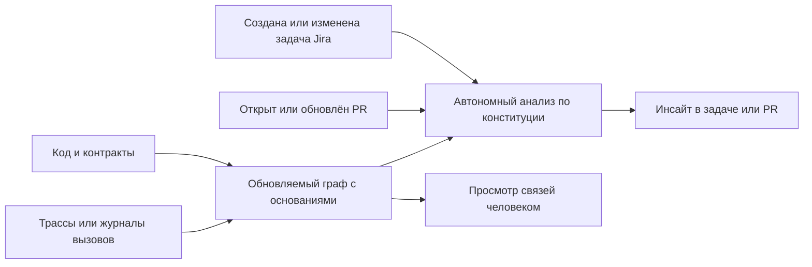

# Автономный сервис анализа влияния изменений

Решение владельца от 24.10.2026: B2B-сервис разворачивается из коробки,
подключается к разрешённым источникам компании и сам выдаёт инсайты по Jira
и PR. Единственный разработчик проекта и команды клиента не сопровождают
каждую задачу. Постоянные оператор, инженер и разметчик в предложение не входят.

**Для команды:** до начала работы и до merge понять, кого может задеть
изменение, на чём основан вывод и что стоит проверить.

## Целевой сценарий

Jira запускает предварительный анализ намерения. PR уточняет его по base/head
и закреплённым версиям потребителей. Это два входа в один механизм.
Граф соединяет объявленные и наблюдаемые связи; у каждой есть источник,
версия или временное окно, актуальность и тип свидетельства. Вывод модели
сохраняется отдельно от проверенного факта. Подробнее: [GRAPH.md](GRAPH.md).

## Состояние на 24.10.2026

| Есть в коде | Ещё предстоит реализовать |
|---|---|
| Узкое ядро Python requests → FastAPI/OpenAPI JSON | Автономная синхронизация источников компании |
| Digest, строки, статусы, история контекстов в SQLite | Устойчивый обновляемый граф кода и runtime-взаимодействий |
| Анализ удаления операции и изменений default page_size | Jira/PR, два SHA, автоматическое обновление комментария |
| Ограниченный модельный протокол и сохранённая серия | Квалифицированная открытая модель в целевом сценарии |
| Синтетическое демо и части установки/возврата | Проверенная коробочная установка автономного сервиса |

#45 и #46 слиты 24.10.2026. Они исправляют OpenAPI-неопределённость и
подпись удаления операции; сами по себе автономный сервис не создают.

## Документы

| Документ | Назначение |
|---|---|
| [OFFER.md](OFFER.md) | Предложение без постоянного сопровождения |
| [DECISIONS.md](DECISIONS.md) | Принятые решения и границы MVP |
| [GRAPH.md](GRAPH.md) | Источники, обновление и роль графа |
| [CONSTITUTION.md](CONSTITUTION.md) | Правила и исполняемые границы агента |
| [INSTALLATION.md](INSTALLATION.md) | Коробка и облачный адаптер |
| [BACKLOG.md](BACKLOG.md) | Инженерные пачки и критерии приёмки |
| [PROTOCOL.md](PROTOCOL.md) | Автономность, качество и полезность |
| [ECONOMICS.md](ECONOMICS.md) | Измеряемые затраты без выдуманной цены |
| [EVIDENCE.md](EVIDENCE.md) | Подтверждения, цели и гипотезы |
| [TRACKING.md](TRACKING.md) | Принятые/отложенные рекомендации и Issues #50–#55 |

Пачка 1 согласует документы и короткую презентацию. Следующие пачки строят
сквозной сценарий; документирование не считается реализацией интеграций.
[Согласованный проект решения](../../superpowers/specs/2026-10-24-autonomous-service-design.md).

[Прежний сопровождаемый пилот](archive/2026-10-24-assisted-pilot/README.md)
сохранён как история. Его ручные роли, 12 задач, шесть недель и критерий 20%
не являются обещанием нового сервиса и не меняются задним числом.
