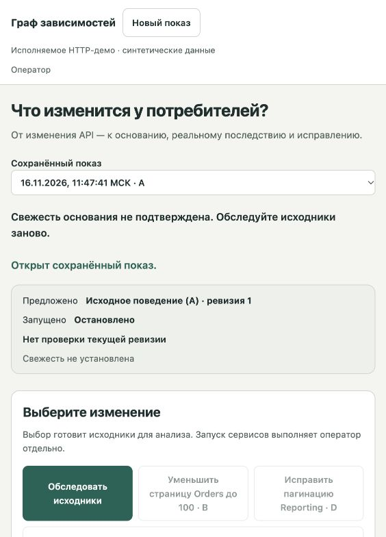
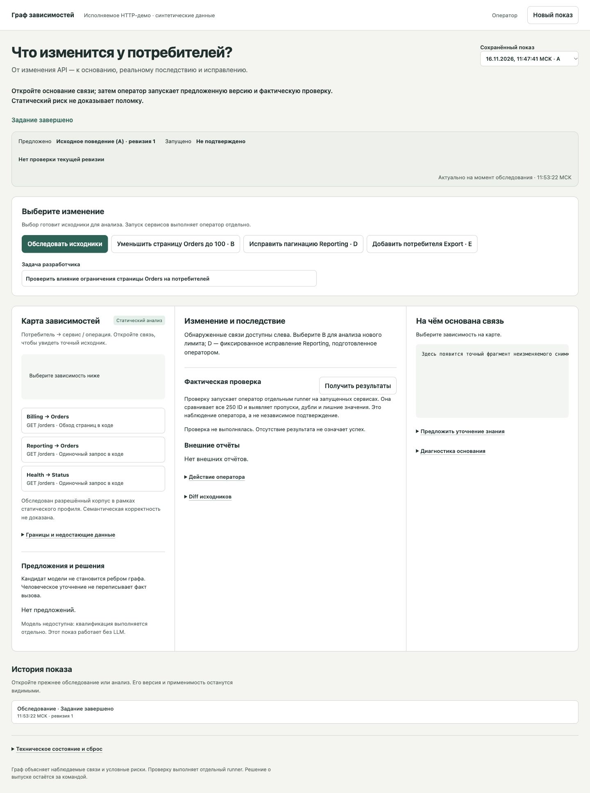
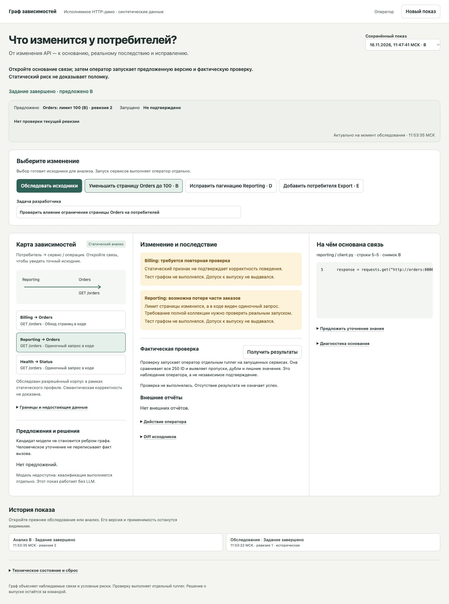
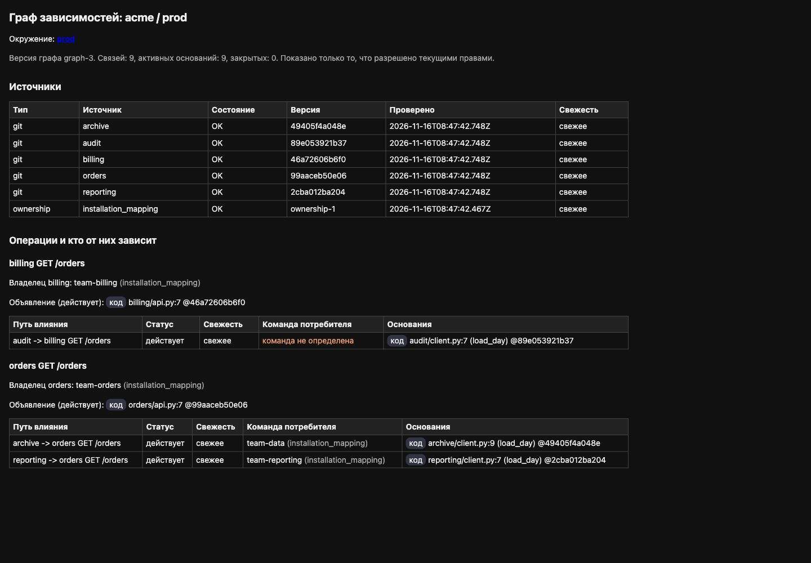
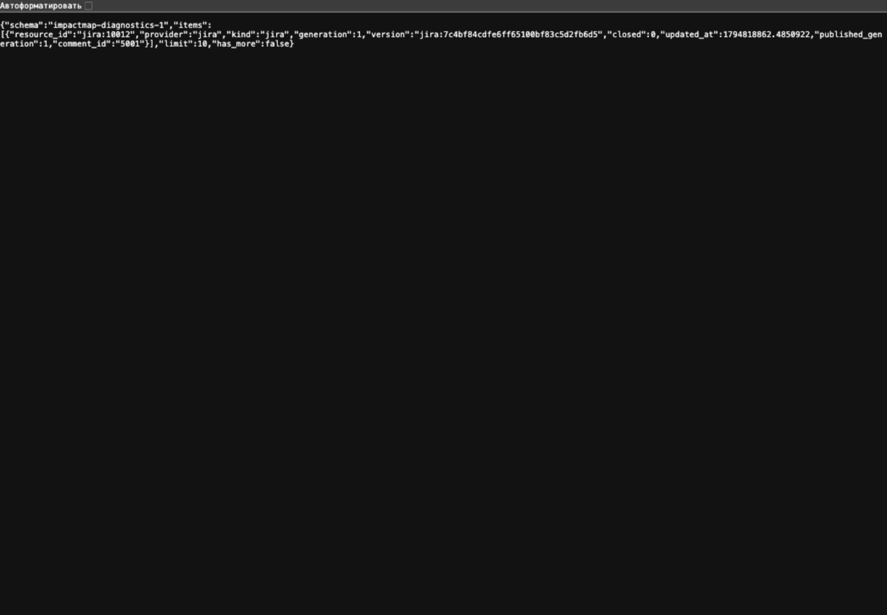
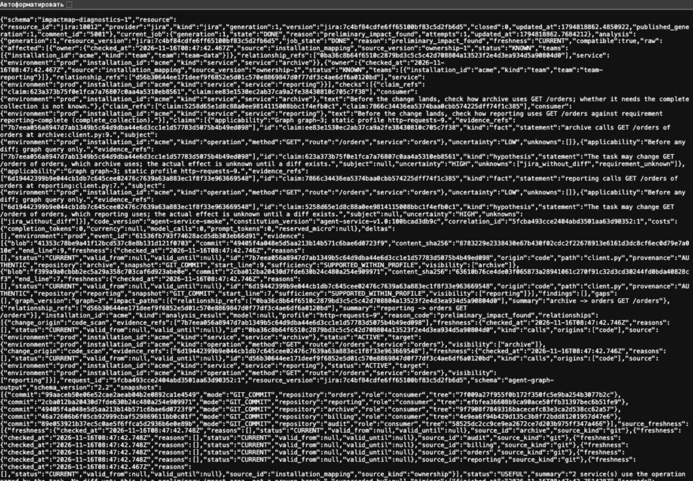

# A6 — обследование существующего UI, 16.11.2026

Обновление после обследования: [A6.2 реализована и проверена локально](../../operations/a6-2-2026-11-16/README.md), выбран вариант2, шрифт уменьшен по замечанию владельца. Исходные снимки и ограничения audit ниже относятся к исходному c82dd59, а не к новому UI access layer. Следующий этап — A6.3.

Статус: обследование локальных поверхностей завершено; владелец выбрал **единое приложение: результаты + раздел оператора**. Обновление после обследования: дизайн утверждён владельцем16.11; [три визуальных направления](visual-directions.md) созданы, выбран вариант2, [кликабельный прототип A6.1 проверен](prototype-verification.md). Полная A6 не закрыта: A6.1 собрана и проверена агентом, пользовательский просмотр и A6.2–A6.5 впереди.

## Условия и границы

Source: `c82dd59`, ветка `codex/impactmap-batch-00`, рабочее дерево до обследования чистое. Просмотр выполнен встроенным браузером Codex на loopback, существующий UI не изменялся. Только синтетические author fixtures из `tests/graph_demo/helpers.py` и `tests/service/test_graph_memory.py`, MODEL OFF. Fixtures созданы заново в этом запуске. Это не интервью, независимая оценка или наблюдение за работой реального клиента.

Демо и service API запущены рядом в одноразовой локальной обёртке. Для них обёртка подставляла исключительно fixture-авторизацию: вход и реальные права этим просмотром **не проверялись**. Реальные токены/ВМ/трекеры/установленный worker не использовались. Сервер остановлен, временный viewport сброшен. Первоначальный viewport — 564×784; для проверки трёхколоночного desktop-layout — 1440×1000. JPEG сохранены и повторно открыты из файлов перед принятием.

## Пройденные шаги

### 1. Открыть сохранённый показ — работает, перегружено для первого знакомства



Есть явное обозначение синтетических данных и следующий шаг. На узком экране сначала идут вводный текст, версии и кнопки; результат и основание находятся ниже. Это наблюдение одного viewport, не полная проверка мобильной версии.

### 2. Обследовать исходники A — работает, результат низко на desktop



Задание завершилось через UI. Видны три связи и ограничения анализа. При 1440×1000 рабочая область начинается примерно на y=745; большая часть первого экрана отдана инструкциям и управлению показом. Предлагается в рабочем продукте поставить итог изменения и состояние данных выше сценарных инструкций. Не переносить кнопки B/D/E в продуктовый UI.

### 3. Выбрать B и открыть Reporting → Orders — работает, хороший путь к основанию



UI показывает возможную потерю заказов отдельно от фактического теста; выбор связи открывает конкретную строку `reporting/client.py` и снимок B. Сохранять это разделение. На скриншоте длинная строка кода не помещается в панель целиком; будущий просмотр должен поддерживать доступную горизонтальную прокрутку/разворачивание. В одном экране смешаны вывод, операторский runner, человеческие уточнения и квалификация модели — разделить задачи ролей.

### 4. Открыть `/graph` сервиса — работает как технический viewer



Есть окружение, версия, источники, владельцы, пути и привязка к commit/строкам. В этом fixture-viewer отсутствуют переход из списка конкретных изменений и просмотр фрагмента кода; основание показано текстовой ссылкой-координатой. Нельзя выдавать эту таблицу за новый интерфейс результатов или админку. Насыщенный синий текст ссылки `prod` на тёмном фоне — видимый риск читаемости, контраст инструментом не измерялся.

### 5. Открыть `/resources?limit=10` — API работает, пользовательского списка нет



Получен один fixture-ресурс. JSON пригоден для диагностики и клиентского кода; строка не является кликабельной карточкой изменения. Для каталога нужны заголовок/источник/дата/состояния и переход к результату. Текущий контракт ограничен последними 100, cursor pagination отсутствует: нельзя обещать полную историю через этот endpoint.

### 6. Открыть `/result?resource_id=jira%3A10012` — данные есть, рабочего экрана нет



Получены раздельные current_job, analysis и publication: DONE / CURRENT / DELIVERED. Экран — сырой большой JSON; итог и основания трудно найти глазами. Часть ответа естественно ниже viewport; сохранён также полный [fixture-result.json](fixture-result.json). CURRENT не означает успешный тест потребителя. GET не выполнял повторную публикацию.

## Замечания по приоритету

| Приоритет | Наблюдение/ограничение | Что изменить |
|---|---|---|
| P0 перед доступом ревьюеров | Служебный Bearer открывает всю установку; demo Basic — отдельная система | Серверные сессии и роли; служебный ключ не попадает в браузер |
| P1 | У service нет человекочитаемого экрана результата (5–6) | Список изменений → итог → основание; три независимых состояния |
| P1 | На desktop вывод низко, сценарии и обязанности смешаны (2–3) | Итог первым, операционные сведения в отдельном разделе |
| P1 | Demo и service используют разные модели данных и доступа | Переиспользовать UX-паттерны, не приклеивать demo sessions к service resources |
| P1 | Текущий API не даёт всю историю/подключения/bindings/полный source viewer | Явные API-расширения; отсутствующие функции не изображать рабочими |
| P2 | Смешаны русский UI и англоязычные подробности результата | Локализовать представление известных кодов, сохранять неизвестные коды и исходную формулировку в деталях |
| P2 | Есть риск читаемости ссылок и длинных строк (3–4) | Контраст, раскрытие кода, клавиатура и zoom в проверках нового UI |

В demo присутствуют подписи контролов, skip-link и live status по DOM/source. Полный keyboard journey, screen reader, focus после async обновления, измерение контраста, zoom и WCAG compliance не проверялись. По скриншотам эти свойства не считаются PASS.

## Комментарии трекеров и оставшиеся проверки

[fixture-comment.txt](fixture-comment.txt) — свежий полный текст author-run Jira stand, **не скриншот реального Jira/Kaiten**. В full document есть смешение языков и диагностические версии. `document.jira_summary` содержит отдельный [короткий русский вариант](fixture-summary-ru.txt); не путать его с полным документом и фактическими настройками установленного worker. Реальные appearance/deep links/права Jira и Kaiten в A6 NOT_RUN; Яндекс не подключён. Перед завершением A6 проверить настоящий короткий комментарий → авторизованный полный результат на выделенных целях после готовности UI.

Все снимки этого отчёта — текущее обследование существующего продукта, **не макеты будущего UI**. Следующий артефакт — [дизайн первой версии](../../superpowers/specs/2026-11-16-impactmap-ui-admin-design.md). При последующем выполнении A6.1 создан отдельный author prototype; существующий demo/service не изменены.

Builder check дизайна: свежий reviewer не нашёл существенных вопросов, мешающих составлению плана. Отмеченные в дизайне продуктовые предположения всё ещё требуют согласования владельца.

## Статус исходных AC A6

| AC | Статус |
|---|---|
| 1. Пользователи и3–5 сценариев выбраны вместе с владельцем | DONE по согласованию16.11: подход,5 сценариев и роли подтверждены владельцем |
| 2. Существующие поверхности и комментарии | PARTIAL: demo/graph/diagnostics просмотрены,6 снимков сохранены; текст fixture-комментария разобран, реальный tracker UI не проверен |
| 3. Подходы и выбор | DONE для подхода:3 варианта сравнены, владелец выбрал единое приложение |
| 4. Навигация и проверенный прототип | Навигация/дизайн согласованы; author prototype A6.1 проверен агентом, пользовательская проверка впереди |
| 5. Права/изоляция/действия/ключи | Согласовано16.11; реализация ещё впереди |
| 6. Согласованный дизайн и реализационные пачки | Дизайн APPROVED16.11; план A6.1 выполнен; production A6.2–A6.5 впереди |

## Воспроизведение и артефакты

Из корня checkout с существующим venv и API dependencies:

```sh
PYTHONDONTWRITEBYTECODE=1 PYTHONPATH=src:.:tests:tools python docs/product/ui-admin-2026-11-16/reproduce/serve_audit.py
```

Открыть loopback `127.0.0.1:18086`, нажать «Обследовать исходники», затем B и Reporting→Orders; отдельно посмотреть `/graph`, `/resources?limit=10`, `/result?resource_id=jira%3A10012`. Остановить Ctrl-C. Обёртка предназначена только для этих disposable fixtures: не использовать с настоящими конфигами/секретами и не публиковать её порт. Она перезапишет fixture-comment/result, но не сохранённые скриншоты. UUID/время/commit fixture могут отличаться, byte-identical JSON не обещается. [Manifest](manifest.json) фиксирует артефакты именно текущего просмотра; новый прогон не становится историческим доказательством без нового отчёта.
