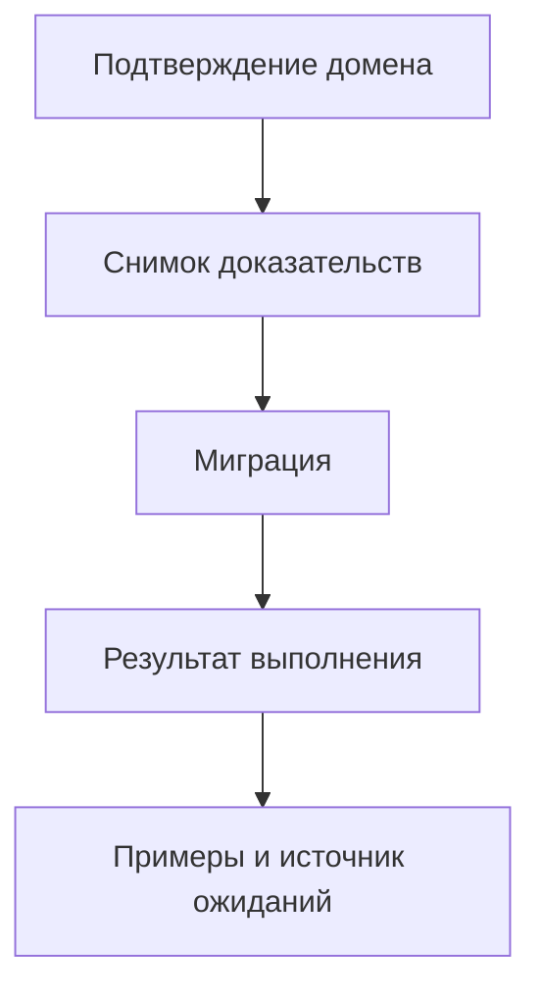

# Версионированный снимок доказательств миграции

Продолжение PR #18. Формат `migration-evidence-snapshot-1` связывает knowledge-1, проверенные миграции, fixture provenance и подписанные подтверждения доменов. Это отдельный advisory-протокол: исходный V2, ledger knowledge-1, подтверждающий эксперимент и развернутый сайт не изменены.

## Что связано

Subject hash включает ID проверенного снимка знаний, полные verification receipts (выражение, входы, ожидаемые и полученные значения, версию и SHA-256 verifier) и ссылки на источники fixture. Подтверждение Ed25519 подписывает subject hash, домен, actor, версию, статус, ссылку на основание и интервал действия. Изменение любого компонента требует нового подтверждения.

Доверенная конфигурация задает actor -> domain/public key; запись подтверждения сама себе полномочия не выдает. Для каждой миграции используется консервативная политика: подтверждают домен производителя и все домены обязательных требований/глобальных правил в снимке. Один действующий уполномоченный actor достаточен для домена; отзыв одного actor не отзывает отдельно действующие подтверждения других actor. Без миграций дополнительные согласования не требуются. Это явная opt-in политика, не заявка на оптимальность числа согласований.

ConfirmationRegistry хранит последнюю версию для пары actor/subject. Повтор версии и возврат назад отклоняются; отозванная или будущая новая версия не позволяет использовать предыдущую. Проверяются подпись, доменные полномочия и временной интервал. Это in-memory прототип: долговременное хранение, восстановление последовательности отзывов после рестарта, ротация ключей и UI подтверждения пока не реализованы. Нельзя запускать registry заново с пустой историей и считать прежние гарантии отзыва сохраненными.

## Проверка актуальности

`fence_evidence_snapshot` проверяет целостность пакета, пересчитывает receipts и подтверждения, сравнивает evidence snapshot ID и вызывает существующую проверку `KnowledgeStore.is_current`. Проверка выполняется под locks registry и knowledge store. Изменение миграции, fixture, источника, актуального подтверждения, доверенной конфигурации или записей knowledge ledger делает старый пакет непригодным. Истечение подтверждения переводит пересчитанное решение в NEEDS_REVIEW; существующий REJECT не отменяется согласованием.

Результат относится только к моменту вызова. `release_authorization=False` возвращается всегда. Проверка не является атомарной публикацией и не выдает release_id. Для реального допуска эту fence нужно включить внутрь транзакции выдачи разрешения с долговременным журналом и восстановлением. Текущий KnowledgeReleaseEngine не научен автоматически требовать этот новый пакет; на сайте нельзя заявлять такую гарантию.

## Граф

`evidence_links` строит детерминированное расширение графа:



Ссылка на исходный knowledge snapshot остается в пакете. Узлы подтверждений показывают actor, domain, evidence_ref, версию и сроки действия. Граф - представление переданного пакета, не самостоятельный валидатор доверия: перед использованием для решения требуется пересчет fence с доверенным registry и live store. Пересчитанный злоумышленником хеш не заменяет доменную подпись и не проходит сравнение с актуальным пакетом.

Подпись означает подтверждение ожиданий уполномоченным actor. Она не доказывает бизнес-истину и полноту примеров. Ссылка provenance сохраняется и подписывается, но ее внешний контент не загружается и не проверяется автоматически. Произвольный SQL, identity migrations и доказательство эквивалентности остаются за границами verifier из PR #18.

## Воспроизведение и результат

```sh
PYTHONPATH=src:tests python -m unittest test_evidence_snapshot test_migration_evidence test_evidence_graph test_consumer_test_baseline test_knowledge
PYTHONPATH=src:tests python tools/run_evidence_snapshot_demo.py
```

58 тестов проходят локально: 14 новых и 44 предыдущих. Новые проверки покрывают подпись/полномочия, пропуск домена, другой subject, будущие/истекшие подтверждения, отзыв/replay версии, изменение миграции/примеров/provenance, обновление knowledge ledger, подмену пакета с пересчетом хеша, отсутствие лишних согласований без миграций, изоляцию копий и графовые пути.

`evidence-snapshot-results.json` воспроизводит synthetic lifecycle: до подтверждений NEEDS_REVIEW, после подтверждений ACCEPT с current=true, после отзыва current=false и NEEDS_REVIEW. Фикстура проверяет жизненный цикл пакета и намеренно содержит отдельно объявленную миграцию, даже если старый контракт не требует ее для прохождения V2. Это допустимо консервативной политикой проверки всех объявленных миграций, но не является реалистичным кейсом конвертации поля bool. Демонстрационные ключи публичные и только тестовые; они не используются в инфраструктуре и не могут подтверждать реальные релизы.
